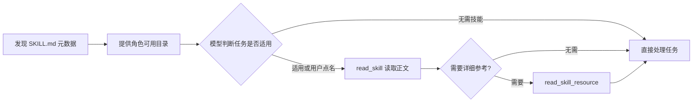

> 当前目录：8个通用分析 skills＋1个 `deep-research` skill。研究专用角色方法迁入独立研究模块，不再作为 skills 暴露。技能本身不授予执行权限。

# Agent Skills 机制

本项目采用官方文档所述的技能包格式和渐进式披露机制，运行于 FinAgent 自建 AgentLoop，不依赖 Codex 或 OpenAI 托管 Skills API。

- [官方 Skills 概念](https://developers.openai.com/plugins/concepts/skills)：先提供名称、描述，再按任务读取完整指令。
- [官方技能编写说明](https://developers.openai.com/plugins/build/skills)：YAML 元数据、Markdown 正文和可选支持资源的组织方式。

## 运行过程



`skill_library.py` 在发现阶段只解析 YAML frontmatter，不把正文及参考文件加入模型上下文。启动上下文中的 `available_skills` 只有 `name`、`description`、包内路径，`skill_usage` 说明如何选择。技能目录放在宿主初始上下文中，用户原始消息顺序保持不变。

模型使用 `read_skill(name)` 后，正文才作为工具结果进入上下文。只有已加载技能可以通过 `read_skill_resource(name, path, offset, limit)` 分页读取相关文本参考。方法文字不是金融事实证据，不会产生原始市场快照或满足数据取证要求。

技能读取使用现有模型和工具预算，不消耗数据源请求预算，也不增加默认额度。独立研究的决策角色使用四次模型请求，其内部方法直接随角色提示词提供，预算留给交接回读、提交和必要修正；普通子 Agent 不继承旧两次调用限制。复杂取数任务应合并互不依赖的调用，只加载适用技能与必要参考。

## 角色与技能分离

固定职责、冻结范围、工具白名单、引用规则和提交合同保留在 `analysts/catalog.py`、`analysts/decision.py`、`analysts/methods.py` 及宿主校验器中，即使不加载技能也继续生效。技能提供可复用的分析方法，不能扩大权限。

持续主会话及普通子 Agent 发现9个技能。8个通用分析方法仍按需加载：`technical-analysis`、`technical-divergence`、`fundamentals-analysis`、`financial-growth`、`financial-margin`、`market-sentiment`、`news-events`、`policy-impact`。

新增 `deep-research` 统一说明独立公司研究的发起、模式选择、上下文继承、进度查看、报告追问和恢复。它调用现有研究工具，角色拓扑、预算、并发、取消、恢复和证据校验仍由代码执行。加载此技能不会自行启动研究，也不会授予启动权限。详见 [主对话与独立研究衔接](DEEP_RESEARCH_CHAT.md)。

目录、`load_skill`、`read_skill` 和 `read_skill_resource` 共用同一视图；恢复旧会话时清理已迁出角色技能的加载标记。五类研究分析师只发现 `analysts/methods.py` 中 `ROLE_SKILLS` 对应的通用方法，单 Agent 对照模式可用所选维度的并集；它们不发现研究启动技能，不能递归启动研究。

例如基本面分析师能自行选择：

| 技能 | 何时使用 |
| --- | --- |
| fundamentals-analysis | 增长来源、财务质量、资产负债与估值依据研究 |
| financial-growth | 需要计算同指标同比或绝对变化 |
| financial-margin | 需要计算利润率或跨期百分点变化 |

原11个研究角色技能的正文完整迁入 `research/prompts/`，由 `research/role_prompts.py` 的固定角色映射加载：

| 用途 | 内部方法文件 |
| --- | --- |
| 多空研究与经理裁决 | `bull.md`、`bear.md`、`research_manager.md` |
| 交叉审阅与质量收口 | `review.md`、`quality_gate.md` |
| 完整决策与风险讨论 | `trader.md`、`risk_aggressive.md`、`risk_conservative.md`、`risk_neutral.md`、`portfolio_manager.md` |
| 旧版综合报告兼容 | `synthesis.md` |

这些角色执行时仅加载本角色方法，不再注册技能读取工具或额外执行一次 `read_skill`。`research-synthesis` 不再是技能包；其旧执行流程尚在，因此方法作为内部提示词保留，避免删除仍有引用的功能。角色提示词与方法文件一同纳入实现指纹。

技术分析师另可选择 `technical-divergence`，通过 `calculate_technical_divergence(result_id)` 对已取回日线计算 MACD/RSI 顶底背离。返回双锚点、候选/确认/失效状态及确认日期，不依赖模型心算。详细口径、参数及局限见 [日线背离规则](../../src/finagent/skills/technical-divergence/references/structure-rules.md)。该能力不改变 NLU 标签或输出 Schema。

## 技能格式与扩展

```text
skills/financial-growth/
├── SKILL.md
└── references/
    └── comparability.md
```

```markdown
---
name: financial-growth
description: 使用可比原始财务事实计算同比或绝对变化。用于财务跨期比较。
---

具体方法……

发现报告期或合并范围差异时，按需读取
[可比性说明](references/comparability.md)。
```

`name` 必须与目录名一致且在技能目录中唯一，使用小写字母、数字与单个连字符，最长64字符；`description` 非空且最长1024字符，说明能力和触发条件。支持 YAML 折行及可选元数据，不以 `allowed-tools` 字段授予任何权限。

新增技能放在 `src/finagent/skills/<name>/SKILL.md`，由技能库发现；供普通对话使用时更新 `CHAT_SKILLS`，供五类分析师使用时更新 `ROLE_SKILLS`。固定研究角色方法放入 `research/prompts/` 并更新 `research/role_prompts.py`；不要再创建面向主对话的角色技能。只有确有条件性细节时才增加参考文件，并在正文说明何时读取。不要把目录中每份参考默认拼进正文。

运行时只允许读取包内 `references/`、`assets/`、`scripts/` 的受支持文本，禁止绝对路径、父目录跳转和符号链接。当前没有新增脚本执行器；金融计算继续走既有证据绑定工具。正文、资源读取的哈希与工具记录用于追踪，`loaded_skills` 写入恢复点，压缩历史后仍可按需重读。

新增文本资源时，更新 `pyproject.toml` 的 package-data，保证安装包包含它们。当前声明包含全部 `SKILL.md`、`references/*.md` 和 `research/prompts/*.md`，`PyYAML>=6,<7` 用于安全解析元数据。原 `get_research_guide` 继续作为旧版方法工具保留，不再承担这些技能包的加载职责。

## 验证

`deep-research` 使用 `skill-creator/scripts/quick_validate.py` 校验格式。安装包应包含9份 `SKILL.md`、三份通用方法参考文档及11份内部角色提示词；需要在独立提取的 wheel 中验证发现、正文读取和角色提示词加载。

2026-11-01 本次全量479项回归通过；新 wheel 的隔离导入、9个技能发现、11份角色方法读取、深度研究工具注册与技能读取均通过，数据源请求为0。安装包结果见 [验证报告](../../.finagent/dist/skills_20261101/skill_package_check.json)。

`tests/test_skills.py`、`tests/test_chat_skill_scope.py`、`tests/test_research_chat.py` 覆盖发现阶段不读取正文、渐进加载、权限、恢复、目录收敛、内部角色提示词、旧综合流程兼容，以及加载 `deep-research` 后调用实际启动工具的合成会话。研究流程另有深度报告、完整决策与失败路径回归。

```bash
.venv/bin/python -m unittest tests.test_skills tests.test_chat_skill_scope tests.test_research_chat
.venv/bin/python -m unittest discover -s tests -t .
.venv/bin/python scripts/build_wheel.py --output .finagent/dist/skills_20261101
.venv/bin/python scripts/check_skill_package.py --wheel .finagent/dist/skills_20261101/finagent-3.0.0-py3-none-any.whl
```

这些检查使用脚本化模型与合成来源，不代表真实模型的技能触发准确率或金融研究质量已验收。
