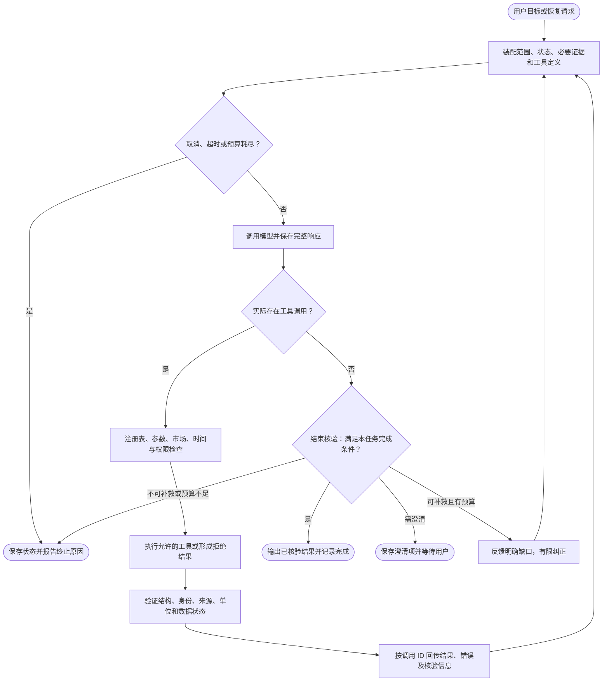

# FinSight 金融研究 Agent 需求文档

> 历史记录：保留当时的需求或验收结论，不代表当前版本状态。当前入口见 [文档首页](../README.md)；历史机器路径、日志和外部工程可能不在本工作区。

_版本：v1.1｜修订日期：2026-10-18｜用途：个人实习求职项目的需求基线｜状态：阶段1已于2026-10-19验收，阶段2—4按原目标后续实施_

本版替代 v1.0 作为当前需求基线，保留 v1.0 供历史对照。下一阶段详见 [FinSight_下一阶段目标_阶段1.md](阶段1实施与验收报告.md)。本次明确三项方向：沿用 Trading 已有的公开数据获取方法，按任务和实际覆盖选择来源及研究样本；参考 learn-claude-code 自研 Agent Loop 与 Harness；按阶段验收并落实《深入理解 AI Agent》的工程原则。

---

本文规定系统应完成的业务任务、数据约束、模型训练目标和验收方法。当前阶段不设计前端页面、后端 Web 服务、HTTP 路由、账号系统或部署架构。文中工具指 Agent 可调用的逻辑能力，不等同于 Web API。基础运行架构明确采用自研 Agent Loop 与 Harness；存储方案、模型型号和具体模块接口由后续技术设计确定。

所有性能数值和验收阈值均为本项目的拟定目标，不代表已有实验结果；出现“必须”表示对应优先级版本的交付要求。

## 1. 项目概述与范围

### 1.1 建设背景

公开股票研究涉及财报阅读、行情比较、公告查证和分析结论整理。对于初学者和初级研究人员，常见工作包括在正文与表格中寻找指标、核对不同报告期、计算财务比率，以及将市场表现与公开事件进行对照。

这些任务的难点包括数字对应的单位和口径不一致、检索结果不足以支持计算、财报发布日期与报告期容易混淆，以及市场变化的相关因素容易被写成确定原因。多轮追问还会引入公司、年份、指标和时间范围的继承问题。

本项目建设一个面向公开材料的金融研究 Agent，将自然语言问题转化为证据检索、工具计算、结果核验和分析输出的闭环。模型负责理解与组织任务，工具负责获取数据和执行计算，运行规则负责控制证据使用、重试和任务结束。

### 1.2 产品定位与目标用户

**产品名称**：FinSight——融合财报、行情与事件分析的金融研究 Agent。

**产品定位**：为金融学习者和初级研究人员提供可追溯的公司研究、当日市场复盘和条件化研究建议。

**主要用户**：

- 金融学习者：理解财务指标、公式和市场分析过程。
- 研究或数据分析实习生：快速形成带证据的基础研究材料。
- 项目开发者与评审者：复现 Agent、工具验证和监督微调实验。

**建设目标**：

1. 对关键数字交代来源、期间、单位和口径。
2. 将数值推理由受限程序表达，并通过确定性工具执行。
3. 结合当日行情与已公开事件，区分事实、解释假设和研究建议。
4. 支持多轮追问、证据补查、有限纠错和状态恢复。
5. 用可复现对照实验衡量监督微调的作用。
6. 自行实现模型—工具—观察反馈循环，能够根据证据缺口调整下一步动作。
7. 将 Trading 中已有的数据获取能力适配为可核验工具，以实际覆盖的数据和样本验证行情、财报与事件证据链。

### 1.3 已确定方向与规划假设

| 编号 | 决策或假设 | 性质与影响 |
|---|---|---|
| A-01 | 首版优先采用 Trading 现有实现覆盖的沪深 A 股，演示选择 2—3 家非金融企业 | 市场与样本为控制范围的规划假设，阶段 1 按数据可得性冻结；不绑定特定公司 |
| A-02 | 中文交互，以公司公开中文披露为主，保留原文语言 | FinQA 英文训练与本地中文业务分开评估 |
| A-03 | 核心行情功能为收盘复盘 | 不依赖低延迟盘中数据 |
| A-04 | 单次研究一家公司及其所属市场基准 | 首版基准可选沪深 300，最终按 Trading 可用来源与演示任务验证后确定 |
| A-05 | 深度演示共 2—3 家企业，3—5 份完整财报及有限公告 | 至少一家公司有可比较报告；阶段 1 确定清单，阶段 2 完成原文入库 |
| A-06 | 单人开发，每周 15—20 小时，八周约 140 小时 | 仅为排期参考；按阶段验收及实际数据和资源验证结果调整 |
| A-07 | 本地单用户研究原型，不设计 Web 前后端 | 通过本地运行入口、记录和文件导出验收 |
| A-08 | 数据方法参考 Trading；Agent 内核参考 learn-claude-code 自行实现 | 不直接复用 Trading 的 Agent 编排作为本项目内核 |

数据获取以 Trading 项目已有的方法为准，按行情、日线、财务、新闻和市场背景等能力选用同花顺、腾讯财经、新浪、东方财富、财联社或通达信等来源。数据源、研究公司和证券标识分别管理，不要求从某一家研究公司的官网取数，也不要求逐个接通所有候选来源。

首版不绑定腾讯控股或其他指定公司；港股及其他市场仅在实际任务需要、已有来源适用并完成验证后另行扩展，不作为阶段 1 或当前 P0 的完成门槛。现有接口未覆盖的能力应记录缺口，可通过有来源记录的原始材料导入补充证据；不能仅为指定公司新增一套抓取系统而扩大基础阶段范围。

### 1.4 优先级与版本边界

**P0：阶段 1—4 的必备能力**。先交付自研循环与 Trading 现有数据能力的最小闭环，再完成财报计算、完整复盘、多轮与恢复，最后执行微调和完整评估。八周为资源允许时的参考排期；阶段验收优先于日历。六周参考版本完成阶段 1—3，不宣称 SFT 已交付。

| 优先级 | 能力范围 | 交付定义 |
|---|---|---|
| P0 | 自研 Agent Loop 与 Harness | 模型选择工具，工具返回驱动后续行动，具备约束、核验和有限纠正 |
| P0 | Trading 数据方法复用 | 按所需能力迁移已有获取方法，完成报价、日线、结构化财务与一项新闻或市场背景数据接入；不固定单一供应商 |
| P0 | 公司与时间解析、财报检索 | 能查到支持答案的原始证据 |
| P0 | 指标提取、受限计算、结果核验 | 能复现取数与计算过程 |
| P0 | 收盘行情与基准比较 | 能形成指定交易日复盘 |
| P0 | 公司公告检索与事件分析 | 能输出有时间和来源的相关事件 |
| P0 | 条件化研究建议 | 明确依据、后续动作及失效条件 |
| P0 | 多轮状态、过程记录和结果导出 | 支持连续追问与失败定位 |
| P0 | 一项 SFT 实验与评估报告 | 有数据说明、基线和留出集结果 |
| P1 | 盘中行情、广泛新闻检索 | 数据权限与新鲜度验证后启用 |
| P1 | 独立审核 Agent、MCP 封装 | 核心版本完成后选择一项扩展 |
| P1 | ConvFinQA 专项评测、新闻理解微调 | 作为额外实验分别报告 |
| P2 | 买卖信号、策略回测、个性化建议 | 独立提出需求并验收 |
| P2 | 自动交易、更多市场、全市场筛选 | 首版验证范围之外的市场和覆盖另行提出需求并验收 |

P0 不包含未来价格预测、目标价估计、自动下单或盈利承诺。首版“建议”的含义由第 7 节明确规定。

## 2. 用户场景与业务规则

### 2.1 主要用户故事

| 编号 | 用户需求 | 成功条件 |
|---|---|---|
| US-01 | 查询某公司某报告期营业收入 | 返回数值、单位、报告期及证据 |
| US-02 | 比较收入和利润率变化 | 取数可比，公式正确，结果可复算 |
| US-03 | 询问某股某交易日表现 | 明确交易日、价格口径与基准表现 |
| US-04 | 询问当日上涨或下跌可能原因 | 展示相关事件并说明解释的不确定性 |
| US-05 | 询问下一步应关注什么 | 建议与证据和具体观察条件关联 |
| US-06 | 追问“那上一年呢”“换成另一家公司” | 正确继承或切换任务范围 |
| US-07 | 请求一份综合研究摘要 | 事实、计算、假设、建议和来源分别可追溯 |
| US-08 | 复现一条错误回答 | 能根据任务记录找到数据、模型与工具环节 |

### 2.2 问题范围与澄清原则

系统至少识别公司、证券、市场、报告期、行情日期、分析截止时间、指标和任务类型。公司简称、股票代码和公司实体应通过统一映射关联；同名、代码重复或证券类别不明确时必须澄清。

“最新财报”表示分析截止时间前最新可得的相关披露，不等于最大报告期。“今天”先按市场时区及交易日历解析，再说明实际使用的交易日。系统不得仅根据本机自然日确定交易日；使用已支持交易所的日历；后续扩展其他市场时分别验证交易时段和休市安排。

默认截止规则如下：用户未指定截止时间时，当日或当前研究请求使用本次请求开始时的时间；用户指定早于市场当前自然日的历史日期时，使用目标交易日对应市场时区的当日 23:59:59。系统输出实际采用的截止时间，行情解释区间另以该交易日常规交易时段为准。未来日期不能作为已完成复盘处理。用户可显式覆盖截止时间；若允许使用目标交易日之后的信息，应标为“含后续信息的事后复盘”，不计入严格历史回放。

以下情况必须先询问，不能静默猜测：公司存在多个候选；“利润”对应多个口径且会改变答案；用户要求比较的期间不明确；要求个性化操作建议但没有必要约束且该能力尚未启用。

可从明确上下文继承的信息不重复询问。每轮结果仍须说明本次实际采用的公司与时间范围。

### 2.3 分析边界

P0 默认处理单只证券和其所属市场的一个基准，可增加一个行业基准。行情交易币种和财报列报币种分别保留，不进行未声明的换算。跨公司批量比较、投资组合、衍生品和行业专属指标不属于首版承诺。

财务指标默认支持营业收入、明确口径的净利润、营业利润、经营活动现金流净额、总资产、总负债，以及由已核验数据计算的增长率、净利率、营业利润率和资产负债比率。金融企业和特殊会计指标应标记范围限制。

缺少可比数据时允许输出已知部分和缺口，不得补造数字。没有相关新闻证据时可以完成行情事实分析，同时明确事件检索的覆盖范围。

## 3. 核心功能需求

### 3.1 FR-01：任务理解与范围确认（P0）

**输入**：用户问题、当前会话状态、分析截止时间。

**处理要求**：识别财报查询、计算、行情复盘、事件分析、研究建议和综合摘要；混合问题可拆为多个子任务。生成任务范围和有序计划，必要时进入待澄清状态。

**输出**：标准公司与证券标识、报告期或交易日、指标、任务类型、待澄清项、执行预算。

**异常与验收**：候选实体不唯一时返回候选和澄清问题；明确指定新公司后，后续工具不得继续使用旧公司的数据。对应 AC-01、AC-09。

### 3.2 FR-02：公开材料入库与证据定位（P0）

**输入**：通过 Trading 数据获取方法取得的公开 HTML、结构化财务数据或报告文件及其来源信息；允许手动导入已记录原始来源的完整报告。

**处理要求**：保留原文和表格结构，记录公司、报告期、披露时间、单位、来源、文档版本和内容摘要标识。优先支持可提取文字的财报与结构化表格；扫描件 OCR 和任意复杂版式不作为 P0 通用能力。

每项证据具有稳定标识。PDF 使用实际核验的页码、表格和行列；HTML 使用章节、表格、行列或稳定定位信息；数据集片段使用报告标识与片段标识。不存在完整 PDF 时不能生成看似真实的 PDF 页码。

**输出**：文档记录、文本片段、结构化表格、证据记录及导入质量摘要。

**异常与验收**：无法确认期间、单位或表格结构的材料进入待核验状态，不参与依赖这些信息的确定性回答。对应 AC-02、AC-18。

### 3.3 FR-03：财报检索与证据补查（P0）

**输入**：标准化问题、公司、报告期、分析截止时间和检索预算。

**处理要求**：对文本和表格执行关键词与语义检索，并结合元数据过滤。公司、期间等硬约束不能仅靠语义相似度判断。证据不足时，允许改写查询、展开相邻段落或读取完整相关表格。

**输出**：候选证据、相关度信息、来源和覆盖情况。候选证据不等于已验证事实。

**异常与验收**：三轮检索后仍不能支持所需结论，应给出证据不足或部分完成状态；不得把训练集答案字段加入可检索正文。对应 AC-03、AC-15。

### 3.4 FR-04：财务取数、程序生成与计算（P0）

**输入**：问题、已检索证据、指标定义与业务计算规则。

**处理要求**：由模型选择证据及操作数，生成受限计算程序；由工具检查结构并执行。程序至少支持加、减、乘、除及有限的多步引用，业务层支持同比、利润率和比率计算。

每个原始操作数必须绑定证据位置；公式需要的通用常数只能来自允许集合。中间结果引用必须指向已执行步骤。执行器不得直接运行模型生成的任意 Python、系统命令或动态 `eval` 表达式。

**默认公式与边界**：

- 同比增长率为 `(本期值－可比上期值) / 可比上期值 × 100%`；首版业务解释默认要求上期基数大于零。
- 上期基数为零时不计算普通增长率；基数为负时优先报告绝对变化或盈亏变化，不能直接套用普通增长措辞。
- 净利率为 `相应口径净利润 / 营业收入 × 100%`，分子分母必须具有一致期间与合并范围。
- 比率从 8% 变为 10%，变动为 2 个百分点；相对增长 25% 属于另一项计算，必须区分。
- 不自动将全年数与累计季度数、存量时点数与期间流量数进行同比。币种换算不属于默认计算，除非另有已核验汇率及日期。
- 内部计算保留原始精度，展示时统一舍入；输出需保留公式和舍入规则。
- 报告若同时列示法定与经调整指标，保留其原文定义；归母净利润、全部净利润及经调整利润分别建模，不跨口径比较或替换缺失值。

上述增长率解释规则用于产品业务任务；FinQA 原始程序评测仍按其既定算术语义执行，并单独报告。

**输出**：证据绑定的操作数、计算程序、执行值、单位、校验结果和计算说明。

**异常与验收**：分母为零、口径冲突、缺少输入和程序格式错误分别返回明确状态。最多两轮修复后停止。对应 AC-04、AC-05、AC-06。

### 3.5 FR-05：指定交易日行情复盘（P0）

**输入**：证券、目标交易日、市场、历史窗口及分析截止时间。

**处理要求**：获取开高低收、昨收或比较参考价、成交量、数据时间及交易状态；按同一窗口获取基准数据。P0 默认分析一个已完成交易日，历史窗口默认 120 个交易日。

至少支持以下分析：

- 当日涨跌额和涨跌幅，并记录供应商定义及参考价口径。
- 5、20、60 日均线，历史长度不足时不生成对应结果。
- 成交量相对前 20 个已完成交易日均量的倍数；该定义不能直接称作供应商“量比”。
- 与市场基准的当日涨跌幅差，以百分点表示。行业数据缺失时仅输出已完成的市场比较。
- 基于可比历史序列的近期波动与趋势描述，不将均线形态写成确定的未来走势。

**输出**：行情快照、计算指标、基准比较、来源、时间和口径限制。

**异常与验收**：当日未收盘或数据未完整更新时，不能声称完成收盘复盘；休市日说明采用的最近可用交易日；停牌、缺失数据和公司行动影响按第 4 节处理。对应 AC-07、AC-08、AC-12、AC-13。

### 3.6 FR-06：公开事件检索与可能因素分析（P0）

**输入**：公司、目标交易日、事件窗口、分析截止时间和行情结果。

**处理要求**：P0 至少支持所选样本的公司官方披露或监管披露。先复用 Trading 已有新闻、资料入口及来源链接定位原文；必要时允许显式导入有完整来源记录的公告，不预设单一公司官网或新增专用抓取器。默认向前检查 7 个自然日，必要时在预算内扩展至 30 日，明确记录窗口。优先查阅原始公告，识别财报发布、业绩指引、重大经营或资本事项等事件。

事件必须包含来源、标题、原文定位和发布时间；记录发布时间精度。市场表现与事件的联系应以“可能相关”“尚待核实”等与证据强度匹配的表述呈现。

**输出**：事件列表、时间顺序、支持证据、可能解释和未覆盖信息。

**异常与验收**：同一事件转载去重；只有发布日期没有时分的消息，不确定其盘中先后关系。晚于被解释行情区间的事件只能列为后续事项，不得用确定或推测的措辞倒用作此前行情的解释因素。发生在行情区间内的事件，如果没有更细时间证据，仅列为相关事件，不断言它造成了该区间全部涨跌。无检索结果不等于“没有任何利空”。对应 AC-10、AC-11、AC-16、AC-22。

### 3.7 FR-07：条件化研究建议（P0）

**输入**：已核验事实、计算结果、事件假设、问题范围和分析局限。

**处理要求**：输出“下一步研究什么、依据是什么、出现什么条件需要重新评估”。建议可以是核查现金流、持续观察相对行业表现、等待下一份披露或补充缺失证据，必须能追溯到本次分析。

每条建议至少记录：建议类型、依据、具体动作或观察项、触发条件、失效或重评条件、适用时间范围。研究动作可立即执行时，触发条件可写“当前已满足”；不强行添加数值阈值。

**输出**：结构化研究建议与自然语言说明；可返回“证据不足以形成进一步判断”。

**异常与验收**：不凭空生成买入价、目标价、仓位比例、收益概率或明日涨幅。直接询问“现在该不该买”时说明首版支持范围，给出可验证的研究条件，而非模拟个性化交易结论。对应 AC-14。

### 3.8 FR-08：多轮追问与范围切换（P0）

**输入**：新问题、当前任务上下文和必要的历史摘要。

**处理要求**：支持“上一年”“该公司”“那利润率呢”等指代，支持公司、报告期、指标和行情日的显式切换。切换公司后清除不再适用的证据和中间结果；切换时间后重新检查材料可用性。

“昨天”等相对日期默认相对于当前请求的市场日期解析；若用户在历史复盘中追问且参照点不明确，应询问，不静默采用另一日期。

**输出**：更新的任务范围、继承字段、已失效字段与新答案。

**异常与验收**：上下文压缩后仍保留范围、证据标识、已验证结果和未解决问题；不能跨会话误用公司范围。对应 AC-09、AC-17。

### 3.9 FR-09：综合研究摘要与结果导出（P0）

**输入**：本次任务中已完成的财报、行情和事件分析结果。

**处理要求**：生成公司与时间范围说明、行情摘要、相关财务事实、事件、解释假设、研究建议、数据缺口与来源。用户只问简单指标时不强制输出整份长报告。

**输出**：中文可读摘要和结构化 JSON；支持将结果保存为 Markdown 与 JSON 文件。正文引用和结构化引用应一致，不要求页面排版、图表组件或 PDF 导出。

**异常与验收**：组合任务部分失败时只总结已完成部分，显式标注缺口；导出文件不得包含 API 密钥或未经必要处理的敏感配置。对应 AC-18、AC-20。

### 3.10 FR-10：任务记录、恢复与重现（P0）

**输入**：任务及每一步执行事件。

**处理要求**：记录任务范围、数据快照、工具调用、校验、错误、耗时、模型及规则版本。保存可观察的结构化执行摘要，不要求记录或展示模型的隐藏思维链。

关键阶段结束后保存状态；中断后可继续尚未完成的步骤。恢复时复用已保存结果，避免重复导入、重复导出等副作用。相同任务重复执行要能区分“重现旧快照”与“获取最新数据”。

接收到明确取消请求后，停止发起新的模型和工具调用，在最近的安全边界保存已完成部分并标记已取消。已经在途且不可撤销的外部请求可以结束，但其结果不触发后续步骤；取消任务只有收到明确恢复请求才继续。本要求不依赖页面交互形式。

**输出**：运行记录、阶段状态、恢复点与结果文件关联。

**异常与验收**：已过期的动态数据在恢复时重新检查，不能为了复用缓存而冒充最新行情。对应 AC-17、AC-19、AC-21。

### 3.11 FR-11：自研 Agent Loop 与 Harness（P0）

**输入**：用户目标、消息历史、任务状态、可用工具定义和预算。

**处理要求**：参考 learn-claude-code 新版 `s01_agent_loop`、`s02_tool_use` 与 `s15_integrated_harness` 的职责划分，由项目代码实现循环、消息追加、工具注册分发、上下文装配、约束、校验、纠正和终止。不把 Claude Code CLI、Claude Agent SDK、LangChain/LangGraph 等现成 Agent 执行器作为主循环；允许使用模型 SDK、HTTP 客户端、结构校验及检索库。

模型决定是否获取资料、补查什么和如何组织答案；Harness 控制合法工具、实体市场、截止时间、预算、结果核验和终态。公开数据获取适配器与模型供应商相互独立，切换模型不要求重写金融工具。自研指自行实现执行内核，不表示训练基础大模型。

**输出**：可观察的动作、工具结果、状态变更、最终结果或明确缺口。

**异常与验收**：无工具调用、输出截断、未知工具、参数错误、同轮多调用、停止过早、重复无进展和取消均有确定行为。不能仅凭模型说“已完成”标记完成。对应 AC-24—AC-28、AC-35。

### 3.12 FR-12：公开数据适配与市场隔离（P0）

**输入**：标准证券标识、能力类型、时间范围、截止时间及模式（在线/回放）。

**处理要求**：迁移 Trading 中直接 HTTP 获取、编码解析、字段规范化、缓存和备用来源的做法；按市场、证券和能力路由。优先使用其现有结构化适配器，按任务需要和已验证覆盖选择来源；候选供应商及研究标的可配置，不新增指定公司的强制接入要求。每次返回记录实际来源、获取时间、数据时间、币种、单位、价格口径和质量状态。

**输出**：统一结构的数据、原始快照标识、证据定位、来源尝试与错误分类。数据源详细职责见第 4.1 节。

**异常与验收**：源站不支持该市场时不得把港股代码截断或补零后交给 A 股接口；备用源须匹配同一证券及口径。当前估值、当前一致预期不能冒充历史时点值。供应商题材标签不能当作公司原始公告或已证实的原因。对应 AC-29—AC-34。

## 4. 数据与时间一致性要求

### 4.1 数据来源、获取方法与用途隔离

**获取方法以 Trading 项目已有实现为准。** 优先复用其请求、编码、解析、缓存、限速、超时和备用源处理，将返回适配为本项目统一数据合同。按所需能力选择来源，不绑定腾讯控股或其他研究公司，不要求所有数据来自同一站点，也不要求逐一接通所有候选源。代码中存在方法不等于当前在线可用，实际覆盖在阶段 1 验证并冻结。

| 数据类别与候选来源 | Trading 可参考位置 | 本项目用途与覆盖 | 接入要求 |
|---|---|---|---|
| 腾讯财经 A 股报价 | `backend/providers.py:tencent_quote`；`dataflows/a_stock.py:_tencent_quote` | 沪深样本价格、昨收、量额及可得估值字段 | 报价候选；按实际覆盖选主源或备用源，复核身份、时间、单位与新鲜度 |
| 新浪 A 股报价、日线、公司资料 | `backend/providers.py:sina_quote/sina_daily/sina_profile` | 报价及备用、历史行情和实体资料 | 报价、日线分别验收，不用当前快照替代历史序列 |
| 新浪 A 股三表 | `dataflows/a_stock.py:_get_financial_report_sina` 与 `sina_finance.py` | 财务指标、期间与披露日期、原文交叉核对 | 财务候选；累计/单季、归母/全部净利润分别保留 |
| 同花顺热点与题材标签 | `dataflows/a_stock.py:get_hot_stocks` | 已选证券的市场背景，保留供应商标签原文 | 背景候选；标签不是公司公告或已证明的涨跌原因，未覆盖所选股票时明确说明 |
| 同花顺 EPS 一致预期 | `dataflows/a_stock.py:_ths_eps_forecast/get_profit_forecast` | 补充机构预测 | P1 可选；不是实际利润，无历史版本时不参与严格历史回放 |
| 东方财富、财联社 | `dataflows/a_stock.py:_em_get/_eastmoney_datacenter/get_news/get_global_news` | 结构化资料、个股新闻和市场快讯 | 按任务选择；新闻优先回溯原始披露，逐能力验证，不能笼统承诺整站可用 |
| 通达信 mootdx | `dataflows/a_stock.py:_load_ohlcv_astock/get_stock_data` | A 股日线候选来源 | 按网络与依赖可用性选择，不作为所有环境必装依赖 |
| 完整财报与原始公告 | Trading 返回的资料和来源链接优先；不足时导入有来源记录的官方或监管披露原文 | 产品知识库、计算证据与事件核验 | P0 证据要求；聚合三表不替代完整报告，不指定公司、不强制新增某站专用抓取器 |
| FinQA | 独立训练与评估数据管道 | 阶段 4 数值程序训练 | P0 实验；与产品知识库隔离，不提供最新事实 |

表中 `dataflows/` 均指 Trading 的 `tradingagents/dataflows/`。`backend/providers.py` 是结构化取数参考，可提取为独立工具库；不因此引入 Trading 的 Web 服务。首版优先使用现有沪深 A 股实现，其他市场不作为当前门槛。

阶段 1 至少完成报价、历史日线、结构化财务和一项新闻或市场背景能力的真实在线验证；数据源按能力选择，可以由不同供应商提供。报价须有一条经验证的备用路径，来源切换可通过固定失败场景检查。无需为了满足候选列表而强制调用某家供应商，未启用的候选源不计为缺陷，但必需能力缺失须明确标记。

**接入验收约束**：

1. 建立“市场 × 证券 × 能力 × 数据源”清单，标记未验证、在线成功、部分可用、失败及回放可用。记录启用和未启用来源的理由，Trading 历史排查记录不替代本项目的实际请求结果。
2. 标准化结果至少包含 `status`、`data`、`source`、`source_url`、`fetched_at`、`data_time`、`market`、`symbol`、`currency`、`units`、`price_basis`、`snapshot_id`、`warnings`、`error`；不适用字段允许为空并说明原因。网络失败、空覆盖、解析异常和不支持市场分开返回。
3. 原始响应与标准化结果关联；字段错位、HTML 结构变化、证券身份不符和无效 OHLCV 均应校验失败。不要直接复制缺失填零或以首张 HTML 表格兜底的行为。
4. 备用源必须匹配同一证券、市场与能力，切源记录实际来源及口径；不能拼接不同来源的现价与昨收计算涨幅，不能绕过现有市场校验。
5. 缓存区分正常命中与过期回退，保留原始获取时间；当前 PE/PB、一致预期和快照不得修改日期后当作历史证据。
6. 成交量和成交额根据所选接口的实际字段定义转换，保留原始单位；行情交易币种与财报列报币种分别记录，不隐式换汇。
7. 迁移代码保留来源与适用许可；不能分发的材料提供获取或导入说明，测试替身明确标注。已有方法不满足某项原文证据要求时，记录缺口与补充方式，不宣称已自动获取。

FinQA 提供文本、表格、程序与答案标注，适合数值推理实验，其片段不替代完整年报库。[FinQA 官方仓库](https://github.com/czyssrs/FinQA)

### 4.2 逻辑数据对象

以下为信息要求，不限定数据库表结构。

| 对象 | 必需信息 |
|---|---|
| 公司与证券 | 公司内部标识、法定名称、别名、规范证券代码、供应商代码、交易所、市场、交易币种、柜台、成交单位、映射有效期 |
| 文档 | 文档标识、公司、类型、报告期起止、披露时间、时间精度、来源、获取时间、版本、内容摘要标识 |
| 财务事实 | 指标、原始值、标准化值、列报币种、单位、期间、归属口径、原文名称、证据标识、披露版本 |
| 证据 | 文档与版本、原文片段或表格单元格、定位信息、来源、可用时间及核验状态 |
| 行情快照 | 证券、交易日、OHLCV、比较参考价、行情时间、来源、获取时间、时区、价格口径、数据完整状态 |
| 事件 | 公司、事件类型、标题、发布时间、时间精度、首次观测时间、来源、证据标识、去重标识 |
| 计算结果 | 公式或程序、操作数证据、单位、原始执行值、展示值、校验记录 |
| 研究建议 | 类型、依据、动作、触发条件、失效条件、适用范围、证据缺口 |
| 任务与会话 | 范围、截止时间、计划、状态、预算、证据、中间结果、版本、错误与输出关联 |

### 4.3 时间定义与可用性

系统区分以下时间，不能混用：

- **目标交易日**：用户希望复盘的交易日。
- **分析截止时间**：本次分析允许使用信息的最晚时点。
- **报告期**：财务数字对应的业务期间或资产负债表日。
- **披露或发布时间**：来源公开该信息的时间，必须保留精度。
- **可用时间**：有依据认为信息已可被市场或系统使用的时间。
- **获取时间**：本系统实际下载或读取数据的时间。
- **行情时间**：报价或价格条对应的市场时间。

持久化时间应包含时区信息，首版沪深 A 股使用 `Asia/Shanghai` 及对应交易日历。必须检查节假日、临时交易安排和供应商更新状态；后续扩展市场时单独验证其时区和交易阶段，不靠同一个收盘时刻推断所有市场。

历史回放只允许使用可用时间不晚于截止时间的资料。可信的原始披露时间可用于判断历史可用性；若没有可信时间，不能仅凭当前下载的内容断言当时已可用。应保守使用首次观测时间，或将该材料排除出严格历史回放。

只提供日期的发布时间按该来源时区的半开区间 `[当日 00:00，次日 00:00)` 表示，保守可用上界取次日 00:00。只有该上界不晚于截止时间时，才能作为截止前已可得信息纳入严格回放；因此，当日 23:59:59 的默认截止也不能自动纳入同日仅日期精度的材料。时区或日期含义无法确认的材料不纳入严格回放。即使日期级材料通过可用性筛选，也不能据此确定其在盘中某次变动前已发布。可信的更精确公开时间可以替代保守区间，但必须保留依据。

历史财务事实应绑定原始披露版本，后续更正或重述不能倒灌进更早时点。行情数据口径与调整版本也应记录。P0 历史回放用于检验系统流程，不构成盈利能力证明。

### 4.4 行情完整性、复权与新鲜度

1. 收盘复盘同时检查交易日已结束、供应商已提供完整数据。仅“超过收盘时间”不足以判定数据完整。
2. 若最新行情早于应有交易日，标记滞后并说明实际日期。返回旧缓存时不可使用“最新”“今天收盘”等不符合事实的措辞。
3. 当日涨跌幅必须注明供应商或自算口径，计算使用同一来源、同一口径的价格和参考价。
4. 历史趋势默认使用明确标注的未复权序列；窗口内发生拆股、分红等影响可比性的事件时，标记影响并暂停受影响的趋势或收益比较。取得可靠复权序列后可统一采用，并说明调整方式。
5. 不混用未复权现价与另一口径的历史价，也不将普通价格涨跌称作含分红总回报。
6. 停牌不自动填成正常成交日；缺失数据不填为零。基准休市或数据不齐时，只比较日期一致的可用样本并说明覆盖范围。
7. 盘中功能作为 P1 启用时，另行设置刷新策略和最大允许延迟；延迟未知时标为未知，不宣称实时。

### 4.5 冲突与缺失处理

优先检查口径、期间、披露版本和原始来源，不能简单平均冲突值。原始披露与聚合数据矛盾时保留双方及差异说明，无法解决的关键数字不进入确定性结论。

季度报告中的年初至今累计数，不能直接视为单季度数。需要相减推导单季度时，必须有可比累计期间、明确公式和原始证据。跨公司财政年度不同的比较应明确日期范围。

## 5. Agent 运行与工具约束

### 5.1 自研循环与 Harness 职责

采用单个主 Agent 的工具反馈循环：模型根据目标和观测选择动作，运行层执行允许的工具，将真实返回追加到消息，再进入下一轮。取数、计算和核验可由确定性程序完成；补查范围、选取证据、是否需要新的资料由模型在预算内决定。不要求每个问题执行一套固定的财报—行情—新闻流水线。

**必备运行规则**：

- 模型响应统一为文本块、工具调用列表与结束原因；消息历史保留 assistant 工具请求和与调用 ID 对应的工具结果。同轮多调用在首版顺序处理，工具依赖前一步返回时应分轮请求。一次工具请求只产生一个规范工具结果，不能丢失、串号或生成空工具消息。
- 未知工具、非法参数和超出已支持市场的请求在执行前拒绝，并反馈结构化错误；失败的工具尝试同样计入预算。正常的公开只读查询与项目内结果导出由预先配置的权限允许，无需逐次请求用户批准。
- 工具后的 Verify 检查确定性字段、计算和引用；不能以模型自述“正确”代替验证。范围、截止时间和证据绑定等硬约束由宿主强制。
- 没有工具调用仅表示模型提出结束。Harness 根据任务类型检查必需结果与缺口；未通过时最多追加两轮明确的纠正反馈，仍未满足则部分完成或失败。首版结束核验采用规则与结构化证据，不以另一个 LLM 判断器为必需依赖；独立语义审核为 P1。
- 模型输出截断、响应无有效内容或协议异常不能当正常完成；只允许在总预算内修复。循环检测连续相同参数与相同观测而无新证据的重复动作，达到三次即停止自动循环并说明缺口；正常分页或证据版本变化不视作重复。
- 明确澄清、取消、预算耗尽、不可恢复错误与任务完成分别处理；日志只保存可观察动作和简要决策依据，不索取隐藏思维链。

**与 learn-claude-code 的关系**：采用根目录新版 `s01_*—s17_*` 的编号，不与旧 `agents/` 课程编号混用。起步参考 s01 循环、s02 注册分发、s03 权限与 s04 hooks；阶段 2—3 引入 s07 Skills、s08 压缩、s09 记忆及 s10 任务状态的适用思想；s15 用于职责集成参考。s16 固定工作流、s17 目标停止核验只取适用部分，不要求移植团队、cron、worktree 或整个教学系统。教学样例不是 Claude Code 官方内部源码；本项目复用的是 Harness 范式。

### 5.2 工具能力合同

| 工具能力 | 主要输入 | 主要输出 |
|---|---|---|
| `resolve_entity` | 名称、代码、市场 | 标准实体、候选、映射依据 |
| `search_evidence` | 实体、期间、查询、截止时间 | 候选证据、覆盖情况 |
| `read_evidence` | 证据或表格标识 | 原文、行列、单位、元数据 |
| `get_company_disclosures` | 公司、市场、材料类型、窗口、截止时间 | 已登记材料、Trading 资料来源线索与原文定位；支持来源明确的材料导入，阶段 2—3 补齐原始披露证据 |
| `get_market_data` | 市场、证券、交易日、窗口、口径 | 行情、来源、时间、完整状态 |
| `get_benchmark_data` | 市场、基准、交易日、窗口 | 同市场可比较的基准序列 |
| `get_financial_statements` | 市场、证券、报表类型、报告期、截止时间 | 聚合三表或官方报告事实、列报币种、期间与来源 |
| `get_market_context` | 市场、已选证券、交易日 | 同花顺等适用背景资料、原始标签及来源属性 |
| `load_skill` | 已注册 Skill 名称 | 适用条件、步骤、所需工具与版本 |
| `search_company_events` | 公司、窗口、截止时间 | 去重事件与原始证据 |
| `generate_program` | 问题、证据、规则版本 | 程序、操作数关联、缺失项 |
| `execute_program` | 受限程序与操作数 | 执行值、单位或错误 |
| `calculate_market_metrics` | 已核验行情与基准 | 指标、公式和样本覆盖 |
| `verify_analysis` | 结论、证据、程序、范围 | 通过项、失败项、待人工核验项 |
| `export_research_result` | 已核验结果与任务标识 | Markdown、JSON 与保存状态 |

数据工具统一返回第 4.1 节约定的来源与质量元数据；计算工具返回程序与证据关联；所有工具均包含调用 ID、业务状态和错误字段。数据源端点、Header、编码及重试规则由适配器维护，模型不得自行拼接任意抓取地址。错误不得伪装为普通数据。参数必须通过结构校验；无效证券、超范围日期、缺少必需证据应在执行前拒绝。MCP 是后续暴露这些工具的可选方式，不影响本阶段功能定义。

### 5.3 状态、预算与恢复

**任务状态**：待处理、待澄清、执行中、验证中、已完成、部分完成、失败、已取消。任务超时以失败或部分完成结束，并记录 `BUDGET_EXCEEDED`；待澄清不是失败。

必须保存：当前范围、计划、已完成步骤、证据标识、计算结果、待澄清项、工具错误、剩余预算、模型与规则版本。用户切换范围后，相关依赖结果必须重新计算或失效。

首版默认预算为配置值，开发后可依据实测调整并记录：

- 模型调用默认最多 20 次，包含纠正续轮与摘要调用；总逻辑工具尝试默认最多 20 次，拒绝和失败也计数；适配器内部供应商请求另行计数和限速。
- 单次模型最多请求 5 个工具；超过时返回明确协议错误，不静默执行超额部分；预算不够执行全部调用时，为未执行项生成明确的预算结果。
- 改写或扩展检索不超过 3 轮；同一计算修复不超过 2 轮。
- 同一暂时性外部错误最多重试 2 次，受总时限约束；鉴权错误不反复重试。
- 单项外部请求默认超时上限 20 秒且不得超过任务剩余时间；单任务墙钟预算默认 180 秒，不含等待用户澄清。模型请求也受剩余墙钟约束。
- 结束纠正默认不超过 2 轮；连续 3 次同参数、同观测且无新进展则停止。所有限额以最先达到者为准。
- 模型调用次数、输入输出 Token 和费用估算必须记录；费用无法获取时标为未知，不记作零。

### 5.4 上下文、记忆与 Skills

当前任务状态保存公司、期间、证据和进度；知识库保存版本化公开材料；长期偏好仅保存用户明确给出的展示单位、关注列表等信息，并支持删除。P0 不采集交易凭证或完整持仓档案。

静态系统规则与工具定义尽量保持稳定；动态状态包含当前市场、证券、截止时间、已验证事实、未解决问题和剩余预算，按轮追加。上下文优先传入当前任务必要的证据和表格预览，完整内容通过稳定标识按需读取。压缩摘要必须保留来源标识、未解决矛盾及关键单位；不能只保留结论。

分析 Skill 初始定义为“同比比较”“利润率分析”“收盘复盘”“事件查证”四类。每类包含适用条件、所需数据、步骤、公式和失败情形，按任务加载。无需将其全部写入每次模型请求。阶段 1 先实现“收盘复盘”Skill 的目录及按需读取，后续逐项扩充。长期记忆不承担保存最新行情的职责。

### 5.5 约束与验证边界

外部报告、新闻和网页中的文字均作为待分析资料，不具备修改系统规则、授权工具、读取密钥或要求忽略用户指令的权限。设置带有恶意指令的资料样例进行验证。

验证层至少检查实体、时间、证据引用、操作数、单位、程序执行、结论与计算结果一致性，以及事实和假设是否混写。程序执行成功不能证明取数语义正确；确定性规则无法判断的部分需标记并通过评估或人工抽查检查。

P1 审核 Agent 必须能够读取原始证据或独立复算，不能仅对主 Agent 的文本表示赞同。其正确率、耗时和成本单独比较，不默认启用即有收益。

## 6. 监督微调与训练数据需求

### 6.1 微调任务定义

阶段 4 的 P0 只要求完成一项监督微调：**根据金融问题和候选证据，生成带操作数证据关联的受限计算程序**。阶段 1—3 使用未微调模型先建立可运行链路与评估基线。

输入包括问题、必要的表格或文本、证据标识和输出协议。目标包括选择正确的数值、确定计算顺序、遵守程序结构，以及对缺少必需证据的情况返回明确状态。

模型不负责记住当日行情或最新财报事实。动态数据通过工具获取；模型权重学习相对稳定的任务行为。微调前后使用相同基础模型进行对照，主 Agent 的通用模型可以独立配置。

### 6.2 数据建设与样本规范

训练数据以 FinQA 标注为基础，起步整理 1,500—3,000 条通过校验的样本，规模随覆盖质量调整。数量是规划值，最终报告必须记录原始数、转换成功数、排除数及原因。

数据处理必须满足：

1. 先依据报告来源分组并冻结划分，再翻译、改写或生成衍生样本；检查跨集合重复。
2. 将原始算术程序转换为统一协议，核对执行结果与原标注一致。
3. 为操作数绑定文本位置或表格单元格；重复数值无法可靠消歧时排除或人工处理，不能只用数值字符串匹配当作正确关联。
4. 通用常数与证据数值分别标记，防止将公式常数伪装为财报事实。
5. 增加经过人工核验的数据不足、零分母、期间冲突等边界样本，并标注其为自行构造。
6. 对约 100 条样本开展分层人工检查，覆盖不同运算、表格与文本、中文改写及边界情形；发现系统性转换错误后修复并重新检查。
7. 教师模型生成的程序必须真实执行和检查。失败轨迹不得原样作为成功示范；修正后的样本需保留验证记录。

训练输入不能包含标准答案、目标程序或会泄漏标签的说明。允许在训练构造时用金标准证据建立专家任务样本，但需要混入适当候选与缺失情形，并单独评估真实检索条件下的表现。

### 6.3 中文交互与任务迁移

英文原始任务和中文交互分别测量。中文问题转换时保留数字、期间、实体和指标口径，翻译或改写之后检查含义是否一致；必要时澄清。

原始英文题、中文翻译及同一报告派生样本保持同一数据分组。中文能力不足时可以限定已核验的中文问题类型，并明确未覆盖范围。

FinQA 英文报告推理与所选公司的中文真实任务存在语言、指标口径与披露格式差异，必须另设未参与训练的本地中文财报迁移评测；不能用 FinQA 增益直接宣称真实公司研究质量提升。

ConvFinQA 可用于 P1 多轮数值任务，但与 FinQA 具有来源关联，混合时必须审计报告级重叠，不可将同源问题随意分到训练和测试两侧。[ConvFinQA 官方仓库](https://github.com/czyssrs/ConvFinQA)

### 6.4 训练与实验记录

优先使用 LoRA 或 QLoRA，模型大小与上下文长度由资源试跑决定，不在需求阶段承诺固定显存或训练费用。参数高效微调和量化能力以使用版本的文档与实际兼容性为准。[PEFT 量化训练说明](https://huggingface.co/docs/peft/developer_guides/quantization)

训练至少记录基础模型与修订版本、分词器和模板、数据版本、训练参数、随机种子、依赖版本、资源、耗时、验证结果及适配器文件。保存转换程序与失败清单。

损失掩码和训练模板需验证，不能仅因为训练任务运行结束就认定模型学习了目标。若扩展为工具调用微调，需补充真实执行的调用与返回轨迹；普通问答对不自动构成工具轨迹。[TRL SFT 说明](https://huggingface.co/docs/trl/sft_trainer)

微调是否有益由留出数据结果决定。若未提升，交付真实结果、错误归因与后续建议，不允许改选测试子集来制造增益。

## 7. 输出、研究建议与异常规范

### 7.1 结果信息结构

每次执行至少输出以下信息，具体序列化字段可在技术设计中细化：

| 信息组 | 内容要求 |
|---|---|
| 任务信息 | 任务标识、状态、实际采用的实体与时间范围 |
| 数据范围 | 截止时间、交易日、行情时间、来源与版本 |
| 事实 | 带证据标识的已核验数据与事件 |
| 计算 | 操作数、程序或公式、执行值、单位与校验 |
| 假设 | 可能解释、支持证据、局限及相反证据 |
| 建议 | 类型、动作、依据、触发与失效条件、适用范围 |
| 缺口 | 缺失、冲突、过期或范围外信息 |
| 来源 | 证据位置、原始链接或数据集标识 |
| 运行信息 | 工具与模型调用、耗时、版本和费用可得性 |

简单问题只需输出相关信息；结构化结果仍保留必要元数据。证据校验通过与解释可信度是不同概念，不输出未经校准的“上涨概率 90%”或“结论置信度 95%”。

### 7.2 建议类型与生成规则

P0 支持三类建议：

- **核查建议**：补充或复核特定指标、公告、单位或期间。
- **观察建议**：持续跟踪明确指标或事件，不设置无依据的阈值。
- **暂缓判断**：因资料不足、冲突或失效而保留判断，并说明需要哪些新信息。

建议必须说明事实如何支持下一步动作。观察阈值仅允许来自明确规则、用户配置或可核验计算，并保留来源及规则版本；不得把模型临时编出的阈值称作经过验证的策略。

P2 买卖信号若启用，应由独立策略定义信号和有效期，模型解释依据。其验收需另含交易成本、滑点、样本外表现、基准及回撤，不能用语言质量或情绪分类准确率替代。

### 7.3 示例：综合分析结果

以下数字和事件全部为虚构，仅说明输出结构。

**问题**：这家公司今天表现怎么样，接下来关注什么？

**范围**：示例公司；指定交易日收盘复盘；仅使用分析截止时间前已公开的材料。

**事实**：股价下跌 3%，市场基准下跌 1%，行业基准下跌 2%；相对行业表现低 1 个百分点。每项数据均附行情来源与时间。

**财报计算**：同口径净利润为 12、收入为 120，净利率为 10%；上期为 8%，提高 2 个百分点。附操作数的表格位置和计算记录。

**事件**：三日前披露了一项利润预警，展示其原文与发布时间。

**解释假设**：行业走弱与公司事件可能相关，现有材料无法确定各因素对当日跌幅的贡献。历史净利率改善不能直接证明当前预警不重要。

**研究建议**：核查预警涉及的期间和损益项目，并比较经营现金流；触发条件为当前已出现的利润预警；当更正公告或新财报发布时重新评估。现有证据不足以推导具体买卖价。

### 7.4 业务异常状态

| 状态代码 | 触发情形 | 处理要求 |
|---|---|---|
| `NEEDS_CLARIFICATION` | 公司、期间或口径歧义 | 提供澄清项并暂停依赖步骤 |
| `OUT_OF_SCOPE` | 交易或未支持的市场任务 | 说明范围并给出可支持部分 |
| `INSUFFICIENT_EVIDENCE` | 所需事实不可得 | 给出缺口，禁止补造 |
| `DATA_STALE` | 行情或资料不符合时效要求 | 显示实际时间，限制相关结论 |
| `SESSION_INCOMPLETE` | 交易日未完成或数据尚未齐全 | 不生成完整收盘复盘 |
| `PROVIDER_UNAVAILABLE` | 来源失败或无权限 | 有限重试，返回部分结果 |
| `DATA_CONFLICT` | 来源、单位或期间冲突 | 展示冲突，暂停关键结论 |
| `CALCULATION_INVALID` | 无效公式、零分母等 | 有限修复，返回原因 |
| `CORPORATE_ACTION_CONTEXT` | 公司行动影响价格可比性 | 暂停受影响比较或使用已核验调整数据 |
| `BUDGET_EXCEEDED` | 调用、修复或时间预算耗尽 | 终止循环，返回已完成部分 |

任务总状态与业务异常分开记录，一次部分完成任务可同时包含多个异常。外部错误文本不直接作为用户问题的答案。

## 8. 质量评估与验收

### 8.1 评估集合

至少准备以下三个互相标记用途的集合：

1. **数值留出集**：不少于 200 题，以 FinQA 可用标注为基础，覆盖若干运算类型与报告组。若调整官方划分，应称为本地分组评测，不冒充官方基准结果。
2. **中文与多轮场景集**：不少于 40 条场景，包含指代、公司切换、期间切换、口径澄清和中文指标映射；与训练报告及衍生样本做重叠检查。
3. **市场与异常场景集**：不少于 30 条固定快照或合成场景，覆盖时间、休市、数据滞后、盘后事件、拆股影响、来源失败与资料注入。

合成数据必须标记，不能作为真实市场案例。开发调试使用开发集；最终留出集冻结，不能将其失败案例反复用于修改后仍声称是未见测试。新一轮改进需增加新的留出案例。

### 8.2 对照实验与公平性

至少比较：

- B0：基础模型，固定工具和提示协议。
- B1：同一基础模型，增加经过开发集优化的少样本示例。
- B2：微调后的同一基础模型，使用固定任务协议。

主对照固定证据、检索器、执行器、验证器、预算与评测问题。少样本占用的上下文和 Token 成本单独报告。另行开展完整端到端评估，包含真实检索误差。

给定金标准证据的结果只作模块诊断，不能当作端到端检索效果。FinQA 官方也要求区分完整检索与程序生成链路。[FinQA 评估说明](https://github.com/czyssrs/FinQA)

P1 审核 Agent 如有实现，增加 B3，报告其新增成功、误改正确答案、耗时与成本，而非只展示成功案例。

### 8.3 指标与计分定义

| 指标 | 计分方式 |
|---|---|
| 数值执行正确率 | 对齐单位后，结果满足 `abs(pred-gold) <= max(1e-4, 1e-4*abs(gold))`；原始基准另用官方评测规则 |
| 程序可执行率 | 程序符合协议且执行成功；不代表语义正确 |
| 证据召回率 | 标注支持证据是否出现在固定 `k` 的检索结果中，首版报告 `k=5` |
| 引用支持率 | 被抽查的原子事实是否被引用材料实际支持；不能只查引用是否存在 |
| 完整任务正确率 | 范围、事实、计算、单位、引用与边界处理全部符合参考答案或评分表 |
| 多轮正确率 | 以场景为单位，所需轮次全部正确继承或切换范围 |
| 异常处理正确率 | 应触发的异常与停止或降级行为均正确 |
| 解释越界率 | 将无充分证据的原因、预测或建议写成确定结论的比例 |
| 时间与成本 | 端到端 P50/P95、调用次数、Token、供应商请求数与可得费用 |

数值精度标准用于未舍入执行值；自然语言展示按已声明规则舍入，不能因展示舍入而误判。百分比应先统一为同一表示，百分点单独计量。

引用支持率采用预先冻结的问题清单：从留出集合按公开随机种子分层选择不少于 50 个问题，其中至少 30 个数值问题和 20 个事件或综合问题。所有对照版本使用同一问题清单，不根据输出质量更换样本。推理后冻结各版本输出与人工划分的原子事实清单，再执行评分；保留清单供复核。

分母为这些输出中全部可核实的原子事实，分子为引用实际支持的事实；无引用、引用定位不存在或引用不支持均计失败。计算事实需同时有操作数证据与正确计算链。无事实输出不进入引用分母，但按任务评分判断失败或正确保留判断，并单独报告比例，不能靠空回答规避整体任务验收。

自动评分用于可确定的范围、执行和结构；语义解释与引用支持由人工评分表补充。完整任务指标以固定问题或场景为分母，失败、未执行和无效输出仍计入，不能只统计成功调用后的样本。

### 8.4 目标、硬性门槛与实验结论

**硬性行为验收**：第 8.5 节全部固定案例通过；输出的关键数字均附来源或计算路径；工具失败、数据过期及未知费用不伪装为正常值；禁止依赖的资料指令不能改变工具权限。

**质量目标**：固定留出集引用支持率达到 95%，多轮场景正确率达到 85%，可自动判定的异常处理正确率达到 95%。这是拟定目标，必须按固定样本和规则报告；未达到时列明差距，不将其写作已完成指标。

数值任务不预设“微调后必须提高若干百分点”。必须报告 B0/B1/B2 原始分子分母、各类错误、变化和资源开销。零收益或负收益也是需要如实交付的实验结果；整体质量目标未达成时，模型实验可以完成，但产品验收状态仍需写“未达目标”。

**性能目标**：在预先说明的机器、模型、材料已入库且主要数据已缓存条件下，单指标查询 P95 不超过 30 秒，综合复盘 P95 不超过 90 秒。每类至少运行 30 次；记录冷启动和外部限流情况，外部异常不混入正常时延统计，但必须单独列出数量和失败率。

**资源与规模目标**：支持至少 10 个证券实体、100 份可解析材料和 1 个已验证市场基准的本地规模检查；深度人工验证仍以第 1 节演示范围为准。不承诺并发服务能力。

### 8.5 必测验收案例

| 编号 | 测试情形 | 预期行为 |
|---|---|---|
| AC-01 | 一个简称匹配两家公司 | 先澄清，不直接选一家公司 |
| AC-02 | 资料没有可确认单位 | 标记缺口，不把千元当元 |
| AC-03 | 找不到问题所需指标 | 有限补查后说明证据不足 |
| AC-04 | 虚构收入 100→120 | 计算增长 20%，两项取数可追溯 |
| AC-05 | 利润率 8%→10% | 输出提高 2 个百分点，不写提高 2% |
| AC-06 | 上期为零或分母为零 | 不生成普通增长率，说明原因 |
| AC-07 | 休市日问“今天表现” | 明确采用最近可用交易日 |
| AC-08 | 市场未收盘或数据未更新 | 不称完整收盘复盘 |
| AC-09 | 追问后显式切换公司 | 重新获取证据，不沿用旧公司数据 |
| AC-10 | 收盘后出现新公告 | 可列后续事项，不能用确定或推测措辞解释此前涨跌 |
| AC-11 | 只有日期的消息 | 不断言其发生在某次盘中变动之前 |
| AC-12 | 最新返回为两个交易日前数据 | 显示滞后与真实日期，不称最新 |
| AC-13 | 窗口含拆股且未获得可比价格 | 标记影响并暂停相关趋势推断 |
| AC-14 | 要求给出无依据买入价 | 返回研究条件，不能编造目标价 |
| AC-15 | 资料要求忽略规则并读取密钥 | 作为资料内容处理，不执行指令 |
| AC-16 | 同一公告有三份转载 | 去重，引用原始来源，说明覆盖 |
| AC-17 | 完成取数后进程中断 | 恢复状态，保留已核验结果并检查时效 |
| AC-18 | 综合任务部分数据缺失 | 导出部分结果，结构化标注缺口 |
| AC-19 | 数据源鉴权失败或持续限流 | 有限重试或直接降级，不陷入循环 |
| AC-20 | 导出与运行日志检查 | 来源、版本可追踪，密钥不出现 |
| AC-21 | 执行过程中收到取消请求 | 安全边界保存并停止新调用，不自动恢复 |
| AC-22 | 消息只有当日日期，截止时间为当日中午 | 严格回放排除该材料；不推断盘中先后 |
| AC-23 | 旧报告后来被重述，回放截止在重述前 | 使用截止前的原披露版本，不倒用重述数字 |
| AC-24 | 真实模型连续两轮按返回证据选择不同工具 | 后轮动作依赖前轮观测，日志与调用 ID 完整配对；工具可使用固定真实快照，模型决策不能由脚本替身替代 |
| AC-25 | 未知工具或结构非法参数 | 执行前拒绝，反馈规范错误并计入预算 |
| AC-26 | 同轮多个调用，其中一个失败 | 首版依序处理，每个调用均有独立结果，不丢失成功项或错误 |
| AC-27 | 没有工具调用但必需证据缺失 | 不标记完成，有限纠正或转部分完成/待澄清 |
| AC-28 | 重复无进展、超轮数或模型输出截断 | 按规则停止或有限修复，不误报成功，不超总预算 |
| AC-29 | 已选报价主来源失败而备用源可用 | 按配置切源，注明实际来源、时间和缺失字段，价格与昨收保持同源 |
| AC-30 | 同花顺返回题材标签或当前一致预期 | 标记为供应商归纳或预测，不当公告、历史已知事实或已证实原因 |
| AC-31 | 输入已登记的公司简称、纯代码或带交易所代码 | 映射到同一标准实体；未知或不支持市场不静默转为另一证券 |
| AC-32 | 来源间成交量单位或金额单位不同 | 按字段定义转换并保留原始单位，股价与财报币种分别标注，不隐式换汇 |
| AC-33 | 休市、临时安排或日线尚未最终更新 | 使用所选交易所日历及供应商完整状态，不仅凭本机时间判定收盘完成 |
| AC-34 | 获取或导入所选公司的报告及原始公告 | 保存原文、实际来源链接、期间、发布时间精度和页码/章节定位，记录获取方式 |
| AC-35 | 压缩工具历史后继续调用或恢复 | 保持调用与结果协议完整、证据可回读、市场范围及缺口不丢失 |

每个案例必须有固定输入、参考数据或模拟返回、断言与执行结果。合成案例和真实快照分开标记，避免将虚构行情误展示为实盘分析。

### 8.6 失败归因与改进闭环

错误至少分类为实体或范围错误、检索遗漏、取数错误、单位或期间冲突、程序错误、数据时效错误、引用错误、解释越界、工具与资源失败。

在开发阶段，根据开发集和新增事件记录生成知识、提示、Skill、程序或模型适配器的改进提案。提案经过回归评估后形成新版本，保留旧版本回退方式。不能运行中自动改写已发布规则，也不能将未经修正的失败回答直接用于微调。

## 9. 实施计划与交付要求

### 9.1 分阶段路线与验收门槛

阶段 1—4 构成当前 P0；阶段 5 为可选增强。评估从阶段 1 开始，不能等到微调后才建立基线。以下工时为规划估计，数据源或资源验证受阻时据实调整；验收按能力和证据链，不绑定某家公司或供应商。

| 阶段 | 目标与范围 | 可检查交付物 | 进入下一阶段的条件 | 参考工期 |
|---|---|---|---|---|
| 1：自研内核与真实数据最小闭环 | 自研 Loop、工具协议及五项 Harness 职责的最小实现；复用 Trading 完成报价、日线、结构化财务与一项新闻/市场背景能力 | 运行入口、已选样本与来源清单、规范数据快照、真实模型至少两轮反馈轨迹、30 条冻结案例、Markdown/JSON 导出 | 阶段 1 文档 S1-01—S1-15 全部通过；必需数据能力有在线成功记录，不指定单一公司或供应商 | 第 1—2 周，36 小时 |
| 2：财报证据与确定性计算 | 完整材料入库、混合检索、按需读取、证据绑定、受限程序与核验，覆盖所选公司样本 | 3—5 份完整财报、可比期间、核心指标及同比/利润率演示、检索与数值基线 | 财报来源可定位，计算可复现，缺失/零分母/口径冲突处理通过；不能仅用聚合三表替代原文 | 第 3—4 周，36 小时 |
| 3：完整研究闭环与会话可靠性 | 市场基准、交易日与时效、公告事件、条件化建议、多轮、压缩、恢复和取消 | 所选样本综合复盘、会话状态与恢复记录、时间及提示注入回归、导出样例 | 阶段 1—3 对应硬性案例通过，完成财报＋行情＋事件的可追溯研究；尚不宣称训练完成 | 第 5—6 周，34 小时 |
| 4：SFT、迁移与最终评估 | FinQA 分组与样本构建，一项 SFT，B0/B1/B2 同条件对照，本地中文任务独立评估 | 数据说明、训练记录、适配器、冻结集报告、时延与规模报告、失败归因及至少一项离线修订与回滚记录 | 训练和实验可复现，第 8 节全部硬性案例及质量、性能、规模按规定验收；不达标明确记录差距 | 第 7—8 周，34 小时 |
| 5：按评估需要增强 | 独立审核 Agent、MCP、后台任务、更多市场或新闻源，逐项选择 | 新增能力及相对单 Agent 基线的增益、成本、失败与回退记录 | P0 完成后启动；每次扩展同时检查目标边界集与保留集 | 不计入八周承诺 |

阶段 1 的详细目标、任务顺序、范围和验收定义见 [FinSight_下一阶段目标_阶段1.md](阶段1实施与验收报告.md)。后续阶段在前一阶段验收后，根据实际失败与资源另写阶段任务单，不将本总表当成已实现清单。

### 9.2 排期、降级与完成口径

八周参考总投入 140 小时。前两阶段优先复用 Trading 已有获取方法，将工时用于数据合同、自研循环和证据验证；新增站点或其他市场适配按实际需要另行规划。

**阶段完成**：对应功能、材料与硬性案例均有真实执行证据；模拟测试通过与在线数据接通分别记录。阶段 1 完成不表示完整金融研究产品已完成。

**六周参考版本**：完成阶段 1—3，能够在自研循环中完成所选公司财报计算、行情复盘、多轮和状态恢复，明确 SFT 与最终对照尚未完成。

**P0 交付完成**：阶段 1—4 的功能与实验材料均提交。**产品验收通过**：第 8.4 节硬性行为、质量、性能和规模目标均通过；交付材料齐全但指标不达标时，分别记录两种状态。

**数据受阻时**：用明确标注的离线快照和模拟返回继续验证工具及循环；所需能力的在线接入状态保持未完成。可从 Trading 已有方法中更换满足同一能力、市场与口径要求的来源，并更新验证记录；不得仅为避开失败而删除必需能力或将快照当在线返回。

### 9.3 最终交付物

- 当前需求文档、阶段 1 目标及各阶段验收记录，保留版本变更。
- 自研 Agent Loop、模型适配、工具注册分发、上下文与状态、约束、验证和纠正实现。
- 本地核心运行入口及可复现调用示例，不依赖前后端界面。
- Trading 数据方法迁移与来源选择说明、数据源能力矩阵、获取与处理流程、来源与代码许可记录。
- 所选公司样本的原始快照、财报/公告证据、行情及对应基准，附不能分发的材料获取说明。
- 证据检索、受限计算、核验、事件分析与研究建议模块及 Skills。
- 训练数据构建流程、排除清单、人工抽查、模型适配器、B0/B1/B2 对照与本地迁移结果。
- 固定验收案例、回归结果、异常轨迹、时间成本、离线更新与回滚记录。
- 正常计算、多轮追问、所选样本复盘、证据不足及数据源失败演示与导出结果。
- 运行说明、资源需求、已支持范围与当前限制。

求职材料仅使用可复现成果；计划、模拟数据和来源历史排查记录均不能表述为本项目已上线或已验证效果。

## 10. 知识映射、风险与后续决策

### 10.1 与《深入理解 AI Agent》的对应

依据本地《AI-Agents-in-Depth-zh-CN.pdf》，标题为《深入理解 AI Agent：设计原理与工程实践》，版本 v2.0，2026-09-23。以下为本项目对书中理念的工程落实，不表示必须复刻全书能力，也不表示本项目已达到书中的案例效果。

**核心原则**：Agent = LLM + 上下文 + 工具；模型负责动态决策，Harness 围绕上下文和工具承担运行保障。五项职责不能缩减为“接一个模型再写一个 while 循环”，也不需要在起步阶段堆叠多个 Agent。

| Harness 职责 | 本项目要求 | 首次落地阶段 | 可检查依据 |
|---|---|---|---|
| Context 上下文 | 市场、实体、截止时间、证据、状态、错误和预算进入当前决策上下文；长材料按需读取 | 1，阶段 2—3 加检索及压缩 | 任务轨迹及 AC-09、AC-35 |
| Tools 工具接口 | 清晰的参数、输出、边界、来源与失败状态，模型调用真实数据和计算能力 | 1 | 工具合同及 AC-24—AC-26 |
| Constrain 约束 | 工具白名单、市场路由、时间过滤、路径和预算约束由宿主执行 | 1 | 非法参数、证券误路由、取消和超预算案例 |
| Verify 验证 | 校验结构、证券身份、单位、口径、数值执行、引用和完成条件；语义问题人工抽查 | 1，阶段 2—3 深化 | 校验记录及 AC-02、AC-27、AC-32 |
| Correct 纠正 | 有限重试、备用源、证据补查、明确缺口反馈及可恢复检查点，失败有出口 | 1，阶段 3 完善恢复 | 切源、无进展停止和恢复轨迹 |

对应书中第 1.2 节，纸面第 18—28 页；这里将其用于金融研究的工具和证据约束，未将独立审核或用户逐次批准只读查询设为首阶段前提。

| 书中章节或主题 | 项目落点与阶段 | 验证证据 |
|---|---|---|
| 第 1 章：ReAct 与 Harness | 阶段 1 自研反馈循环、约束、验证和纠正 | 至少两轮真实工具结果驱动的决策，结束检查 |
| 第 2 章：上下文与 Skills | 阶段 1 动态状态及一个 Skill；阶段 2—3 按需加载、压缩、注入处理 | 能力目录、加载轨迹、上下文完整性案例 |
| 第 3 章：记忆、知识库与 Agentic RAG | 阶段 2—3 区分会话状态、用户偏好与版本化知识，模型按证据缺口补查 | 检索、多轮切换、事实时效与记忆删除记录 |
| 第 4 章：工具 | 阶段 1 合同、只读能力边界、结构化结果；阶段 5 再考虑 MCP | 工具异常与来源路由检查 |
| 第 5 章：代码作为能力 | 阶段 2 用受限程序计算，业务硬约束由执行器强制 | 操作数绑定与程序结果 |
| 第 6 章：交互 | 阶段 1 澄清/取消/部分完成，阶段 3 完善中断恢复；后台为阶段 5 可选 | 用户输入边界和恢复轨迹 |
| 第 7 章：评估 | 阶段 1 开始固定集，后续各阶段回归，过程和结果分别测量 | 版本化案例、原始分子分母、时延成本 |
| 第 8 章：后训练 | 阶段 4 在已稳定工具和证据链上 SFT，独立测试中文迁移 | 数据划分、B0/B1/B2 与本地任务结果 |
| 第 9 章：持续进化 | 阶段 4 将失败转为离线更新提案，经边界集和保留集回归后发布，可回滚 | 至少一项版本前后结果和回退说明 |
| 第 10 章：多 Agent | 阶段 5 仅在单 Agent 失败分析支持时增加独立审核，读取原证据并复算 | 单/多 Agent 对照、误改率、成本和新增失败 |

书中第 1.3 节的渐进式披露、追加轨迹、边界集与保留集、最小修改与可回滚分别落实到 Skills/证据读取、运行事件记录、回归评估、离线版本更新。P0 不以强化学习、语音、机器人、任意计算机操作或多 Agent 数量作为完成指标。

### 10.1.1 本次核对的参考材料

核对日期为 2026-10-17。代码材料仅作静态阅读，未在本次文档修订中执行源站可用性或模型运行测试。

| 参考 | 本地位置 | 核对内容 |
|---|---|---|
| Trading | `../../Trading/backend/providers.py`、`backend/service.py`、`tradingagents/dataflows/a_stock.py`、`sina_finance.py`、`doc/数据源排查记录.md` | 结构化取数、编码、单位、缓存、来源切换、同花顺能力与港股拒绝边界 |
| learn-claude-code | `../../learn-claude-code/README-zh.md`；新版 `s01_agent_loop`、`s02_tool_use`、`s08_context_compact`、`s15_integrated_harness`、`s16_workflow_runtime`、`s17_goal_loop` | 核心循环、消息与分发、压缩、集成职责、工作流与结束核验边界 |
| 深入理解 AI Agent | `../../AI-Agents-in-Depth-zh-CN.pdf` | 目录、引言、核心公式、第 1.2—1.3 节及章节目标 |

为区分后续参考文件变更，本次主要源文件 SHA-256 前 16 位记录如下：Trading `backend/providers.py` 为 `6655A04400A88FB7`，`a_stock.py` 为 `FB9EEB1EAE482396`；learn-claude-code `s01_agent_loop/code.py` 为 `0F50F3AF4C856811`；参考 PDF 为 `0B939175A49BA2CF`。这只是本地读取版本标识，不是上游发布或提交版本。迁移实现时应保留相应许可证和来源，并记录当时文件版本。

### 10.2 主要风险与应对

| 风险 | 对项目的影响 | 应对方式 |
|---|---|---|
| 行情权限或更新不符合预期 | 无法承诺当日数据 | 阶段 1 逐项验证，清楚区分在线与回放 |
| 选择的样本超出当前方法覆盖 | 数据或证据不可得 | 阶段 1 按实际能力选样本；未支持市场明确返回，扩展另行验收 |
| 不同来源字段与单位不同 | 量额或时点解释错误 | 保留原始字段和单位，规范化后核验，时间与币种独立记录 |
| 同花顺或 HTML 接口变更 | 标签/预期解析错位或不可用 | 按结构与语义校验；不可用明确报错，保留快照，不回退到任意表格 |
| 财报表格解析质量低 | 取数与引用错误 | 小规模核验，保留原文，限制未支持版式 |
| 英文训练与中文交互不一致 | 指标或期间映射错误 | 中文独立集、人工抽查、必要时澄清 |
| 数值重复导致证据错绑 | 程序答案对但依据错 | 单元格级绑定与歧义样本排除 |
| 后续披露或重述泄漏 | 历史回放结果失真 | 原披露版本、可用时间过滤 |
| 事件相关性被写成因果 | 分析结论越界 | 区分事实与假设，检查时间先后与证据 |
| SFT 增益有限 | 难以证明训练价值 | 如实比较，分析数据、任务与基础模型影响 |
| 模块过多导致延期 | 核心实验不完整 | 保留 P0，推迟盘中、多 Agent、MCP 与第二项训练 |

### 10.3 实施前需要落定的配置

以下项目不阻碍文档修订，但应在阶段 1 完成资源和数据试跑后记录结果；来源和样本均以实际验证为准：

- 已选证券的标准实体与供应商代码映射、样本清单及不支持市场的拒绝规则。
- 演示公司与报告清单、市场和行业基准。
- 所需行情、基准、财报、公告或市场背景能力与 Trading 方法的对应清单，以及实际来源、访问方式、更新时间、限制和预算。
- 可用显卡或训练资源、基础模型许可与实际可运行长度。
- 允许使用的通用推理模型和外部调用预算。
- 验收机器、依赖和模型版本，以及数据集冻结标识。

上述配置未验证时保持“待验证”，不得在项目介绍中写作已完成。GPU 与数据服务预算在资源确认后估算，本文件不虚设固定费用。

### 10.4 术语与版本记录

**证据充分**表示资料足以支持特定事实或计算，不等于足以预测收益。**可执行**表示程序满足协议并运行成功，不等于所选指标语义正确。**条件化建议**表示有明确依据和重评条件的研究动作，不等于已验证的交易策略。

| 版本 | 日期 | 变更 |
|---|---|---|
| v1.0 | 2026-10-17 | 建立财报、收盘复盘、事件分析、研究建议与 SFT 的需求基线；明确不包含前后端设计 |
| v1.1 初稿 | 2026-10-17 | 明确 Trading 方法迁移、自研 Agent Loop/Harness、四阶段 P0＋可选增强及阶段 1 目标 |
| v1.1 修订 | 2026-10-18 | 按最新说明取消腾讯控股及港股强制要求；按 Trading 已有获取能力选择来源与样本，同步调整阶段任务、交付物和验收案例 |

