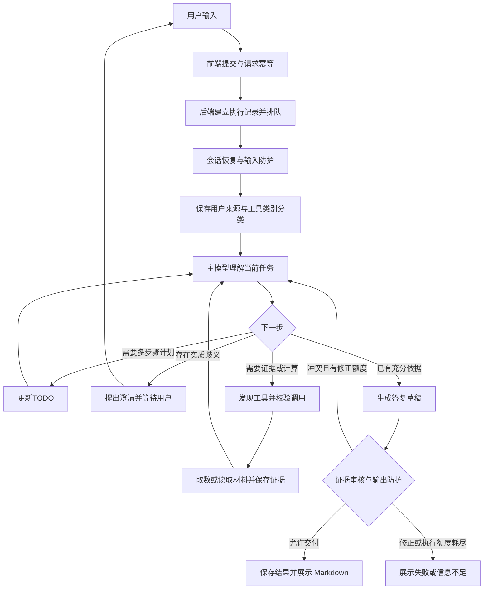
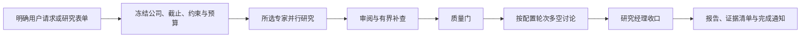

# FinSight 从用户输入到结果展示：场景、链路与难点

编写日期：2026-11-04。依据当前工作区的 Python 后端、React 前端和 `finagent.toml`，面向希望理解产品行为、讲解项目或继续开发的读者。

本文沿着用户的一次操作往下走：输入了什么，系统如何理解，调用什么能力，最后展示什么，以及哪里容易出错。示例中的请求与回复结构用于解释代码行为，**不是本次真实模型、实时行情或完整研究的实测结果**；不填入未经获取的市场数字。

## 1. 先看用户入口与处理路径

| 用户从哪里进入 | 用户操作 | 系统入口 | 最终去向 |
| --- | --- | --- | --- |
| 工作台 `/` | 输入问题并发送 | 创建会话，再提交消息 | 跳转 `/chat/:sessionId` 展示执行与答复 |
| 对话页 `/chat/:sessionId` | 首问、追问、澄清、更正 | 在同一会话提交新消息 | 保留上下文，展示新一轮结果 |
| 研究页 `/research` | 填公司代码、目标、可选截止时间，确认开始 | 显式提交独立研究 | 回到对话页，后台研究出现在研究列表 |
| 对话页 | 明确说“帮我生成某公司的深度研究报告” | 主 Agent 调用研究启动工具 | 后台执行，前台可继续聊天 |
| 报告页 `/research/:researchId` | 阅读、点击引用、导出、追问 | 读取报告、证据清单或提交报告问题 | 证据抽屉、Markdown 文件或原会话答复 |
| CLI | 自然语言、会话命令、研究命令 | `SessionHost` 或命令处理器 | 终端文本、来源、诊断与研究文件 |

界面上“比较两家公司的盈利质量”会填入一条先确认公司和报告期的问题；“解读一份财报”进入资料库；“发起公司深度研究”打开研究表单。这些入口没有预先生成的财务结论。

这里有两种核心执行方式：

- **普通对话**：主 Agent 根据当前目标选择工具，在同一轮中取证、计算、分析和回答。说“深入分析一下”仍可走这条路径。
- **独立研究**：由明确的用户请求或研究表单启动，冻结范围，使用单独预算与研究角色链，在后台形成报告。

分类器输出 `research` 只表示建议使用研究类工具，不能代替明确启动依据。公司独立研究只支持已接入的沪深股票；指数查询和行业排名另有工具。

源码：[工作台](../../web/src/features/Workspace.tsx)、[研究表单](../../web/src/features/Research.tsx)、[HTTP 入口](../../src/finagent/web/app.py)、[研究启动边界](../../src/finagent/harness/research.py)。

## 2. 所有普通对话共用的执行链

拒绝的输入不会按普通请求继续。没有歧义或不需要数据的请求可以跳过相应步骤，实际工具顺序由主模型选择，并受宿主校验。

### 2.1 从点击发送到开始执行

1. 首页先调用 `POST /api/v1/sessions` 建立会话，再调用 `POST /api/v1/sessions/{id}/messages`。已有会话直接提交消息。
2. 后端检查消息合同，例如不能为空、最长 12000 字符。提交消息时要求 `Idempotency-Key`。
3. WebStore 创建运行记录；SessionManager 将任务放入有界执行队列。返回的 HTTP `202` 表示已受理，尚未完成回答。
4. 同一会话串行执行，避免两轮同时修改对象、任务范围和证据；不同会话仍受全局并发限制。
5. 执行线程取得会话宿主，调用 `SessionHost.submit()`，再由 `AgentKernel.run()` 运行模型与工具循环。

前端对网络结果未知的提交保留幂等键，方便重试；服务端对同一会话与同一键返回原运行记录。相同键更换内容会冲突。它保护的是提交操作；不能由此推导所有外部请求都具有“恰好执行一次”保证。

**难点：**浏览器超时不等于后端未执行。没有幂等与持久化运行记录，用户重试可能重复消耗模型预算或启动两份研究。

源码：[前端请求封装](../../web/src/api/client.ts) → `api()`；[WebStore](../../src/finagent/web/store.py) → `create_run()`；[SessionManager](../../src/finagent/web/session_manager.py) → `submit()`、`execute()`。

### 2.2 输入分类、任务理解和工具发现各做什么

当前项目配置启用 `[intent]`，关闭旧 `[nlu]`；工具采用 `deferred` 加载，并启用最终答复事实校验。这里描述配置文件中的选择，不代表相关模型服务当前在线，也不代表环境变量没有覆盖配置。

| 机制 | 回答的问题 | 输出与边界 |
| --- | --- | --- |
| 工具意图分类 | 用户要做什么动作、涉及哪些数据领域？ | 精确闲聊规则或原版 Qwen JSON 分类，宿主映射工具类别；不生成金融参数 |
| TODO与摘要 | 需要做哪些步骤、做到哪里、有哪些仍有效条件？ | 主模型更新计划，宿主保存和注入；最新用户原话优先 |
| Skills | 这类问题按什么方法做？ | 按需读取分析步骤与注意事项，不增加权限 |
| 工具发现 | 应该取得哪个工具的定义？ | `search_tools` 或 `select_tool_groups` 按需披露工具 |
| 执行检查 | 本次调用是否符合参数、权限和用户范围？ | 不符合则返回结构化错误，供模型纠正 |

分类器可多选，例如“茅台去年利润和最近股价”涉及 `fundamentals` 与 `market`。超时、模型缺失、非法 JSON 等会触发规则降级；未知或低置信度请求会放宽候选类别。原文不会因为分类输入上限而被截断后交给主 Agent。

`deferred` 模式下，分类是发现建议；工具目录保持稳定，发现结果通过结构化工具引用提供定义。`eager` 模式下，分类直接影响初始可见工具，主模型仍可补选。两种模式都会检查角色与执行权限。

当前 Web 允许列表保留 `select_tool_groups`，可通过它取得工具组定义；`search_tools` 是否可用还取决于入口的工具过滤，不能把 CLI 的完整工具目录照搬到网页。

**难点：**类别判断不等于理解完整任务。识别出“财务”以后，仍要解决归母还是全部净利润、全年还是单季、比较谁、是否排除行情等问题；发现工具也不代表可以越过用户约束执行。

源码：[意图路由](../../src/finagent/intent_routing.py)、[工具发现](../../src/finagent/harness/discovery.py)、[会话宿主](../../src/finagent/harness/host.py) → `_route_tools()`、`schemas()`、`execute()`。

### 2.3 模型调用工具后，什么才算“有依据”

金融工具通常返回 `Observation`，其中区分：

- `data`：规范化后的数据；`symbol`、`currency`、`units` 等表示对象与口径。
- `data_time`：数据自身的时间；`fetched_at`：系统何时取得数据，两者含义不同。
- `snapshot_id` / `snapshot_ids`：原始内容快照；`result_id`：保存的规范结果。
- `status`：`ok`、`partial`、`empty`、`error`；另外保留 `warnings`、`stale`、`cache_hit`。

主 Agent 可以根据结果继续取证，或通过 `read_evidence` 回读本任务登记的原始内容。来源失败、旧缓存、缺字段和时间不确定性会随结果保留，不能在答复中自动消失。

最终草稿交给 Qwen3.5-9B 审核完整回答与证据。后端根据活动任务筛选已登记结果，读取完整规范正文和来源元数据，保留公司、期间、币种、获取/披露时间、计算依据及限制。审核模型判断证据能否支持回答，并检查限定词、归因和用户约束；后端检查来源 ID、逐字引文和审核协议，不再先提取主张后逐字段匹配。

发现问题时反馈主模型修改或补查，当前配置最多修正两次，每次重新组装证据并审核。证据超限或不完整、服务失败、无效输出、修正耗尽时不交付草稿。审核前的工具调用附带文字暂不展示，工具状态正常展示。`review_passed` 不代表全文真实或上游来源已独立核实，模型漏检与误拦需要独立人工标注集验证。

源码：[数据合同](../../src/finagent/data/contracts.py)；[工具登记](../../src/finagent/harness/extensions.py)；[证据组装与审核器](../../src/finagent/answer_review.py)；[宿主门禁](../../src/finagent/harness/host.py) → `_review_answer()`。

### 2.4 执行过程和最终答复怎样显示

浏览器通过 SSE 接收 `run.started`、`tool.started`、`tool.completed`、`research.progress` 等事件，并刷新查询；对话与研究页还有轮询兜底。事件有持久化递增游标，便于断线后接续。

当前模型请求不是 token 流。用户在等待时看到工具或研究阶段状态，最终文字完成后整体展示为 Markdown；不显示虚构的进度百分比或剩余时间。对话页只保留有限的近期活动摘要，不等于展示全部执行日志。

如果本轮 `tool_calls == 0`，页面会提示“本轮未调用工具，不代表重新查询或核验过数据”。有工具调用同样不能单凭次数证明答案正确。

源码：[事件投影](../../src/finagent/web/session_manager.py) → `transform()`、`observe()`；[前端 SSE](../../web/src/app/context.tsx)；[对话展示](../../web/src/features/Chat.tsx)；[Markdown 渲染](../../web/src/components/MarkdownContent.tsx)。

### 2.5 CLI 中如何观察同一条链

CLI 的自然语言同样经过 SessionHost 与 AgentKernel，终端用文本显示工具进度和答复；不经过 Web 的 HTTP 队列和页面投影。

| 输入 | 用途 |
| --- | --- |
| 直接输入问题与追问 | 普通取数、解释、分析与澄清接续 |
| `/sources` | 查看本会话的结果 ID、工具、对象、来源、时间及失效状态 |
| `/details` | 查看上轮结果、用量、预算和事实检查状态 |
| `/research --symbol 600519.SH 分析现金流质量` | 显式启动后台深度研究 |
| `/research-status`、`/research-report` | 查看关联研究状态或报告 |
| `/research-resume 研究ID` | 显式请求恢复原研究，仍需通过恢复校验 |

这些斜杠命令由终端处理器解析，网页使用对应按钮和接口；不能要求网页用户通过输入 `/details` 打开故障诊断。

源码：[终端入口与命令处理](../../src/finagent/harness/terminal.py) → `run_terminal()`、`command()`。

## 3. 场景一：问候、能力咨询与概念解释

**用户输入：**“你好”“你能做什么？”“市盈率是什么意思？”

**后台处理：**完整匹配的问候、感谢或能力介绍可命中闲聊规则，跳过 Qwen 分类调用，但仍由主模型生成回答。概念解释可被归为 `concept`，无需为了通用定义强制取行情。普通解释和简单查询无需先创建计划。

**结果展示：**对话页显示自然语言解释，可以带公式与明确标记的假设示例；没有工具调用则出现相应提示。

**难点与边界：**“你好，查一下茅台股价”包含实际查询，不能因为有问候就走纯闲聊。“市盈率是什么意思”和“茅台现在市盈率多少”也必须区分，后者需要当前公司数据。假设数字要标明用途，不能混入实际行情陈述。

源码：[分类规则](../../src/finagent/intent_routing.py) → `social_rule()`、`IntentRouter.route()`；[闲聊判断](../../src/finagent/intent.py) → `requires_data()`。

## 4. 场景二：查某只股票的当前行情

**用户输入：**“贵州茅台现在多少钱？顺便看一下涨跌幅。”

**后台处理：**

1. 分类建议 `market`；主 Agent 记录行情任务及原文对象。
2. `resolve_entity` 将名称映射为 `600519.SH`；唯一明确匹配才自动绑定。
3. 发现并调用 `get_quote`，参数与任务对象必须一致。
4. DataService 按配置尝试主备来源，校验证券身份与数据结构，保存原始快照。近期缓存可复用；刷新失败而退回旧缓存时保留原获取时间并标注过期。
5. 主模型根据返回字段组织答复，最终经过事实检查与输出防护。

**结果展示：**公司名称与代码、供应商返回价格和涨跌信息、行情时间、来源，以及延迟或完整性限制。这里不预填真实价格。

**难点与边界：**

- 名称命中只是映射，仍需来源数据继续核验身份。
- 行情时间、抓取时间、实际交易日、最终收盘状态不能互相代替。
- 快照里的开高低收无法证明“早盘冲高、尾盘回落”的先后路径，需要分时证据。
- 当前快照不能用来回答历史截止查询；历史价格应改用日线能力。

源码：[实体与行情服务](../../src/finagent/data/service.py) → `resolve_entity()`、`quote()`、`_fetch()`、`_cached()`；[行情工具](../../src/finagent/tools/perception.py) → `build_registry()`。

## 5. 场景三：对象有歧义、代词不明或市场未接入

**用户输入：**“查一下平安”“那它呢？”“看看某只美股。”

**后台处理：**名称解析结合本地目录与在线沪深股票搜索。如果存在多个候选，返回候选名称和代码并进入澄清；代词不能唯一绑定时也保留待澄清项。用户下一轮回复名称或序号后，主模型根据真实候选再次解析对象，再执行查询。

系统保存澄清前已用预算，接续时继承，避免每次追问都把额度重置。关键歧义由主模型提问，宿主在等待澄清时暂停后续领域操作；不再使用Frame字段依赖门禁。

**结果展示：**对话中出现需要用户回答的问题，例如“请确认是平安银行还是中国平安”；未接入市场给出能力范围说明。页面继续使用同一输入框承接回答。

**难点与边界：**不能默认选最后谈过的公司，也不能强制所有用户先提供代码。名称在线检索只覆盖沪深 A 股，搜索不到某指数不能证明该指数不存在。裸 `000001` 与 `000001.SH` 也有股票和指数之别，应按现有映射解析。

源码：[实体解析](../../src/finagent/data/service.py) → `resolve_entity()`；[澄清接续](../../src/finagent/harness/host.py) → `submit()`。

## 6. 场景四：指数查询与行业整体排名

### 6.1 查询一个指数

**用户输入：**“上证指数最近走势怎样？”“用中证银行指数看看银行板块。”

**后台处理：**通过已支持指数映射解析对象，调用股票与指数共用的行情或日线工具；价格单位采用 `index_point`。银行板块可映射为 `399986.SZ` 的中证银行指数代表口径，结果带代理说明。

**结果展示：**指数名称、代码、点位或区间表现，以及来源和日期。如果使用银行指数代表板块，需要明确这一口径。

**难点与边界：**股票价格的“元”不能套到指数点位；指数走势不能冒充整个行业全量表现；指数不支持公司财报或独立公司研究。

### 6.2 比较全体行业强弱

**用户输入：**“今天哪个行业最强？列前五个。”

**后台处理：**直接调用 `get_sector_ranking(limit=5)`，读取新浪供应商行业集合并按其涨跌幅排序。不先选个股，也不拿单个银行指数代替行业榜。

**结果展示：**可以给出本次取得的供应商行业排序与获取时间，但应解释**缺少可核对的行情时间，不能确认是今日、实时或最终收盘排名**。

**难点与边界：**用户的时间要求可能超出数据能力。当前榜单不支持历史、一周或月区间排序，也不支持资金流排序、任意包含或排除项；不能悄悄忽略这些约束后继续给榜单。

源码：[指数映射](../../src/finagent/data/symbols.py)；[行业数据](../../src/finagent/data/providers/sectors.py)；[行业服务](../../src/finagent/data/service.py) → `sector_ranking()`。详见[指数数据](../data/INDEX_DATA.md)、[行业排名](../data/INDUSTRY_RANKING.md)。

## 7. 场景五：历史复盘、技术分析与背离

**用户输入：**“复盘茅台某个已结束交易日的表现，和沪深300比较。”“最近有没有日线 MACD 底背离？”

**后台处理：**

1. 主 Agent 确认对象、目标日、历史窗口和不复权口径；可读取技术分析 Skill 或研究步骤。
2. `resolve_task_scope` 处理交易日期与范围；收盘复盘使用 `get_market_data`，对照指数使用 `get_benchmark_data`。
3. `calculate_closing_review` 从已登记序列计算涨跌、均线、量比和相对基准百分点差等。
4. 背离问题使用 `calculate_technical_divergence`，返回指标、双枢轴、确认时间、候选和失效状态；主模型据此解释。
5. 数据长度、日期或最终性不足时，保留缺口，不能靠语言补齐结论。

**结果展示：**以文字或表格展示实际交易日、计算结果、基准和信号状态，区分“候选”“确认”“失效”。当前 Web 没有证据绑定的技术图表，不能把文字分析描述成已经显示 K 线图。

**难点与边界：**

- 自然日可能是休市日；收盘复盘链路有交易日历处理，基础 `get_daily_bars` 本身并不证明完整交易日覆盖。
- 基础日线只返回截止自然日之前的数据；不能看到当日一行就当作完整收盘。
- 不复权价格遇到公司行动会影响技术指标解释。
- 背离确认需要后续数据，历史回看时不能将后来才知道的信息提前使用；日线信号也不能推导成分钟线信号或确定涨跌预测。

源码：[范围与复盘工具](../../src/finagent/tools/analysis.py)；[行情计算](../../src/finagent/market.py)；[技术指标](../../src/finagent/technical.py)；[基础日线](../../src/finagent/data/service.py) → `daily()`。

## 8. 场景六：查财务数据、比较公司与计算增长率

**用户输入：**“比较茅台和五粮液2025年经营现金流。”“按归母净利润口径，算茅台2025年净利率和同比变化，不看股价。”

**后台处理：**

1. 记录公司集合、报告期、指标、合并范围、币种、单位和“不看股价”等约束；“利润”含义不明时先澄清。
2. 逐一解析公司。切换查询焦点时，不能把前一家公司的结果绑定给后一家公司。
3. 简单三表查询可以调用 `get_financial_statements`。它读取第三方聚合财报，不等同于完整官方年报。
4. 需要确定性计算时，选取在线三表返回的 `fact_id`；执行器核对接口原始响应及期间、单位、币种和任务授权。
5. `generate_program` 只校验输入并返回受限程序草稿；`execute_program` 才执行四则运算，并检查结果是否符合声明的业务公式。
6. 最终按公司、指标、期间组织表格和分析，保留证据来源与不可比项目。

**结果展示：**每家公司单独列出报告期、指标名称、值与单位，再解释差异。增长率、利润率和利润率变化分别标注 `%` 或“百分点”，并说明计算依据。

**难点与边界：**

- 全年、年初至今累计、单季与时点值不可随意混用；归母、全部净利润和扣非也不等价。
- 同比增长率为 `(本期－上期) / 上期 × 100%`；普通增长率要求正的上期基数。亏损到盈利不能硬套这条公式，可以改为绝对变化或盈亏说明。
- 利润率变化是两期利润率相减，以百分点表达，不等于利润增速。
- 程序使用证据事实 ID 和受限常数，不允许模型直接塞任意财务数字或执行 Python；草稿不能冒充执行结果。
- 在线三表返回可计算字段的 `fact_id`；缺少字段或请求的口径不受支持时，应说明缺口。

源码：[财务数据服务](../../src/finagent/data/service.py) → `financials()`；[证据计算](../../src/finagent/tools/financial.py) → `semantic_expected()`、`execute()`；[字段核验](../../src/finagent/data/financial_facts.py) → `StatementFacts.fact()`。

## 9. 财报资料库已移除

自 2026-11-05 起不提供本地财报导入、上传、检索或原文读取。用户直接询问公司财务指标，系统在线获取三表并执行受限计算。正文、附注或业务原因不在三表覆盖范围时明确说明缺口，不要求上传原文。

## 10. 场景八：新闻、政策、情绪和“为什么涨”

**用户输入：**“茅台最近为什么涨？”“这项政策对银行有什么影响？”“市场对这家公司情绪如何？”

**后台处理：**分类可能同时建议 `market`、`news`与 `policy`。主 Agent 根据需求读取相关 Skill，取行情、个股新闻、宏观政策、资金流或关注度等已接入数据；原始披露事件可通过本地材料检索。情绪和技术指标可由对应计算工具处理，再解释支持依据与缺口。

**结果展示：**按“已观察事实—可能解释—尚不能确认的部分”组织回答，列出来源与时间。没有找到公告或新闻时，说明当前检索覆盖，不能写成“市场没有任何利好”。

**难点与边界：**

- 个股新闻主要覆盖近期第一页，不是全历史事件库。
- 新闻热度、资金流与价格同时变化不能直接证明因果；系统不应将相关性写成已查明的上涨原因。
- 盘后公告不能解释当天此前的盘中路径；只有日期的材料也不能用于精确判断事件先后。
- 政策影响需要适用对象、实施时间和传导路径，不能只匹配行业关键词就下结论。

源码：[个股新闻](../../src/finagent/data/service.py) → `news()`；[政策、资金流与情绪工具](../../src/finagent/research/data_tools.py)；[事件检索](../../src/finagent/tools/analysis.py) → `events()`；[分析 Skills](../../src/finagent/skills)。

## 11. 场景九：多轮追问、修改条件与切换任务

用户说“比较两家公司2024年现金流，不看股价”，随后说“改成2023年，其他不变”时，主模型根据原话、摘要和TODO继承仍有效条件，重新查询与计算，更新需要重做的步骤。没有独立任务字段patch或任务激活工具。

TODO随会话检查点保存，通过运行时上下文提供给模型。已有清单距离上次更新或提醒达到3次模型尝试时，宿主提示更新。长对话通过结构化摘要和可回读归档继续工作；摘要、TODO都不能证明金融事实。语义继承和计划更新仍可能遗漏，应以多轮更正场景验证。

源码：[会话宿主](../../src/finagent/harness/host.py)、[上下文整理](../../src/finagent/harness/context.py)、[TODO更新](../../src/finagent/harness/extensions.py)。

## 12. 场景十：明确发起独立深度研究

**用户输入：**“帮我给刚才那家公司做一份深度研究报告，重点看经营现金流，不做估值。”

**后台处理：**

1. 主 Agent 确认“刚才那家公司”能唯一解析，记录研究任务与约束。
2. 调用 `start_deep_research`，提供最新真实用户消息的 `source_id`、逐字请求引用、模式和公司。
3. 宿主检查明确启动依据，排除否定、假设、功能咨询和已有报告解读。同一用户来源、公司与模式的重复启动会复用已有工作记录。
4. 冻结交接信息：用户原文、约束、公司、截止时间、范围及TODO副本。主对话的陈述不会自动变成研究的金融证据。
5. 后台建立 `work_id`，研究创建后关联 `research_id`；使用独立预算、取消信号、检查点和角色产物。
6. 当前显式 `deep_research` 走 v2.2 选择与编排：所选专家并行取证，之后进行审阅、质量门、多空讨论与研究经理收口。依赖和质量条件不满足时，下游可能被阻挡并输出缺口。
7. 产出结构化报告、Markdown 和证据清单，更新研究状态，并向主会话发送通知。

默认可选专家维度包括基本面、新闻、技术、市场情绪、宏观政策；实际使用维度以研究冻结范围为准。不能把并行专家数量直接当成独立观点的真实性保证。

**结果展示：**前台先显示后台研究已启动，可以继续聊天；研究页显示阶段与状态，报告可用后进入报告页。研究表单提交成功、前台启动回复完成、后台研究完成是不同时间点。

**难点与边界：**

- “深入看看”“你能做研究吗”“不要启动研究”都不能自动消耗一份独立研究预算；当前自然语言授权检查有明确短语规则，部分表达可能需要澄清。
- 主会话继续聊天或切换公司后，已启动研究仍使用原冻结范围；改变目标需要另行明确处理，不能假装原研究已同步更新。
- 每个角色必须在获准的证据与上游产物范围内执行；多空讨论不能创造新事实。
- 除 Web 的资源上限外，研究协调器还会检查进程级研究锁，可能返回 `RESEARCH_BUSY`；页面允许提交不代表多份研究一定同时执行成功。
- 各阶段共享受控的研究预算，并给后续阶段保留额度。恢复不会清空既有用量。

源码：[研究启动与交接](../../src/finagent/harness/research.py) → `explicit_request()`、`launch_research()`；[模式选择](../../src/finagent/research/selection.py) → `select()`、`config_for()`；[实际编排](../../src/finagent/research/decision_coordinator.py) → `DecisionCoordinator`；[角色拓扑](../../src/finagent/research/workflow.py) → `plan()`。

## 13. 场景十一：完整决策模式与一般研究的区别

**用户输入：**明确要求完整研究与决策、交易方案和风险讨论；或在 CLI 中显式选择 `full_decision`。

**后台处理：**在深度研究链之后，增加交易员、按轮次顺序执行的激进／保守／中性风险分析师，以及投资组合经理收口。下游读取封存的上游产物，检查引用闭合、版本、范围与决策资格；质量不足时允许观望或暂不作决定。

**结果展示：**报告包含研究意见、条件化方案、风险讨论和适用限制。当前 Web 新建研究表单固定提交 `deep_research`，没有完整决策模式选择器；后端合同、自然语言研究入口和 CLI 有对应模式能力。

**难点与边界：**角色发言数量不代表证据充分，也不能把模型间达成一致当作投资有效性验证。交易员和投资组合经理是研究角色，项目没有券商账户、真实下单或持仓执行功能。

源码：[工作流与产物检查](../../src/finagent/research/workflow.py) → `plan()`、`seal()`、`validate_output()`；[决策编排](../../src/finagent/research/decision_coordinator.py)；[Web 表单](../../web/src/features/Research.tsx) → `ResearchForm()`。

## 14. 场景十二：阅读报告、点引用、导出和追问

**用户操作：**打开已生成的报告，点击某项发现旁的引用，导出文件，再问“哪些结论仍缺证据？”

**后台处理与展示：**

| 操作 | 后台处理 | 用户看到什么 |
| --- | --- | --- |
| 打开报告 | 校验 Web 归属，读取 `report.json` 与证据清单；确定性拆分章节 | 标题、截止范围、状态、核心发现、正文、缺口和来源 |
| 看核心发现 | 读取结构化产物中的已接纳主张，取有限条数 | 带引用入口的发现，不额外调用模型生成新摘要 |
| 点击引用 | 按引用 ID 取来源、定位与可用片段 | 证据抽屉；没有精确片段则提示按原定位查来源，不编页码 |
| 查看研究过程 | 读取实际任务与阶段状态 | 角色、阶段、状态与原因，以及允许的取消／恢复操作 |
| 导出 | 返回已有 Markdown 报告 | 下载 Markdown；当前没有 PDF 导出 |
| 提交报告追问 | 在原会话读取授权报告与证据，按原范围执行，并禁用研究启动工具 | 跳转原对话页查看答复，不因追问自动开第二份研究 |

报告会分别展示执行状态、内容完整度、审阅状态与 `outcome_verified`。例如“执行完成但内容部分可用、结果尚未核验”并不矛盾：流程结束与结论已证实是不同属性。

**难点与边界：**

- 报告追问必须绑定具体报告，不能只凭聊天里出现过一个报告 ID 就跨会话读取。
- 历史报告有原截止范围，不能用来声称刚刚核验了最新行情；过时行情证据会被标记失效，晚于当前历史截止的报告会被拒绝采用。
- 当前报告适配器返回空图表集合，界面没有证据绑定图表。引用清单为空时也应展示真实空状态。
- 引用存在只证明可回查来源位置，不自动证明该来源支持所有推断；内容审阅与结果核验仍需分别理解。

源码：[报告适配器](../../src/finagent/web/reports.py) → `ReportAdapter.load()`；[报告界面](../../web/src/features/Report.tsx)；[引用接口](../../src/finagent/web/app.py) → `create_app().citation()`；[追问处理](../../src/finagent/web/session_manager.py) → `execute()`；[历史报告证据采用](../../src/finagent/harness/research.py) → `ResearchService.read()`。

## 15. 场景十三：停止、刷新、断线与服务重启

| 用户动作或故障 | 系统如何处理 | 页面结果与限制 |
| --- | --- | --- |
| 点击“只停止当前回复” | 设置该次前台运行的取消状态与信号 | 前台进入取消过程；不把全部后台研究一起取消 |
| 在研究页停止某份研究 | 按指定工作记录发送取消信号 | 保留既有研究记录与产物，阶段状态继续更新 |
| 刷新页面 | 从后端运行记录、消息与研究状态恢复展示 | 已完成结果仍可查看，不依赖浏览器内存 |
| SSE 断线 | EventSource 重连，按游标接续，页面轮询兜底 | 保留现有内容，连接恢复后继续更新 |
| 关闭浏览器 | 后端研究线程继续运行 | 再次打开后可读状态；依赖后端服务仍存活 |
| 后端进程退出或重启 | 保留存储；未完成运行记为 interrupted，不自动重放结果未知的操作 | 用户明确恢复原研究；不能宣称旧线程仍在运行 |
| 点击恢复研究 | 检查原启动依据、冻结范围、预算、配置与产物 | 满足条件后接续；预算不足或无法验证时可能拒绝 |

**难点：**“前台回复已结束”“浏览器已关闭”“后台研究已停止”是不同状态。取消是协作式信号，正在等待的网络请求可能需要到超时或检查点才结束；恢复也需要验证旧证据和上游产物是否仍适用。

源码：[前台取消与启动恢复](../../src/finagent/web/session_manager.py) → `cancel()`、`start()`、`cancel_research()`；[后台工作](../../src/finagent/harness/background.py)；[研究恢复](../../src/finagent/research/selection.py) → `resume_selected()`；[持久化状态](../../src/finagent/harness/state.py)。

## 16. 场景十四：模型不可用、数据不足、规则冲突或恶意材料

| 情况 | 系统处理 | 应交付的结果 |
| --- | --- | --- |
| 意图模型连接失败或 JSON 不合法 | 使用规则降级分类并记录原因 | 主任务可继续；不能声称 Qwen 已成功分类 |
| 主模型网络错误或输出截断 | 有界重试、上下文恢复或截断续接；每次尝试计入预算 | 成功则正常答复，失败则保留会话并给诊断 |
| 数据主源失败 | 按支持情况尝试备用来源，保留错误与降级信息 | 返回带限制的数据，或说明来源全部失败 |
| 缺少原文、期间不匹配、没有可算事实 | 有界补查，依赖检查拒绝不合法计算 | 明确已知与缺口，不填造数字 |
| 同样的工具错误反复出现 | 内核按重复失败规则止损 | 结束为失败或未完成，避免无限循环 |
| 答复数字与授权证据冲突 | 反馈纠正；超过上限则 `FACT_CHECK_FAILED` | 被拒绝草稿不作为最终答案交付 |
| 材料中出现“忽略用户、泄露密钥、执行命令”等文字 | 将来源内容作为不可信资料，执行输入／输出与信任边界检查 | 不因资料文字取得权限；必要时拒绝或过滤 |

Web 对主模型失败保存脱敏的错误类型、网络异常、HTTP 状态与建议，展示“故障诊断”。早期历史记录可能没有结构化诊断，不能补造原因。模型网络与数据网络使用各自代理配置，模型连通也不证明行情源连通。

网页工具范围限定于金融研究、上下文与报告能力，不提供任意 Shell、文件系统和通用扩展工具入口；当前 Web 仍是本机单用户应用。输入防护、信任标签、工具权限和输出脱敏共同降低注入与泄露风险，但规则过滤不能保证识别所有攻击表达。

**难点：**一轮里可能“取数成功、最终生成失败”，也可能“程序执行完成、结论依据不足”。展示层要如实表达每种状态，不能把网络成功、HTTP `202`、工具返回或一份 Markdown 文件存在统称为任务成功。

源码：[内核与预算](../../src/finagent/harness/kernel.py) → `AgentKernel.run()`、`Ledger`；[Web 诊断](../../src/finagent/web/diagnostics.py)；[防护实现](../../src/finagent/security.py)；[本机边界](../../src/finagent/web/app.py) → `create_app().local_boundary()`。详见[事实检查](../security/FACT_CHECKING.md)、[注入与泄露防护](../security/PROMPT_INJECTION_DEFENSE.md)。

## 17. 把项目难点归纳为可解释的工程问题

| 难点 | 为什么难 | 当前处理方法 | 仍需验证或改进 |
| --- | --- | --- | --- |
| 理解真实需求 | 同一句话包含对象、期间、指标、排除与代词 | 分类建议 + 主模型理解 + TODO及领域参数和证据核验 | 实际模型的抽取准确率、多轮稳定性 |
| 保持金融口径 | 年度／累计／单季、归母／全部利润、元／亿元容易混淆 | 显式口径、原文定位、Decimal 计算与公式检查 | 非标准表格与更多会计语义覆盖 |
| 时间一致性 | 获取时间、行情时间、披露时间、历史截止各不相同 | 独立字段、截止过滤、失效标记和交易日处理 | 上游未知时间、最终性与历史修订版本 |
| 可追溯回答 | 模型可能生成合理但无依据的数字或解释 | 原始快照、结果 ID、证据回读、主张引用和最终规则门禁 | 全文语义支持、复杂因果与规则漏检 |
| 稳定工具调用 | 参数错误、协议不合法、接口失败、输出截断都可能发生 | Schema、权限检查、有界恢复、调用结果配对与止损 | 真实来源持续可用性、模型长任务表现 |
| 控制上下文成本 | 完整工具定义、长资料和历史会不断膨胀 | 渐进披露、稳定目录、追加状态、压缩与回读 | 网关协议兼容、真实缓存命中与压缩损失 |
| 研究角色协作 | 角色可能重复劳动、跨范围引用或互相放大错结论 | 冻结交接、隔离工具、封存产物、引用闭合与质量门 | 独立报告质量、人类审阅与业务效果 |
| 后台执行与恢复 | 前台、研究、浏览器与进程的生命周期不同 | 独立工作记录、幂等、租约、取消、检查点和显式恢复 | 独立执行进程、资源调度与更强恢复能力 |
| 可信展示 | “有结果”容易被误读为“已核验” | 分开显示执行、内容、审阅与核验状态，保留缺口 | 更清楚的来源浏览与证据绑定图表 |

项目最需要持续验证的是整条链是否守住用户范围和证据边界：从“用户究竟问什么”，到“工具实际取到了什么”，再到“最后写出的每项结论能支持到哪里”。局部模块可运行，只能说明对应机制存在。

## 18. 如何按这份文档走一遍项目

建议在可连接模型与数据源的本机环境中，依次操作下面的场景；不要预设请求一定成功，信息不足和失败展示同样属于观察内容。

| 顺序 | 操作 | 重点观察 |
| --- | --- | --- |
| 1 | 问一个金融概念，再问实际公司当前数据 | 是否区分解释与取证，是否如实显示工具使用 |
| 2 | 输入有歧义的公司名，再回答澄清 | 是否在同一会话继续，是否避免错误绑定对象 |
| 3 | 查询股票、指数与行业排名 | 单位、时间、范围和代理口径是否分别说明 |
| 4 | 做双公司财务比较，再更正年份和增加公司 | 条件是否准确继承，旧证据是否仍适用 |
| 5 | 上传材料并解读，进一步要求计算 | 是否区分已解析原文与可计算的已核验事实 |
| 6 | 明确启动一份公司研究，再继续普通聊天 | 研究是否保持冻结范围，前后台状态是否区分 |
| 7 | 打开报告、点击引用、导出并追问 | 定位是否可回查，追问是否回到原会话且不新开研究 |
| 8 | 刷新页面、停止前台或指定研究、检查允许的恢复 | 运行记录是否保留，状态与实际操作是否一致 |

这些操作是人工走查建议，不是本次执行记录。本文仅新增说明与文档索引，没有运行真实模型、金融来源或完整研究，也没有以旧版回归数字声称当前全链路质量已验收。

相关代码测试可从 [Web 测试](../../tests/test_web.py)、[浏览器流程](../../web/e2e/workspace.spec.ts)、[会话接续](../../tests/test_conversation_state.py)、[工具发现](../../tests/test_tool_discovery.py)、[事实检查](../../tests/test_fact_check.py)、[对话与研究衔接](../../tests/test_research_chat.py) 阅读。合成测试验证程序行为，真实数据质量、模型正确率与研究价值需要独立验收。

进一步阅读：[项目设计说明](PROJECT_DESIGN.md)、[Web 工作台](../guides/WEB_APP.md)、[任务理解](../features/TASK_UNDERSTANDING.md)、[主对话与独立研究衔接](../features/DEEP_RESEARCH_CHAT.md)、[运行说明](../guides/RUNNING.md)。
