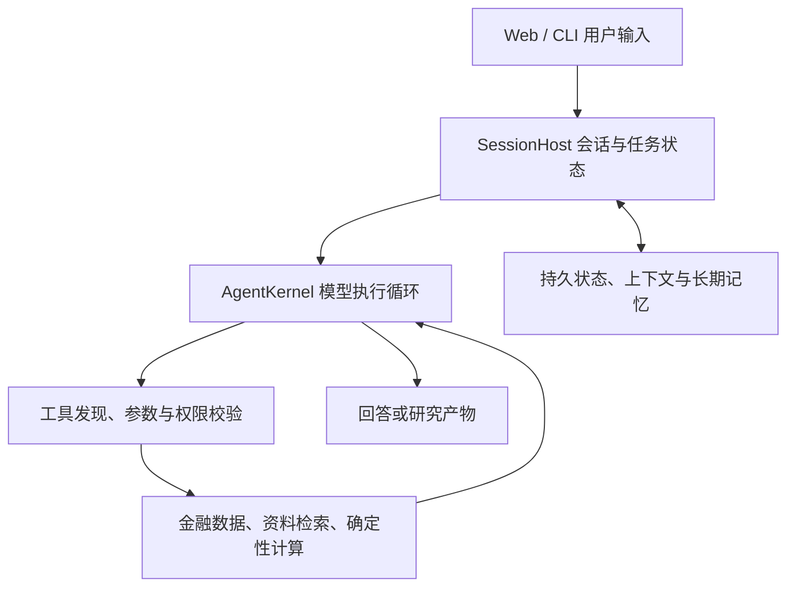

# FinSight 项目深入学习与面试准备指南

整理日期：2026-11-04。面向 Agent / LLM 应用开发岗位，也可用于梳理后端工程和金融研究应用设计。

[返回总览目录](README.md) · [项目设计说明](PROJECT_DESIGN.md) · [输入到结果的完整链路](INPUT_TO_RESULT_GUIDE.md)

本文提供学习顺序、源码入口、练习和面试自测方法。具体设计以当前源码和生效配置为准；文中的训练场景是学习用例，不代表已经完成真实金融数据或研究报告验收。个人职责应按实际参与范围填写。

## 1. 准备目标与学习方法

按照“走通一条真实请求 → 拆解各模块 → 验证设计取舍 → 练习面试表达”的顺序准备。目标是能够用具体案例解释模块如何配合，并回答为什么这样设计、代价是什么、如何验证以及哪些问题尚未解决。

每个模块可以按四个层次检查掌握程度：

| 层次 | 能做到什么 | 学习产出 |
| --- | --- | --- |
| 认识 | 说明模块负责什么、解决什么问题 | 一句话职责和一个场景 |
| 追踪 | 从入口找到关键调用和数据变化 | 调用链、时序图或状态变化记录 |
| 解释 | 比较替代方案，说明选择和代价 | 一张设计卡 |
| 验证 | 找到测试与失败案例，说明结论边界 | 验证依据和改进方案 |

第一轮先建立全局认识，再沿一条请求链读源码；第二轮选择两到三个设计重点深入。每次阅读都带着问题，避免从头逐行阅读大型文件而失去主线。

## 2. 建立整体认识

### 2.1 项目定位

可以用下面这段话建立初步认识，再结合自己的职责改写：

> FinSight 是面向中文金融研究的持续会话 Agent 工作台，支持金融查询、财报资料检索、确定性计算和独立深度研究。模型负责理解需求、选择工具和组织回答；宿主负责正式任务状态、工具权限、执行预算和证据约束。普通对话与独立研究复用执行内核，通过不同上下文、角色和工作流完成任务。

### 2.2 整体架构



这张图只表达核心职责。工具类别分类、模型协议适配、Web 认证和独立研究拓扑需要在后续分别展开。

建议依次阅读：

1. [项目设计说明](PROJECT_DESIGN.md)：理解整体分层、数据所有权和设计取舍。
2. [输入到结果的完整链路](INPUT_TO_RESULT_GUIDE.md)：把设计对应到具体用户场景。
3. [当前代码结构](ARCHITECTURE.md)：找到各模块的源码位置。
4. [项目设计清单](PROJECT_DESIGN_CHECKLIST.md)：第一轮读完后查漏补缺。
5. [Harness 来源与能力映射](HARNESS_PARITY.md)：区分参考基础、项目适配和个人贡献；历史实现描述需要对照当前源码。

完成标准：不看文档，用三分钟说明项目解决的问题、一次请求的主要路径，以及模型和宿主分别负责什么。

## 3. 用一组连续请求贯穿源码

### 3.1 学习场景

在独立学习会话中依次提出：

```text
比较贵州茅台和五粮液2024年的经营现金流，不看股价。
改成2023年，其他不变。
现在先解释一下，经营现金流和净利润为什么可能不一致？
给贵州茅台生成一份深度研究报告，重点分析现金流质量。
```

启动和依赖准备参考[运行说明](../guides/RUNNING.md)、[Web 工作台](../guides/WEB_APP.md)和[Redis 运行说明](../features/REDIS_RUNTIME.md)。先检查现有服务，按需启动；学习过程优先新建会话。真实模型和数据调用可能产生费用，研究请求还需要独立预算。

若资料缺失或接口不支持某个口径，记录系统如何表达缺口。不要为了得到完整答案而把缺失事实当作已知输入。

### 3.2 沿链路回答的问题

| 阶段 | 需要查清的问题 | 建议入口 |
| --- | --- | --- |
| 输入 | CLI / Web 如何找到会话，Web 如何确定用户归属？ | [terminal.py](../../src/finagent/harness/terminal.py)、[session_manager.py](../../src/finagent/web/session_manager.py) |
| 宿主 | 用户原文、公司、年份、排除条件分别存在哪里？ | [host.py](../../src/finagent/harness/host.py)、[context.py](../../src/finagent/harness/context.py) |
| 模型请求 | 哪些消息、状态、记忆和工具定义进入请求？ | `SessionHost.prepare()`、`model_messages()`、`schemas()` |
| 执行循环 | 模型如何提出调用，宿主如何校验并返回结果？ | [kernel.py](../../src/finagent/harness/kernel.py)、`SessionHost.execute()` |
| 证据 | 来源、时间、币种、单位和原文定位如何保留？ | [contracts.py](../../src/finagent/data/contracts.py)、[financial_facts.py](../../src/finagent/data/financial_facts.py) |
| 变更 | 第二轮如何只修改年份，继承公司和排除条件？ | [context.py](../../src/finagent/harness/context.py) |
| 研究 | 公司、截止时间、约束和预算如何冻结与交接？ | [research.py](../../src/finagent/harness/research.py)、[workflow.py](../../src/finagent/research/workflow.py) |
| 恢复 | 页面刷新、请求中断或进程重启后如何处理？ | [state.py](../../src/finagent/harness/state.py)、[Web 说明](../guides/WEB_APP.md) |

第一次追踪重点看 `SessionHost.submit()`、`AgentKernel.run()` 和 `SessionHost.execute()`。第二次再深入任务理解、工具发现及数据处理，避免同时展开所有分支。

### 3.3 执行记录模板

每轮保存一份脱敏记录，不记录密钥、登录 Cookie 或完整认证头：

```text
用户输入：
进入的接口 / 函数：
本轮执行前的任务状态：
状态变化及对应用户原文：
模型可见的工具范围：
实际工具调用及关键参数：
工具观测的来源 / 时间 / 单位：
最终回答依赖的证据：
调用次数、停止原因和未完成项：
```

完成标准：画出这组请求的时序图，能解释每轮新增了什么、继承了什么，以及这些行为由哪个模块负责。

## 4. 分模块学习路线

| 模块 | 核心问题 | 源码入口 | 参考资料与完成产出 |
| --- | --- | --- | --- |
| 执行内核 | Host 与 Kernel 如何分工？工具协议怎样配对？何时重试、停止或返回失败？ | [host.py](../../src/finagent/harness/host.py)、[kernel.py](../../src/finagent/harness/kernel.py) | [项目设计第4章](PROJECT_DESIGN.md)；画模型—工具循环，追踪一次失败路径 |
| 会话接续 | TODO如何更新、提醒和持久化？用户更正有哪些风险？ | [context.py](../../src/finagent/harness/context.py) | [任务理解](../features/TASK_UNDERSTANDING.md)；解释“只改年份”的模型继承与歧义风险 |
| 模型与工具分类 | 谁分类工具类别，谁决定具体调用？分类失败如何处理？不同模型职责是什么？ | [intent_routing.py](../../src/finagent/intent_routing.py)、[models.py](../../src/finagent/models.py) | [工具意图分类](../models/INTENT_ROUTING.md)；画分类与主模型执行的关系 |
| 工具与 Skills | 统一注册、场景策略、权限、渐进发现分别解决什么问题？Skill 如何加载？ | [registry.py](../../src/finagent/tools/registry.py)、[discovery.py](../../src/finagent/harness/discovery.py)、[skill_library.py](../../src/finagent/skill_library.py) | [统一工具](../features/UNIFIED_TOOLS.md)、[工具发现](../features/TOOL_DISCOVERY.md)、[Skills](../features/SKILLS.md)；追踪一个工具从注册到执行 |
| 金融数据与计算 | Observation 为什么保留元数据？不同报告期和单位如何约束？公式如何绑定证据？ | [service.py](../../src/finagent/data/service.py)、[contracts.py](../../src/finagent/data/contracts.py)、[financial.py](../../src/finagent/tools/financial.py) | [数据文档](../data/README.md)；完成一个数字从原文到回答的追溯 |
| 上下文与记忆 | 消息、任务状态、长期记忆分别保存什么？压缩、召回和删除怎样实现？ | [context.py](../../src/finagent/harness/context.py)、[memory.py](../../src/finagent/harness/memory.py)、[memory_search.py](../../src/finagent/harness/memory_search.py) | [长期记忆](../features/MEMORY.md)；画信息生命周期，解释一次降级 |
| 研究与协作 | 研究角色如何组织依赖？范围、产物引用和预算如何交接？完成与质量有何区别？ | [workflow.py](../../src/finagent/research/workflow.py)、[decision_coordinator.py](../../src/finagent/research/decision_coordinator.py)、[budget.py](../../src/finagent/research/budget.py) | [研究与聊天衔接](../features/DEEP_RESEARCH_CHAT.md)；画研究依赖图和失败处理路径 |
| 持久化与并发 | Redis 与 MySQL 各保存什么？事件去重、确认和任务认领如何实现？ | [state.py](../../src/finagent/harness/state.py)、[tasks.py](../../src/finagent/harness/tasks.py) | [Redis 运行说明](../features/REDIS_RUNTIME.md)、[MySQL 迁移与验收](../features/MYSQL_STORAGE.md)；画存储分工表，解释并发认领 |
| Web 与用户隔离 | 身份如何绑定数据目录？提交幂等、后台队列、SSE 和刷新恢复如何协作？ | [app.py](../../src/finagent/web/app.py)、[session_manager.py](../../src/finagent/web/session_manager.py)、[user_runtime.py](../../src/finagent/web/user_runtime.py) | [登录设计](../security/LOGIN_SYSTEM_DESIGN.md)、[Web 说明](../guides/WEB_APP.md)；画登录后一次提交的时序图 |
| 安全与评测 | 外部文本如何处理？小模型如何审核回答和证据？如何分别验证程序、模型行为和答案质量？ | [answer_review.py](../../src/finagent/answer_review.py)、[tests](../../tests)、[experiments](../../src/finagent/experiments) | [安全文档](../security/README.md)、[评测文档](../evaluation/README.md)；选择一个失败案例解释验证边界 |

优先深入执行内核、任务理解、工具、金融证据和记忆；再选择研究协作或 Web 工程作为第二条重点路线。后端岗位可提高持久化、并发、认证和恢复的优先级。

## 5. 每个模块写一张设计卡

### 5.1 可复制模板

```text
模块 / 设计名称：
1. 问题：具体哪个用户场景或失败现象需要解决？
2. 实现：入口、关键数据结构、调用顺序和状态变化是什么？
3. 选择：还有什么合理方案？为什么采用当前方案？
4. 代价：增加了什么复杂度、延迟、资源占用或维护负担？
5. 验证：对应哪个测试 / 运行记录 / 实验？它能够证明什么？
6. 边界：什么情况下会失败？下一步如何改进和验证？
我的参与：实际完成的设计、实现、验证及参考来源。
源码和证据位置：
```

### 5.2 示例：TODO与长会话接续

**问题：** 多步骤任务容易遗漏工作，长会话又需要保留有效条件并响应用户更正。

**实现：** `todo_write`保存步骤与进度，Redis检查点支持恢复，运行时上下文提供最新清单；3次模型尝试未更新时提醒。历史通过带来源的摘要与可回读归档接续，最新用户原话优先。

**选择与代价：** 已移除独立Task Frame及其额外更新协议。简化状态维护，但需求继承和TODO更新仍依赖主模型；不能声称保留字段版本或Frame工具门禁。

**验证：** [test_conversation_state.py](../../tests/test_conversation_state.py)覆盖直接查询、TODO恢复、提醒、旧会话迁移及研究快照；脚本模型回归不能证明真实语义理解准确率。

### 练习一：观察一次完整执行

在输入入口、`SessionHost.submit()`、模型请求、工具执行和状态保存处设置断点，或者阅读已有脱敏执行记录。逐步比较输入与输出，完成第3章的执行记录。

完成标准：能说明模型具体看到了什么、为什么能调用某个工具、执行结果如何回到模型，以及回答依据在哪里。

### 练习二：分析一个失败案例

从已有测试或候选评测中选择预算耗尽、对象切换错误、工具参数错误或数据缺失等案例，按“触发条件 → 发生层级 → 错误传播 → 用户结果 → 修复与验证”分析。

完成标准：解释问题应当修改提示词、任务状态、工具合同、数据源还是执行预算，并说明依据。单纯增加重试次数需要评估成本与重复失败风险。

### 练习三：完成一次小扩展

在独立练习副本或可回退的改动中，选择增加一个简单金融工具、一个分析 Skill，或一个已有指标的边界处理。追踪注册、权限、数据合同和相关验证流程。

完成标准：说明新增能力改动了哪些层、为什么需要这些改动，以及如何确认它接入现有链路。可以参考[项目设计第18章](PROJECT_DESIGN.md)的扩展指南。

## 7. 当前实现与效果表述边界

面试前重新核对[项目配置](../../finagent.toml)和相关源码；本节描述截至整理日期的仓库状态，部署环境变量和后续修改可能改变实际行为。

| 容易混淆的点 | 准确表述 |
| --- | --- |
| 多种模型职责 | 主模型负责执行与回答；工具分类使用原版 Qwen；记忆向量使用 Embedding；历史微调 NLU 是独立可选路径，当前 TOML 中关闭。具体主模型由生效配置决定 |
| Redis 与 MySQL | Redis 保存短期运行状态；MySQL 保存认证、Web 元数据、研究账本和向量缓存，按 namespace 隔离；正文和归档在文件中。旧 SQLite 仅作离线迁移与备份 |
| 登录与隔离 | Web 已实现第一版登录与账号独立目录；账号隔离仍需服务端身份校验，不能只依赖目录名或 Redis key |
| 并发能力 | 接入 Redis 不等于完成分布式执行；当前会话和服务租约仍依赖本机文件锁，Web 有单进程限制 |
| 检索能力 | 长期记忆的 BM25 / 向量混合召回与财报资料检索是不同路径，不能把两者统一描述为同一种向量 RAG |
| 上下文压缩 | 当前阈值主要按字符量控制，原文可回读；摘要仍可能损失信息，不能描述为无损或精确 token 预算 |
| 多角色研究 | 已实现角色组织、范围冻结、交接校验和预算机制；准确率提升需要相应对照实验支持 |
| 缓存与成本 | 支持渐进工具发现与缓存协议，不代表已经测得稳定的费用下降比例 |
| 行业行情 | 缺少可审计市场时间的返回只能作为获取时的参考，不能称为已验证实时或收盘行情 |
| 参考与贡献 | 基础 Harness 存在参考来源；讲清参考能力、项目适配和自己的实际工作，来源映射中的旧存储描述需结合当前实现理解 |

### 7.1 如何引用现有评测数字

[2026-11-03 候选集实测](../evaluation/CURRENT_EVALUATION_RESULTS.md)记录了98组、118轮数据，整段对话自动检查通过率为79/98，即80.61%；自然语言回答正确率尚无正式结果，且未满足该候选协议的全部门槛。

使用该数字时必须同时说明：

- 它是当时冻结版本的自动检查结果，后续事实规则门禁和注入防护不在该版本结果覆盖内。
- 金融工具使用冻结合成 HTTP 和原文资料，研究执行为 stub，不能代表真实市场研究报告质量。
- 标签未经独立审核，数据已用于开发诊断；不能再称为未见测试集。
- 自动检查通过、程序测试通过和金融回答正确是不同结论。

面试时可以围绕失败案例讲诊断和改进方法。新增效果声明需要对应版本、数据集、评测条件和证据。

## 8. 七天第一轮准备计划

| 时间 | 学习任务 | 当天产出 | 自测标准 |
| --- | --- | --- | --- |
| 第1天 | 定位、架构、运行入口、参考来源 | 架构图、90秒项目介绍 | 不看资料讲清项目目标和职责分工 |
| 第2天 | 一次普通请求与执行内核 | 请求时序图、执行记录 | 能追踪输入、模型调用、工具观测和停止 |
| 第3天 | 任务理解、分类、工具与 Skills | 三张设计卡 | 能解释“只改年份”和一次工具参数错误 |
| 第4天 | 数据、资料检索、财务计算 | 一个数字的证据追溯 | 能说明来源、报告期、单位、公式和引用 |
| 第5天 | 上下文、记忆、Redis 与恢复 | 状态及存储分工表 | 能解释压缩、召回降级和恢复边界 |
| 第6天 | 深度研究、Web 与用户隔离 | 研究依赖图、故障分析 | 能解释冻结范围、交接、幂等和身份归属 |
| 第7天 | 评测、取舍、模拟追问 | 三个重点设计故事及验证依据 | 每个设计都能连续回答三轮追问 |

这是一轮学习安排，按可用时间调整。未完成真实运行的内容标为“源码追踪”或“测试观察”，避免混同亲自验证过的行为。

## 9. 面试自测与材料整理

### 9.1 高频自测问题

1. 为什么需要 Agent？项目中哪些任务用普通检索加固定流程也能完成？
2. `SessionHost` 与 `AgentKernel` 为什么分开？如果放在同一个类里会有什么维护问题？
3. 分类器、主模型、工具发现和宿主权限分别决定什么？分类错误如何影响执行？
4. TODO如何配合用户原话和摘要接续？为什么提醒不能保证需求同步正确？
5. 如何阻止工具调用越权？提示词注入和工具权限校验之间是什么关系？
6. 如何说明一个财务数字来自哪里？单位、累计和单季度口径不一致时怎么办？
7. 消息历史、任务状态和长期记忆有什么区别？误记、删除和压缩后回读如何处理？
8. 为什么选用当前检索和存储方案？换成向量数据库或分布式服务需要解决哪些问题？
9. 为什么使用多个研究角色？交接如何校验，如何判断额外调用成本是否值得？
10. 一个用户重复提交，或者研究中途失败，系统怎样避免重复执行并保留状态？
11. 当前最有说服力的评测证据是什么？哪些质量结论仍然没有证据？
12. 哪些能力来自参考项目？你实际做了哪些设计、实现与验证？下一步优先改什么？

这些问题用于检查理解程度。回答时回到具体场景、源码和证据；尚未验证的问题说明验证方法。

### 9.2 面试前应当具备的材料

- [ ] 一份30秒介绍、一份90秒介绍和一份约五分钟的完整项目讲解。
- [ ] 一张整体架构图、一张请求时序图、一张研究依赖图。
- [ ] 一张消息、任务状态、长期记忆与各存储的分工表。
- [ ] 至少三张重点设计卡，包含选择、代价、验证和边界。
- [ ] 一个数字从原文到计算和回答的追溯示例。
- [ ] 一个失败案例和一个亲手完成的小扩展。
- [ ] 一份个人贡献及参考来源清单。
- [ ] 一份效果证据清单，注明日期、版本、条件和未验证项。

准备的第一步：读懂并画出“一次用户输入如何经过 SessionHost 和 AgentKernel，调用工具后形成回答”的完整过程，再将其他模块逐个接到这条链路上。
