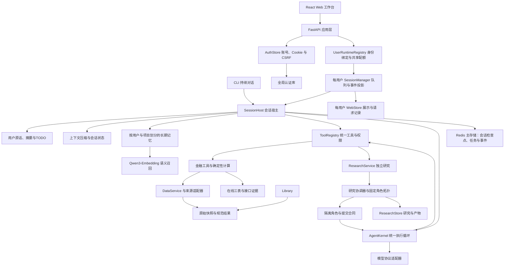
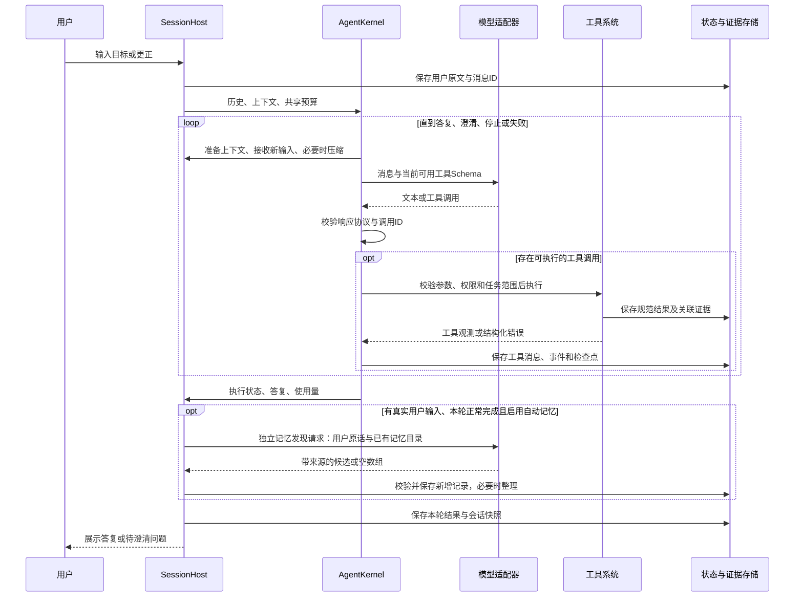
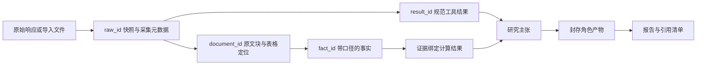
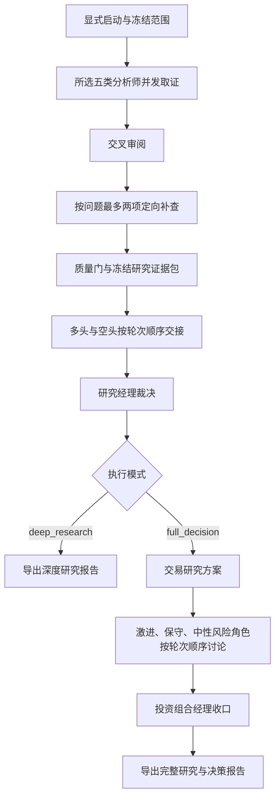

# FinSight 项目设计说明

2026-11-15 存储更新：当前源码的认证、Web 元数据、研究账本和向量缓存已改用 MySQL，Redis 与文件继续保留。正式迁移和服务切换已完成；初始化、旧库迁移和实测状态见 [MySQL 存储交付记录](../features/MYSQL_STORAGE.md)。下文历史 SQLite 路径按迁移前版本理解。

本文面向希望理解项目全貌、继续开发或介绍项目设计的读者。产品名为 **FinSight**，Python 包名为 `finagent`，当前包版本为 `3.1.0`。说明依据 2026-11-04 工作区中的代码和配置同步，覆盖持续会话 Agent、统一工具注册、金融证据工具、独立深度研究以及具备账号登录和独立用户数据目录的 Web 工作台。

文中的“已实现”指存在对应代码机制；测试、真实数据连通和研究质量分别说明。历史文档中的验收数字按其当时版本理解，不能直接作为当前版本的质量结论。

源码定位约定：下文文件路径均相对 `src/finagent/`，可点击文件名打开源码。介绍具体设计机制时标注“文件 → 函数/类方法”；介绍文件整体职责时只标注文件名。`create_app().events()` 等写法表示外层函数中定义的内部函数；工具名称与实际处理函数不同时，分别说明。

## 阅读导航

1. [项目定位与设计目标](#1-项目定位与设计目标)
2. [整体架构与技术选型](#2-整体架构与技术选型)
3. [核心概念及数据所有权](#3-核心概念及数据所有权)
4. [一次普通请求如何执行](#4-一次普通请求如何执行)
5. [任务理解与多轮变更](#5-任务理解与多轮变更)
6. [工具系统与权限](#6-工具系统与权限)
7. [金融数据与证据链](#7-金融数据与证据链)
8. [在线三表与财务计算](#8-在线三表与财务计算)
9. [上下文、持久状态与长期记忆](#9-上下文持久状态与长期记忆)
10. [Skills 与提示词](#10-skills-与提示词)
11. [独立深度研究与完整决策](#11-独立深度研究与完整决策)
12. [任务、委派与后台运行](#12-任务委派与后台运行)
13. [Web 工作台](#13-web-工作台)
14. [模型接入、配置与预算](#14-模型接入配置与预算)
15. [存储布局与运行恢复](#15-存储布局与运行恢复)
16. [测试与评估](#16-测试与评估)
17. [关键设计取舍与现有边界](#17-关键设计取舍与现有边界)
18. [源码阅读与扩展指南](#18-源码阅读与扩展指南)
19. [启动与观察设计行为](#19-启动与观察设计行为)

## 1. 项目定位与设计目标

FinSight 是面向沪深股票及已接入国内主要指数的金融研究助手。它将用户的自然语言目标转化为带约束的查询、取证、计算和分析过程，保留可追踪的执行记录，并支持围绕同一任务持续追问和更正。

主要使用场景包括：

- 查询证券行情、日线、公司资料和聚合财务报表。
- 结合新闻、政策、市场情绪和技术指标分析公司。
- 在线查询财务三表，核对接口字段并执行证据绑定的财务计算。
- 在多轮对话中比较公司、修改报告期、限定会计口径或排除某类分析。
- 明确启动独立深度研究，查看阶段进度、读取报告并继续追问。

项目的核心设计问题是：**如何让模型在可恢复、有预算和证据边界的环境中完成金融任务。** 因此，代码除了模型调用，还实现了会话宿主、任务合同、工具权限、原始证据、确定性计算、研究交接和失败恢复。

当前没有真实下单、券商账户接入或投资组合执行能力。`full_decision` 中的交易员与投资组合经理是研究角色，生成的是结构化研究意见。

## 2. 整体架构与技术选型

### 2.1 分层关系



这是一套共享 Python 核心、当前以单机单 Web 进程运行的应用：CLI 和 Web 是两个入口，普通对话和研究角色复用 `AgentKernel`。Web 可同时服务多个登录账号，由服务端为每个账号绑定独立数据根目录；不同账号共享应用级线程池和并发额度。图中的 ResearchService 是代码层服务抽象，当前并非另行部署的远程微服务。

**源码定位：** CLI 入口在 [cli.py](../../src/finagent/cli.py) → `main()`；Web 应用组装在 [web/app.py](../../src/finagent/web/app.py) → `create_app()`；会话组装在 [harness/host.py](../../src/finagent/harness/host.py) → `SessionHost.__init__()`；统一循环在 [harness/kernel.py](../../src/finagent/harness/kernel.py) → `AgentKernel.run()`。研究入口在 [harness/research.py](../../src/finagent/harness/research.py) → `ResearchService.start()`，研究角色经 [harness/compat.py](../../src/finagent/harness/compat.py) → `ResearchLoop.run()` 复用内核；`AgentLoop` 是其在 `agent.py` 中的兼容别名。

### 2.2 技术选择

| 部分 | 当前选择 | 在项目中的作用 |
| --- | --- | --- |
| 核心语言 | Python 3.11+ | Agent、数据处理、研究编排、CLI 和后端 |
| 合同校验 | Pydantic 2、JSON Schema | 工具参数、数据结果、研究提交的结构检查 |
| 网络请求 | HTTPX | 模型和金融来源请求、超时与代理 |
| 文本处理 | BeautifulSoup、可选 pdfplumber | HTML 清洗、资料解析、文本 PDF 读取 |
| 短期会话存储 | Redis、Lua、WATCH/MULTI | 会话检查点、任务原子更新、有序事件与通知确认 |
| 其他业务存储 | MySQL、SQLAlchemy Core、JSON、JSONL、原始文件 | 账号、Web 展示与研究账本、长期记忆及证据归档 |
| 登录认证 | Argon2id、随机令牌 Cookie、服务端 MySQL | 密码哈希、可撤销会话、邀请与审计 |
| 长期记忆检索 | BM25、Qwen3-Embedding-8B、RRF | 小规模私人记忆混合召回；MySQL 缓存向量 |
| Web 后端 | 可选 FastAPI、Uvicorn | HTTP 接口、SSE 和静态前端 |
| Web 前端 | React、TypeScript、Vite | 对话、研究、报告和设置页面 |
| 前端数据层 | React Query、React Router | 服务端状态查询、页面路由 |
| 验证 | unittest、Vitest、Playwright | Python 回归、前端单元检查和浏览器流程 |

主线通过 `models.py` 直接适配模型接口，执行循环和编排由项目自身实现。Harness 能力参考 learn-claude-code，来源及适配范围见 [HARNESS_PARITY.md](HARNESS_PARITY.md)。

## 3. 核心概念及数据所有权

理解项目时，应先分清几个容易混淆的对象：

| 概念 | 含义 | 主要归属 |
| --- | --- | --- |
| Web User | 不可变账号 ID；服务端认证后确定私有数据根目录 | [web/auth_store.py](../../src/finagent/web/auth_store.py)、[web/user_runtime.py](../../src/finagent/web/user_runtime.py) |
| Session | 持续对话，拥有历史、任务、约束、来源和关联研究 | [harness/host.py](../../src/finagent/harness/host.py)、[harness/state.py](../../src/finagent/harness/state.py) |
| 一次前台请求 | 从用户输入到回答、澄清、取消或失败的一段执行 | [harness/kernel.py](../../src/finagent/harness/kernel.py) |
| TODO与会话摘要 | 执行步骤、进展及已确认条件；最新用户原话优先 | `harness/host.py`、`harness/context.py` |
| 执行任务 | 要完成哪些工作、谁负责、有哪些前置依赖 | [harness/tasks.py](../../src/finagent/harness/tasks.py) |
| Observation | 工具规范结果，附状态、对象、时间、单位和证据 | `data/contracts.py` |
| 原始快照 | 请求返回内容或导入文件的原始字节与采集元数据 | [data/evidence.py](../../src/finagent/data/evidence.py) |
| 长期记忆 | 可跨会话复用的用户偏好、反馈、稳定项目背景或线索 | [harness/memory.py](../../src/finagent/harness/memory.py)、[harness/memory_search.py](../../src/finagent/harness/memory_search.py) |
| Research | 独立预算和冻结范围下的一次研究 | [research/store.py](../../src/finagent/research/store.py)、[research/decision_coordinator.py](../../src/finagent/research/decision_coordinator.py) |
| Artifact | 研究角色提交并封存的结构化产物 | `research/workflow.py` |
| Web Run | 网页一次异步提交及其展示状态 | [web/store.py](../../src/finagent/web/store.py) |

这些对象各自承担不同职责。例如，“比较两家公司现金流”属于语义任务；“分别取两家财报”可以拆成执行任务；研究员提交的观点属于研究产物；支撑观点的原始表格属于证据。不能用其中一种对象的状态代替另一种对象的状态。

## 4. 一次普通请求如何执行

### 4.1 入口和会话宿主

默认 CLI 主链路是：

```text
cli.py: main()
→ harness/terminal.py: run_terminal()
→ harness/host.py: SessionHost.submit()
→ harness/kernel.py: AgentKernel.run()
```

`SessionHost` 负责准备执行环境：加载或新建会话、恢复证据引用和显式截止时间、获取会话租约、注册工具、建立预算、读取待交付通知，并生成本轮模型上下文。有真实用户输入时，还会执行已开启的工具类别分类及当前用户/项目范围内的记忆召回；Web 在创建宿主之前先完成账号认证和数据目录绑定。

模型每次收到的不只是聊天文本，还包括当前任务视图、焦点对象、有效约束、失败尝试、证据失效标记、技能目录和运行范围。完整历史过长时，通过归档和回读控制上下文大小。

**源码定位：** [harness/host.py](../../src/finagent/harness/host.py) → `SessionHost.__init__()` 组装并恢复会话，`_restore_context()` 恢复执行上下文，`submit()` 建立或续接请求预算并接收通知，`model_messages()` 拼装模型输入；[harness/state.py](../../src/finagent/harness/state.py) → `RuntimeStore.lease()` 获取租约；[harness/context.py](../../src/finagent/harness/context.py) → `ContextManager.compact()`、`read_output()` 压缩与回读。

### 4.2 模型—工具—观测循环



`AgentKernel` 只处理通用执行秩序，不按“技术分析”“财务分析”等业务意图选择固定工作流。主模型在普通对话中决定先读技能、先取数据、请求澄清还是直接解释。

循环中有几项关键约束：

1. **先校验协议。** 工具调用 ID 必须存在、唯一，并与模型响应中的工具列表一致。定位：[harness/kernel.py](../../src/finagent/harness/kernel.py) → `AgentKernel.validate()`。
2. **每次尝试计入预算。** 模型重试与工具失败不会获得无限免费重试。定位：[harness/kernel.py](../../src/finagent/harness/kernel.py) → `Ledger.charge()`、`AgentKernel.run()`。
3. **工具调用必须配对。** 中断、截断或提前停止时，为尚未执行的调用补上明确的未执行结果，恢复时也修复孤立调用。定位：[harness/kernel.py](../../src/finagent/harness/kernel.py) → `AgentKernel.run()` 的入口修复和 `finally`；[harness/host.py](../../src/finagent/harness/host.py) → `SessionHost._close_orphans()`。
4. **失败进入观测。** 参数错误、范围冲突等返回结构化错误，模型可以在剩余额度内纠正。定位：[tools/registry.py](../../src/finagent/tools/registry.py) → `ToolRegistry.execute()`；聊天的任务范围与结果处理见 [harness/extensions.py](../../src/finagent/harness/extensions.py)。
5. **重复失败会止损。** 有限窗口内相同失败达到阈值时，以 `NO_PROGRESS` 停止。定位：[harness/kernel.py](../../src/finagent/harness/kernel.py) → `AgentKernel.run()`；失败签名由 [harness/host.py](../../src/finagent/harness/host.py) → `SessionHost.failure_signature()` 提供。
6. **截断不算完成。** 模型返回长度截断时走有界恢复，仍不能完成则记为失败。定位：[harness/kernel.py](../../src/finagent/harness/kernel.py) → `AgentKernel.run()`；[harness/host.py](../../src/finagent/harness/host.py) → `SessionHost.truncated()`。

### 4.3 什么叫“完成”

普通答复可以是自然语言，不要求用固定 JSON 包装。当前配置通过 `SessionHost.check_answer()` 调用 Qwen3.5-9B 审核完整草稿、用户约束与当前任务证据。后端从完整规范结果读取正文，保留来源、报告期、获取/披露时间和数据限制；模型判断支持、矛盾、证据不足和过度推断，后端校验审核协议与引文真实性。生产流程不再单独提取结构化主张或用逐字段规则作为最终判断。

审核返回修改问题时进入主循环，补查或改写后重新审核，默认最多修正两次。证据包不完整、审核失败或修正耗尽时不交付该草稿。`review_passed` 是模型对所提供证据支持关系的判断，不证明全文真实、来源独立可靠或没有漏检；旧规则和主张提取仅作为显式关闭 review 后的兼容路径。显式 Goal 的完成判断与证据审核分别计账。

因此，“本轮执行完成”“已经拿到资料”“结论得到证据支持”是三个需要分别判断的问题。

**源码定位：** [harness/host.py](../../src/finagent/harness/host.py) → `check_answer()`、`_review_answer()`；[answer_review.py](../../src/finagent/answer_review.py) → `build_evidence_packet()`、`QwenAnswerReviewer`；[harness/extensions.py](../../src/finagent/harness/extensions.py) 登记来源与任务；[harness/kernel.py](../../src/finagent/harness/kernel.py) 控制修改循环。配置与边界见[事实核验说明](../security/FACT_CHECKING.md)。

## 5. 任务理解与多轮变更

### 5.1 用户原话、摘要与 TODO

主模型依据最新用户原话、会话摘要和现有计划理解任务。多步骤任务通过 `todo_write` 记录执行步骤与进度，简单查询直接执行，不强制额外提交任务结构。

TODO写入会话状态，随Redis检查点保存；每次模型调用前通过`runtime_context.session.todos`提供最新清单。已有清单长时间未更新时，宿主按3次模型尝试的间隔提醒；提醒不保证实际进度或语义正确。

### 5.2 多轮继承与更正

用户只改年份时，主模型需要继承其余条件、更新需要重做的计划，并向领域工具传入新的明确报告期。原始消息和带来源的摘要用于接续；不能把TODO的完成标记当成数据已核验。

独立Task Frame已于2026-11-17移除。当前没有字段patch、任务版本冲突检查或Frame工具范围门禁。旧会话恢复会清理其遗留状态及派生约束，保留TODO、用户原话和证据。

### 5.3 领域校验与局限

证券仍由`resolve_entity`解析，关键歧义通过`ask_user`澄清。财务计算仍检查事实所属公司、可用时间、快照完整性和业务公式；存在显式执行口径时检查币种、合并范围及累计/单季口径。用户约束的完整理解和TODO维护仍依赖主模型，不能声称自动解决所有需求漂移。

源码：[host.py](../../src/finagent/harness/host.py)、[inherited.py](../../src/finagent/harness/inherited.py)、[financial_facts.py](../../src/finagent/data/financial_facts.py)。迁移与边界见[会话接续说明](../features/TASK_UNDERSTANDING.md)。

## 6. 工具系统与权限

### 6.1 统一工具定义与场景策略

v3.1 将聊天与研究统一为 `Tool / ToolRegistry`。金融工具、会话控制工具和 MCP 工具共享注册、Schema、权限与调用分派；聊天与研究分别配置执行策略。SessionHost 的 `registry`、旧属性 `pool` 和 `finance` 指向同一实例，不再创建金融工具包装对象或嵌套分派。

| 组件 | 责任 |
| --- | --- |
| `tools/registry.py` | 统一 Tool、Pydantic / JSON Schema 参数合同、输出校验、权限、角色视图和调用分派 |
| `harness/tools.py` | 权限与工作区文件 / Shell 能力；旧工具名称仅作为统一实现的兼容入口 |
| `harness/extensions.py` | 注册会话 / 任务 / 研究等工具，配置聊天任务范围与结果处理策略 |
| `harness/compat.py` | 研究运行适配，直接调用同一 ToolRegistry 并登记研究证据 |

金融工具的主会话调用路径是：

```text
模型工具调用
→ ToolRegistry 参数与权限检查
→ 领域澄清与参数校验
→ 直接执行领域 handler
→ Observation 校验
→ 保存 result_id 与证据引用
→ 返回工具观测
```

**源码定位：** [harness/extensions.py](../../src/finagent/harness/extensions.py) → `register_tools()` 中的 `prepare()`、`complete()` 分别处理领域澄清和结果登记；[tools/registry.py](../../src/finagent/tools/registry.py) → `Tool`、`ToolExecutionPolicy`、`ToolRegistry.execute()`；[data/evidence.py](../../src/finagent/data/evidence.py) → `EvidenceStore.save_result()`。新增工具与兼容方式见[统一工具说明](../features/UNIFIED_TOOLS.md)。

### 6.2 工具按能力分组

| 类别 | 代表工具 | 用途 |
| --- | --- | --- |
| 工具发现 | `search_tools`、`select_tool_groups` | 查找能力并披露允许范围内的工具 |
| 对象和取数 | `resolve_entity`、`get_quote`、`get_daily_bars`、`get_financial_statements` | 实体解析与金融数据 |
| 行业参考 | `get_sector_ranking` | 对供应商返回行业集合排序 |
| 财务与证据 | `get_financial_statements`、`read_evidence` | 在线三表、回读接口证据 |
| 计算 | `execute_program`、`calculate_closing_review`、`calculate_technical_divergence` | 财务、行情和日线背离计算 |
| 任务与上下文 | `todo_write`、`update_state`、`read_output` | 理解、进展与归档回读 |
| 方法 | `read_skill`、`read_skill_resource`、`load_skill` | 按需读取分析方法 |
| 研究 | `start_deep_research`、`research_status`、`read_research_report` | 启动、观察和采用独立报告 |
| 通用 Harness | 文件、Shell、子任务、团队、MCP、Workflow | CLI 环境中的扩展执行能力 |

工具是否实际可用，还取决于入口、角色视图和权限。不能从源码中存在某工具，推断 Web 用户或任意研究角色都能调用它。

当前仓库配置采用 `tool_loading="deferred"`。宿主在会话内保存稳定的工具目录，核心工具为 `search_tools`、`select_tool_groups`、`ask_user`，其余允许的工具带 `defer_loading=true`。模型通过发现工具获得结构化 `tool_reference`，API 在该对话位置展开定义；定义仍随请求提供给 API。没有发现工具的窄角色直接加载自己的允许工具，避免无法发现任何能力。

只有可信宿主发现结果能生成协议引用；普通工具输出中的同名字段不产生加载权限。分类结果在 deferred 模式中仅作发现建议，不能逐轮改写顶层工具目录；`eager` 则按类别筛选和补选实际 schema。历史引用可以保留旧定义，但执行仍检查当前注册表和角色权限，不能借历史引用恢复被移除的研究启动能力。加载协议与缓存限制见[工具渐进披露与前缀缓存](../features/TOOL_DISCOVERY.md)。

**源码定位：** 基础金融工具由 [tools/perception.py](../../src/finagent/tools/perception.py) → `build_registry()` 注册；材料和财务计算由 [tools/financial.py](../../src/finagent/tools/financial.py) → `register_financial_tools()` 注册；行情分析由 [tools/analysis.py](../../src/finagent/tools/analysis.py) → `register_analysis_tools()` 注册；[tools/registry.py](../../src/finagent/tools/registry.py) → `ToolRegistry.view()` 裁剪角色工具；[harness/host.py](../../src/finagent/harness/host.py) → `SessionHost.schemas()`、`execute()` 落实入口过滤。

**发现实现：** [harness/discovery.py](../../src/finagent/harness/discovery.py) → `definitions()` 保存会话工具目录，`search()` 排序允许的能力，`result_message()` 附加可信引用；[harness/host.py](../../src/finagent/harness/host.py) → `SessionHost.search_tools()`、`select_tool_groups()`、`tool_message()` 对接发现；[models.py](../../src/finagent/models.py) → `CompatibleChatModel._anthropic_complete()` 转换引用与延迟定义。

### 6.3 权限如何落实

运行时使用 `read`、`workspace`、`internal`、`ask` 等权限类别；需要审批的操作由前台处理，后台不能代替用户授权。文件路径解析后必须位于工作区，并排除宿主数据、虚拟环境及 `.env`、`.git` 等受保护位置。

通用 Shell 优先在无网络、隔离凭证的 Bubblewrap 沙箱中执行。内核不允许命名空间时，退化为小范围只读 argv 命令，任意 Shell 命令明确失败。文件工具的可访问范围与金融工具的证据授权是不同边界。

工具 Schema 禁止外部引用，避免借校验过程读取文件或访问远程地址。Skills、材料原文、摘要、记忆和队友消息都不能扩大工具权限。

**源码定位：** [harness/tools.py](../../src/finagent/harness/tools.py) → `Permissions.check()` 处理权限，`Permissions.path()` 限制文件路径，`WorkspaceTools.sandbox_args()` 构造沙箱，`WorkspaceTools.shell()` 执行及处理只读退化，`check_schema()`、`validate()` 拒绝外部 Schema 引用；终端授权由 [harness/terminal.py](../../src/finagent/harness/terminal.py) → `ApprovalBroker.ask()`、`answer()` 协调。

## 7. 金融数据与证据链

### 7.1 数据层结构

[data/service.py](../../src/finagent/data/service.py) 负责实体解析、来源选择、缓存、历史范围和输出口径；来源格式解析分别由 [data/providers/tencent.py](../../src/finagent/data/providers/tencent.py)、[sina.py](../../src/finagent/data/providers/sina.py)、[eastmoney.py](../../src/finagent/data/providers/eastmoney.py)、[sectors.py](../../src/finagent/data/providers/sectors.py) 承担；[data/http.py](../../src/finagent/data/http.py) 统一实施网络请求约束。

数据源请求只能访问登记的 HTTPS 主机，不接受模型提交的任意 URL。请求有超时、重试和来源预算，当前响应体上限为 4 MiB，且不自动跟随重定向。已读取的响应内容和采集元数据保留为原始快照。

**源码定位：** [data/http.py](../../src/finagent/data/http.py) → `SourceHTTP.__init__()` 配置客户端，`SourceHTTP.get()` 校验来源并限制响应、重试及保存原始内容；[runtime.py](../../src/finagent/runtime.py) → `ExecutionContext.source_request()`、`request_timeout()` 管来源计账和超时；[data/service.py](../../src/finagent/data/service.py) → `DataService._fetch()`、`_cached()` 管来源选择与缓存。

### 7.2 Observation 为什么带这么多元数据

| 字段 | 回答的问题 |
| --- | --- |
| `status` | 数据正常、部分可用、为空，还是发生错误？ |
| `symbol`、`market` | 这是哪个证券、哪个市场的数据？ |
| `source`、`source_url` | 数据来自哪里？ |
| `fetched_at` | 系统何时获取了响应？ |
| `data_time` | 响应描述的行情或报告时间是什么？ |
| `currency`、`units`、`price_basis` | 数值采用什么币种、单位和价格口径？ |
| `snapshot_id(s)`、`result_id` | 如何找回原始内容及本次规范结果？ |
| `cache_hit`、`stale`、`warnings` | 是否命中缓存、过期或存在解释限制？ |

工具返回内容即使结构合法，也可能只达到 `partial`。例如供应商未提供可靠最终收盘标志，或财务字段仍待原始披露核对，系统不能自行补成已确认。

**源码定位：** 字段定义位于 [data/contracts.py](../../src/finagent/data/contracts.py)，其中 `Observation.check_contract()` 检查错误、时间、快照及过期状态；[data/service.py](../../src/finagent/data/service.py) → `DataService.daily()`、`financials()` 保留对应数据缺口与状态。

### 7.3 证据引用路径



原始快照 ID 的哈希包含内容与元数据。同样的字节在不同采集时间获取，不会覆盖原有获取记录。规范结果使用独立 `result_id` 保存；会话再登记本次获准使用的 ID。磁盘上存在某份证据，不等于任意角色可以引用。

**源码定位：** [data/evidence.py](../../src/finagent/data/evidence.py) → `EvidenceStore.save_raw()`、`save_result()` 保存两类记录，`read()`、`load_result()` 回读；[tools/perception.py](../../src/finagent/tools/perception.py) → `build_registry()` 内部的 `read_evidence()` 检查当前任务授权；[research/runner.py](../../src/finagent/research/runner.py) → `AnalystRunner.context()` 根据宿主授予记录建立角色证据集合。

### 7.4 时间、缓存和数据缺口

需要区分三个时间：**报告期、信息可用时间、系统获取时间**。一份年报覆盖某年，不代表当年年底就已经公开；今天取回的公司资料，也不能自动用来回答历史截止问题。

数据层针对不同接口限制历史回填，新闻按可用时间过滤，财报缓存包含截止时间，防止历史任务复用更晚的信息。持续会话中，旧报价和行业结果也会按时效加入失效集合。

当前行业工具有一个典型边界：新浪行业汇总没有可靠行情时间，因此 `data_time=null`，不能把获取时间解释为实时行情时间。它能提供返回集合的排序参考，不能证明“今天哪个行业最强”，也不支持周/月累计排名。指数代理口径、个股资金流和行业汇总同样不能互相替代。见 [INDUSTRY_RANKING.md](../data/INDUSTRY_RANKING.md) 与 [INDEX_DATA.md](../data/INDEX_DATA.md)。

**源码定位：** [data/service.py](../../src/finagent/data/service.py) → `DataService.quote()`、`profile()` 限制历史快照使用，`news()` 按可用时间过滤，`financials()` 将截止时间加入缓存键，`sector_ranking()` 处理行业快照；[data/providers/sectors.py](../../src/finagent/data/providers/sectors.py) → `industry_snapshot()` 解析行业数据并保留时间缺口；[harness/host.py](../../src/finagent/harness/host.py) → `SessionHost.prepare()` 标记过期报价和行业结果。

## 8. 在线三表与财务计算

本地财报资料库的导入、检索、原文读取和 Web 上传已移除。基本面分析直接使用 `get_financial_statements` 查询新浪聚合利润表、资产负债表和现金流量表。供应商接口响应保存为原始快照，结构化字段与计算记录可按证据 ID 回查；这不等同于获取完整官方财报。

### 8.1 在线字段与操作数

返回结果包括报告期、披露时间、币种、累计/时点口径、字段定位及 `fact_id`。字段 ID 绑定接口快照、报表类型、期间和指标；不接受模型自填的金额。本次任务未查询、已失效或过期的结果不能进入计算。供应商未核实的合并范围使用 `provider_reported`，不能自动声称合并或母公司口径；明确要求不支持的口径时保留缺口。

### 8.2 受限程序计算

`generate_program` 校验操作数并返回草稿，`execute_program` 执行 Decimal 四则运算。执行前从接口快照重新解析并核对字段、内容摘要、证券、报表类型、期间和任务授权；常数只允许 `0/1/100`。同比要求相邻年度同窗口同指标，普通增速要求正的上期基数；利润率要求同期间利润和营业收入；负债率要求同日资产负债，利润率变化以百分点表达。

### 8.3 完整性和边界

基本面覆盖检查使用在线三表核心字段、可比期间及已执行计算，不再要求本地原文事实。三表缺少的正文、附注、业务原因和未映射指标不能凭推测补齐。政策资料导入和长期记忆检索是独立功能，保持原范围。

源码：[financial_facts.py](../../src/finagent/data/financial_facts.py) → `attach_facts()`、`StatementFacts.fact()`；[financial.py](../../src/finagent/tools/financial.py) → `execute()`；[review.py](../../src/finagent/research/review.py) → `coverage()`。

## 9. 上下文、持久状态与长期记忆

### 9.1 三种信息各自承担什么职责

| 类型 | 保存内容 | 使用方式 |
| --- | --- | --- |
| 模型上下文 | 当前历史、工具结果、摘要和运行视图 | 供这一轮推理，受长度约束 |
| 持久会话状态 | 原始用户更新、任务版本、证据索引、失败和开放问题 | 支持跨轮和进程重启后恢复 |
| 长期记忆 | 可跨会话复用的稳定偏好、反馈和背景 | 先筛选相关记录，再注入当前上下文 |

会话恢复不只依赖模型生成的摘要。用户原文在任何裁剪之前写入来源记录，工具全文和历史也有归档路径。

**源码定位：** [harness/host.py](../../src/finagent/harness/host.py) → `SessionHost._register_user()` 保存用户原文和来源，`checkpoint()` 保存会话快照；[harness/state.py](../../src/finagent/harness/state.py) → `RuntimeStore.save()`、`load()` 持久化及恢复；[harness/context.py](../../src/finagent/harness/context.py) → `ContextManager.offload()` 保存可回读全文。

### 9.2 分级压缩

`ContextManager` 依次处理过大的工具输出、工具结果总量和历史，并定期生成结构化会话摘要：

1. 大结果落盘，留下预览与全文路径。
2. 较旧的大工具结果缩减成可恢复引用。
3. 默认保留最近 3 个用户轮次（包含当前正在处理的一轮）；更早的已完成轮次累计到 8 轮时，调用模型合并旧摘要和这些历史，生成新摘要。宿主通知、运行状态快照和工具调用不计为用户轮次。
4. 消息数超过 50、达到字符预算或手动压缩时也尝试结构化摘要，按压力保留最近消息组。切分保持工具调用与结果完整配对。

摘要固定包含 `user_needs`（用户需求）、`confirmed_parameters`（已确认参数与约束）、`completed`（已完成事项）、`current_progress`（当前进展）、`pending`（待办、失败和未确认问题）。各项附有来源 ID；宿主校验 JSON 合同和来源是否存在，保存来源到原文归档的消息位置。校验不能证明摘要语义或金融结论正确。下一次压缩输入包含上一版摘要，要求保留仍有效的信息和用户更正。

被压缩的消息在模型工作上下文中替换为摘要和归档引用，不重复附带原文预览；已摘要的普通用户原文也不再经运行状态快照重复注入。持久状态中的用户原文、transcript 和归档仍保留，明确的有效约束仍随当前任务提供。需要细节时用 `read_output` 分页回读。摘要作为不可信历史数据提供，不能授予工具权限或作为新鲜证据。

定期摘要失败或没有缩短上下文时，保留原消息，同一待压缩片段在当前宿主中不反复尝试；如果已有长度压力或用户强制压缩，则降级为可回读的归档引用，并明确摘要不可用。摘要调用计入当前请求的模型与时间预算，使用现有主模型及安全包装。默认参数可在 `[limits]` 中设置：`context_summary_turns = 8`（设为 0 关闭定期触发），`context_keep_turns = 3`。当前触发仍依据轮次、消息数和字符预算，不是精确 tokenizer 预算；真实长对话的摘要保真度和 token 收益需另行评估。

**源码定位：** [harness/context.py](../../src/finagent/harness/context.py) → `ContextManager.compact()` 包含上述分级处理，`groups()` 维护消息分组，`offload()` 落盘全文，`read_output()` 限制归档回读范围；[harness/host.py](../../src/finagent/harness/host.py) → `SessionHost.prepare()` 在每轮执行前触发自动压缩。

### 9.3 长期记忆

`MemoryStore` 将 `user`、`feedback`、`project`、`reference` 四类记录保存为独立 JSON，包含描述、正文、真实用户消息来源、时间、用户/项目范围及常驻标记。`MEMORY.md` 是目录索引，实际检索读取 JSON。用户偏好/反馈默认在同一用户的项目间共享，也可限定项目；项目与参考资料始终限定当前项目。用户和项目范围在调用 Embedding 或重排模型之前过滤。

**召回流程：** 少量稳定偏好常驻，其余记录分别执行中文重叠双字片段/英文标识的 BM25 和向量余弦检索，再以 RRF 融合。当前配置如下，字符预算按完整记录计算，并非 token 预算：

| 项目 | 当前值或行为 |
| --- | --- |
| 常驻偏好 | 最新优先，最多 4 条、1600 字符，不依赖查询相似度 |
| Embedding | Ollama `qwen3-embedding:8b`，本机默认端口 11434；返回 4096 维 |
| 查询格式 | Qwen 任务指令加用户查询；记忆文档使用描述与正文 |
| 语义阈值 | 0.35，是开发样例校准值，不是相关性概率 |
| 融合候选 | 最多 20 条 |
| 自动重排 | 项目配置 always，对非空候选调用 Qwen3-Reranker-8B 独立评分服务；auto 仅在候选竞争时调用 |
| 相关记忆 | 最多 5 条、8000 字符；加常驻后最多 9 条、9600 字符 |
| 故障回退 | Embedding 超时或异常时使用关键词检索与常驻偏好；重排异常保留融合排名 |

MySQL `memory_vectors` 表按 namespace、记忆用户、记忆 ID、内容摘要及模型/服务/格式指纹缓存向量，正文或配置变化后按需重算。它没有 ANN 索引，当前仍扫描范围内的记录并在 Python 中逐条计算相似度，适用于每用户少量记忆。

**每轮发现：** 启用 `memory_enabled` 和 `auto_memory` 后，每个有真实用户输入且正常完成的主会话回合都通过独立请求复用主模型，不要求“记住”等触发词。输入为最近 4 条真实用户消息（每条最多 3500 字符），及当前范围内最多 40 条已有记忆目录（合计最多 6000 字符）。没有值得新增的信息时返回 `[]`；候选必须引用真实消息，临时任务限制、动态行情和凭证仍有规则过滤。只有新增记录才触发同主题整理，完全重复或已遗忘记录不算新增。

失败、取消、等待澄清、无新用户输入的后台续跑和子 Agent 不执行自动发现。发现同步运行，通常增加一次模型请求及等待时间，沿用本轮共享预算；异常记录为 `memory_extraction_failed`，不覆盖已完成的答复。`memory_discovered` 仅记录新增 ID；`memory_recalled` 记录召回 ID、渠道数量和降级状态。当前没有独立的 9B 记忆提取服务；工具意图分类的 Qwen 9B 和用于召回的 Embedding 是另外两条路径。

**删除与隔离：** 删除移除 JSON 和缓存向量，同时记录内容与来源的遗忘标记。召回完成及发送模型前重新检查记录，发送视图清空旧上下文快照的记忆字段，避免旧快照再次作为记忆注入；历史对话原话、摘要与审计仍是独立数据，删除长期记忆不会清除全部历史。

记忆是带来源的背景，不能作为新的授权或最新市场证据。**CLI 和登录后的 Web 均按配置支持长期记忆和自动提取。** Web 由认证账号绑定独立数据根目录，不能由浏览器或模型指定其他用户。当前有查看/删除 API 和 CLI 命令，尚无独立的网页记忆管理面板。配置、存储和验证边界见 [长期记忆与召回](../features/MEMORY.md)和[登录指南](../guides/LOGIN.md)。

**源码定位：** [harness/memory.py](../../src/finagent/harness/memory.py) → `MemoryStore.select()` 常驻及混合召回，`extract()` 提取并检查来源，`write()` 检查持久范围和敏感内容，`consolidate()` 整理，`forget()` 写遗忘标记并删除记录；[harness/memory_search.py](../../src/finagent/harness/memory_search.py) → BM25、向量缓存与 RRF；[harness/host.py](../../src/finagent/harness/host.py) → `SessionHost.submit()` 判断自动提取触发条件，`model_messages()` 注入选中记忆。

## 10. Skills 与提示词

### 10.1 渐进加载分析方法

普通会话可发现九个 Skills：

| Skill | 方法范围 |
| --- | --- |
| `technical-analysis` | 技术结构与指标分析 |
| `technical-divergence` | 日线 MACD/RSI 背离及条件限制 |
| `fundamentals-analysis` | 基本面与财务质量 |
| `financial-growth` | 可比财务增长 |
| `financial-margin` | 利润率及百分点变化 |
| `market-sentiment` | 市场情绪 |
| `news-events` | 新闻和事件查证 |
| `policy-impact` | 政策影响 |
| `deep-research` | 独立研究入口和报告交互 |

启动时只提供技能元数据，适用时读取 `SKILL.md` 正文，必要时再分页读取参考文件。方法文本不能充当金融事实或授予工具权限。

**源码定位：** [skill_library.py](../../src/finagent/skill_library.py) → `SkillLibrary.__init__()`、`catalog_message()` 发现和提供元数据，`read()` 读取正文，`read_resource()` 校验并分页读取资源；[tools/skills.py](../../src/finagent/tools/skills.py) → `register_skill_tools()` 注册读取工具；[harness/extensions.py](../../src/finagent/harness/extensions.py) → `load_skill()` 实现 Harness 加载入口。普通技能清单位于 [analysts/methods.py](../../src/finagent/analysts/methods.py)。

### 10.2 通用方法与固定角色分离

研究角色的固定职责、工具白名单、提交合同和范围由代码规定。多头、空头、研究经理、风险角色等十一份内部方法位于 `research/prompts/`，执行时只加载当前角色的方法。

这种分离使普通分析可以自由选择方法，独立研究则维持明确分工和交接。研究分析师只看与自身职责相关的技能，不获得研究启动入口，避免递归发起研究。

主会话系统提示词位于 `prompts/assistant.md`；修改旧提示词或某个角色方法不一定影响全部入口。扩展时应先确认实际加载路径。详见 [SKILLS.md](../features/SKILLS.md)。

**源码定位：** [harness/host.py](../../src/finagent/harness/host.py) → `SessionHost.model_messages()` 读取主会话提示词；[research/role_prompts.py](../../src/finagent/research/role_prompts.py) → `role_method()` 按固定映射读取角色方法；[analysts/decision.py](../../src/finagent/analysts/decision.py) → `prompt()` 组装决策角色提示词；[research/runner.py](../../src/finagent/research/runner.py) → `AnalystRunner.run()` 根据角色裁剪工具并注册对应通用技能。

## 11. 独立深度研究与完整决策

### 11.1 启动与上下文交接

独立研究通过显式 CLI/终端命令，或模型调用 `start_deep_research` 发起。自然语言启动要引用真实用户消息和请求原文；宿主检查启动意图、模式及当前任务范围。加载技能、咨询功能或普通“深入看看”本身不会授予启动资格。

启动时冻结公司、截止时间、选定分析维度、任务快照和有效约束，并保存 `conversation_handoff.json`。同一用户来源、公司和模式的重复启动会复用既有工作，避免重试误开第二份预算。

研究使用独立预算在后台运行，可以继续普通对话；之后修改主会话任务，不会修改已冻结研究。后台工作 ID 与研究 ID 是两个标识，接口负责关联它们。

**源码定位：** [harness/research.py](../../src/finagent/harness/research.py) → `explicit_request()` 核对启动原话，`launch_research()` 检查任务、去重、复制冻结范围并建立后台工作，其内部 `run().created()` 保存交接文件和研究 ID；[research/selection.py](../../src/finagent/research/selection.py) → `select()` 登记宿主选择，`consume()` 验证范围、有效期及单次使用；[harness/background.py](../../src/finagent/harness/background.py) → `Background.launch()` 启动后台执行。

### 11.2 当前两种研究拓扑



五类分析师是技术、情绪、新闻、基本面和政策，可以选择其中部分维度；当前首波并发上限为三。多空及风险角色存在前后依赖，按设计顺序交接，并非全部并行。

`deep_research` 在研究经理阶段结束；`full_decision` 继续交易方案、风险讨论和投资组合经理阶段。质量门可能阻止下游或降低可交付内容，图示不代表每次运行都会成功执行全部节点。

当前显式模式通过 `SelectedRequest` / `SelectedScope` 进入决策协调器。仓库还保留早期 `ResearchRequest → review → synthesis` 及旧记录兼容路径；阅读旧 `coordinator.py` 时，需要结合 `selection.py`、`decision_coordinator.py` 和 `workflow.py` 理解当前入口。

**源码定位：** [research/workflow.py](../../src/finagent/research/workflow.py) → `plan()` 声明角色节点和依赖，`validate_config()` 检查轮数与预算兼容；[research/decision_coordinator.py](../../src/finagent/research/decision_coordinator.py) → `DecisionCoordinator._execute()` 执行首波并发、审阅、定向补查、质量门及顺序讨论；[research/quality.py](../../src/finagent/research/quality.py) → `research_bundle()` 汇总证据包和质量门；[research/coordinator.py](../../src/finagent/research/coordinator.py) → `ResearchCoordinator.run()` 分派请求，`_execute()` 保留旧综合流程。

### 11.3 角色提交与引用闭合

研究角色通过 `submit_analysis` 提交结构化主张或角色意见，而不是把一段自由文本直接视为合格交接。宿主检查范围、引用、计算及最低证据覆盖；结构合法但覆盖不足的产物会降为 `partial`。

每份封存产物包含 `scope_hash`、产物 ID、产物哈希、角色、尝试次数、输入产物引用和提示词版本。下游引用对应到具体产物及条目；恢复时会检查哈希和范围，依赖变化会使相关下游产物失效。

同一研究内的 `DataBroker` 通过范围和参数组成缓存键，对适用只读取数使用 single-flight：多个角色请求同一数据时共享进行中的请求，返回深拷贝，并在各自上下文登记证据。

**源码定位：** [research/runner.py](../../src/finagent/research/runner.py) → `AnalystRunner.run()` 内部的 `submit()` 检查分析师交接，`DataBroker.wrap()` 实施 single-flight；[research/review.py](../../src/finagent/research/review.py) → `validate_claims()`、`coverage()` 检查主张与覆盖；[research/decision_runner.py](../../src/finagent/research/decision_runner.py) → `DecisionRunner.run()` 内部的 `submit()` 接收决策角色提交；[research/workflow.py](../../src/finagent/research/workflow.py) → `seal()` 封存，`verify_seal()` 验证，`resolve()`、`validate_output()` 检查交接引用；[research/decision_coordinator.py](../../src/finagent/research/decision_coordinator.py) → `DecisionCoordinator._execute()` 内部的 `execute()` 使依赖变化的产物失效。

### 11.4 独立预算和恢复

研究预算分别限制总调用、角色调用、工具、来源、耗时和尝试数，并为下游及最终收口预留资源。显式 `deep_research` 根据所选维度和轮数计算预算，不能简单等同于 `[research]` 段的数值。

恢复沿用原研究范围、有效产物和剩余预算，检查用户启动记录、实现指纹和证据完整性。它不重置为一份全新的研究额度，也不会把重启前的线程视为仍在执行。

报告分别保存执行状态、内容完整度、审阅状态与 `outcome_verified`。研究“完成”允许伴随部分资料或未核验结果；主张和引用结构通过检查，不代表每句自然语言支持关系已被证明。报告追问读取原对象及历史范围，新增最新信息应另行明确任务。

详见 [DEEP_RESEARCH_CHAT.md](../features/DEEP_RESEARCH_CHAT.md)。

**源码定位：** [research/budget.py](../../src/finagent/research/budget.py) → `ResearchBudget.reserve()`、`settle()`、`remaining()` 管持久预算和预留；[research/selection.py](../../src/finagent/research/selection.py) → `config_for()` 计算模式预算，`authorize_resume()`、`resume_selected()` 校验用户恢复授权；[research/decision_coordinator.py](../../src/finagent/research/decision_coordinator.py) → `DecisionCoordinator.resume()`、`_execute()` 检查并复用研究；[research/store.py](../../src/finagent/research/store.py) → `ResearchStore.acquire()` 检查执行所有权和指纹；[research/decision_reporting.py](../../src/finagent/research/decision_reporting.py) → `export_decision()` 分别导出内容及审阅状态；[harness/research.py](../../src/finagent/harness/research.py) → `ResearchService.read()`、`read_report()` 检查报告读取范围。

## 12. 任务、委派与后台运行

Harness 提供几种不同粒度的工作组织能力：

| 机制 | 解决的问题 | 主要实现 |
| --- | --- | --- |
| Todo | 展示当前计划与进展 | [harness/extensions.py](../../src/finagent/harness/extensions.py) → `todo()` |
| 执行任务板 | 依赖、认领、完成与工作区绑定 | [harness/tasks.py](../../src/finagent/harness/tasks.py) → `TaskBoard.create()`、`dependencies()`、`claim()`、`finish()`、`verify_cwd()` |
| 隔离子 Agent | 将有边界的子问题放入独立上下文 | [harness/host.py](../../src/finagent/harness/host.py) → `SessionHost.child()` |
| 团队 | 队友状态、消息、计划审批与关闭 | [harness/background.py](../../src/finagent/harness/background.py) → `Teams.spawn()`、`send()`、`submit_plan()`、`review()`、`drain()` |
| Worktree | 绑定任务的独立 Git 工作目录 | [harness/tasks.py](../../src/finagent/harness/tasks.py) → `TaskBoard.create_worktree()`、`verify_cwd()` |
| 后台和 Cron | 长工作、定时触发及归属会话通知 | [harness/background.py](../../src/finagent/harness/background.py) → `Background.launch()`、`recover()`；`Scheduler.schedule()`、`tick()`、`ack()` |
| MCP | 连接宿主已登记的 stdio 工具服务器 | [harness/mcp.py](../../src/finagent/harness/mcp.py) → `MCPManager.connect()`、`StdioMCP.request()`、`call()` |
| Workflow | 执行可信注册步骤、保存 journal 和恢复 | [harness/workflows.py](../../src/finagent/harness/workflows.py) → `WorkflowRuntime.register()`、`run()`、`WorkflowContext.phase()` |
| Goal | 显式目标的完成检查与有界续跑 | [harness/goals.py](../../src/finagent/harness/goals.py) → `GoalController.set()`、`evaluate()`；[harness/kernel.py](../../src/finagent/harness/kernel.py) → `AgentKernel.run()` |

普通子 Agent、队友和固定研究角色都能复用 Kernel，但上下文和工具视图不同。普通委派共享父请求的 Ledger，不能通过新增子任务绕过额度；独立研究则在用户明确启动后建立独立预算。

**源码定位：** [harness/host.py](../../src/finagent/harness/host.py) → `SessionHost.child()` 将传入的 Ledger 继续传给子会话 `submit()`；[harness/extensions.py](../../src/finagent/harness/extensions.py) → `child_task()` 裁剪普通子任务工具；[harness/background.py](../../src/finagent/harness/background.py) → `Teams.spawn()` 交接团队工作；[research/decision_coordinator.py](../../src/finagent/research/decision_coordinator.py) → `DecisionCoordinator._execute()` 建立独立研究预算。

Cron 和后台工作有持久记录、恢复和通知机制，但没有独立常驻调度服务或分布式任务集群。Worktree 依赖可用 Git 仓库，任意机器上有源码目录并不保证此能力可运行。当前 Web 不向模型开放这些通用执行入口。

## 13. Web 工作台

### 13.1 页面与后端分工

Web 由独立 React 前端和可选 FastAPI 后端组成，后端复用 SessionHost 和研究服务。模型密钥只在后端读取。

| 页面 | 主要职责 |
| --- | --- |
| `/login` | 用户名或邮箱登录、记住我、返回原页面 |
| `/register` | 单次邀请码注册；可由部署配置关闭 |
| `/forgot-password` | 说明部署者重置密码流程，当前不发送找回邮件 |
| `/privacy`、`/terms` | 当前数据处理与使用边界说明 |
| `/` | 工作台与问题入口 |
| `/chat/:sessionId` | 持续对话、工具进度与研究关联 |
| `/research` | 研究列表、启动、取消与恢复 |
| `/research/:researchId` | 报告正文、目录、证据抽屉、导出和追问 |
| `/settings` | 脱敏的运行状态与只读设置说明 |

[web/auth.py](../../src/finagent/web/auth.py) 与 [web/auth_store.py](../../src/finagent/web/auth_store.py) 管身份协议及服务端会话；[web/user_runtime.py](../../src/finagent/web/user_runtime.py) 绑定登录用户的数据根目录和运行上下文；[web/session_manager.py](../../src/finagent/web/session_manager.py) 管执行线程、会话串行和进度投影；[web/store.py](../../src/finagent/web/store.py) 管 Web 会话归属、幂等提交和展示事件；[web/reports.py](../../src/finagent/web/reports.py) 负责报告展示适配。

**源码定位：** [web/session_manager.py](../../src/finagent/web/session_manager.py) → `SessionManager.submit()` 接收执行请求，`execute()` 串行执行同会话工作，`observe()` 观察内核运行事件；[web/reports.py](../../src/finagent/web/reports.py) → `ReportAdapter.load()` 从已有产物确定性地提取报告和核心发现，不另调用模型摘要。前端路由位于 [main.tsx](../../web/src/main.tsx)，认证状态与路由门禁位于 [app/auth.tsx](../../web/src/app/auth.tsx)，登录与注册页面位于 [features/auth/Login.tsx](../../web/src/features/auth/Login.tsx)。

### 13.2 提交、幂等和事件

消息、研究及报告追问提交需要 `Idempotency-Key`。同一会话同一键重试返回原记录；同键换内容返回冲突。HTTP 202 仅表示已接收，并返回可查询的运行 ID。

服务端通过 SSE 提供工具开始/结束、研究进度、答复完成和失败等事件。事件有持久递增游标，支持断线续接；源事件投影和游标在 Web 数据库同一事务写入，避免重复扫描造成重复事件。

业务提交先完成 Cookie 认证、来源与 CSRF 校验，再交给该账号的 Store/Manager。前端为每个身份建立独立 QueryClient，身份变化时销毁旧查询缓存、请求、幂等键和 SSE；事件游标按用户命名。`X-FinSight-User` 及 SSE 的 `expected_user_id` 仅检查预期身份与 Cookie 是否一致，不能授予身份。广播与窗口重新聚焦触发状态核对；SSE 在投递期间继续检查会话撤销，心跳不延长登录空闲期。

模型适配器当前使用 `stream=False`。因此浏览器看到的是**真实工具与阶段事件**，最终答复完成后显示；没有模型 token 流，也不伪造完成百分比。前端另有轮询兜底。

**源码定位：** [web/app.py](../../src/finagent/web/app.py) → `create_app()` 内部的 `key()`、`submit_message()`、`create_research()`、`question()` 校验幂等键并返回异步提交；[web/store.py](../../src/finagent/web/store.py) → `WebStore.create_run()` 检查键和请求摘要，`project()` 在同一事务内写事件及源游标，`events()` 分页读取；[web/session_manager.py](../../src/finagent/web/session_manager.py) → `SessionManager.transform()`、`observe()` 生成脱敏展示事件；SSE 由 [web/app.py](../../src/finagent/web/app.py) → `create_app().events()` 及内部 `stream()` 提供；模型非流式请求见 [models.py](../../src/finagent/models.py) → `CompatibleChatModel.complete()`、`_anthropic_complete()`。

### 13.3 入口限制和并发

| 约束 | 当前实现 |
| --- | --- |
| 部署范围 | 单进程、账号登录与独立用户目录；默认回环地址，服务器模式需显式配置 HTTPS 同源与 Host/Origin |
| 身份与租户 | 服务端 Cookie 账号认证、每用户独立目录；组织租户共享尚未实现 |
| 执行线程 | 应用共享，默认四个，可配置 |
| 未完成提交 | 全局默认三十二个，每用户默认八个 |
| 后台研究 | 全局默认三份，每用户默认一份 |
| 常驻会话实例 | 每用户最多三十二个，用户运行上下文默认上限六十四个，空闲可回收 |
| 单会话执行 | 串行，跨进程会话租约防止冲突 |
| Web 进程 | 进程租约拒绝第二个 Web worker |
| 模型工具 | 金融、上下文、任务表示和报告能力白名单 |
| 主动关闭 | MCP；长期记忆与自动记忆遵循配置 |

Web 不自动公开 CLI 历史会话与研究；报告访问校验 Web 归属，追问轮次禁用独立研究启动工具。财报资料上传、导入和检索入口已移除，财务分析使用在线三表及其接口证据。

浏览器关闭和主动退出登录不会取消后台研究；禁用账号后由维护线程取消其执行。用户运行上下文空闲默认 30 分钟且没有未完成工作时可回收，应用同时最多保留 64 个用户上下文。服务启动扫描已持久化用户，即使用户没有再次登录，也会标记旧队列和失效后台线程；未知结果的操作不自动重放。完整说明见 [WEB_APP.md](../guides/WEB_APP.md)和[登录指南](../guides/LOGIN.md)。

**源码定位：**

- 本机边界：[web/__main__.py](../../src/finagent/web/__main__.py) → `main()` 绑定回环地址；[web/app.py](../../src/finagent/web/app.py) → `create_app().local_boundary()` 检查客户端、Host 和 Origin，`create_app().lifespan()` 获取 Web 进程租约。
- 登录与目录：[web/auth.py](../../src/finagent/web/auth.py)、[web/auth_store.py](../../src/finagent/web/auth_store.py) 提供 Cookie/CSRF 与会话撤销；[web/user_runtime.py](../../src/finagent/web/user_runtime.py) → `UserRuntimeRegistry` 绑定账号目录、管理共享执行器、全局/每用户配额和空闲回收。
- 并发与工具限制：[web/session_manager.py](../../src/finagent/web/session_manager.py) → `SessionManager.__init__()` 接收共享线程池并关闭 MCP，记忆遵循配置；`host()` 限制常驻会话和工具视图，`launch_bounded()` 限制研究并发，`session_lock()`、`execute()` 实施同会话串行；[web/store.py](../../src/finagent/web/store.py) → `WebStore.create_run()` 限制待处理提交。
- 会话与报告归属：[web/store.py](../../src/finagent/web/store.py) → `WebStore.session()`；[web/session_manager.py](../../src/finagent/web/session_manager.py) → `SessionManager.report_owner()`、`execute()`，其中 `execute()` 在报告追问期间移除研究启动工具。
- 中断及恢复：[web/store.py](../../src/finagent/web/store.py) → `WebStore.recover()` 标记未知运行；[web/session_manager.py](../../src/finagent/web/session_manager.py) → `SessionManager.start()` 标记失效后台工作，`close()` 处理进程退出；研究恢复接口在 [web/app.py](../../src/finagent/web/app.py) → `create_app().resume_research()`。

### 13.4 登录、会话与账号管理

私有 API 在本机和服务器模式中均要求登录。登录支持用户名或邮箱，密码使用 Argon2id 哈希；随机会话令牌只通过 HttpOnly、SameSite Cookie 交给浏览器，认证库保存令牌哈希和可撤销状态。普通登录空闲 2 小时、绝对 12 小时；记住我空闲 7 天、绝对 30 天。注册使用有有效期、可绑定邮箱的单次邀请，并在事务中消费；登录按账号和 IP 限流，保留认证审计。

`/api/v1/auth/csrf` 建立预认证上下文，登录后轮换令牌；写请求校验 CSRF 及 Origin/Referer。默认 `auth.mode="local"` 仅允许回环客户端和 Host；服务器模式要求显式 HTTPS Origin 与 Host，同源部署，Cookie 改为 Secure 的 `__Host-finsight_session`。应用不信任任意转发头来改变身份或源，公开 OpenAPI 与文档端点关闭；目标服务器 HTTPS 部署仍需独立验收。

部署者通过 `finagent auth` 创建账号、发邀请、重置密码及启用/禁用账号。重置和状态变更撤销已有会话。普通 Web 账号没有跨用户管理接口，当前也没有管理员角色/RBAC、组织成员共享、SSO、MFA 或邮件找回。不存在源码内置的固定账号，部署时创建的账号不属于产品默认配置，凭证不应写入设计文档。

旧共享数据必须由部署者显式指定接收账号，在维护停写条件下运行 `migrate-legacy --owner ...`；默认仅预览，`--apply` 才备份和迁移。工具拒绝非空目标，检查进程租约与运行任务，对保留的业务 SQLite 使用 backup 包含已提交 WAL，并额外备份/迁移 Redis 运行快照，修复结构化路径与记忆归属；不会把旧数据自动交给首个登录用户。迁移后的旧归档路径仅映射到该账号当前会话副本，不读取旧共享根目录。

**源码定位：** [web/auth_store.py](../../src/finagent/web/auth_store.py) → `password_tools()`、`password_hash()`、`AuthStore.authenticate()`、`new_session()`、`resolve()`、`check_csrf()`、`update_user()`；[web/auth.py](../../src/finagent/web/auth.py) → `csrf()`、`login()`、`logout()`、`register()`；[web/user_runtime.py](../../src/finagent/web/user_runtime.py) → `user_settings()`、`UserRuntimeRegistry.for_user()`、`clean()`；[web/auth_cli.py](../../src/finagent/web/auth_cli.py) → `main()`；[web/migration.py](../../src/finagent/web/migration.py) → `migrate_legacy()`、`copy_consistent()`、`rewrite_metadata()`；[harness/context.py](../../src/finagent/harness/context.py) → `ContextManager.read_output()`。完整约束见[登录系统方案](../security/LOGIN_SYSTEM_DESIGN.md)。

## 14. 模型接入、配置与预算

### 14.1 模型适配

`models.py` 将 Chat Completions 和 Anthropic Messages 转为统一 `ModelReply`，包含消息、工具调用、结束原因和使用量。`LazyChatModel` 延迟建立真实客户端，帮助和部分本地诊断不需要先成功连接模型。

普通主线使用配置的主模型；摘要、记忆等辅助操作默认通过同一套模型工厂并单独记录用途。独立研究还支持角色模型配置。接口兼容不代表任意模型都具备可靠工具使用能力，需要分别验证。

当前仓库将 `tool_loading` 设为 `deferred`、`prompt_caching` 设为 `true`；配置类的通用默认值仍为 `eager`、`false`。原生延迟工具需要 Anthropic Messages 兼容端点实现 `defer_loading` 和 `tool_reference`，缓存设置还要求接受顶层 `cache_control`。Chat Completions 配置使用 deferred 会在发请求前报错；普通网关应显式使用 eager 并按能力关闭缓存设置，不能把普通工具调用兼容性当成原生发现兼容性。

宿主尽量保持系统指令、会话工具目录及已有消息前缀稳定：运行状态变化时追加快照，不因纯记账字段变化反复追加。历史压缩、工具合同/配置变化，以及发送视图清理旧快照中的记忆字段，都可能改变请求前缀；缓存是否命中以供应商用量为准。适配器和辅助调用账本保留 `cache_read_input_tokens`、`cache_creation_input_tokens` 及嵌套缓存计数，未返回字段不等于零命中。当前网关的 echo 交互已验证原生引用和缓存字段，不构成真实金融任务缓存收益评测，见[工具加载说明](../features/TOOL_DISCOVERY.md)。

**源码定位：** [models.py](../../src/finagent/models.py) → `CompatibleChatModel.complete()`、`_anthropic_complete()` 适配两种协议，`LazyChatModel.complete()` 延迟初始化；[harness/host.py](../../src/finagent/harness/host.py) → `SessionHost.auxiliary()`、`account()`、`record_usage()` 记录辅助用途和开销；研究模型选择在 [research/runner.py](../../src/finagent/research/runner.py) → `AnalystRunner.model_settings()` 和 [research/decision_runner.py](../../src/finagent/research/decision_runner.py) → `DecisionRunner.model_settings()`。

### 14.2 配置来源

`finagent.toml` 定义运行参数；配置目录 `.env` 提供本地覆盖；相同受支持环境变量优先使用进程环境值。密钥通过配置的环境变量名读取，不应写入说明文档或前端。

支持环境覆盖的模型地址、模型名和代理等字段遵循：

```text
进程环境变量 → 配置目录 .env → TOML 中对应字段
```

该优先级只适用于加载器支持的字段，不表示任意配置都可自动用环境变量覆盖。相对数据目录、模型目录和工作区路径以配置文件目录为基准。

模型请求与金融来源可分别使用 `FINAGENT_MODEL_PROXY`、`FINAGENT_DATA_PROXY`。没有专用设置时沿用 HTTPX 环境代理行为；改配置通常需要重启已创建的后端客户端。

Embedding 和工具意图分类使用各自 endpoint，连接不继承上述代理；Embedding API key 单独读取，不自动复用主模型密钥。Web 登录身份通过服务端账号替换 `memory.user_id` 并重设 `data_dir`，配置中的 `local` 只代表 CLI 操作员范围。

**源码定位：** [config.py](../../src/finagent/config.py) → `find_config()` 查找配置，`read_local_env()` 按字面值读取 `.env`，`load_settings()` 合并支持的环境覆盖、读取密钥并解析相对路径；[models.py](../../src/finagent/models.py) → `CompatibleChatModel.__init__()` 使用模型代理；[data/service.py](../../src/finagent/data/service.py) → `DataService.__init__()` 将数据代理交给 [data/http.py](../../src/finagent/data/http.py) → `SourceHTTP.__init__()`。

### 14.3 当前普通请求额度

以下数值来自当前仓库 `finagent.toml`，是配置值，可以调整：

| 限制 | 数值 |
| --- | --- |
| 模型调用 | 40 |
| 工具调用 | 60 |
| 每次模型响应可执行工具数 | 5 |
| 金融来源请求 | 120 |
| 活动执行时间 | 360秒 |
| 单次请求时间 | 20秒 |
| Harness 模型恢复重试 | 2次 |
| Stop 续跑上限 | 5次 |

澄清保存已使用额度，用户补充后续接；等待用户输入或权限确认与活动执行时间分别处理。一次请求可以多次调用模型，不能把“一轮对话”视为一次 API 调用。

工具意图分类、摘要、记忆重排、回合结束后的记忆发现和整理也会占用相应模型预算，并按角色记账。记忆发现没有无限额的独立保留池；本轮模型额度已耗尽时会记录发现失败并保留业务答复。Web 的共享线程池、队列和研究配额另外控制应用并发，不能用单请求预算代替这些限制。

**源码定位：** [harness/kernel.py](../../src/finagent/harness/kernel.py) → `Ledger.charge()`、`remaining()`、`pause()` 计账、检查活动耗时及扣除等待；`AgentKernel.run()` 检查每响应工具上限、模型重试和 Stop 次数；[harness/host.py](../../src/finagent/harness/host.py) → `SessionHost.submit()` 保存和恢复 `clarification_budget`；[tools/registry.py](../../src/finagent/tools/registry.py) → `ToolRegistry._permission()` 扣除前台授权等待时间；[runtime.py](../../src/finagent/runtime.py) → `ExecutionContext.request_timeout()` 计算请求超时。

### 14.4 主模型、工具分类、Embedding 与可选 NLU

以下是当前仓库配置，不包含本地凭证；实际主模型地址与名称由部署配置决定：

| 用途 | 当前配置 | 与主执行的关系 |
| --- | --- | --- |
| 普通回答及辅助记忆发现/整理 | 主模型 `[model]` | 同一模型客户端，独立请求、用途和用量 |
| 工具类别分类 `[intent]` | 开启；原版 `qwen3.5:9b`，Ollama 端口 11435，预算 8 秒 | 建议工具类别；不生成业务参数，也不负责记忆提取 |
| 记忆向量 `[memory]` | 开启；`qwen3-embedding:8b`，端口 11434，预算 30 秒 | 编码查询与记忆正文，不生成记忆文本 |
| 记忆重排 `[memory]` | `Qwen/Qwen3-Reranker-8B`，端口11436，4-bit，HTTP评分 | 对范围内候选排序，不调用主聊天模型 |
| 微调理解建议 `[nlu]` | 关闭；保留 `finagent-intent:qwen3.5-9b-v2-f16` 配置 | 可选建议，不替代主模型理解或执行权限 |
| 独立研究角色 | `[research]` / `[decision]` 可指定 profile | 未覆盖的角色继承主模型配置 |

运行存储另由 `[runtime]` 配置，默认 `redis://127.0.0.1:6379/0`，可通过 `FINAGENT_REDIS_URL` 覆盖；它是会话主存储，不属于模型或向量检索服务。配置值和凭证脱敏、启动与迁移见 [Redis 会话存储](../features/REDIS_RUNTIME.md)。

当前项目另已开启 `[intent]`：规则优先识别完整闲聊，其他请求使用未微调 Qwen3.5-9B 多标签分类，筛选主模型工具类别；失败采用规则兜底，主模型可补选。该路径位于 [intent_routing.py](../../src/finagent/intent_routing.py) 与 `SessionHost._route_tools()`，不依赖下述微调 NLU。配置、部署和验证见[工具意图分类](../models/INTENT_ROUTING.md)。

当前 `[nlu].enabled=false`。开启后 Qwen/Ollama 只提供可纠正的理解建议，主模型仍负责决定下一步；建议超时、缺失或无效会记录诊断，不阻断主线。

旧 NLU 训练、诊断和验收模块继续保留，不能据此理解成默认请求先经过分类器再进入固定金融路由。候选包和服务可用性也需要独立验证，见 [NLU.md](../models/NLU.md)。

**源码定位：** [harness/host.py](../../src/finagent/harness/host.py) → `SessionHost._route_tools()` 调用分类并计账，`_get_hint()` 判断 NLU 开关、调用解析器并捕获诊断，`model_messages()` 将结果作为建议注入；[intent_routing.py](../../src/finagent/intent_routing.py) → `IntentRouter.route()`、`tools_for_groups()`；[nlu/qwen3.py](../../src/finagent/nlu/qwen3.py) → `get_parser()` 建立可选解析器；[harness/memory_search.py](../../src/finagent/harness/memory_search.py) → `HTTPEmbedder` 建立独立向量请求。配置合同位于 [config.py](../../src/finagent/config.py)。

## 15. 存储布局与运行恢复

默认数据目录为 `.finagent/`。CLI 继续使用根目录下的数据；登录 Web 将各项私有业务存储放在账号独立根目录。下面省略历史运行和实验目录：

```text
.finagent/
├── auth/auth.sqlite3             全局账号、会话哈希、邀请、限流和审计
├── services/redis/                本机 Redis AOF 持久化文件
├── web_server/locks/              单 Web 进程文件租约
├── users/usr_<ID>/               账号独立业务根目录
│   ├── .owner.json               归属标记
│   ├── evidence/                 原始响应或导入文件及元数据
│   ├── results/                  Observation 规范结果
│   ├── web/web.sqlite3           Web 会话、请求和展示事件
│   ├── v3/
│   │   ├── .runtime_redis.json   Redis 后端/命名空间标记；检查点和事件在 Redis
│   │   ├── locks/                会话/宿主资源租约
│   │   ├── sessions/<session_id>/
│   │   │   ├── transcript.jsonl  逐条消息记录
│   │   │   └── outputs/          大结果和历史归档
│   │   └── memory/users/usr_<ID>/
│   │       ├── mem_<ID>.json     长期记忆原始记录
│   │       ├── MEMORY.md         目录索引
│   │       ├── embeddings.sqlite3 向量缓存
│   │       ├── forgotten*.json   内容和来源的遗忘标记
│   │       └── archive/          整理前版本，不参与自动召回
│   ├── research.sqlite3          独立研究范围、预算、任务和引用
│   └── research/<research_id>/   计划、交接、证据包、产物和报告
├── migration/                    显式旧数据/Redis 导入的备份、一致快照与清单
├── v3/                           CLI 运行存储和历史共享运行数据
│   └── memory/users/local/       CLI 默认长期记忆
├── evidence/、results/            CLI 接口证据与结果
└── research.sqlite3、research/   CLI 研究与历史共享研究
```

`RuntimeStore` 现在只使用 Redis 保存短期运行状态：Hash 保存完整会话检查点和按会话划分的任务记录，List 保留记录顺序，Sorted Set 与正文 Hash 保存有序事件及待确认通知。事件去重、分配序号和通知入队用 Lua 原子执行；任务认领、依赖和完成使用 WATCH/MULTI 乐观事务。文件仍保存 transcript、压缩归档和本机租约，JSON 文件采用临时替换。

Redis 前缀由配置 namespace 和运行数据根目录的 SHA-256 共同生成，用户目录和 CLI 对应不同命名空间；业务键不设 TTL。本机 Redis 采用 AOF、逐次刷盘和 noeviction，数据位于 `.finagent/services/redis/`。连接失败明确报错，没有 SQLite 或内存兜底；已有命名空间缺失时拒绝静默建立空历史。当前源码的认证、Web 元数据、研究账本和向量缓存已统一使用 MySQL，按 namespace 隔离；旧服务切换状态见页首交付记录。

升级时使用 `scripts/migrate_runtime_to_redis.py` 先预览，再维护停写并 `--apply`。迁移读取包含已提交 WAL 的一致备份，保留原事件序号、通知确认和检查点，导入后回读核对；旧 `runtime.sqlite3` 仅保留作迁移/回退材料，不再被运行路径读写。详情及恢复约束见 [Redis 短期记忆](../features/REDIS_RUNTIME.md)。

Web 会话、资料、证据、报告、记忆和 SSE 都从认证后的用户上下文解析路径及归属。账号目录检查符号链接和 `.owner.json`，业务 ID 不能作为跨用户访问凭证。独立目录是当前应用的数据隔离机制，不代表为每个用户分配独立操作系统进程、容器或组织租户。

恢复的关键原则是“保留已确认的状态，明确未知部分”：

- 恢复用户原文、约束、有效任务和证据引用。
- 修复未配对工具调用，明确此前是否没有执行结果。
- 对丢失的后台执行线程标记中断，不假装它仍在运行。
- 研究恢复检查原范围、实现与产物，沿用剩余额度。
- 已存在证据和已完成操作不代表可以无条件自动重放整个流程。

Redis、MySQL 和文件共同构成当前源码的存储方案，跨数据库、外部模型请求与文件之间没有统一分布式事务；Web 幂等机制也不等于供应商调用端到端恰好执行一次。Redis 已接入但会话/服务租约仍为本机文件锁，不能据此启用多 Web worker。

**源码定位：** [harness/state.py](../../src/finagent/harness/state.py) → `RuntimeStore.__init__()` 建立 Redis 客户端与命名空间检查，`save()` 保存检查点，`emit()`、`events()`、`ack()` 管事件，`update_records()` 管任务事务，`snapshot()`、`restore()` 管离线快照；`lease()`、`append_transcript()`、`atomic_json()` 管文件。旧库导入在 [harness/runtime_migration.py](../../src/finagent/harness/runtime_migration.py) → `legacy_snapshot()`、`migrate_runtimes()`；[data/evidence.py](../../src/finagent/data/evidence.py) → `write_json()` 原子替换证据元数据；[harness/background.py](../../src/finagent/harness/background.py) → `Background.recover()` 标记丢失线程；[harness/host.py](../../src/finagent/harness/host.py) → `SessionHost.__init__()`、`_restore_context()` 恢复会话；[research/store.py](../../src/finagent/research/store.py) → `ResearchStore.acquire()` 及 [research/decision_coordinator.py](../../src/finagent/research/decision_coordinator.py) → `DecisionCoordinator._execute()` 检查研究所有权、预算和已有产物。

账号目录与迁移入口：[web/user_runtime.py](../../src/finagent/web/user_runtime.py) → `user_settings()`、`UserRuntimeRegistry.start()`、`for_user()`；[web/migration.py](../../src/finagent/web/migration.py) → `migrate_legacy()`。

## 16. 测试与评估

### 16.1 验证分层

| 层次 | 主要检查 | 不能据此证明 |
| --- | --- | --- |
| 合同与确定性测试 | 参数、范围、期间、公式、证据、状态机 | 主模型一定能正确理解真实问题 |
| 合成会话回放 | 多轮继承、纠错、失败、研究授权和恢复 | 真实来源持续可用 |
| 认证与隔离测试 | Cookie/CSRF、撤销、越权 ID、目录归属、迁移与并发配额 | 已证明所有攻击面安全或生产部署合规 |
| 浏览器测试 | 登录/退出、多账号及标签页、提交、刷新、报告、引用、资料库移除 | 金融结论正确、任意浏览器或并发下均无问题 |
| 真实模型检查 | 模型连接、工具选择、真实交互轨迹 | 稳定的研究质量提升 |
| 业务对照实验 | 当前Agent与直接模型在特定样本上的差异 | 独立留出质量与投资收益 |

主要回归入口：

```bash
PYTHONPATH=src .venv/bin/python -m unittest discover -s tests -t .
```

`tests/test_harness_v3.py` 关注内核和持久机制，`test_runtime_redis.py` 验证真实 Redis 合同、并发事务与旧库导入；`test_conversation_state.py` 关注TODO接续及旧会话迁移；`test_data.py`、财务及技术相关测试关注领域逻辑；`test_research*.py` 关注角色和研究失败路径；`test_auth.py`、`test_web.py`、`test_startup.py` 关注账号、工作区和启动边界；`test_memory.py` 关注召回、每轮发现、来源、删除和故障；`test_tool_discovery.py`、`test_messages.py`、`test_intent_routing.py` 关注发现协议、缓存计数和分类。前端验证入口是 `web` 下的 `npm test`、`npm run build`、`npm run test:e2e`；创建运行宿主的回归需要 Redis 可连接。

最近保存的交付验证记录（2026-11-04）应与业务质量分别解读：

- Redis 主运行存储改造后，Python 全量 **733 项通过，60.011 秒**；浏览器流程 **11 项通过，9.0 秒**。实际 AOF 重启恢复、旧库导入及既有登录会话回读通过，见 [Redis 交付记录](../features/REDIS_RUNTIME.md)。
- 前序每轮记忆发现改造后曾通过 721 项回归，涵盖连续回合发现、空结果、开关、来源/范围及提取失败保留答复；这些行为继续纳入当前回归。
- 登录交付阶段前端单测 **8 项**及生产构建通过；Redis 改造没有改变前端代码，单测与构建记录仍按该阶段理解。
- 当前主模型在临时目录中的两条记忆冒烟样例通过：无关键词偏好新增 1 条、临时限制新增 0 条；Qwen3-Embedding 的 6 条开发召回样例曾经阈值校准后通过。两者均不构成独立质量评测，也没有比较主模型与 9B 记忆提取的优劣。
- 工具发现曾对当前网关完成无业务副作用的 echo 实测，返回结构化引用及缓存用量字段；没有测量金融任务缓存命中率或费用下降比例。

相应环境与限制见 [登录指南](../guides/LOGIN.md)、[记忆说明](../features/MEMORY.md)、[工具发现说明](../features/TOOL_DISCOVERY.md)。

### 16.2 对话评测与业务消融

`dialogue_evaluation.py` 使用同一组对话进行离线回放或真实主模型评测。回放把标注动作交给真实宿主，检查状态和边界；真实模式让模型自行提出工具动作。两者应分别报告。

`experiments/` 提供直接模型与当前 Agent 两组对照，历史三组消融仅作为旧版本记录，记录回答、引用、数值、调用和 token 使用。实验固定材料与检索条件，支持数据集摘要、审核、冻结及留出检查；默认聊天不依赖实验模块。

**源码定位：** [dialogue_evaluation.py](../../src/finagent/dialogue_evaluation.py) → `evaluate()` 执行对话评测，`ReplayModel.complete()` 返回标注动作，`check_expectations()` 检查结果，`ModelBudget.wrap()` 计入模型额度；[experiments/runner.py](../../src/finagent/experiments/runner.py) → `prepare()`、`_review()`、`run()` 管冻结准备、审核与实验，`_job()` 执行单项对照，`ExperimentBudget.wrap()` 记录模型调用和用量；[experiments/scoring.py](../../src/finagent/experiments/scoring.py) → `grade()` 评分。

真实模型配合冻结合成资料，可以测试工具交互和特定任务表现；不能替代真实市场数据和人工报告评审。现有实验记录也不足以宣称已证明 Agent 准确率提高或 token 成本下降，详见 [BUSINESS_EXPERIMENTS.md](../evaluation/BUSINESS_EXPERIMENTS.md) 及 [BUSINESS_EXPERIMENT_RESULTS.md](../evaluation/BUSINESS_EXPERIMENT_RESULTS.md)。

本次 Redis 改造运行了完整回归、合成浏览器流程、AOF 重启恢复和已有数据迁移，并同步核对源码、配置及文档入口；没有重新执行真实金融模型/市场来源业务评测。历史业务实验的 540 项回归等数字仍属于原冻结版本，不能作为当前全量数量或新功能质量结论。

后续 v3.1 统一工具注册运行了753项 Python 回归、固定 ID 的研究链路及干净 wheel 隔离冒烟，具体条件、产物和未验证项见 [v3.1 更新记录](../requirements/FinSight_v3.1_统一工具注册更新方案.md)。该次未重跑浏览器E2E或真实金融模型评测。

## 17. 关键设计取舍与现有边界

### 17.1 为什么采用这些设计

| 设计选择 | 得到的能力 | 付出的成本 | 源码定位 |
| --- | --- | --- | --- |
| 唯一 Kernel，多种运行时上下文 | 统一协议、预算、失败和恢复行为 | 需要清楚划分 Runtime 与领域逻辑 | [harness/kernel.py](../../src/finagent/harness/kernel.py) → `AgentKernel.run()` |
| 普通会话由主模型决定路径 | 支持自由追问与灵活组合工具 | 依赖模型规划，调用成本和失败路径更复杂 | [harness/host.py](../../src/finagent/harness/host.py) → `SessionHost.model_messages()`、`schemas()`；[harness/kernel.py](../../src/finagent/harness/kernel.py) → `AgentKernel.run()` |
| 持久化TODO | 计划与进度可恢复 | 需模型主动更新，不能证明需求已完整同步 | [host.py](../../src/finagent/harness/host.py) → `prepare()`、`checkpoint()` |
| 原文、结果和引用分开保存 | 可以回读数据来源、复核计算 | 存储量和权限管理更复杂 | [data/evidence.py](../../src/finagent/data/evidence.py) → `EvidenceStore.save_raw()`、`save_result()`；[research/store.py](../../src/finagent/research/store.py) → `ResearchStore.grant()` |
| 受限财务程序 | 可重放算术和业务公式检查 | 只覆盖明确支持的指标与计算 | [tools/financial.py](../../src/finagent/tools/financial.py) → `execute()`、`semantic_expected()` |
| 通用方法按需加载 | 减少无关提示词，便于方法维护 | 技能选择准确性仍需评估 | [skill_library.py](../../src/finagent/skill_library.py) → `SkillLibrary.catalog_message()`、`read()`、`read_resource()` |
| 固定研究拓扑与独立预算 | 角色职责、交接和成本上限清晰 | 延迟及调用成本更高，不自动保证分析更优 | [research/workflow.py](../../src/finagent/research/workflow.py) → `plan()`；[research/budget.py](../../src/finagent/research/budget.py) → `ResearchBudget.reserve()` |
| Redis 主运行存储与本地线程 | 集中保存会话检查点、任务及原子有序通知 | 新增 Redis 依赖，文件租约仍限制单机，未交付分布式执行 | [harness/state.py](../../src/finagent/harness/state.py) → `RuntimeStore.update_records()`、`emit()`；[harness/background.py](../../src/finagent/harness/background.py) → `Background.launch()` |
| Web 使用受限工具视图 | 能复用内核并控制网页执行面 | 当前不能通过网页使用全部 Harness 能力 | [web/session_manager.py](../../src/finagent/web/session_manager.py) → `SessionManager.host()` |
| 登录身份绑定独立数据目录 | 用户数据和运行入口具有明确归属 | 单机应用隔离，仍需服务端鉴权与归属检查 | [web/user_runtime.py](../../src/finagent/web/user_runtime.py) → `user_settings()`、`UserRuntimeRegistry.for_user()` |
| 每轮语义发现与少量核心偏好常驻 | 不依赖关键词也能发现稳定反馈 | 增加模型等待与成本，提取质量仍需业务评测 | [harness/memory.py](../../src/finagent/harness/memory.py) → `MemoryStore.extract()`、`core_records()` |
| 稳定工具目录与原生引用 | 按需展开定义，减少逐轮替换目录 | 依赖网关协议，实际缓存收益需测量 | [harness/discovery.py](../../src/finagent/harness/discovery.py) → `definitions()`、`result_message()` |

### 17.2 需要保留的能力边界

现有实现已交付第一版多用户登录、服务端会话和账号数据目录隔离；尚未交付组织租户/成员共享、管理员角色/RBAC、独立执行集群、多 Web worker、真正 token 流、OCR、证据绑定图表和 PDF 报告导出。网页有 Markdown 导出，但不能将其视为 PDF 导出。

长期记忆已使用向量召回，但没有 Milvus/ANN 索引、独立小模型提取服务或网页记忆管理面板；资料库仍是关键词/财务概念检索。每轮发现提高的是被检查的机会，不能据此宣称已经形成可靠的用户习惯学习系统。缓存协议和有限冒烟通过，也不能直接推导费用下降比例或完整报告质量。

金融能力还受数据覆盖和接口口径限制：本地资料检索不是全网资料覆盖；行业参考排序没有可靠行情时间；聚合财报不是原始报表语义全部核验；技术背离是限定参数和日线范围内的计算结果，不能外推到任意周期。

程序可以检查结构、ID、数值和许多范围关系，对自然语言因果解释、证据是否足够支持判断、任务理解是否完整，仍需要真实模型评测与人工审阅。

**源码定位：** 在线三表字段和聚合财报边界见 [financial_facts.py](../../src/finagent/data/financial_facts.py) → `StatementFacts.fact()` 和 [data/service.py](../../src/finagent/data/service.py) → `DataService.financials()`、`sector_ranking()`；日线背离范围见 [technical.py](../../src/finagent/technical.py) → `calculate_divergences()`、`compare_pivots()`；政策 PDF 解析范围见 [text_material.py](../../src/finagent/research/text_material.py) → `parse_material()`；仅 Markdown 导出见 [web/app.py](../../src/finagent/web/app.py) → `create_app().export()`。尚未实现的能力没有对应实现函数。

## 18. 源码阅读与扩展指南

### 18.1 建议阅读顺序

| 顺序 | 文件 | 重点问题 |
| --- | --- | --- |
| 1 | [cli.py](../../src/finagent/cli.py)、[harness/terminal.py](../../src/finagent/harness/terminal.py) | 用户输入如何进入系统？ |
| 2 | [harness/host.py](../../src/finagent/harness/host.py) | 会话拥有哪些状态，如何准备模型请求？ |
| 3 | [harness/kernel.py](../../src/finagent/harness/kernel.py) | 模型和工具怎样交替执行，何时停止？ |
| 4 | [harness/extensions.py](../../src/finagent/harness/extensions.py)、[harness/tools.py](../../src/finagent/harness/tools.py)、[harness/discovery.py](../../src/finagent/harness/discovery.py) | 工具如何注册、发现、校验和授权？ |
| 5 | [context.py](../../src/finagent/harness/context.py) | 多轮需求如何通过摘要和TODO接续？ |
| 6 | [data/service.py](../../src/finagent/data/service.py)、[data/contracts.py](../../src/finagent/data/contracts.py) | 数据口径、状态和来源如何统一？ |
| 7 | [financial_facts.py](../../src/finagent/data/financial_facts.py)、[tools/financial.py](../../src/finagent/tools/financial.py) | 在线三表如何进入计算？ |
| 8 | [harness/context.py](../../src/finagent/harness/context.py)、[harness/state.py](../../src/finagent/harness/state.py)、[harness/memory.py](../../src/finagent/harness/memory.py) | 压缩后如何回读，重启后如何恢复，每轮如何发现长期记忆？ |
| 9 | [harness/research.py](../../src/finagent/harness/research.py)、[research/selection.py](../../src/finagent/research/selection.py) | 明确研究请求如何转成冻结范围？ |
| 10 | [research/decision_coordinator.py](../../src/finagent/research/decision_coordinator.py)、[research/workflow.py](../../src/finagent/research/workflow.py) | 角色如何交接、核验和恢复？ |
| 11 | [web/app.py](../../src/finagent/web/app.py)、[web/auth_store.py](../../src/finagent/web/auth_store.py)、[web/user_runtime.py](../../src/finagent/web/user_runtime.py)、[web/session_manager.py](../../src/finagent/web/session_manager.py) | 网页如何认证、隔离用户、提交、执行和展示？ |
| 12 | [experiments/runner.py](../../src/finagent/experiments/runner.py)、[tests](../../tests) | 哪些设计有验证入口，证据覆盖到什么程度？ |

`agent.py` 及 `harness/compat.py` 仍服务研究与旧产物适配；`intent.py`、旧 `session.py` 和 NLU 相关模块中的历史路径，也需要结合调用方判断。不要把早期入口当作 v3 默认对话架构。

### 18.2 如何扩展

**新增金融数据能力：** 在来源层实现解析，返回完整 Observation；在领域工具层定义严格参数并注册；补充任务范围规则，明确历史可用性、单位和证据；按需要加入 Web 或研究角色视图。测试应覆盖供应商异常与口径边界。

修改入口：[tools/perception.py](../../src/finagent/tools/perception.py) → `build_registry()`；[web/session_manager.py](../../src/finagent/web/session_manager.py) → `SessionManager.host()`；[research/runner.py](../../src/finagent/research/runner.py) → `AnalystRunner.run()`。来源适配文件位于 `data/providers/`，数据合同文件为 [data/contracts.py](../../src/finagent/data/contracts.py)。

**新增分析方法：** 创建 `skills/<name>/SKILL.md`，补充通用或角色可见清单。仅在需要条件性细节时拆出参考文件，并同步 package-data，避免源码能读、安装包缺文件。

修改入口：技能发现与加载见 [skill_library.py](../../src/finagent/skill_library.py) → `SkillLibrary.__init__()`、`view()`、`read()`；可见清单位于 [analysts/methods.py](../../src/finagent/analysts/methods.py)，打包配置位于根目录 `pyproject.toml`。

**新增计算指标：** 先定义原文事实、指标口径和可比条件，再扩展确定性公式及结果合同。不能只在提示词里要求模型自行算数。

修改入口：[financial_facts.py](../../src/finagent/data/financial_facts.py) → `attach_facts()`、`StatementFacts.fact()`；[tools/financial.py](../../src/finagent/tools/financial.py) → `semantic_expected()`、`execute()`；[financial_facts.py](../../src/finagent/data/financial_facts.py) → `validate_fact_scope()`。

**新增研究角色：** 同步修改角色合同、拓扑、工具与证据视图、预算预留、引用校验、报告适配和恢复规则。角色方法文件本身不足以形成完整研究能力。

修改入口：[research/workflow.py](../../src/finagent/research/workflow.py) → `plan()`、`validate_config()`、`validate_output()`；[research/decision_runner.py](../../src/finagent/research/decision_runner.py) → `DecisionRunner.run()`；[research/decision_coordinator.py](../../src/finagent/research/decision_coordinator.py) → `DecisionCoordinator._execute()`；[research/decision_reporting.py](../../src/finagent/research/decision_reporting.py) → `export_decision()`。决策角色合同位于 [research/decision_contracts.py](../../src/finagent/research/decision_contracts.py)，方法映射位于 [research/role_prompts.py](../../src/finagent/research/role_prompts.py)。

**新增网页功能：** 优先复用核心服务，明确 Web 归属和提交幂等，投影必要的脱敏事件，并更新类型与浏览器验证。避免在前端直接访问模型或自行拼出研究事实。

修改入口：[web/app.py](../../src/finagent/web/app.py) → `create_app()` 及其路由函数；[web/store.py](../../src/finagent/web/store.py) → `WebStore.create_run()`、`project()`；[web/session_manager.py](../../src/finagent/web/session_manager.py) → `SessionManager.submit()`、`execute()`、`transform()`。前端类型位于 `web/src/api/types.ts`，浏览器验证位于 `web/e2e/workspace.spec.ts`。

## 19. 启动与观察设计行为

### 19.1 CLI

```bash
python -m venv .venv
source .venv/bin/activate
python -m pip install -e '.[calendar]'
finagent --session design-study
```

启动前按 `.env.example` 配置模型地址、名称和密钥，并确认网关与 `tool_loading` / `prompt_caching` 配置兼容。主对话核心可独立于 Ollama 工作；当前默认工具分类和记忆向量使用本机 Ollama，服务不可用时分别走规则分类和关键词召回降级，可能先等待各自超时。要复现完整配置，准备对应模型与 endpoint，见[工具分类](../models/INTENT_ROUTING.md)和[记忆配置](../features/MEMORY.md)。

创建或恢复会话前必须连接 Redis；本机可使用 `finsight-redis.service` 或在另一终端运行 `scripts/serve_runtime_redis.py`。首次旧数据库导入需要维护停写，见 [Redis 启动与迁移](../features/REDIS_RUNTIME.md)。

可以依次输入以下问题，观察任务继承与范围变化；实际回答受模型、网络及资料覆盖影响：

```text
比较贵州茅台和五粮液2025年经营现金流，不看股价。
改成2024年，其他不变。
现在先解释一下，经营现金流和净利润为什么可能不一致？
给贵州茅台生成一份深度研究报告，重点分析现金流质量。
```

用 `/details` 查看使用量和诊断，`/sources` 查看来源，`/research-list` 查看独立研究，`/compact` 观察压缩后继续追问。资料未导入或数据口径不支持时，应观察系统如何保留缺口，而不是期待每个问题都能生成完整结论。

**源码定位：** [cli.py](../../src/finagent/cli.py) → `main()` 解析启动参数；[harness/terminal.py](../../src/finagent/harness/terminal.py) → `run_terminal()` 协调交互，`command()` 分派 `/details`、`/sources`、`/research-list`、`/compact` 等命令。

### 19.2 Web

```bash
.venv/bin/python -m pip install -e '.[web,pdf,calendar]'
.venv/bin/python -m finagent auth create-user yourname
cd web
npm ci
npm run build
cd ..
PYTHONPATH=src .venv/bin/python -m finagent.web --port 8000
```

首次部署时使用示例命令创建自己的账号，密码在终端交互输入；已有账号可跳过创建。打开 `http://127.0.0.1:8000/login` 登录后，可以观察账号独立工作区、异步提交、真实工具事件、报告引用和刷新后的记录恢复。旧共享数据不会自动出现，迁移、邀请、密码重置及 HTTPS 服务器模式见 [LOGIN.md](../guides/LOGIN.md)；其他开发和故障排查步骤见 [RUNNING.md](../guides/RUNNING.md) 和 [WEB_APP.md](../guides/WEB_APP.md)。

**源码定位：** [web/__main__.py](../../src/finagent/web/__main__.py) → `main()` 启动 Uvicorn；[web/app.py](../../src/finagent/web/app.py) → `create_app()` 创建应用，内部 `frontend_page()` 返回前端入口，`events()` 提供事件续接，`citation()` 回读报告引用。前端构建命令定义于 `web/package.json`。
