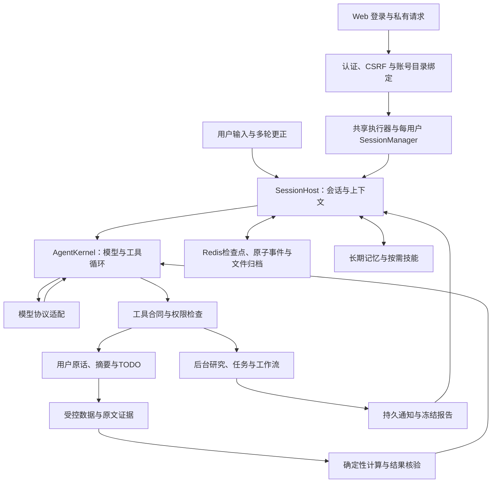

# FinAgent / FinSight 项目设计清单

更新日期：2026-11-04。基于当前源码、仓库配置与已保存的验证记录整理，供项目介绍、架构说明和面试使用。设计价值描述对应实现机制，不将功能存在解释为效果已经提升。完整链路见 [PROJECT_DESIGN.md](PROJECT_DESIGN.md)，本清单突出可以在源码中定位的设计点。

## 项目定位与核心原则

FinSight 是面向中文金融研究的持续会话 Agent。它围绕用户目标完成证券解析、受控数据查询、在线三表查询、证据绑定计算和多轮更正，并提供独立后台研究、持久任务、每轮发现的长期记忆与扩展工具能力。CLI 与具备账号登录、独立数据目录的 React/FastAPI Web 工作台复用核心执行层。

核心原则是：**模型负责理解目标和选择路径，宿主负责维护正式状态、限制执行范围、校验工具合同和金融证据。**

默认入口：`CLI → SessionHost → AgentKernel → 工具/数据/计算 → 观测 → 主模型`。子Agent、队友和研究角色复用同一个Kernel，使用各自上下文和授权工具。

Web 入口：`浏览器 → Cookie/CSRF 与来源校验 → 账号绑定的运行上下文 → SessionManager → SessionHost`。账号隔离在宿主创建前确定，不能由模型指定任意用户 ID。

项目在learn-claude-code参考Harness的基础上做持久化与金融领域适配，保留来源和许可记录。介绍时应突出整合、改造及新增领域设计，来源对照见 [HARNESS_PARITY.md](HARNESS_PARITY.md)。

## A. 执行架构与模型接口

### 01. 统一Agent执行内核

- **实现**：`AgentKernel`承接模型调用、工具执行、观测回填、协议校验、预算、停止与恢复。主会话和不同执行角色共用执行逻辑。
- **价值**：协议和可靠性修复集中在一处，业务方法和研究拓扑可以独立演进。
- **代码**：[kernel.py](../../src/finagent/harness/kernel.py)、[host.py](../../src/finagent/harness/host.py)、[compat.py](../../src/finagent/harness/compat.py)。

### 02. 会话宿主与执行循环分工

- **实现**：`SessionHost`拥有对话、焦点对象、用户约束、证据索引、记忆和通知；Kernel负责执行顺序和生命周期。
- **价值**：连续追问和恢复拥有明确的状态所有者，执行循环能够复用于隔离任务。
- **场景**：查询一家公司后追问、更正年份、比较另一家公司，再返回原问题。

### 03. 模型协议适配、原生工具发现与延迟初始化

- **实现**：统一模型接口支持 Chat Completions 和 Anthropic Messages，保留供应商消息与原始缓存用量。当前项目配置使用 `deferred` 与前缀缓存：稳定登记工具目录，发现结果转换为结构化 `tool_reference`；核心工具直接加载，其余按需展开。`LazyChatModel` 另负责延迟建立客户端，与工具延迟加载是两种机制。
- **价值**：业务与供应商协议解耦，减少逐轮替换工具目录；本地帮助和部分诊断可在尚未连接模型时使用。
- **边界**：deferred 依赖网关实现 `defer_loading` / `tool_reference`，缓存设置还依赖 `cache_control`；普通接口使用 eager。当前 echo 实测验证过网关兼容性，尚无金融任务缓存收益结论。
- **代码**：[models.py](../../src/finagent/models.py)、[discovery.py](../../src/finagent/harness/discovery.py)、[工具加载与缓存](../features/TOOL_DISCOVERY.md)。

### 04. 工具调用协议完整性

- **实现**：校验工具调用ID、assistant消息、调用参数表示和结束原因；保存工具请求/结果配对，恢复时补齐未闭合记录，不自动重复状态未知的执行。
- **价值**：降低中断后消息序列失效和不确定动作被重复执行的概率。
- **代码**：[kernel.py](../../src/finagent/harness/kernel.py)、[host.py](../../src/finagent/harness/host.py)。

## B. 任务理解与多轮状态

### 05. 持久化TODO与执行进度

- **实现**：主模型调用`todo_write`提交完整步骤清单，宿主校验状态和数量后保存，随检查点恢复并注入运行时上下文。
- **边界**：TODO不能证明步骤真正完成，也不授予执行权限。

### 06. 主动更新与宿主提醒

- **实现**：已有TODO距离上次更新或提醒达到3次模型尝试时，提示按实际进展更新；空列表不强制创建计划。
- **边界**：提醒不能保证模型正确提取本轮更正。

### 07. 多轮继承与更正

- **实现**：依据最新用户原话、带来源的会话摘要和TODO继承仍有效条件，领域工具继续核验实际参数、证据和计算口径。
- **边界**：独立Task Frame及字段版本门禁已移除，继承准确性仍需模型评测。

### 08. 宿主实体解析和候选确认

- **实现**：复用本地目录与受控搜索，将用户原文名称映射为证券；不唯一时保存候选；用户回复序号时由主模型根据真实候选再次解析，不应猜测或沿用旧公司。
- **价值**：对象绑定有可追查依据，也能自然支持“选第一个”的多轮交互。
- **边界**：目录映射与证券真实存在、行情身份核验分别处理。
- **代码**：[symbols.py](../../src/finagent/data/symbols.py)、[service.py](../../src/finagent/data/service.py)。

### 09. 财务口径与时间锚点

- **实现**：区分净利润、归母净利润、营业利润、累计/单季、合并/母公司、币种、单位、报告期和信息截止时间。相对期间由主模型结合原始时间上下文转为明确年份；缺少锚点时澄清。
- **价值**：金融问题中“取到数字”之后仍能检查可比条件。
- **场景**：明确“利润”口径、“三季度”是单季还是累计、历史截止时有哪些资料可用。

### 10. 字段歧义按操作依赖处理

- **实现**：未明确的信息保存为pending；工具检查与自己相关的歧义；暂停、结束或前置依赖未完成时限制执行。
- **价值**：已明确的部分可以继续完成，关键歧义也不会被静默猜测。
- **场景**：利润口径待确认时，已确认公司的行情查询仍可执行。

## C. 金融数据、证据与计算

### 11. 原始证据与规范结果分层

- **实现**：原始响应保存内容和来源元数据，规范结果使用`Observation`统一合同；`raw_`与`result_`分别标识源快照和工具结果。
- **价值**：能够从模型结论回查规范值，再追到具体原始响应。
- **细节**：快照身份包含获取元数据，保留相同内容在不同采集时刻的历史。
- **代码**：[evidence.py](../../src/finagent/data/evidence.py)、[contracts.py](../../src/finagent/data/contracts.py)。

### 12. 受控数据访问与多供应商适配

- **实现**：数据层只访问登记HTTPS来源；禁用自动重定向，限制响应大小，记录请求时间和错误；腾讯、新浪、东方财富由独立适配器转为统一结果。
- **价值**：来源策略、字段校验、主备切换与缓存集中处理，模型无需理解每家接口格式。
- **边界**：供应商可用性和实时性仍需运行时判断。
- **代码**：[http.py](../../src/finagent/data/http.py)、[providers/](../../src/finagent/data/providers)、[service.py](../../src/finagent/data/service.py)。

### 13. 在线三表字段与接口证据

- **实现**：在线获取三表，返回绑定快照、报表类型、期间和指标的字段 ID；不提供本地财报导入、检索和原文读取。
- **价值**：无需用户上传材料即可完成三表查询与财务计算，输入仍可追溯。
- **边界**：供应商三表不等于完整财报；正文、附注和未支持口径不做推断。
- **代码**：[financial_facts.py](../../src/finagent/data/financial_facts.py)、[financial.py](../../src/finagent/tools/financial.py)。

### 14. 证据绑定的受限计算程序

- **实现**：模型选择`fact_ids`并生成加减乘除步骤；程序只接受受限引用和常数，由Decimal执行，校验期间、币种、范围、分母和业务公式。
- **价值**：计算输入、步骤和结果可审阅，降低自由文本心算和任意代码执行带来的不确定性。
- **场景**：同比、利润率、负债率、利润率变动等。
- **代码**：[financial.py](../../src/finagent/tools/financial.py)。

### 15. 对实际事实再次检查任务口径

- **实现**：在线三表字段进入计算前检查利润、累计/单季/时点、母公司/合并、币种与用户排除项，避免只验证请求参数而忽略实际证据语义。
- **价值**：参数写对但取错报表时，能够阻止其继续进入计算。
- **代码**：[validate_fact_scope](../../src/finagent/data/financial_facts.py)、[StatementFacts.fact](../../src/finagent/data/financial_facts.py)。

### 16. 显式处理金融数据时效和最终性

- **实现**：分别记录获取时间、数据时间、披露时间和可用时间；缓存回用时重新检查截止；行情快照、历史日线、正式收盘及事后信息按不同条件处理。
- **价值**：支持历史视角分析，减少把后续信息用于解释此前走势的错误。
- **边界**：第三方未给出的最终完整状态保持未知，不由时钟或模型补齐。
- **代码**：[service.py](../../src/finagent/data/service.py)、[market.py](../../src/finagent/market.py)、[analysis.py](../../src/finagent/tools/analysis.py)。

### 17. 版本化技术指标与信号状态

- **实现**：MACD、RSI和背离结构由确定性代码计算，保存公式版本、预热要求、枢轴锚点及确认时间，区分候选、确认和失效。
- **价值**：技术分析能够说明计算口径和信号可得时间，便于复核。
- **边界**：筛查规则不构成价格反转预测，也没有实盘收益验证。
- **代码**：[technical.py](../../src/finagent/technical.py)。

## D. 上下文、记忆与持久化

### 18. 分级上下文压缩与原文回读

- **实现**：先转存大结果，再微压缩旧工具输出，随后归档历史或生成摘要；保留工具配对和用户原文来源账本，提供授权回读工具。
- **价值**：控制长对话上下文开销，同时保留恢复详细证据的路径。
- **边界**：摘要存在信息损失，原文仍是核查依据。
- **代码**：[ContextManager](../../src/finagent/harness/context.py)。

### 19. 有来源的长期记忆生命周期

- **实现**：用户偏好、反馈、项目和参考线索保存为有来源的 JSON，按账号和项目过滤；稳定偏好最多 4 条/1600 字符常驻，其余采用 BM25 + Qwen3-Embedding-8B 余弦召回、RRF 融合及专用 Qwen3-Reranker-8B 重排，相关记忆最多 5 条/8000 字符。
- **每轮发现**：开启记忆与自动记忆后，每个有真实用户输入且正常完成的主会话回合都独立调用当前主模型；输入最近 4 条用户原话及可见的已有记忆目录，不要求“记住”等关键词，允许返回空数组。检查真实来源、持久范围和临时限制，只对新增记录进行后续整理；重复或遗忘记录不算新增。
- **价值**：给自然表达的稳定偏好和纠正提供跨会话复用机会，同时保留来源、范围及删除语义。Web 的账号身份由服务端强制绑定，不依赖浏览器自报用户 ID。
- **边界**：提取同步运行并占用共享模型预算；异常不覆盖原答复，失败/取消/等待澄清/无新输入续跑/子 Agent 不自动发现。MySQL memory_vectors 表只缓存向量，尚无 ANN 或 Milvus；Embedding 异常降级到关键词召回。删除不等于清除全部历史，模型提取质量仍需评测。
- **代码**：[MemoryStore](../../src/finagent/harness/memory.py)、[混合检索](../../src/finagent/harness/memory_search.py)、[host.py](../../src/finagent/harness/host.py)、[记忆说明](../features/MEMORY.md)。

当前 Qwen3-Embedding 只负责编码召回向量；工具分类的 Qwen 9B 不参与记忆发现，记忆提取/整理复用主模型，重排使用独立 Qwen3-Reranker-8B。本地财报资料库已移除；长期记忆是独立功能。

### 20. Redis 主会话存储、原子事件与跨进程租约

- **实现**：Redis Hash 保存会话检查点，任务依赖/认领/完成用 WATCH/MULTI 乐观事务；Lua 原子处理事件去重、序号、通知入队及确认。每个数据根目录使用独立命名空间，不设 TTL；JSONL 保留 transcript，本机文件锁限制同一会话被重复打开。
- **价值**：连续工作有持久记录，减少并发写坏和重启后丢失上下文的情况。
- **迁移与恢复**：旧会话 SQLite 仅由离线工具读取，备份后导入并核对原序号、待确认通知与检查点，运行时没有 SQLite 兜底。本机 Redis 使用 AOF 逐次刷盘和 noeviction，已验证服务重启恢复临时检查点、任务和通知。
- **边界**：Redis 是新的必需依赖；没有交付分布式任务队列或多 Web worker。账号、Web 元数据、研究账本和向量缓存已迁到 MySQL，按 namespace 隔离，见 [MySQL 交付记录](../features/MYSQL_STORAGE.md)。
- **代码**：[state.py](../../src/finagent/harness/state.py)、[runtime_migration.py](../../src/finagent/harness/runtime_migration.py)、[Redis 说明](../features/REDIS_RUNTIME.md)。

## E. 预算、权限与可靠性

### 21. 共享操作预算与研究阶段预留

- **实现**：普通请求共享模型、工具、来源和墙钟预算，澄清与子任务沿用额度；研究使用持久reservation，并为下游分析与最终收口预留额度，失败和在途调用仍计入。
- **当前配置**：普通请求为 40 次模型、60 次工具、120 次来源请求、360 秒活动预算；每响应最多执行 5 个工具。分类、摘要及记忆辅助请求也计入预算，不能把一轮聊天等同于一次 API 调用。
- **价值**：防止委派、重试或前期采集吃光预算，提升长流程成本可解释性。
- **代码**：[Ledger](../../src/finagent/harness/kernel.py)、[budget.py](../../src/finagent/research/budget.py)。

### 22. 有界重试与无进展停止

- **实现**：错误有明确类型与retryable标记；重试、截断恢复和停止续跑有上限；重复失败签名进入无进展判断；中断与失败保留状态。
- **价值**：让模型有机会纠参和恢复，同时限制失败循环的时间和调用开销。
- **代码**：[errors.py](../../src/finagent/errors.py)、[kernel.py](../../src/finagent/harness/kernel.py)。

### 23. 宿主拥有权限边界

- **实现**：工具名和schema先校验；文件路径必须落在工作区，保护凭证和宿主存储；Shell优先使用隔离环境，隔离不可用时仅允许少量受限命令。
- **价值**：把可以执行什么落实为程序规则，外部文本、记忆和技能正文不能自行授予权限。
- **边界**：安全机制不是对任意环境的绝对安全证明；Git worktree只提供工作副本隔离。
- **代码**：[tools.py](../../src/finagent/harness/tools.py)、[hooks.py](../../src/finagent/harness/hooks.py)。

### 24. 插件式工具和按需技能

- **实现**：聊天、研究和 MCP 使用同一 `Tool / ToolRegistry`，由场景策略保留权限、范围、预算与证据处理；金融工具不再二次注册。`search_tools` / `select_tool_groups` 发现当前角色允许的能力，可信发现结果才产生原生协议引用。Skills 按需读取正文/参考；stdio MCP 实现握手、分页发现、调用、命名与 schema 检查。
- **价值**：扩展方法和数据能力可以复用宿主控制，不必改写执行内核。
- **边界**：发现和历史引用不扩大执行权限；当前真实 MCP 适配重点是 stdio，Web 关闭 MCP 及通用文件/Shell 能力。稳定目录与追加状态快照有助于保留前缀，但历史压缩、配置变化及记忆失效清理仍可能改变缓存前缀。
- **代码**：[extensions.py](../../src/finagent/harness/extensions.py)、[discovery.py](../../src/finagent/harness/discovery.py)、[skill_library.py](../../src/finagent/skill_library.py)、[mcp.py](../../src/finagent/harness/mcp.py)。

## F. 并发、后台与独立研究

### 25. 可认领的依赖任务与隔离子执行者

- **实现**：任务依赖图检查成环，事务内认领和校验owner；子Agent使用隔离上下文、工具集合及继承约束；团队有计划和消息协议，可绑定Git worktree。
- **价值**：多人角色协作有任务归属和依赖关系，避免只依靠自然语言约定调度。
- **边界**：这是进程内协作与本地持久化能力，未建立大规模并发吞吐结论。
- **代码**：[tasks.py](../../src/finagent/harness/tasks.py)、[background.py](../../src/finagent/harness/background.py)、[host.py](../../src/finagent/harness/host.py)。

### 26. 带去重和确认的后台事件

- **实现**：后台完成/失败、队友与cron通知关联所属会话，持久记录event ID、待投递状态与确认；重启后在途线程标记为中断，而非虚构继续运行。
- **价值**：主对话可在等待期间继续工作，通知有恢复和排查依据。
- **边界**：不宣称通用exactly-once执行；cron依赖活跃宿主进程。
- **代码**：[background.py](../../src/finagent/harness/background.py)、[state.py](../../src/finagent/harness/state.py)。

### 27. 冻结独立研究范围与结构化角色交接

- **实现**：启动研究校验最新真实用户请求，冻结公司、截止、约束、任务快照和预算；角色按固定依赖拓扑协作，交接产物带scope hash、artifact hash及条目引用。
- **价值**：聊天切换公司不会改变在跑研究；下游能核对自己采用的是哪个版本、哪个主张和依据。
- **边界**：角色讨论提供多视角组织方式，不能据此宣称分析准确率更高。
- **代码**：[harness/research.py](../../src/finagent/harness/research.py)、[research/workflow.py](../../src/finagent/research/workflow.py)、[selection.py](../../src/finagent/research/selection.py)。

### 28. 完成状态与内容质量分开

- **实现**：运行状态、研究内容状态、证据覆盖和质量门分别记录；引用、公式、范围和覆盖不足会形成具体限制。
- **价值**：能区分工作流执行结束、材料齐全及结论得到支持，保留失败原因。
- **事实边界**：已有一次真实研究试跑因输出截断返回内容不可用，不能作为有效金融报告验收。

### 29. 可恢复工作流与可选Goal检查

- **实现**：宿主注册async工作流，支持parallel/pipeline和结果schema；语义journal记录步骤结果，以版本、参数和调用内容生成缓存键。显式Goal可通过只读模型检查器决定继续、等待或停止。
- **价值**：明确流程可以复用已完成步骤；长期目标有独立的完成检查入口。
- **边界**：不承诺任意外部副作用自动无损恢复；Goal检查仍是模型判断。
- **代码**：[workflows.py](../../src/finagent/harness/workflows.py)、[goals.py](../../src/finagent/harness/goals.py)。

## G. 可观察性、实验与交付

### 30. 用户可见进度与诊断记录

- **实现**：终端展示实际工具、部分参数、状态、耗时、来源及数据时间；Web 经 SSE 展示真实工具/研究阶段事件，持久游标支持断线续接，另有轮询兜底。完整消息和事件另行保存，参数预览包含脱敏和长度控制。
- **价值**：用户知道系统在做什么，开发者能够定位等待、缺数据和失败环节。
- **边界**：已交付 Web 工作台，但模型仍是非流式请求；阶段事件不等于 token 流，不伪造完成百分比。
- **代码**：[progress.py](../../src/finagent/harness/progress.py)、[terminal.py](../../src/finagent/harness/terminal.py)、[web/app.py](../../src/finagent/web/app.py)、[web/store.py](../../src/finagent/web/store.py)。

### 31. 分层评测与可审查的效果声明

- **实现**：单元/跨模块回归、对话宿主回放和真实模型业务实验分别运行；新版业务实验对照直接模型与当前Agent；历史三组实验仅代表旧版本，并检查数值、口径、引用、正文金额、延迟与token。
- **价值**：能讨论组件的实际收益与代价，不依赖功能数量推断效果。
- **事实边界**：2026-11-04 Redis 主运行存储改造后 Python 全量 733 项通过（60.011 秒）、浏览器流程 11 项通过（9.0 秒），实际 AOF 重启恢复及旧库导入核对通过。前序记忆改造的 721 项、登录交付的前端单测 8 项及构建记录仍按其阶段理解；没有新增真实金融质量结论。
- **历史业务记录**：36 组 51 轮宿主回放通过；业务候选集 48 组 69 轮，其中 30 组开发、18 组留出。真实开发试跑各方案均 3/3 通过，未显示正确率收益，完整 Agent 开销更高；旧实验的 540 项回归属于其冻结版本，不是当前全量数量。
- **代码与结果**：[experiments/](../../src/finagent/experiments)、[业务结果](../evaluation/BUSINESS_EXPERIMENT_RESULTS.md)、[公开快照](../evaluation/experiments/business_v1/README.md)。

### 32. 实验冻结、人工审核与零调用重新评分

- **实现**：记录数据、源码、提示合同和配置摘要；后续运行归档源码和逐调用输入；按对话配对统计，失败保留分母；留出集先审核再运行，重新评分写入单独分析版本。
- **价值**：结果能够审阅和复核，减少挑选成功记录、样本泄漏和混合版本的误导。
- **边界**：标签目前是开发候选；首次pilot未保存完整推理源码快照，记录该限制，不补造历史证据。

### 33. 干净构建与安装一致性检查

- **实现**：从全新staging构建wheel，验证安装后导入路径、资源文件和包摘要；提示、技能及数据JSON跟随包交付。
- **价值**：减少旧build/lib或本地开发路径造成的“本机可运行、安装后不一致”。
- **边界**：现有检查覆盖当前Linux/Python环境，不泛称所有平台全部验证。
- **代码**：[build_wheel.py](../../scripts/build_wheel.py)、[pyproject.toml](../../pyproject.toml)。

## H. Web 身份、隔离与运行资源

### 34. 可撤销的服务端登录会话

- **实现**：用户名/邮箱登录、单次邀请注册、Argon2id 密码哈希、随机令牌 Cookie、服务端会话哈希与过期检查、CSRF/来源校验、账号/IP 限流及审计。普通登录空闲 2 小时/绝对 12 小时，记住我空闲 7 天/绝对 30 天。
- **价值**：账号身份独立于聊天会话，退出、密码重置和账号状态变化有服务端撤销依据，凭证不进入 Agent 或 Embedding。
- **边界**：本机访问同样要求登录；服务器模式须显式 HTTPS Host/Origin 和 Secure Cookie。当前没有管理员角色/RBAC、SSO、MFA 或邮件找回，账号维护由部署者 CLI 完成。
- **代码**：[auth_store.py](../../src/finagent/web/auth_store.py)、[auth.py](../../src/finagent/web/auth.py)、[auth_cli.py](../../src/finagent/web/auth_cli.py)、[登录指南](../guides/LOGIN.md)。

### 35. 身份绑定的业务目录与显式历史迁移

- **实现**：全局认证库位于 `.finagent/auth/`，每个账号的会话、资料、证据、研究、上传及记忆位于 `.finagent/users/usr_<ID>/`；服务端按不可变账号 ID 创建 Store/Manager，检查 owner 标记、路径和业务归属。CLI 继续使用自己的根目录与操作员范围。
- **价值**：隔离覆盖存储、查询、执行和事件，浏览器或模型不能靠提交其他用户 ID 切换数据根目录。
- **迁移**：部署者显式选择空账号并停写，先预览再备份/迁移；检查租约与在途任务，保存按 namespace 的 MySQL 业务快照，对旧 SQLite 做包含 WAL 的离线备份，并备份/迁移 Redis 原子快照，修复结构化路径和记忆归属。旧归档回读只映射到该用户的当前会话副本，不读取旧共享根目录。
- **边界**：这是单机应用的账号数据隔离，没有独立 OS 容器或组织租户；旧数据不会自动交给第一个登录账号，也不覆盖已有用户数据。
- **代码**：[user_runtime.py](../../src/finagent/web/user_runtime.py)、[migration.py](../../src/finagent/web/migration.py)、[context.py](../../src/finagent/harness/context.py)、[app.py](../../src/finagent/web/app.py)。

### 36. 前端认证状态、缓存与事件的身份一致性

- **实现**：React Router 保护私有页面，登录后返回允许的站内页面；每个身份创建独立 QueryClient，身份变化清理旧缓存、请求、幂等键和 SSE。事件游标按用户保存，多标签广播与窗口聚焦重新核验 Cookie 身份；私有请求的预期身份只用于一致性检查。
- **价值**：减少切换账号或标签页通知延迟时，将旧身份响应写入新工作区的风险；认证令牌不保存到 localStorage 或 URL。
- **边界**：浏览器端状态不是鉴权依据，服务端每次请求仍校验；忘记密码页仅提供部署者重置流程，当前没有自动邮件服务。记忆已有查看/删除 API，但没有独立网页管理面板。
- **代码**：[main.tsx](../../web/src/main.tsx)、[auth.tsx](../../web/src/app/auth.tsx)、[client.ts](../../web/src/api/client.ts)、[context.tsx](../../web/src/app/context.tsx)、[Login.tsx](../../web/src/features/auth/Login.tsx)。

### 37. 跨账号共享执行器、配额与恢复

- **实现**：单 Web 进程共享默认 4 个执行线程；未完成提交全局 32/每用户 8，研究全局 3/每用户 1；同会话串行。每用户最多 32 个宿主，应用用户运行上下文上限 64，空闲 30 分钟且无工作可回收；启动时扫描所有已持久化用户，失效队列/线程标记中断，不重放未知操作。
- **价值**：多账号不会各自扩大线程池和研究并发总额；归属、队列、预算与恢复各有明确控制点。
- **边界**：服务租约限制同根目录单进程，未实现多 worker 或分布式队列。退出登录不取消研究，禁用账号会取消其执行；重启不能让旧线程继续运行。
- **代码**：[user_runtime.py](../../src/finagent/web/user_runtime.py)、[session_manager.py](../../src/finagent/web/session_manager.py)、[store.py](../../src/finagent/web/store.py)、[config.py](../../src/finagent/config.py)。

## 建议的项目介绍方式

### 30秒介绍

> 我做了一个面向中文金融研究的持续会话 Agent。在参考 Harness 的基础上，将模型执行、任务状态、工具权限和金融证据分层，加入带来源与版本的任务更正、原文绑定的确定性计算、独立后台研究和长期记忆，并提供账号隔离的 Web 工作台。验证时分别检查协议、权限、数值、引用和真实模型效果，保留尚未验证的边界。

### 可深入讲解的设计主题

1. 模型负责提出理解，宿主负责正式提交与执行限制。
2. 数字从原文单元格到规范事实、程序和回答的完整证据链。
3. 会话状态、工具协议、预算和后台交接的恢复语义。
4. 当前聊天范围与独立研究冻结范围的隔离。
5. 用对照实验解释准确性、协议完整性和成本之间的取舍。
6. 每轮记忆发现、混合召回、真实来源和删除语义如何配合。
7. 登录身份如何贯穿数据根目录、后台研究、前端缓存与 SSE。

### 求职材料中的表述边界

可以描述已经实现的架构、合同、约束、测试、安装和试跑记录。当前不宜写成：生产级多租户平台、完整远程MCP生态、成熟习惯学习系统、已证明多Agent提升金融准确率、经过收益验证的交易系统，或独立金融测试准确率100%。

可以明确写“已实现账号登录及独立用户工作区”，但不能将其扩展成“组织租户/RBAC 已交付”；可以写“每轮发现与向量召回”，但不能将其扩展成“已部署 Milvus、独立小模型记忆服务或验证了用户习惯学习效果”。
