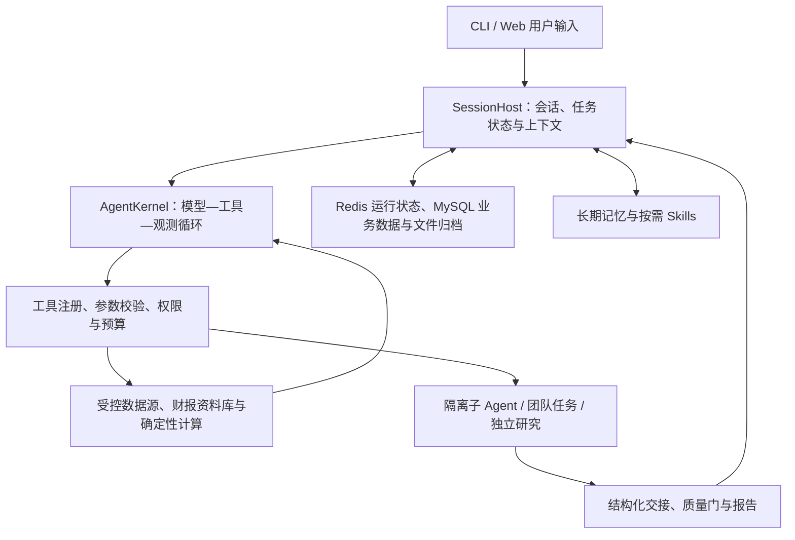

# FinAgent / FinSight 项目特点与简历说明

整理日期：2026-11-03。依据当前源码与项目内保存的验证记录，面向 Agent 应用开发、LLM 应用工程和金融智能研究相关岗位。

本文先解释设计，再提供可直接改写进简历的文字。功能实现、离线验证和真实模型效果分别说明；简历中的个人职责应按实际参与范围取舍。

## 一、项目定位与整体架构

**项目名称：FinSight——面向中文金融研究的持续会话 Agent 与多智能体研究工作台。**

项目围绕证券查询、财报原文检索、财务计算、多公司比较和独立深度研究，构建可持续对话、可追溯取证、可恢复执行的 Agent 系统。提供 CLI 与本地 Web 工作台，两种入口复用会话宿主、执行内核和研究服务。

架构的核心分工是：**模型理解需求并选择执行路径，宿主管理正式状态、工具权限、操作预算和证据校验。**

项目基于 learn-claude-code 参考 Harness 进行重构与金融领域适配，保留来源和许可。可以重点介绍持久会话、任务变更、证据计算、研究交接与评测设计；基础 Harness 的参考来源见[能力来源对照](HARNESS_PARITY.md)。

技术栈：Python、Pydantic、JSON Schema、Redis、MySQL、SQLAlchemy Core、Alembic、HTTPX、FastAPI、React、TypeScript、SSE、stdio MCP、unittest、Vitest、Playwright。

## 二、上下文设计：让连续工作有明确的状态和恢复路径

### 2.1 将会话状态与对话消息分开管理

多轮研究需要保留公司、报告期、用户排除项、待澄清问题和已取证结果。仅依赖历史消息，容易在对象切换、纠正或历史压缩后丢失条件。

`SessionHost` 持有持续会话，分别管理用户原文来源、目标、有效约束、假设、开放问题、失败尝试、后续动作、证据索引和产物引用。每次请求模型时，组装系统提示、结构化状态视图、相关记忆、技能目录及对话消息。

当前焦点公司与整个任务涉及的公司集合分别保存。例如“比较茅台和五粮液”之后追问“先看五粮液”，可以切换当前焦点，同时保留原比较任务和先前证据。

**工程价值：** 为追问、更正、切换对象和重启恢复提供统一的状态来源，也让开发者能够查看模型执行时实际继承了哪些条件。

### 2.2 分级压缩，并保留原文回读能力

上下文管理按不同信息的恢复成本处理历史：

| 层级 | 实现方式 | 保留的信息 |
| --- | --- | --- |
| 大结果转存 | 大工具结果写入文件，以内容摘要哈希命名，返回预览和文件位置 | 原始工具结果全文 |
| 旧结果微压缩 | 工具输出累计较大时，优先转存较旧的长结果 | 最近结果及旧结果读取入口 |
| 历史裁剪归档 | 消息较多时按消息组归档早期历史，保留近期交互 | 可回读的历史记录 |
| 摘要压缩 | 仍超出限制或显式压缩时，归档旧记录并生成进展摘要 | 最近消息组、摘要及原始归档 |

压缩按工具调用与结果配对保留消息组；用户原文预先进入独立来源账本。`read_output` 允许在当前会话目录内分页回读，摘要失败时也保留归档入口。

当前阈值主要按字符量控制，不能描述为精确的 token 预算器。摘要仍可能损失信息，详细核查依赖原文。

### 2.3 按需加载分析方法，按角色控制可见内容

Skills 采用渐进式加载：先展示名称和描述，模型判断需要后读取正文，再按需分页读取参考资料。普通会话当前可发现 **8 个通用分析技能和 1 个深度研究入口技能**。

固定研究角色的多空、审阅和风险方法放在研究模块内部，由执行器只加载对应角色的方法。普通会话不携带全部角色提示词。技能正文、记忆、外部资料和历史摘要均被标注为上下文数据，不能自行扩大工具权限。

**简历表述：**

> 设计持续会话上下文管理，分离任务状态与消息历史，实现大结果转存、旧结果微压缩、历史归档和摘要压缩，保留工具调用配对与原文回读入口；结合按需 Skills 和角色可见范围组织模型上下文。

源码：[host.py](../../src/finagent/harness/host.py)、[context.py](../../src/finagent/harness/context.py)、[skill_library.py](../../src/finagent/skill_library.py)。验证：[test_harness_v3.py](../../tests/test_harness_v3.py)、[test_skills.py](../../tests/test_skills.py)、[test_chat_skill_scope.py](../../tests/test_chat_skill_scope.py)。

## 三、用户记忆管理：有来源、按需召回、可整理与遗忘

### 3.1 区分短期任务约束与长期信息

“这次只看现金流”应保留在本次任务中；“以后回答先给结论”才具有跨会话复用价值。项目将长期记忆与会话状态分开保存，支持四种类型：

| 类型 | 记录内容 | 示例 |
| --- | --- | --- |
| user | 用户稳定偏好与背景 | 以后先给结论，再列依据 |
| feedback | 对回复或工作方式的反馈 | 比较公司时需要明确统计口径 |
| project | 持续项目背景 | 正在研究某行业现金流质量 |
| reference | 后续查找所需的线索 | 某类资料的存放位置 |

每条记忆包含 ID、描述、正文、类型、来源、持久范围、用户/项目范围、常驻标记和创建时间；独立 JSON 文件保存内容，`MEMORY.md` 生成目录索引，MySQL 缓存向量。

### 3.2 提取与写入有来源约束

自动提取在启用记忆、启用自动记忆、有真实用户输入的主会话正常完成回复后执行，不要求特定触发词；通过独立请求复用主模型，从最近用户原话发现候选，并提供当前范围的已有记忆目录减少重复，允许返回空数组。

宿主检查候选来源、`persistent` 范围及临时任务表达；显式 `memory_write` 也要求引用本会话真实用户消息。写入通过规则拦截部分凭证和动态行情表达，并进行正文去重。

这些检查提供来源约束和基础过滤；候选内容是否准确概括原话，仍依赖模型与规则覆盖，不能描述为完整的语义验证。

### 3.3 常驻偏好与混合召回

召回先过滤用户/项目范围，加载最多 4 条稳定偏好/反馈作为常驻记忆；其他记录使用 BM25 和 Embedding 余弦相似度检索，通过 RRF 融合候选，最多注入 5 条查询相关记忆。两部分分别限制字符预算。

候选超出上限且两路第一名不同时，自动模式才调用模型重排。正文保留在本地 JSON，MySQL 保存向量缓存，无需独立向量数据库；Embedding 服务故障回退到关键词检索，并记录降级状态。配置与真实模型小样本验证见 [长期记忆与召回](../features/MEMORY.md)。

### 3.4 整理、归档与删除墓碑

同主题记忆可由模型提出合并方案，宿主校验 ID 和类型，保存合并前归档及来源集合。文件锁和临时文件替换用于协调写入及索引更新。

用户可以通过 CLI 的 `/memory` 查看，通过 `/memory forget ID` 删除。删除时记录正文哈希和来源 ID，阻止同一正文或已删除来源被旧摘要自动重新写入。

**工程价值：** 稳定偏好可以跨会话复用，用户更正和删除有明确入口；记忆保留来源，便于追查错误来自哪次表达。

当前记忆按部署者配置的用户和项目隔离，Web 仍为本机单用户应用，没有登录系统；删除针对活跃记忆及自动恢复路径，不代表清除所有历史会话、归档或备份。

**简历表述：**

> 实现带用户来源的长期记忆生命周期，区分稳定偏好与临时任务约束，支持用户/项目范围隔离、常驻偏好、BM25/向量混合召回及按需模型重排，并保留合并来源与删除标记。

源码：[MemoryStore](../../src/finagent/harness/memory.py)、[混合检索](../../src/finagent/harness/memory_search.py)、[宿主触发逻辑](../../src/finagent/harness/host.py)、[记忆写入校验](../../src/finagent/harness/extensions.py)、[CLI 记忆入口](../../src/finagent/harness/terminal.py)。验证：[test_memory.py](../../tests/test_memory.py)、[test_harness_v3.py](../../tests/test_harness_v3.py)、[test_web.py](../../tests/test_web.py)。

## 四、工具设计：把模型决策转化为可校验的执行

### 4.1 统一注册与调用合同

v3.1 的工具统一通过 `Tool / ToolRegistry` 注册名称、描述、参数合同、处理函数、输出合同及权限类型，动态提供给模型。聊天与研究共享校验和分派实现，通过执行策略保留各自的任务范围、预算和证据处理；旧 `RuntimeTool` 名称只作为返回统一 Tool 的兼容构造入口。

工具参数错误返回结构化错误，供模型修正。Schema 禁止远程或文件外部引用，避免参数校验产生额外文件或网络访问。执行循环校验工具调用 ID、消息角色与结束原因，确保请求和结果配对。

工具可以分为金融取数、原文检索与读取、确定性计算、会话状态、记忆、研究、任务协作和扩展接入等能力。新增能力通过注册接入，无需为每类业务维护独立的模型循环。

### 4.2 统一金融观测与证据链

不同数据源返回结果统一为 `Observation`，包含状态、数据、来源 URL、获取时间、数据时间、证券、币种、单位、快照 ID、缓存状态、警告和错误。

原始响应保存为 `raw_` 快照，规范结果保存为 `result_` 记录。财报资料保留文档、页面、表格和单元格定位；模型读取、计算和报告引用可以沿这些标识回查原始依据。

**工程价值：** 供应商适配、缓存、时效判断和事实追溯共享统一合同，工具返回的不只是一个无法核查的数字。

### 4.3 证据绑定的确定性计算

模型负责选择事实和计算意图，计算工具接受 `fact_ids` 与受限算术步骤，由 `Decimal` 执行。计算前检查期间、币种、单位、合并范围、累计或单季度口径及业务公式，限制分母等不合法输入。

例如计算同比，需要本期和上年同期两份可比事实；计算利润率，需要确认利润与收入具有一致口径。技术指标 MACD、RSI 与背离结构也由版本化代码计算，并记录确认时间和信号状态。

**工程价值：** 输入事实、公式步骤和输出结果都可复核，将金融数值正确性落实为程序检查。

### 4.4 权限、扩展与执行场景适配

工作区工具检查路径和受保护目录；Shell 优先使用隔离环境，隔离不可用时仅提供少量受限只读命令。MCP 支持真实 stdio 握手、分页发现、工具命名和 Schema 校验，并接入同一工具池。

Web 入口提供更窄的金融研究与上下文工具集合，关闭 Shell、任意文件、通用子 Agent 和 MCP 入口。不同执行角色的可用能力由宿主决定，技能或资料文本不能授予权限。

**简历表述：**

> 构建基于 JSON Schema 的动态工具注册与执行层，统一参数校验、权限控制和结构化错误；设计原始快照—规范结果—原文定位的金融证据链，实现绑定事实 ID 的 Decimal 受限计算，并支持 stdio MCP 扩展。

源码：[tools.py](../../src/finagent/harness/tools.py)、[extensions.py](../../src/finagent/harness/extensions.py)、[contracts.py](../../src/finagent/data/contracts.py)、[evidence.py](../../src/finagent/data/evidence.py)、[financial.py](../../src/finagent/tools/financial.py)、[mcp.py](../../src/finagent/harness/mcp.py)。验证：[test_data.py](../../tests/test_data.py)、[test_harness_v3.py](../../tests/test_harness_v3.py)、[test_technical_divergence.py](../../tests/test_technical_divergence.py)。

## 五、多智能体协作：隔离执行、明确依赖与结构化交接

### 5.1 统一内核，按任务组织角色

主会话、隔离子 Agent、团队成员与研究角色共用 `AgentKernel`。协议、重试、预算和停止逻辑集中维护；角色差异体现在上下文、工具集合、方法提示及输出合同。

| 协作方式 | 适用任务 | 主要机制 |
| --- | --- | --- |
| 隔离子 Agent | 对局部问题独立检查或取证 | 新上下文、继承约束和任务快照、共享操作预算 |
| 团队任务 | 存在任务归属与前置依赖的协作 | 任务板、原子认领、owner 校验、消息和计划协议 |
| 独立深度研究 | 多维取证、交叉审阅与报告生成 | 冻结范围、固定依赖拓扑、结构化产物、独立研究预算 |

普通主会话的执行路径由模型选择；固定多空与风险拓扑属于独立研究服务。

### 5.2 上下文隔离与预算继承

子 Agent 使用独立消息上下文，继承用户约束、截止时间和只读任务快照，不能修改主会话任务。返回答案、执行状态和结果索引，由父会话显式采用证据。

一次普通请求及其子执行者共用 `Ledger`，模型、工具、来源调用与活动时间受统一限制，摘要和记忆等辅助调用也计入模型额度。澄清后继续执行沿用已有操作预算。

独立研究使用自己的持久预算，为下游裁决和最终收口预留额度；失败或中断的已预留调用继续计数。

### 5.3 依赖任务与原子认领

`TaskBoard` 支持任务依赖检查、成环拒绝、事务内认领及 owner 校验。团队支持计划提交、审阅、消息传递与关闭协议；通用工作任务可绑定 Git worktree，明确执行目录。

**工程价值：** 协作拥有可检查的任务状态和归属，减少重复认领与依赖未满足时提前执行。Git worktree 用于工作副本隔离，不构成安全沙箱。

### 5.4 多视角研究与不可变交接

独立研究按需选择技术面、情绪、新闻、基本面、政策等分析维度。`deep_research` 大体经过分析师、交叉审阅、质量门、多空讨论和研究经理收口；`full_decision` 进一步加入交易方案、不同风险视角及组合经理。

宿主建立依赖拓扑。交接产物包含研究范围哈希、产物哈希、角色、尝试 ID、输入产物引用和具体条目 ID；下游检查引用版本及授权范围。

启动时冻结公司、截止时间、用户约束、任务快照和预算。用户在主对话中切换公司，不会改变已运行研究的范围。后台进度与完成事件关联所属会话，研究完成后可读取报告、采用授权证据并继续追问。

运行结束、内容完整度、证据覆盖和质量审阅分别记录。多角色讨论提供组织与复核机制，其准确率收益仍需对照实验验证。

**简历表述：**

> 实现统一内核下的子 Agent、团队任务与独立研究协作，结合上下文隔离、任务依赖、事务认领和共享预算控制执行；以冻结研究范围、产物哈希及条目级引用完成多角色交接，支持后台进度和报告追问。

源码：[host.py](../../src/finagent/harness/host.py)、[tasks.py](../../src/finagent/harness/tasks.py)、[background.py](../../src/finagent/harness/background.py)、[workflow.py](../../src/finagent/research/workflow.py)、[budget.py](../../src/finagent/research/budget.py)、[研究衔接](../../src/finagent/harness/research.py)。验证：[test_harness_v3.py](../../tests/test_harness_v3.py)、[test_research_v21.py](../../tests/test_research_v21.py)、[test_research_chat.py](../../tests/test_research_chat.py)、[test_research_failures.py](../../tests/test_research_failures.py)。

## 六、Agent 评估：同时观察完成质量、证据和成本

### 6.1 分层验证不同问题

| 层级 | 验证内容 | 结果可以说明什么 |
| --- | --- | --- |
| 单元与跨模块回归 | 参数、权限、协议、状态、记忆、预算和恢复 | 已覆盖的程序行为符合断言 |
| 对话宿主回放 | 将标注动作交给真实宿主，检查继承、更正和范围 | 状态及工具边界在给定动作下正确 |
| 真实模型业务实验 | 模型自主选择动作，检查最终答案和执行记录 | 特定语料与配置下的完成质量和成本 |
| Web 与浏览器测试 | 提交、刷新恢复、事件、报告引用和上传 | 合成场景中的产品交互与集成行为 |

任务对话语料包含 **36 组、51 轮**，业务实验候选语料包含 **48 组、69 轮**，后者划分为 30 组开发集、18 组留出集。它们属于开发阶段编写的语料，人工独立验收状态需另行说明。

### 6.2 三组对照与任务表示消融

业务实验对照：直接模型读取原始资料、移除任务表示的 Agent、启用任务表示的完整 Agent。模型与原始资料保持一致，两种 Agent 使用相同金融工具及默认检索策略，控制任务表示相关差异。

直接模型内联读取资料，Agent 通过工具检索，二者对照反映端到端方案差异。任务表示的组件收益主要通过两个 Agent 方案比较。

### 6.3 数值与引用由程序评分

评分包括对话成功率、请求字段准确率、必需数值召回、引用支持率、无依据结构化数字率、正文金额审计和输出合同完整率，同时记录调用次数、服务商 token 用量及 P50/P95 延迟。

引用检查要求数值确实被相应原文支持，且 Agent 实际读取过该来源。公司、报告期、币种、单位、合并范围和累计或单季度口径参与核验；正文带金额或百分比单位的数字额外审计，避免只检查结构化字段而遗漏正文。

格式失败与运行失败保留在相应评分分母，未执行项显示覆盖不足。自由文本语义、无单位数字及金额所属关系仍需要人工审阅。

### 6.4 冻结实验与版本化重评分

实验支持运行前冻结源码、数据、提示合同与配置，保存调用输入和执行记录，留出运行要求提供事前人工审核。结果按对话 ID 配对，重复先在同一对话内汇总，再做 bootstrap；后续评分修订输出独立分析版本，可不重新调用模型。

首次试跑早于完整源码与请求归档机制，只保留当时摘要及输出记录；已有文档明确标注此限制。

### 6.5 现有结果的可用范围

截至已保存的业务报告，真实模型仅完成开发集 3 组对话的三方案试跑，共 9 个对话运行、15 个回答轮次。三方案均完成这 3 组，**尚未观察到任务表示的正确率收益，完整 Agent 的调用与 token 开销更高**。留出集效果测试尚未完成。

2026-11-02 的 Web 文档记录后端离线回归 591 项、前端单元测试 4 项、浏览器测试 7 项通过。这些是对应版本的历史验证记录，不能当作当前重新执行结果或真实金融准确率。

**工程价值：** 项目具备讨论组件收益、失败原因和成本代价的基础；发现简单任务上复杂方案开销更高，也是有价值的实验观察。

**简历表述：**

> 搭建覆盖 48 组、69 轮候选对话的金融 Agent 评测框架，支持直接模型、完整 Agent 与任务表示消融三组对照，实现数值、口径、可见引用及正文金额核验，记录 token/延迟，并支持实验冻结、配对统计和零调用重评分。

源码：[dialogue_evaluation.py](../../src/finagent/dialogue_evaluation.py)、[experiments/](../../src/finagent/experiments)。说明与结果：[业务实验方案](../evaluation/BUSINESS_EXPERIMENTS.md)、[首次试跑结果](../evaluation/BUSINESS_EXPERIMENT_RESULTS.md)、[公开实验快照](../evaluation/experiments/business_v1/README.md)、[Web 验证记录](../guides/WEB_APP.md)。

### 6.6 2026-11-05 路由与记忆组件对照

按事前冻结配置完成了关键词/Qwen 路由与记忆四方案真实模型对照，详见[完整结果与实验边界](../evaluation/RESUME_COMPARISON_RESULTS.md)。数据为开发者编写的候选集，尚未独立审核。

**可用于简历的量化表述：**

> 在自建 130 轮候选任务数据上，对比关键词与 Qwen 意图路由，工具类别集合匹配率由 59.23% 提升至 96.15%，提高 36.92 个百分点；在 24 条合成记忆留出查询上，混合召回 Recall@5 达到 98.21%，与最佳单路召回持平，引入重排后 NDCG@5 由 0.9137 提升至 0.9306。

98.21% 是未重排的混合召回阶段指标。重排后的 Recall@5 为 92.86%，同时无相关非核心记忆查询中的误召回由 10/10 降至 1/10。不能写成混合召回优于最佳单路，也不能将路由匹配率当成 Agent 任务成功率。

## 七、其他值得写进简历的设计

### 7.1 持久化TODO与上下文状态

主模型通过`todo_write`维护执行步骤和进度，宿主校验后保存到会话状态，随Redis检查点恢复，并在模型调用前提供最新状态视图。已有清单3次模型尝试未更新时，宿主注入更新提醒。

结合用户原话、结构化摘要和原始历史回读接续长任务。需求继承和进度更新仍依赖主模型，提醒不等于完成验证。独立Task Frame已移除，不再将字段版本和Frame范围门禁作为当前简历亮点。

依据：[host.py](../../src/finagent/harness/host.py)、[会话接续说明](../features/TASK_UNDERSTANDING.md)。

### 7.2 信息时效与历史可得性检查

区分数据获取时间、数据所属时间、披露时间和可用时间；在缓存复用、资料读取和报告采用时检查截止条件。区分行情快照、历史日线、正式收盘及未知最终性，原文事实进入计算前再次检查用户口径。

**简历表述：** 建立金融数据时效与可比性检查，在资料检索、缓存复用和事实计算阶段校验截止时间、报告期与财务口径，约束历史视角中的资料使用。

依据：[service.py](../../src/finagent/data/service.py)、[financial_facts.py](../../src/finagent/data/financial_facts.py)、[market.py](../../src/finagent/market.py)。

### 7.3 可恢复执行与失败控制

Redis 主存储保存会话检查点、任务和事件，WATCH/MULTI 实现任务乐观事务，Lua 原子实现有序事件去重及通知确认；JSONL 保存 transcript，本机文件锁限制同一会话重复执行。Redis 不可用时明确报错，不回退到旧 SQLite；中断操作保留记录，不自动重复结果未知的动作。

内核提供有界重试、截断处理和重复失败停止；工作流保存步骤 journal 与结果，支持复用已完成步骤。恢复能力遵循明确执行边界，不承诺任意外部副作用恰好执行一次。

**简历表述：** 实现基于 Redis 检查点、乐观任务事务、原子通知及会话租约的执行恢复，结合工具协议修复、有界重试、无进展停止及工作流 journal 管理失败与中断；提供旧运行库的一致备份与离线导入。

依据：[state.py](../../src/finagent/harness/state.py)、[kernel.py](../../src/finagent/harness/kernel.py)、[workflows.py](../../src/finagent/harness/workflows.py)。

### 7.4 复用内核的 Web 研究工作台

React + TypeScript 前端通过 FastAPI 复用原有执行与研究服务，提供持续对话、研究管理、报告与证据抽屉、资料上传和故障诊断。

请求使用幂等键，服务端以有界执行队列和会话串行控制并发；SSE 使用持久递增游标，支持断线续接，投影事件和源游标在同一事务提交。浏览器展示工具与研究阶段事件，最终答案完成后展示。

**简历表述：** 构建 React + FastAPI 本地研究工作台，复用 Agent 内核实现对话、后台研究、证据查看和资料导入，设计请求幂等、会话串行、有界队列及基于持久游标的 SSE 事件恢复。

当前为本机单用户产品，尚无多租户或横向扩容能力；SSE 传递阶段事件，尚未实现模型 token 流。依据：[web/](../../src/finagent/web)、[前端](../../web/src)、[Web 说明](../guides/WEB_APP.md)。

### 7.5 模型适配与安装交付

统一适配 Chat Completions 与 Anthropic Messages 协议，保留供应商所需消息字段；提示词、Skills、参考资料和角色方法随 wheel 打包，支持从干净 staging 构建并验证隔离安装的导入路径与资源完整性。

**简历表述：** 统一多模型消息与工具协议适配，建立提示资源随包交付及隔离安装检查，验证开发源码与安装产物的一致性。

依据：[models.py](../../src/finagent/models.py)、[build_wheel.py](../../scripts/build_wheel.py)、[pyproject.toml](../../pyproject.toml)。

## 八、可直接改写的简历版本

### 8.1 Agent / LLM 应用岗位版本

**FinSight｜金融研究 Agent 与多智能体工作台**  
**技术栈：** Python、Pydantic、JSON Schema、MySQL、Redis、MCP、FastAPI、React、TypeScript

面向中文金融研究，在参考 Harness 基础上构建持续会话 Agent，支持证券查询、财报原文检索、证据计算、多轮更正及后台深度研究。

- **上下文与记忆：** 分离结构化会话状态和消息历史，实现分级压缩、原文回读与按需 Skills；构建带来源的长期记忆，支持选择召回、同主题整理和删除墓碑。
- **任务理解：** 实现版本化任务表示，以用户来源、字段 patch 和版本检查承接公司、期间及财务口径更正，并将正式任务范围用于工具执行校验。
- **工具与证据：** 以 JSON Schema 统一工具合同，结合权限控制、原始快照和单元格定位建立证据链；实现绑定事实 ID 的 Decimal 受限计算及 stdio MCP 扩展。
- **多智能体：** 复用统一执行内核，支持子 Agent 隔离上下文、共享预算、依赖任务原子认领与多角色研究；通过冻结范围、产物哈希和条目级引用管理交接。
- **评测工程：** 构建 48 组、69 轮候选对话及三方案对照，覆盖数值、口径、引用与正文金额核验，支持 token/延迟追踪、实验冻结、配对统计和离线重评分。

正式一页简历可选最符合岗位的 3～4 条；全栈岗位可用上一节的 Web 工作台表述替换一条。上述条目描述已实现机制，未声称效果提升。

### 8.2 更短的三条版本

- 基于参考 Harness 构建持续会话金融 Agent，设计结构化任务状态、带来源的字段变更、分级上下文压缩及可整理与遗忘的长期记忆，支持多轮继承、更正和会话恢复。
- 构建 Schema 约束的金融工具与证据计算链路，复用统一内核实现隔离子 Agent、多角色研究和持久后台通知，以共享预算、冻结范围及结构化交接控制执行。
- 搭建 48 组、69 轮候选对话的三方案评测，程序核验数值、财务口径和实际可见引用，记录 token/延迟，并支持实验冻结、消融分析及版本化重评分。

## 九、面试介绍与结果使用边界

### 9.1 一分钟介绍

> 我做的是一个面向中文金融研究的持续会话 Agent，支持财报查询、比较、计算和独立后台研究。在参考 Harness 基础上，我重点建设了三个部分：第一是有来源和版本的任务状态，用户更正年份或切换公司时，可以检查究竟修改了哪些字段；第二是金融证据链，数字能够回到原始快照和财报单元格，计算由绑定事实的程序执行；第三是执行与评测，多角色共用内核，通过隔离上下文、预算和结构化交接协作，同时用直接模型、完整 Agent 和消融方案比较质量与成本。目前已完成小规模开发集试跑，尚未证明准确率提升，简单任务上完整 Agent 的开销更高，这也为后续优化提供了依据。

### 9.2 可以量化什么

| 可以使用的数字 | 应如何解释 |
| --- | --- |
| 8 个通用技能 + 1 个深度研究入口 | 当前普通会话可发现的方法目录规模 |
| 36 组、51 轮任务对话 | 宿主回放与模型评测的开发语料规模 |
| 48 组、69 轮业务候选对话 | 评测框架的数据规模，含 30 组开发、18 组留出 |
| 3 种业务方案 | 直接模型、移除任务表示的 Agent、完整 Agent |
| 9 个真实模型对话运行 | 开发集 3 组 × 3 方案的首次试跑，非完整候选集验收 |
| 历史离线与浏览器通过数量 | 必须绑定对应版本和记录，不能解释为真实模型准确率 |

当前证据不足以使用“准确率提升 X%”“幻觉率下降 X%”“token 成本降低 X%”或“多智能体显著优于单 Agent”等效果声明。BM25 的高分来自隔离实验模块的开发语料，不能写成默认线上检索或独立留出收益。

整体上，最有辨识度的项目主线是：**以可追溯的任务状态驱动执行，以证据和程序约束金融数值，以对照评测检验复杂 Agent 的收益与成本。**
