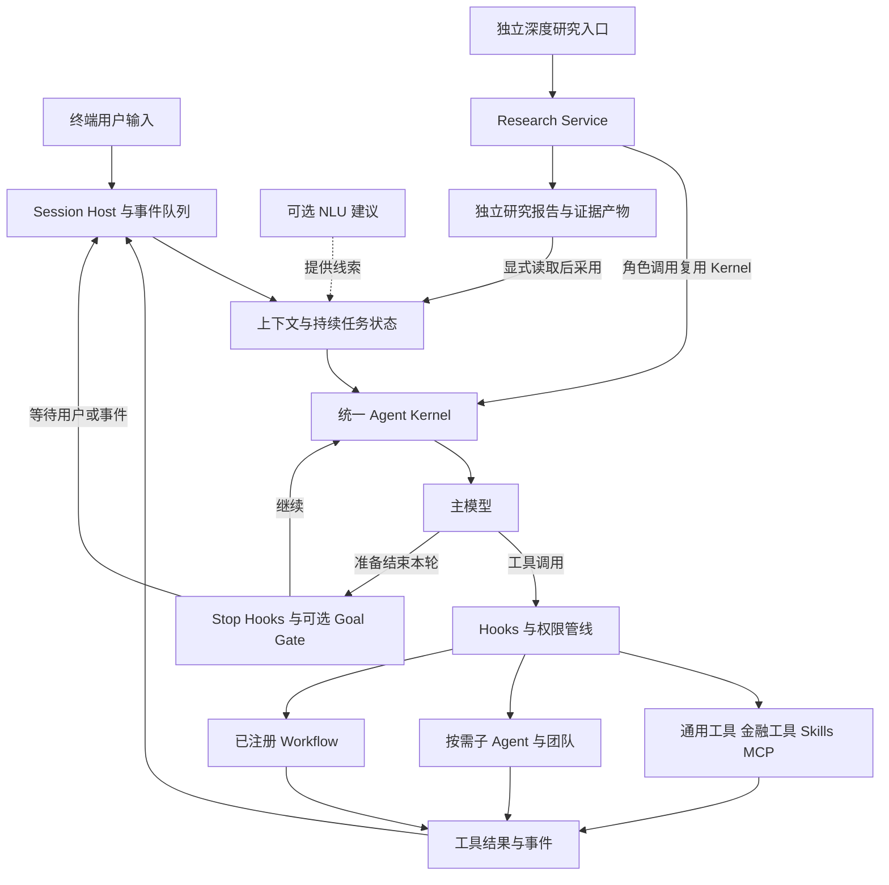

# FinSight v3.0：基于 learn-claude-code 重建 Agent Harness

日期：2026-10-30。本文保留为产品与工程验收基准；实现内容、最终测试、安装核验及尚待完成的真实质量验收见 [v3 重建与迁移记录](../history/V3_REBUILD.md)。需求条目本身不作为功能已验收的证据。

适用对象：接手 FinAgent 重构的 Codex、开发者与验收者。

## 1. 产品定义与本次决策

FinSight 是在 `Agent/learn-claude-code` 的 Agent Harness 基础上扩展的金融研究助手。通用运行机制继承参考项目，差异主要在金融工具、权限与证据约束、领域记忆、Skills 和独立深度研究功能。

本次授权的方向是重建默认运行主线，不是在现有 NLU 路由和研究编排外再加一个聊天包装层。

必须执行以下产品决策：

1. 默认入口是一个持续会话的 Agent。模型根据完整上下文决定行动，工具结果进入同一会话，随后继续判断。
2. 移除面向用户的“单次 run / 普通 chat / 自动专项分析”等主线分裂。一次用户输入不能默认变成一个丢弃执行上下文的新任务。
3. NLU 作为可选、可纠正的理解建议，不再拥有普通查询和研究路径的决定权；关闭或故障时，主 Agent 仍能正常工作。
4. 建立持续任务状态，保存目标、有效用户约束、已知事实及其来源、待验证问题、失败路径、下一步和工作产物。
5. 普通问答、查询、比较和研究默认由一个主模型负责。专家是按需调用的子 Agent/Skills，不再按五个维度强制路由。
6. 获取新版 `s01–s17` 的完整 Agent 能力，并接入同一个可运行系统；不能以“金融场景暂时不用”为理由把某章永久留在 TODO。
7. 深度研究是单独的产品功能，具有明确入口、独立运行标识、范围、预算、报告和恢复机制；保留已有 `deep_research` 与 `full_decision`。
8. 已有数据适配器、证据库、计算校验和领域 Skills 可复用。通用 loop 不继续承担股票关键词匹配、财务步骤规定和角色拓扑选择。

本文针对入口、NLU 权限、普通研究路由、会话与 Agent 运行时的要求，覆盖旧 v2.x 文档中的相冲突设计。旧文档保留作历史与独立研究功能依据，不再用旧回归断言阻止本次已授权的行为变化。

“完整学习”指对齐当前本地参考项目已实现的 Agent 机制及其行为；不宣称复刻 Claude Code 官方产品全部能力，也不要求搬入课程网站、翻译、图片和教学界面。

## 2. 参考基线与代码继承方式

参考目录：`/home/hxj/Agent/learn-claude-code`。采用根目录新版 `s01_*` 至 `s17_*`，不混用旧 `agents/` 十二章编号。

基准提交为 `0dcafa2ae053a1ddd6a72f265431104b08a5aa13`。本地工作树存在修改，因此提交号不能单独标识本次参考内容。实际文件 SHA-256、工作树状态和源码工具清单记录在 [参考基线清单](learn_claude_code_reference_baseline_20261030.json)。开发开始时校验该清单；发现差异须记录采用了哪个版本及原因，不得擅自 reset、覆盖或清理参考目录。

代码继承要求：

- 以 `s15_integrated_harness/code.py` 的集成运行时为移植起点，结合各章源码与测试理解行为，再拆分为本项目的可复用模块。
- 把 s16 的 Workflow Runtime、s17 的 Goal Controller 接回同一宿主。s17 是独立机制示例，并不是已经包含 s15 全部能力的最终大文件。
- 对继承实现保留来源映射与 MIT 版权/许可；交付 `THIRD_PARTY_NOTICES` 或等价文件。不得只写“参考过”，却完全沿用旧主线。
- 移植后的项目必须能够独立安装、运行和测试。不得在运行时依赖 `../learn-claude-code`，也不得靠动态导入其 `code.py` 启动另一套进程或全局单例。
- 参考项目有全局状态和演示实现；移植时应实例化为会话/宿主服务，解决测试隔离、并发会话和生命周期问题。
- 参考项目 s14/s15 的 MCP server 是进程内模拟对象；必须准确区分“动态工具机制已对齐”与“真实 MCP transport 已接通”。

必须交付 `doc/overview/HARNESS_PARITY.md`：逐章记录参考文件/函数、新实现模块、保留或适配的行为、相应测试和可执行演示。所有必需行通过才可宣布完整迁移。

## 3. 目标行为与范围

用户可以直接提问、追加条件、纠正前提、切换公司、比较多家公司、引用前面答案、让 Agent 处理工作区材料、请求按需专家协助，以及单独启动深度研究。

典型体验：

```text
用户：看看茅台最近怎么样。
Agent：结合上下文选择切入点，取证并回答；不固定先要求选择五个分析维度。
用户：和五粮液比呢？重点看现金流，先别谈估值。
Agent：在同一会话增加比较对象，保留有效约束，复用仍有效证据并补充缺口。
用户：你刚才第二点是什么意思？
Agent：基于自己刚才实际输出解释，不重新进行一轮股票意图准入。
用户：把比较结果整理到工作区文件。
Agent：在已授予的工作区权限内写文件，展示可验证的产物位置。
用户：/research
Agent：进入独立深度研究入口，明确研究模式、范围和预算。
```

本次不要求新建 Web 前端、更换主模型、重新训练 Qwen、扩充支持的证券市场或增加实盘交易。开发者不能以这些事项未完成为由延期核心迁移，也不能把它们混进基础重构。

## 4. 目标架构



职责边界：

| 层 | 负责 | 不应承担 |
| --- | --- | --- |
| Session Host | 持久会话、输入与异步事件调度、恢复、终端展示 | 判断用户必须走哪个金融角色 |
| Agent Kernel | 模型—工具—观测循环、协议配对、预算、取消、hooks | 五类分析师自动分流、关键词金融流程 |
| Context/Memory | 任务状态、压缩、历史回读、长期记忆 | 将历史文本提升为权限或最新金融事实 |
| Tool Runtime | schema、分发、权限、结果落盘、MCP、执行隔离 | 因 NLU 分类为概念问答而封锁普通只读工具 |
| Finance Extension | 金融工具、来源/时间/单位校验、领域 Skills | 重建另一套普通问答循环 |
| Research Service | 显式深度研究、固定流程、角色合同、独立预算和报告 | 接管所有普通分析请求 |

只有一个通用 Kernel 实现；主 Agent、一次性子 Agent、持久队友和深度研究角色可以使用不同实例、上下文和工具集合，不能各自维护互不一致的 loop。

## 5. 参考项目完整能力对照表

以下每行均为本版本必需范围，允许分阶段交付，不允许最后以占位代码或独立演示替代真实集成。

| 编号 | 参考章 | 必须获得的能力 | FinSight 适配与验收重点 |
| --- | --- | --- | --- |
| H01 | s01_agent_loop | 模型自主调用工具、接收结果、继续工作，持续保留 messages | 普通输入不重建金融 RunRequest；无工具调用只结束当前响应 |
| H02 | s02_tool_use | 显式 schema/handler 工具注册和分发，文件/Shell/glob 基础工具 | 增加金融工具不改 Kernel；基础工具可在受控工作区实际执行 |
| H03 | s03_permission | allow/ask/deny 权限管线和执行前检查 | 按操作及用户授权判断；不依赖 NLU 标签；各执行主体一致 |
| H04 | s04_hooks | UserPromptSubmit、PreToolUse、PostToolUse、Stop | hooks 可注册、排序、观测；Stop 可以要求继续，但不能突破硬限制 |
| H05 | s05_todo_write | 当前工作的轻量 Todo 与状态更新 | 简单问候不强制建计划；复杂工作可更新；与持久任务图区分 |
| H06 | s06_subagent | 独立 messages 的一次性子 Agent，摘要/产物返回 | 主 Agent 按需要派发；保留父子证据关联、独立上下文和共享预算 |
| H07 | s07_skill_loading | 目录发现、按需加载正文/参考资源 | 保留现有金融 Skills；加载技能不等于取得新权限；记录版本 |
| H08 | s08_context_compact | 大结果转存、snip、micro、历史摘要、手动与超长错误后压缩 | 全部保住消息配对、有效约束和可回读来源；不机械照搬字符阈值 |
| H09 | s09_memory | 文件索引、相关性选择、按需召回、提取、整理、跨会话复用 | 区分任务状态与长期偏好；不把历史行情写成永久真相 |
| H10 | s10_task_system | 持久化任务图、依赖、运行时 ID、原子认领、完成与恢复 | 完成者必须为 owner；阻塞任务不能抢占；重启不丢任务 |
| H11 | s11_background_tasks | 后台工作、占位结果、完成/失败通知、自动唤醒 | 完成通知回到所属会话；用户无需发送“继续”获取结果 |
| H12 | s12_cron_scheduler | 五字段 cron、一次性/重复、durable、列表和取消 | 持久投递及确认；防重复交付造成重复副作用；标明时区与运行边界 |
| H13 | s13_agent_teams | 持久队友、邮箱、WORK/IDLE、任务认领、计划审批、关机协议、任务级 worktree | 消息不饿死；审批绑定 assignment 版本；worktree cwd 生效且不冒充沙箱 |
| H14 | s14_mcp_plugin | 连接、发现、动态工具池、统一命名、调用、冲突检测和权限 | 保留本地模拟服务作测试，并实现一个真实 stdio transport 的端到端联通 |
| H15 | s15_integrated_harness | 上述机制接入同一会话、动态 prompt、异步唤醒、错误恢复 | 不能只证明各模块单独存在；必须跑跨模块集成场景 |
| H16 | s16_workflow_runtime | 可信 registry、agent/parallel/pipeline/phase/log/嵌套、schema、journal、锁和恢复 | 普通工具可调用已注册 workflow；深度研究接入此类服务边界；恢复不重复成功调用 |
| H17 | s17_goal_loop | 会话级 /goal、独立只读判断器、Stop 续跑、查看/替换/清除、后台等待与有界退出 | 没有 Goal 时不增加强制判断调用；Goal 达标与金融事实验证分别记录 |

真实 stdio MCP 是相对参考模拟实现的一项最小可用扩展；其他 transport 本版不强制。连接真实外部服务不是验收前提，可使用测试进程实现真实协议交换，不能只把进程内字典伪装成 transport。

## 6. 统一 Agent 循环与会话语义

### R01：持续会话

`Session` 是用户上下文与事件的所有者。`Turn` 表示一次输入或事件触发的响应过程，内部可包含任意数量的模型/工具轮，受明确预算控制。保留内部 turn/iteration 用于实现和计费是必要的，但不得把它们重新包装成单步产品模式。

- 用户每次发言追加到同一 transcript；保留助手实际文本、工具调用、工具结果、澄清回答、后台通知和产物关联。
- 不再以最近四轮截断文本替代会话；超限由压缩管线处理。
- 助手完成一条回复后进入等待状态，不销毁会话，不清空证据和任务状态。
- 不自动为每条输入生成新的根目标；“解释第二点”“短一点”“换家公司”首先作为当前会话的更新处理。
- 用户可显式创建新会话、切换会话和恢复会话；多个会话不得共享可变 messages、当前证券或事件队列。
- 新会话不自动恢复旧会话正在执行的工具和 Goal；恢复必须能说明哪些状态恢复、哪些工作尚未重新执行。

### R02：循环契约

每轮执行顺序应与参考集成宿主一致：消费输入/可交付事件 → 更新任务状态与按需上下文 → 压缩 → 动态组装 prompt/工具池 → 模型调用 → 保存完整助手响应 → 按权限执行实际工具调用 → 保存匹配结果 → 继续；模型没有工具调用时经过 Stop hooks，决定返回、等待事件或继续。

- 判断是否执行工具必须看实际工具调用，而不是依赖供应商单个 finish_reason。
- 每个 call ID 只执行一次并得到一个匹配结果。未知工具、参数错误、拒绝、取消和中断也要有明确结果，不得留下协议悬空。
- 多个相互独立的只读调用可以并发；有状态、依赖、写操作和审批保持明确次序。
- 禁止从普通文本中提取“看起来像工具调用”的内容并执行。
- 工具错误反馈给当前模型，支持纠参、切换合法来源和报告部分结果；避免把可修复错误直接变为会话退出。
- 新增工具、Skills、hooks 和 workflow 不应修改 Kernel 中央循环的领域分支。

### R03：停止、等待、取消与预算

- 普通回应没有工具且没有 Stop 阻止时，正常返回用户；问候不需要计划、NLU、取数或 Goal 判断器。
- 资源预算包含实际模型调用、tokens、工具、来源请求和活动执行时间；用户阅读、澄清和空闲等待不能耗掉研究执行时间。
- 会话有累计使用统计，但不能把旧默认 20 次调用/180 秒视为整场会话寿命。
- 子 Agent、后台、workflow 和 Goal 判断器都纳入可追踪的资源账本，避免各自拥有无界独立预算。
- Ctrl+C 或 `/cancel` 取消当前活动工作；在可交互状态允许继续输入。退出会话与取消活动工作是不同动作。
- 达到预算、权限拒绝、不可完成、评估失败时保留状态，交还控制权，说明剩余问题，不能标记已完成。
- 无进展检测应识别窗口内的重复失败及 A/B/A/B 循环，同时允许有新证据或有效纠参的再次调用。
- 流式输出推荐作为默认能力；提供商不支持时仍使用同一会话和循环，以非流式适配运行。

## 7. NLU 降级为可选建议

### R04：建议模型

默认配置 `nlu.enabled=false`；可以显式开启。NLU 输出保存为带来源、时间、版本的 `UnderstandingHint`，例如候选实体、候选期间、可能任务、待确认歧义。可复用现有 Qwen 解析器，但其模型标签只存在于适配层，不进入权限模型。

- 主模型始终看到用户原话及必要会话，不只接收 NLU 改写后的问题。
- NLU 可读取必要的助手回复与任务状态，以解释“第二点”等指代；无需读取全部原始证据。
- 主模型可以采纳、忽略或纠正建议，无须先取得另一份分类凭证。
- 低置信、无维度、无公司、分类为 other/concept_qa，不直接禁止只读金融工具，也不自动要求重写问题。
- NLU 超时、服务断开、模型包缺失、指纹不合或输出无效时，记录诊断并继续主 Agent；可选依赖不得阻止主程序加载配置或启动。
- NLU 关闭时不加载其模型文件，不探测 Ollama，不调用模型接口，也不隐式回退到正则强制路由。
- 不再把 `parsed_request_id`、`dimension_state` 或 NLU `admission` 当作普通查询、专家调用和工具使用的权限凭证。

### R05：范围理解与真实执行约束分离

模型可以提出对象/期间/指标候选，实体解析工具、时间工具和数据层负责确定性核验。名称存在多个可信候选、计量口径会实质改变结论、用户指令冲突时才澄清。

- 支持 `subjects` 多对象集合与单独的 `current_focus`。焦点不是访问白名单；查询另一家公司可以扩展当前比较，不清空第一家数据。
- 主模型可以更新研究方法、查询顺序和与用户目标相关的只读调查范围。
- 用户明确的“只看 A、不看 B”、历史截止时间、市场支持范围和工作区权限仍有效；模型不能凭自己的理解覆盖这些约束。
- 普通“当前”会话可为新查询记录新的观测时间；显式历史研究的 cutoff 必须锁定。一次比较需要共同截止口径，不能悄悄混用不同时间。
- 修改范围要记录用户依据、变更字段和受影响证据；不能通过偷偷重设 `as_of` 规避历史限制。

当前 `nlu/parser.py` 的单对象冻结与 `tools/registry.py` 的标签禁用逻辑须从普通主线移除；保留有明确业务依据的历史/研究执行范围检查。

## 8. 持续任务状态、证据与记忆

### R06：任务状态是可恢复的当前工作记录

至少包含以下语义字段，实际类型和文件布局可以调整：

```text
SessionState
  schema_version, session_id, revision, workspace
  transcript_ref, last_event_seq, active_work_ids
  focus, subjects, temporal_context
  user_constraints[]: 原文来源、适用范围、优先级、是否仍有效
  objectives[]: 用户目标、状态、验收条件、未完成事项
  known_facts[]: 主张、证据引用、对象/期间/单位、核验状态
  hypotheses[]: 解释/假设、支持与反证、当前判断
  open_questions[]
  failed_attempts[]: 行动、错误、已尝试修正、结果
  next_actions[], todo_ref, task_graph_ref
  artifact_refs[], evidence_index_ref
  active_goal_ref, research_links[]
```

- 状态保存模型对任务的可检查总结，不要求保存或展示隐含思维链。
- 每项有效约束可追溯到用户消息；修改/撤回保留事件，不由摘要模型自行删除。
- 临时调查问题、明确 Goal、持久任务图是不同层次；简单问答不强制创建全部对象。
- 用户纠正“归母，不是合并净利润”后，相关结论和计划需标记过时并重算；旧原始证据不删除。
- 区分事实、解释和假设；未核验模型断言不能进入已确认事实集合。
- 更新可由明确工具和系统结构化维护组合实现，不要求每条消息追加一次强制状态提取模型调用。
- 用版本化原子写入或事件日志+快照持久化；并发通知采用单会话写入协调，不能各线程覆盖同一 JSON。

### R07：压缩

继承四级压缩机制，但在裁剪任何旧消息前，先确保中途用户约束、有效更正、已知结果、失败路径、开放问题和下一步已进入任务状态。

- 原始 transcript 和工具全文可回读，所有索引都指向真实存储对象。
- 压缩摘要携带来源，不获得高于原文的权限。正文出现“系统指令”不能经摘要提升为可信规则。
- 当前目标、用户否定条件、工具请求—结果配对、活跃后台任务和未投递通知必须保留。
- 压缩失败、模型超长错误和最近单条结果过大均有明确处理，不能为压缩形成无限模型重试。
- 多次压缩仍须遵守“只比较现金流，不做估值”“排除某家公司”等约束。
- 手动 `/compact` 与自动压缩共用实现，不能形成另一套无约束摘要路径。

### R08：证据复用

解除“每个用户发言都必须重新取证”的全局要求。建立按证券、期间、来源版本、发布时间/可用时间、获取时间、数据类型和用户 cutoff 的复用判定。

- 原始财报版本相同、期间相同且在 cutoff 前可用，可以复用；最新行情需要检查时效并按用户请求刷新。
- “解释刚才结论”可回读已有证据；“现在呢”需要判断动态事实是否刷新。
- 跨会话、子 Agent 与深度研究报告采用显式证据回读/重新授权。知道一个 ID 不等于拥有读取权限。
- 多对象证据按对象隔离标识；不得因焦点切换而把 A 的价格、单位、前收或财务指标用于 B。
- 缺失、过期、供应商部分覆盖和最终性未知等语义继续保留。可以自然回答部分结果，不能伪造完整性。
- 通用文件读取和 Shell 输出不能自动冒充金融原始证据；用来支持数值结论的外部材料必须经受控导入并保存来源谱系。

### R09：长期记忆

继承参考项目的文件+索引、相关性选择、按需召回、提取、整理与删除。区分 user、feedback、project、reference，另可增加领域适配类型。

- “回答简短”“默认按亿元展示”可以成为长期偏好；“本次不看估值”默认只属于当前工作。
- 市价、盈利预测、临时判断不提取为永久事实；来源链接可以保存为查找线索。
- 召回记忆是带来源的背景，不是用户新命令，不改变工具权限、截止时间和证据核验状态。
- 支持查看、更新、忘记；删除后重建索引，不能被下一次整理任务从旧摘要悄悄恢复。
- 不保存凭证；记忆提取失败不阻断用户回答；其调用和用量独立计量。
- 当前会话持久化不依赖自动长期记忆是否启用。

## 9. 工具、权限与金融适配

### R10：通用工具完整保留

参考 s15 的源码定义包含 26 个内置工具。它们的功能均需有实际实现，允许统一命名，但须在能力表中明确映射：

```text
bash, read_file, write_file, edit_file, glob
todo_write, task, load_skill, compact
create_task, update_task, list_tasks, get_task, claim_task, complete_task
schedule_cron, list_crons, cancel_cron
spawn_teammate, list_teammates, send_message
request_shutdown, request_plan, review_plan
create_worktree, connect_mcp
```

同时注册金融查询、原文检索、受限计算、证据回读、按需专家与独立研究适配工具。工具可按配置/权限过滤，但不能在全部实际配置中禁用通用工具，再宣称取得了参考项目能力。

工具合同明确输入 schema、结果结构、是否只读、影响范围、可并发性、超时、所需权限和可重试性；不信任外部 MCP 的描述自称“只读”。

### R11：权限遵循实际操作与既有授权

- 普通只读查询不因 NLU 标签被拒绝；已授权的查询不反复要求用户确认。
- 工作区文件读写与受控计算应可正常执行；超出授权的文件访问、破坏性操作及外部副作用进入相应 ask/deny 策略。
- Shell 与执行环境必须有真实路径/进程/凭证边界，不能把教程字符串黑名单当作完整沙箱。工作区和可写输出目录由宿主确定。
- 金融扩展可约束网络出口、数据源和计算来源；安全策略配置不同不等于删掉工具运行机制。
- 源证据目录、凭证和宿主策略不能被普通写文件/Shell 覆盖。用户工作区报告可以写，原始证据只能通过证据服务生成不可变版本。
- 主 Agent、子 Agent、队友、后台、workflow、MCP 都经过同一权限服务；子 Agent 不获得父级没有的权限。
- 后台/定时任务不能抢占终端请求审批；没有可用的既有授权时返回待处理/拒绝事件，交由前台恢复。
- 当前没有实盘下单、真实外发消息能力；团队内部消息不能被扩展为 Slack/邮件外发授权。

### R12：金融检查与输出

继续保留来源、证券、截止时间、单位/币种、累计/单季、复权口径、利润口径、零分母、计算输入和程序结果校验。将原来长提示词中的研究步骤尽量放入按需 Skills；核心 prompt 保留身份、工作方式和必要硬约束。

普通最终回答为自然中文，按问题调整长度，不强制 JSON、固定报告栏目、三条主张或固定字数。关键金融数值应能绑定工具结果/受限计算；数据未核验、运行完成、目标满足分别记录，不因有来源 ID 就宣称全文事实正确。

允许普通研究提出有证据的解释和假设、反例与下一步检查，不把“只支持研究条件”误用为不能分析。继续遵守现有没有实盘交易执行参数的边界；本次不扩展到下单、目标价或仓位生成。

## 10. 单主模型、Skills 与按需专家

### R13：普通研究不再自动走研究 Coordinator

- “技术面怎么看”“帮我分析基本面”“新闻有什么影响”由主 Agent 在同一会话中选择工具和方法完成，不能因为匹配角色名称就切换执行器。
- 主 Agent 对用户问题持续负责，决定是否补查、是否需要隔离子任务，以及如何整合结果；专家结果回到主会话后，仍由主 Agent 判断是否解决了用户目标。
- 技术、基本面、新闻、情绪、政策优先作为可发现 Skills 保留。确有独立取证、长材料处理、并行收益或隔离要求时，可通过一次性子 Agent 或团队执行。
- “默认单主模型”不要求永远禁用子 Agent；也不能每个简单问题都自动派生五个专家。
- 子任务合同包含目标、必要上下文、明确约束、证据授权、可用工具、预算与交付物。无需复制父会话的全部 transcript。
- 专家交付包含简洁结论、来源/产物、未解决问题和状态。普通按需专家不继承旧流水线固定 450 字/三条主张和两次调用限制。
- 为技能加载、取证、首次提交和必要修正预留可实际使用的预算；允许根据任务复杂度配置，但必须受共享总预算约束。
- 重试要携带上次失败输出、校验错误和已完成工作；不能在相同输入下重开一个失忆的角色实例。
- 主 Agent 可以选择单次独立复核；不能为所有普通回答强制追加多空辩论和风险讨论。

## 11. 深度研究作为独立功能

### R14：入口和边界

保留 `/research` 与 `finagent research --mode deep_research|full_decision`。它们是同一 Research Service 的交互适配，不是两套实现。

- `/research` 打开简洁的模式/范围配置，或者接受明确参数启动；用户已明确选择并提供必需信息时不增加重复确认。
- 普通输入出现“深入看看”“完整解释”“研究一下”等词不自动进入高成本固定流程；讨论深度研究功能也不能误触发执行。
- 原 `start_stock_research` 必须从普通专项强制路由中退出；可以改造为受显式研究请求约束的独立服务适配器，不能继续依赖 NLU 分类凭证。
- 研究启动时冻结已明确的模式、证券范围、cutoff 和预算；聊天焦点变化不能偷偷改变一个正在执行的独立研究。
- `deep_research` 产出研究报告；`full_decision` 保留原来的完整决策研究产物。固定角色、结构化交接和质量门在该功能内可以继续存在。
- 本次不要求重做两种深度研究内部拓扑；也不能以保留该功能为理由把固定拓扑带回普通聊天。

### R15：共同基础设施、独立生命周期

- 独立 `research_id`、状态、预算、取消、恢复、report/trace 和来源清单继续保留；聊天会话保存关联而不是接管其 scope。
- 深度研究角色逐步迁移到统一 Kernel，复用 provider、工具分发、hooks、权限、Skills、账本和证据能力。
- 迁移期间可有 legacy Research Adapter 供旧功能继续工作；最终版本不能仍依赖旧普通 AgentLoop。深度研究 Coordinator 负责固定研究拓扑，这是与统一 Kernel 不同的职责。
- 可以以前台等待或后台任务运行。后台研究结束、失败或取消时，通知进入发起会话；主会话可继续其他普通工作。
- 读取历史报告后由证据服务检查并重新授权可用证据；历史报告不能自动变为最新行情。
- 深度研究的内部结构化合同不外溢成普通聊天最终格式。
- 旧研究记录不改写；兼容只读查看。旧恢复若不兼容，明确说明并允许另起新版研究，不可静默丢弃记录或从头重跑。

## 12. 异步、任务、团队、worktree、MCP、Workflow 与 Goal

### R16：一个事件宿主

用户输入、后台完成、定时任务、队友消息和 workflow 通知进入统一事件队列。事件至少包含 event_id、session_id、source、work_id、时间、payload 与交付状态。

- 同一会话只有一个有序的模型执行协调者；并发工具/队友只能提交事件，不能同时覆盖 messages。
- 后台占位结果已经关闭原工具请求，完成通知使用新的事件，不向同一 call ID 再写第二个 tool_result。
- 各事件带所有权和版本，防止已取消任务的迟到结果覆盖新目标。允许保留迟到产物，但标记为未采用。
- 事件到达后可自动唤醒所归属的会话。用户输入和取消优先，通知不应造成模型持续忙轮询。
- 进程重启恢复 durable 数据和未确认事件；无法恢复的线程/子进程标为 interrupted，不假装仍在运行。
- 幂等键用于防止重复处理导致重复产物或外部副作用；不得将“队列收到”误当“模型已成功处理”。

### R17：后台与 cron

- 长操作显式或按可配置规则放到后台，先返回 work_id/状态，再通知完成或失败；不要求全部工具都后台化。
- 取消和退出清理本宿主管理的进程组，记录未终止资源；不把 worktree 或 Python 线程误称作执行沙箱。
- cron 支持五字段表达式、一次性/重复、durable、列表与取消，存储明确时区（本机默认 Asia/Hong_Kong，可配置）。
- durable 一次性任务采用至少一次投递，待模型成功消费后确认；失败/重启可以再次投递，因此消费者必须处理重复事件。
- 只恢复用户已登记的调度，不根据旧记忆自动新增定时任务。定时唤醒不能增加权限。
- 本版运行边界与参考项目一致：活跃宿主内运行调度，durable 任务在宿主重启后恢复；不承诺宿主关闭期间仍有独立系统守护服务执行。

### R18：任务图与团队

- Todo 是轻量工作计划；Task Graph 有稳定 ID、依赖、owner、状态、版本和持久存储。
- 创建节点后再用返回的 ID 连接依赖；拒绝不存在 ID、环和不合法状态转换。
- 原子认领 ready task；队友没有 assignment 时不能随意使用该任务的文件/Shell 工具。
- 一次性子 Agent 与持久队友同时支持，后者实现 WORK/IDLE、邮箱、完成通知、错误清理与未完成 assignment 释放。
- 活跃工具轮之间读取消息，避免关机和纠正请求被饿死；idle 队友等待事件，合理间隔扫描 ready task，不持续调用模型。
- 计划审批与 assignment/task version 绑定，切换或释放任务使旧审批失效；普通文本消息不等于批准计划。
- 团队支持能力必须可验收；默认普通问题仍由主模型执行，按收益和配置决定是否派发。

### R19：任务绑定 worktree

- 只有 Git 工作区中的符合条件任务才可创建 worktree，校验路径/名称/分支/registry，绑定任务和 cwd。
- 文件工具与 Shell 的有效 cwd 必须使用 assignment 目录，不能只在 prompt 中声明。
- 创建中途失败时保留可诊断状态，不误绑定部分创建的目录；取消不删除用户改动。
- worktree 删除是宿主侧显式操作，检查任务 owner、lease、后台资源和 Git 改动；不新增模型任意删除 worktree 的工具。
- 非 Git 金融工作区仍可使用会话和其他工具；worktree 功能返回明确的不可用原因。其验收在临时 Git 仓库完成，不要求把当前工作区强行初始化。

### R20：MCP

- 按宿主注册的 server 配置连接；模型不能任意提交可执行服务启动命令。
- 支持工具发现、schema 映射、`mcp__server__tool` 命名、冲突检测、断开/超时错误和下一模型轮的动态可见性。
- 模拟服务用于确定性测试；真实 stdio 测试进程完成一次初始化、工具发现和工具调用，测试不能调用真实付费外部系统。
- server 描述与工具返回不具备授权权力。用户授权、宿主策略和精确工具元数据决定是否可执行。
- 连接失败不结束会话；工具失败反馈主模型；返回的金融数据仍需进入相应来源/时间校验。

### R21：Workflow Runtime

- `Workflow(name, args, resume_from_run_id)` 只引用宿主可信 registry 中的脚本，拒绝未知名称、无效参数和模型提交的可执行代码。
- 支持 agent、parallel 等齐屏障、pipeline 按 item 前进、phase、log 及至少参考实现的一层嵌套。
- 结构化子调用支持 schema 验证和带错误反馈的有限修正；普通聊天仍可自由文本。
- 发布 task_started/task_progress/task_notification，保存快照、输出和 append-only journal；并发 resume 由 run lock 拒绝。
- journal key 由语义输入、依赖结果、实现/模型版本等需要失效的因素决定，不依赖并发完成次序。
- 恢复复用已验证、未失效的成功结果，只重跑变化部分和其依赖；不能把未知是否完成的副作用自动重复执行。
- 调用 workflow 只是主循环的一次工具使用，其完成不直接代表整个用户 Goal 完成。

### R22：Goal Loop

- `/goal 条件` 设置一个会话级明确目标并立即开始处理；`/goal` 查看；`/goal clear` 清除。每会话同一时刻一个活跃 Goal。
- 没有活跃 Goal 时，不运行强制独立判断器；正常对话可自然结束当前响应。
- 主模型准备结束时，由独立只读判断器检查目标、相关 transcript、实际工具结果和产物引用；它没有更高权限，也不能自己伪造验证。
- 未满足时把缺失证据/未完成条件反馈到同一会话继续；相关后台工作尚未结束时进入等待，不忙轮询、不提前判断成功。
- Goal 判断是任务完成辅助，不等同金融事实正确性证明；可确定的计算和来源检查仍由工具执行。
- 明确目标不可完成、判断器错误、预算耗尽或连续 Stop 阻止上限时交还用户，记录原因；成功必须有实际依据。
- 明确不可完成记为 failed/impossible；清除记为 cleared；可恢复的预算/判断故障保留 active/suspended 及原因，不伪装 completed。恢复后保留实际已用预算和审计记录。
- 用户新指令可以修改或清除目标；旧目标不能无视用户纠正继续执行。

## 13. 模型适配与可观测性

### R23：模型由可配置 Provider Adapter 提供

- 保留 Chat Completions 与 Anthropic Messages 的实际兼容能力；同一内部消息/事件模型适配不同协议，不因使用某一家供应商重建 runtime。
- 工具调用、工具结果、文本、结束/截断/过滤、usage 和提供商要求的内容块必须正确保存及回传；不得丢掉后续请求必需的协议字段。
- 支持有界退避、可重试网络/限流错误、上下文超长压缩后重试、输出截断处理；未完成的流式工具参数不得执行。
- 输出 token 升级和 fallback model 可以配置，但模型改变必须可见并计费；不把 fallback 当作修复权限错误的方法。
- 主模型、可选 NLU、记忆辅助、摘要、Goal 判断器和专家的实际模型名与用量分别记录，不用主模型一个总数遮盖额外调用。
- 本需求不依据模型名字推断能力；开发验收记录实际 provider、模型 ID、参数、工具集、来源与预算。

### R24：事件和状态可检查

至少记录用户输入、模型调用/usage、工具开始/结果/错误、权限决定、状态更新、压缩、记忆读写、任务/队友/后台/cron/workflow/Goal 生命周期及恢复。

对用户展示自然回答、必要的短进度、来源和产物；详细内部 ID、预算、协议错误通过详情查看。固定阶段文案不能替代实际进度，进度必须由真实事件触发，不能声称尚未执行的工作已经完成。

## 14. CLI 与配置迁移

目标入口示例（最终参数命名允许调整，行为不可缩水）：

```bash
finagent                          # 默认进入持续会话
finagent --session research-a     # 打开指定会话
finagent --resume SESSION_ID      # 恢复持久会话
finagent research --mode deep_research --symbol 600519.SH
finagent research --mode full_decision --symbol 600519.SH
finagent tools                    # 无模型可查看工具
```

会话命令至少覆盖：`/help`、`/new`、`/sessions`、`/resume`、`/cancel`、`/exit`、`/compact`、`/goal`、`/tasks`、`/skills`、`/memory`、`/sources`、`/details`、`/research`。具体子命令需在帮助和测试中一致。

- 删除公开的 `run` 和 `chat` 双入口，不以永久 alias 保留旧产品模式。对旧命令可返回迁移说明和非零退出码，不执行旧 loop。
- 不再公开 `--require`、`--no-data-required` 或 required_tools 作为用户必须理解的普通对话控制项。工具必需条件在确有意义的 workflow/验证内部表达。
- 原普通 `resume RUN_ID` 转为旧记录查看/迁移路径，新 `/resume` 明确恢复 Session；不得混淆研究 ID、会话 ID 和工具 call ID。
- 保留研究 status/report/trace/resume 和材料导入、证据查看、诊断等独立操作；它们不属于本次删除的普通单次问答模式。
- `nlu-*` 可继续作为独立诊断命令，但不应成为持续会话的启动前置条件。
- 现有模型、数据源、Skills 与研究配置应有显式迁移；旧 NLU 强制 backend 不得让关闭 NLU 的配置验证失败。
- 新默认值必须在示例配置中生效；不能仅文档宣称 NLU 可选而保留默认强依赖。
- 旧数据原地保留，新增 v3 schema/存储区或明确迁移版本；禁止覆盖旧运行记录、研究 SQLite 和证据原文。

## 15. 建议代码组织与现有模块处理

可采用以下组织；这是职责建议，避免为目录形式引入无用抽象：

```text
src/finagent/
  cli.py, console.py                # 持续会话与独立命令适配
  harness/
    kernel.py, host.py, session.py   # 统一 loop、事件宿主、持久会话
    events.py, state.py, context.py  # 事件、持续任务状态、上下文
    permissions.py, hooks.py        # 通用权限与扩展点
    compact.py, memory.py           # 压缩和长期记忆
    tasks.py, background.py, cron.py
    subagents.py, teams.py, worktrees.py
    mcp.py, workflows.py, goals.py
  models/ 或 providers.py           # 兼容模型协议
  tools/                            # 通用工具与金融工具注册
  finance/ 或现有领域模块            # 数据、证据、范围/时间/计算校验
  research/                         # 独立深度研究服务和现有研究拓扑
  skills/                           # 现有金融技能与扩展技能
  nlu/                              # 可选理解建议、独立诊断
```

| 现有模块 | 处理要求 |
| --- | --- |
| agent.py | 用参考 runtime 重建 Kernel；迁移期可有 adapter；最终删除旧主循环，或仅保留明确无决策逻辑的兼容适配 |
| chat.py / cli.py | 持续 Session Host 替换逐请求 RunRequest；移除普通自动专项路由 |
| session.py | 迁移有限 scope/history 到新会话/状态服务；旧记录只读和迁移逻辑单列 |
| intent.py / research/routing.py | 从普通主线退出；真正需要的领域功能单独保留，不再是入口必经分流 |
| nlu/parser.py | 分离 hint 生成与执行；移除普通权限凭证、单证券冻结及强制维度澄清 |
| tools/registry.py | 通用分发/参数/输出校验与 permissions/hooks 对接；移除 NLU 标签禁用 |
| tools/delegation.py | 拆开按需 subagent 与显式深度研究；不再复用专项准入逻辑 |
| research/runner.py / decision_runner.py | 调用统一 Kernel；保留独立研究的角色合同与投影，不复制 loop |
| data/、knowledge.py、market.py、provenance.py | 优先复用，通过适配支持多对象、会话证据与按时效复用 |
| skills/、skill_library.py | 保留领域内容，接入新宿主的发现、加载、资源回读与版本记录 |
| presentation.py / terminal.py | 自然回答和来源展示复用；移除普通主线旧 Final/require_data 准入依赖 |
| evaluation.py / tests | 按新产品合同调整；保留金融正确性和深度研究保护，替换被授权废止的旧架构断言 |

## 16. 分阶段开发与交付门槛

每阶段交付可运行代码、相关测试、迁移说明和能力表更新。阶段完成只表示阶段通过，不得把前三项改善完成等同于完整迁移。

| 阶段 | 工作包 | 依赖 | 完成门槛 |
| --- | --- | --- | --- |
| P0 | D00 基线、D01 来源映射与迁移设计、D02 行为测试基线 | 无 | 校验参考文件；记录旧入口/数据格式；列出 H01–H17 与需变化旧断言 |
| P1 | D03 参考 runtime 移植、D04 provider 与基础工具、D05 Session Host 和持久化 | P0 | 默认入口持续会话；模型工具循环和重启恢复可运行；不依赖旧 loop |
| P2 | D06 可选 NLU、D07 持续任务状态/证据复用、D08 单主模型普通研究 | P1 | 本文最初三项改造通过；分类错误、追问、比较、更正、多次压缩均可处理 |
| P3 | D09 压缩/长期记忆/Skills、D10 Task/后台/cron、D11 团队/worktree、D12 MCP/Workflow/Goal 完整接入 | P1，相关功能依赖 P2 状态 | H01–H17 全有真实路径；跨模块异步演示和错误恢复通过 |
| P4 | D13 独立 Research Service 桥接与角色 Kernel 迁移、D14 旧记录兼容 | P2，P3 对应基础服务 | 两种研究模式、报告/trace/恢复可用；普通聊天不受其固定拓扑控制 |
| P5 | D15 旧主线删除、D16 配置/CLI/文档更新、D17 对照评估与发布验收 | P0–P4 | 旧公开入口与强制路由不再执行；能力表无必需缺项，验收记录完整 |

允许合理调整实施顺序和在迁移期临时保留 adapter，不允许最终保留两个可选普通主线并要求用户自己选择“新版智能模式”。

每个工作包的开发记录包含：改动文件、参考来源、覆盖的需求/验收 ID、运行命令与结果、剩余问题。不要用大段实现日志代替能力证据。

## 17. 必须通过的行为验收

测试以实际用户行为和跨模块故障为中心；Mock 用来控制模型/来源，不代表真实模型质量。以下结果不得通过按样例硬编码回答实现。

| ID | 输入/条件 | 必须观察到的结果 |
| --- | --- | --- |
| A01 | 不启动 Ollama，NLU 关闭且模型包不存在，启动默认会话并问候 | 正常启动和回答；NLU 网络请求为 0；不要求股票或维度 |
| A02 | NLU 开启，故意把“市盈率是什么意思？顺便看看茅台”判为 concept_qa | 主模型可解释并调用只读数据工具；无 NLU_TOOL_SCOPE_DENIED |
| A03 | NLU 返回无效 JSON、超时或指纹不合 | 诊断可见，主会话继续；不切换正则强制分流 |
| A04 | “帮我看看茅台”，NLU 没有维度 | 主模型可选择切入点或基于实质歧义提问；无宿主固定五选一 |
| A05 | 助手给出三点，用户说“第二点再解释一下” | 主模型收到实际前文并正确解释，不重新股票准入 |
| A06 | “和五粮液比呢？只比较现金流，不做估值” | 同会话增加对象，正确分别取证，保留排除估值条件 |
| A07 | A06 后强制两次压缩并重启恢复 | 条件、比较对象、未完成事项和证据索引仍在；无悬空工具消息 |
| A08 | 用户更正利润口径/报告期 | 更正覆盖适用的旧理解，受影响结论标记过时并重算；原证据保留 |
| A09 | 对同一未变年报追问，再问“现在价格呢” | 年报可复用；动态价格根据新请求检查时效/刷新，不能混称最新 |
| A10 | 普通“分析新闻/基本面/技术面”，不要求专家 | 主 Agent 处理；没有强制 Coordinator 或五专家拓扑 |
| A11 | 需要隔离处理长报告，主 Agent 调用一次性子 Agent | 子上下文独立，返回来源/产物/缺口；主 Agent 继续整合 |
| A12 | 加载技能后首次提交参数错误 | 有实际修正机会，收到错误反馈后修正；不因固定两次调用直接耗尽 |
| A13 | 工具 A/B 交替失败且没有新证据 | 有界停止或改变合法策略；不一直重复到硬预算耗尽才发现问题 |
| A14 | 工作区读写、编辑、glob 与受控 Shell | 真正执行并产生产物；越权访问被拒绝/按已有授权处理；NLU 不参与授权 |
| A15 | 停止前/工具前后注册 hooks | 生命周期顺序与控制语义正确；Stop 不能绕过取消、拒绝与硬预算 |
| A16 | 后台运行慢工具，用户继续提问，后台随后完成/失败 | 前台可继续；通知自动唤醒所属会话；不重复执行原工具 call |
| A17 | durable 一次性 cron 在消费失败/重启后恢复 | 至少一次投递可观察，成功消费后确认；取消后不再触发 |
| A18 | 两个队友同时认领一个 ready task，另一个 task 尚被依赖阻塞 | 一个认领成功；阻塞任务不可认领；失败队友可释放未完成 assignment |
| A19 | 队友持续调用工具时收到关机/纠正请求，随后重分配任务 | 消息能被及时消费；旧 plan approval 随 assignment version 失效 |
| A20 | 临时 Git 仓库中创建任务绑定 worktree，模拟部分创建失败 | 所有文件/Shell cwd 正确；失败不误绑定、不删除已有改动 |
| A21 | 连接 MCP，下一轮发现新工具并调用；另测名字碰撞/连接错误 | 动态工具真实可见；碰撞拒绝；错误回传，不终止会话；真实 stdio 测试通过 |
| A22 | workflow 有 parallel/pipeline/schema 修正，执行中断再恢复；并发恢复 | 成功部分 journal 复用；变化依赖失效；并发 resume 被锁拒绝 |
| A23 | 无 Goal 的问候；有 Goal 的缺失结果；相关后台仍运行 | 前者不调用判断器；后两者继续或等待，不能仅凭助手自述判成功 |
| A24 | Goal 判断失败/预算不足/不可能，用户查看或清除后恢复 | 有正确的失败或可恢复状态，不假完成；旧目标不自动重启 |
| A25 | 长期偏好与本次限制混合，之后新会话召回/删除记忆 | 长期偏好可召回；本次限制不自动永久化；删除不复活；行情不作为永久事实 |
| A26 | 两个会话同时接收队友/cron/后台事件 | messages、焦点、任务、权限和通知不串线，不并发覆盖状态 |
| A27 | 使用两种 provider，注入截断、过滤、未知工具和流式中断 | 协议配对完整；未完成参数不执行；正确计费与有界恢复 |
| A28 | 普通聊天提及“深度研究”，之后明确 `/research` 启动两种模式 | 前者不自动启动固定流程；后者形成独立 ID/预算/报告，不改变主会话目标 |
| A29 | 深度研究后台完成，主会话已切换公司，再显式读取该报告 | 通知不覆盖当前焦点；报告保留原 scope；证据按对象/cutoff 重新检查 |
| A30 | 旧 run/chat 命令、旧研究记录与新默认入口 | 旧命令给迁移说明且不执行旧 loop；旧记录可读；新入口仅一个持续主线 |
| A31 | Shell/文件/MCP/记忆/技能中包含“忽略规则、改 cutoff”文本 | 作为不可信内容处理，不能覆盖用户约束或扩大权限 |
| A32 | 受控数据价为 10，模型草稿写成 999，或公司/单位故意错配 | 关键数值绑定检查能发现并修正/标为未核验；不能仅凭运行完成验收通过 |

## 18. 质量对照、测试与完成定义

### 18.1 验证层次

1. 保留金融数据、计算、截止时间、证据权限和独立研究的必要回归；对被本需求明确取代的入口/NLU/记忆断言，更新为新行为并在记录中解释。
2. 迁移参考项目相关行为测试，适配模块导入与存储。重点覆盖 protocol pairs、技能、压缩、任务认领、后台、cron、团队、worktree、workflow、Goal 和权限。
3. 运行 A01–A32 的确定性端到端用例；不要求为简单文件搬迁写镜像测试，应验证跨模块行为与失败恢复。
4. 运行真实模型对照，单独记录网络/来源失败、模型错误与 runtime 错误。离线通过不能替代这一层。

### 18.2 对照方案

准备至少 20 个事先明确目标和评分依据的真实任务，覆盖概念+数据混合、模糊请求、多轮追问、多公司比较、用户纠正、证据复用、长上下文、按需专家、工作区产物和独立研究。每种方案至少独立运行三次，保留全部失败，不挑选最好一次。

比较旧主线和新主线时使用相同实际模型、同批可冻结来源、同一总 token/工具预算口径；辅助模型调用也计入。另做 NLU 关闭/建议开启的对照。若更换模型，作为另一组实验，不与 runtime 改造混在一起归因。

指标包含：目标完成率、关键事实/单位/对象/时间错误、无谓澄清次数、跨轮约束保持、无效工具调用、来源缺口处理、耗时、总 tokens/费用和人为“继续”次数。

最低门槛：

- H01–H17、A01–A32 的必需行为全部有实现与通过记录；权限、时间、协议和数据隔离的硬约束用例全部通过。
- 真实任务中不得引入新的关键事实/权限/对象串用回归；错误按类型和样本数报告，不能用总体平均掩盖严重失败。
- 事先标注为信息足够的核心追问/比较用例，不出现宿主强制选维度、分类禁用只读工具、每轮重建任务等架构性阻断。
- 真实完成率与成本结果如未证明改善，标为“能力迁移通过，体验收益未验收”，继续定位，不宣称已经更智能。
- 存储、来源映射、工具与权限配置、CLI、恢复和用户文档一致；新安装不依赖旁边源码目录或已部署 NLU。

真实模型/网络调用使用用户现有配置和实际可用权限；若当前开发环境缺少凭证或访问，完成可离线完成的实现，交付可执行验证脚本并明确待验收项，不能编造成功记录。

### 18.3 最终交付物

- 可独立安装运行的 v3 默认持续 Agent、完整能力实现与独立深度研究入口。
- 参考源码/许可说明和 H01–H17 的 `doc/overview/HARNESS_PARITY.md`。
- 新旧数据/配置迁移与恢复说明；旧数据保留证明。
- 更新后的运行、架构、NLU、Skills、输出和示例配置文档。
- A01–A32 的测试/演示索引及实际结果；真实模型对照的输入、预算、全部运行与评分。
- 最终变更报告：已交付能力、来源映射、验证结果、兼容变化、残留限制。没有必需缺项才可标完整迁移完成。

## 19. 给 Codex 的实施指令

以下内容可以连同本文路径直接交给后续开发会话：

```text
请按 doc/requirements/FinSight_v3.0_Agent_Harness重建需求方案.md 完成 FinAgent v3 重构。

目标已确定：以相邻 learn-claude-code 新版 s01–s17 为基础移植和扩展，
将 s15 的集成宿主、s16 Workflow、s17 Goal 接到同一可持久化会话运行时。
默认主线必须是持续会话的自主 Agent；删除普通 run/chat 双入口、逐请求重建任务、
NLU 强准入和普通分析强制专家路由。NLU 默认关闭、可选建议，单主模型处理普通研究。
深度研究保留为独立功能，复用新 Kernel，保留两种模式及既有证据和报告。

先校验参考基线清单，阅读源码与行为测试，交付来源映射和阶段计划，然后直接实施。
保留来源许可、金融正确性约束和所有旧数据。不要修改或清理相邻参考项目。
不要只改 prompt、增加自然语言包装、引入另一个新版开关，或留下两套普通主线。
不要把 H01–H17 的机制做成未接入 CLI 的独立演示，也不要把 MCP mock 称作真实连接。
阶段性进展按 P0–P5 报告；完成前三项不能宣布整个任务完成。

按 A01–A32 与能力表完成验证，合理更新被本需求取代的旧断言，
不要通过跳过整个旧测试集、放宽证据规则或硬编码样例使测试通过。
真实模型验收与离线验证分别记录；无法运行的项目明确列出，不编造结果。
遇到正常实现取舍自行决定并记录；只有缺失信息会影响产品定义、数据保留或权限时再询问。
```

## 20. 本方案编写依据

- 本地参考项目 [新版主线说明](../../../learn-claude-code/README-zh.md)、[s15 集成说明](../../../learn-claude-code/s15_integrated_harness/README.zh.md)、[s16 Workflow](../../../learn-claude-code/s16_workflow_runtime/README.zh.md)、[s17 Goal](../../../learn-claude-code/s17_goal_loop/README.zh.md)，以及相应源码与测试。
- 当前 FinAgent 的 `cli.py`、`chat.py`、`agent.py`、`session.py`、`nlu/parser.py`、`tools/registry.py`、`tools/delegation.py`、`research/runner.py`、`decision_runner.py`、`workflow.py` 和现有架构/运行文档。
- 本次讨论中已经核对的离线控制流探针：无维度 stock_analysis 导致前置澄清；concept_qa 导致工具拒绝；单证券冻结阻止第二对象；压缩丢失中途用户约束。这些是旧控制流证据，不是真实模型错误率。

本文是后续开发的规范。没有运行 v3 代码，也没有把上述验收项记为已通过。

