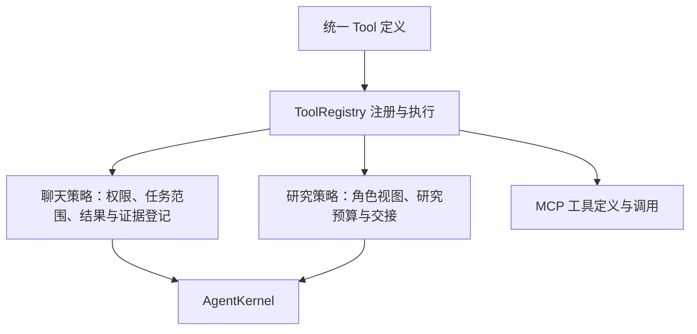

# FinSight v3.1：统一工具定义、注册与执行

日期：2026-11-04。版本：3.1.0。状态：已按方案完成开发与回归，实施结果见第9节；未自动重启现有服务。

[返回需求目录](README.md) · [项目设计](../overview/PROJECT_DESIGN.md)

## 1. 更新原因

v3.0 的普通聊天使用 `RuntimeTool / ToolPool`，金融领域和研究使用 `Tool / ToolRegistry`。聊天先建立领域注册表，再为金融工具创建 RuntimeTool，执行时又回调领域注册表，产生两份工具对象、两层注册和两次分派。

研究与聊天确实需要不同上下文、预算、范围和输出处理，但这些差异应由运行策略表达，无须维护两套工具基础设施。本次采用研究侧 Tool / ToolRegistry 为统一入口，保留聊天和研究各自的执行策略。

## 2. 目标与边界

- 只保留一个正式 Tool 类型和一个 ToolRegistry 实现。
- 金融、任务、记忆、文件、研究启动及 MCP 工具都使用同一注册、Schema 生成和调用分派机制。
- 聊天中的金融工具直接进入同一个注册表，移除“RuntimeTool 包装后再次调用 finance.execute”的桥接链。
- 保留权限、任务范围、证据登记、输出转存、研究角色限制、提交次数限制和预算规则。
- 保留公开工具名、参数合同、模型协议及前端接口；业务结果继续使用 Observation，控制类工具可返回自身 JSON 结果。
- 不更改研究拓扑、记忆算法、用户数据归属、Redis / SQLite 布局或预算额度，不引入数据库迁移。

这是一项基础设施重构，不以测试通过声明模型回答质量提高、研究准确率提高或成本下降。

验收补充（2026-11-04）：全量研究回归暴露出原有脱敏规则会把随机十六进制 ID 内的数字片段识别为手机号，改写 source_id / artifact_id，导致研究未启动或交接校验失败。本次追加局部兼容修复：仅排除完整 32 / 64 位、含十六进制字母的标识符内部手机号片段；保留独立手机号、显式敏感字段、已配置密钥及其他原有规则。使用固定含手机号数字的 ID 覆盖聊天启动和完整研究流程，不通过重跑随机用例或关闭防护规避失败。

## 3. 统一后的结构



图中箭头表达组合关系。聊天和研究分别创建自己的注册表实例与上下文，使用的是同一个类；不会把不同用户或角色的全部工具放在全局可调用池中。

## 4. 数据结构与接口

### 4.1 Tool

统一定义保存 name、description、arguments、handler、perception、permission 和 output_model。

- arguments 支持 Pydantic 模型与 JSON Schema：领域工具沿用类型化参数，内置 / MCP 工具使用已有 Schema。
- handler 的正式合同为 `(args, ctx)`。类型化工具接收模型实例，Schema 工具接收校验后的字典；需要共享 Ledger 的工具从 `ctx.operation_ledger` 获取。
- `schema()` 统一生成模型函数定义。后端处理函数和权限对象不发送给模型。
- output_model 默认 Observation；控制类和 MCP 工具显式设置为 None，保留原有 JSON 结果。
- 使用同一个注册入口拒绝名称冲突、无效 Schema 和外部 Schema 引用。

### 4.2 ToolRegistry

正式执行接口为 `execute(name, arguments, ctx, ledger=None, foreground=True)`。执行链统一为：

```text
检查上下文与研究预算
→ 找到工具并解析参数
→ Schema 校验与权限检查
→ 场景执行前策略
→ 类型化参数解析
→ 调用唯一 handler
→ 输出合同与上下文检查
→ 场景结果处理
→ 返回结果并结算研究预算
```

JSON Schema 负责外部参数结构，Pydantic 继续负责领域转换和语义校验；这是不同合同职责，不是两套注册与分派。

`view(allowed)` 从同一注册表类型生成角色受限视图，并保留权限策略，不因裁剪工具而放宽执行授权。工具替换采用 dataclasses.replace，保留新增的权限和输出合同元数据。

### 4.3 执行策略

统一注册表通过显式策略配置 permissions、执行前检查、执行后处理、错误形式、待澄清限制和提交次数限制，不按“聊天 / 研究”再复制 execute 实现。

聊天策略：

- 保留 SessionHost 的角色 / 工具筛选检查。
- 对领域工具运行 guard_task_tool。
- 保存 Observation，登记 result_id、snapshot_id、已知事实和取证结果，处理大输出转存。
- 控制工具保留自身 JSON 结果，注册表基础错误以结构化字典返回。
- 前台审批等待继续从活动耗时中扣除，共享操作预算仍由 Kernel / Ledger 管理。

研究策略：

- 保留角色工具白名单、冻结范围和研究独立账本。
- 统一注册表按上下文中的 ResearchBudget 进行工具预留与结算，每次分派只计一次。
- 保留待澄清限制与 submit_analysis 最多一次修正；错误继续以 Observation 返回。
- ResearchRuntime 继续负责研究证据授权、产物引用与记录，不维护另一套工具注册 / 校验代码。

## 5. 逐模块迁移

| 模块 | 改动 |
| --- | --- |
| tools/registry.py | 合并 Tool、注册、Schema、权限、分派与错误处理，加入执行策略 |
| harness/tools.py | 保留 Permissions 和 WorkspaceTools；旧 ToolPool 仅为 ToolRegistry 别名，RuntimeTool 仅为创建统一 Tool 的兼容函数 |
| harness/host.py | 只创建一个工具注册表；finance 作为旧属性别名指向同一对象；显式保存领域工具名称集合 |
| harness/extensions.py | 移除金融工具二次注册；设置聊天执行策略，直接注册其余统一 Tool |
| harness/mcp.py | 直接创建统一 Tool，保留名称规范化、Schema 和读 / 审批权限 |
| web/session_manager.py、acceptance.py | 用明确的领域工具集合生成原有白名单，避免 finance 别名包含控制工具后扩大 Web 权限 |
| research/runner.py、research/evaluation.py | 使用 replace 包装处理函数，保留权限、输出合同等元数据 |
| 文档与版本 | 更新架构、设计说明、功能索引与版本号；冻结评测快照不改写 |

兼容名称不会持有独立工具字典或另一套 execute。仓库正式代码迁移到统一类型，旧测试和扩展导入可继续使用兼容入口。

## 6. 开发顺序

1. 先完成本方案与验收标准。
2. 合并工具类型、Schema 校验和注册表执行实现。
3. 迁移聊天到单实例注册表，移除嵌套分派，保留结果处理与权限。
4. 迁移内置工具、MCP、研究包装和 Web 白名单。
5. 添加跨场景回归测试，再运行现有聊天、研究、发现、权限和 Web 测试。
6. 完成全量 Python 回归、文档链接与版本检查，将实测记录写入本文。

## 7. 验收标准

- 聊天金融工具只保留一份 Tool，执行时不回调另一张注册表；旧 pool / finance 属性指向同一实例。
- 同一个领域工具定义可分别由聊天和研究运行环境使用，参数和模型工具 Schema 一致。
- 非法参数、未知工具、无权限调用、角色视图之外调用均不能执行处理函数。
- 参数和输出合同保留；Schema 外部文件 / 网络引用被拒绝。
- 聊天 Task Frame 检查、证据登记、大结果转存和控制工具结果正常。
- deferred 工具引用、稳定目录、Web 工具白名单和 MCP 权限不因统一而扩大。
- 研究工具预算恰好计一次；失败 / 中断预留、提交次数和冻结范围仍受约束。
- 既有测试通过；新增测试覆盖上述跨层行为，不能仅断言类名或方法名改变。

## 8. 兼容、上线与恢复

不自动重启现有服务，不修改线上凭据或已有用户数据。部署时先完成 / 取消在途工作，再重启 CLI 或 Web 加载新代码。已有会话仍按现有机制恢复；旧研究若实现指纹不匹配，继续由原有恢复检查拒绝续跑，可只读查看并按已有机制新建研究。

版本回退需要使用配套源码恢复，不在运行中的会话内混用新旧工具实现。工具定义和结果合同保持兼容不代表任意旧执行线程可以自动恢复。

## 9. 实施记录

### 9.1 已完成的变更

- 在 [tools/registry.py](../../src/finagent/tools/registry.py) 合并 Tool、Schema 校验、权限、注册、角色视图与执行分派，通过 ToolExecutionPolicy 配置场景行为。
- SessionHost 只保留一个注册表，registry / pool / finance 指向同一实例；删除金融 RuntimeTool 包装与 finance.execute 嵌套分派，改为 before / after 策略检查任务和登记结果。
- 内置、记忆、任务、研究启动和 MCP 工具接入同一个 Tool 类型；ToolPool 是别名，RuntimeTool 是兼容构造函数，旧调用形式在同一 execute 中规范化。
- 研究角色与冻结回放使用 replace 保留工具元数据；工具预算每次分派只预留、结算一次，保留提交次数和冻结范围规则。
- Web 与候选验收使用 finance_tool_names，而不是完整注册表生成领域白名单，避免文件 / Shell / 队友等能力被意外开放。
- 保留原有文件 / Shell 的 TOOL_ERROR 合同与审批等待扣时行为。
- 修正了 MCP 读取旧工具池权限属性的遗漏，并追加内部十六进制 ID 的手机号误判兼容修复。新增固定 source_id / artifact_id 的聊天启动与完整研究链路回归（断言19次模型调用），保留真实手机号、显式敏感字段及已配置密钥拦截检查。
- 包版本与源码版本更新为3.1.0，架构、设计说明、面试准备、工具功能与安全文档同步更新。工具使用方法见[统一工具说明](../features/UNIFIED_TOOLS.md)。

### 9.2 实际验证

| 检查 | 结果 | 结论边界 |
| --- | --- | --- |
| 最终 Python 全量回归 | **753项通过，88.746秒** | 覆盖程序行为和合成执行，不代表真实金融回答质量 |
| 新增回归 | **20项** | 统一工具15项、标识符与敏感信息3项、固定 ID 的聊天与完整研究2项；均包含在全量结果中 |
| 定向回归 | 43项通过，4.649秒 | 统一工具、安全规则与固定 ID 的两条研究链路 |
| 干净 wheel 构建 | finagent-3.1.0-py3-none-any.whl | 从临时干净源码目录构建，排除现有 build/lib 中的历史技能残留 |
| 安装包隔离冒烟 | 通过 | 从解压 wheel 导入3.1.0；执行类型化工具；9个Skills和11份角色方法齐全；模型与来源请求为0 |
| 源码与文档检查 | 通过 | 只剩一个正式 Tool 类、一个 ToolRegistry 类，版本一致，更新文档的本地链接有效 |

测试使用临时目录和独立 Redis Unix socket。启动器仅在测试进程中将默认 Redis 客户端路由到隔离实例，保留环境变量与 .env 优先级测试语义；测试结束关闭并清理临时实例，不清理现有 Redis 或用户目录。

迭代中出现的研究失败没有通过修改金标、关闭防护或删除用例处理：固定 ID 复现了原有手机号误判，修复后原用例和新增确定性用例均通过。初次 wheel 检查还发现本地旧 build/lib 含已移除角色技能，因此交付包改用干净源码目录构建；保留原 build 目录，未将其当作当前源码。

### 9.3 验证记录与使用

- [机器可读汇总与实现指纹](../../.finagent/validation/unified_tools_v3_1_20261104/summary.json)
- [最终全量测试日志](../../.finagent/validation/unified_tools_v3_1_20261104/full_regression.log)
- [定向测试日志](../../.finagent/validation/unified_tools_v3_1_20261104/targeted_regression.log)
- [wheel 隔离冒烟与摘要](../../.finagent/validation/unified_tools_v3_1_20261104/wheel_smoke.json)
- [干净构建日志](../../.finagent/validation/unified_tools_v3_1_20261104/package_build.log)
- [3.1.0 安装包](../../.finagent/validation/unified_tools_v3_1_20261104/wheel/finagent-3.1.0-py3-none-any.whl)
- [本机隔离测试启动器](../../.finagent/validation/unified_tools_v3_1_20261104/run_isolated_tests.py)

这些文件是本机验证产物，位于 .finagent；分享文档或克隆项目时应另行携带所需记录。本次未执行真实主模型、真实金融来源、费用对照或浏览器E2E复测，也未自动部署。运行中 CLI / Web 需要重启才能加载新实现；旧研究恢复仍遵守原有实现指纹检查。
