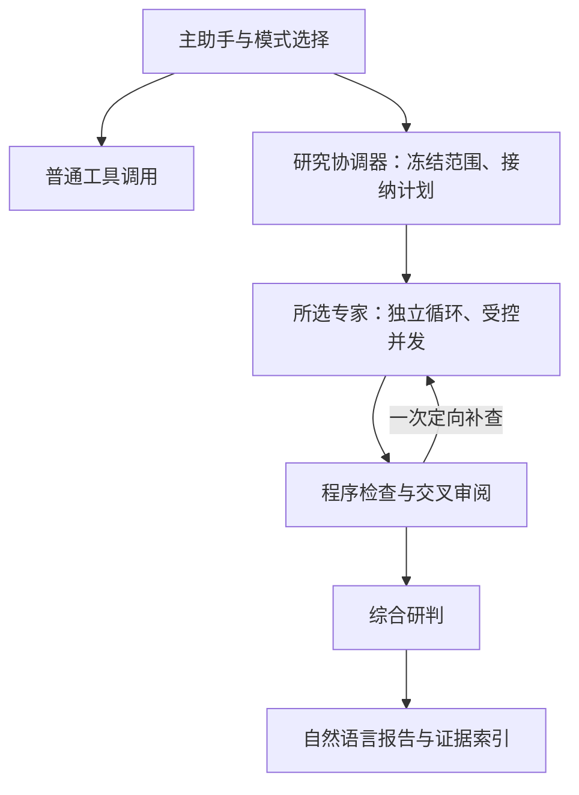

# FinSight 需求文档 v2.0：五类分析师与深度研究

| 项目 | 定义 |
|---|---|
| 文档版本 | v2.0 |
| 日期 | 2026-10-20 |
| 用途 | 指导 Codex 在当前 FinAgent 上完成第二阶段开发及验收 |
| 状态 | 开发需求基线；本文不表示功能已经实现或验收通过 |
| 产品名称 / 代码包 | FinSight / `finagent` |
| 主要依据 | [阶段二 Harness 方案](FinSight_需求文档_v2.0.md)、当前工作区源码、[自然语言结果与结束行为](../features/OUTPUT.md) |
| 历史基线 | [需求文档 v1.1](../history/FinSight_需求文档_v1.1.md)，保留用于追溯 |

## 🎯 1. 目标、范围与版本关系

### 1.1 本阶段目标

在现有个人金融助手中增加技术分析师、情绪分析师、新闻分析师、基本面分析师和政策分析师。用户可以调用单项能力，也可以请求对一只股票进行深入研究，由多个专家协作、核验证据、补查关键缺口并生成综合报告。

开发必须复用当前自研 AgentLoop、数据服务、证据仓库、财报检索和受限计算，借鉴 deer-flow 的 Harness 分层、按需技能、子任务上下文隔离、预算控制和产物交接。五类分析能力共用一套运行机制。

### 1.2 规范用语

- **必须 / 不得**：本阶段硬性要求，违反则对应验收不通过。
- **默认**：必须提供的初始行为，可通过本文允许的配置覆盖。
- **建议**：可由 Codex 根据现有代码调整，说明理由即可。
- **P0**：v2 本阶段交付门槛。**P1**：本阶段完成后的可选增强。
- **可用证据**：满足来源、访问范围、对象、时间和内容检查的材料；不表示预测有效。
- **程序检查通过**：规定的结构、引用或数值检查通过；不表示所有自然语言推断已经证明。

本文件的 v2 是需求版本，不要求立即把 Python 包版本改为 `2.0.0`。

### 1.3 对旧基线的调整

| 主题 | v2 要求 |
|---|---|
| 多 Agent | 提前成为阶段二 P0；五个角色与综合研究均必须交付 |
| 财报、计算、会话恢复 | 以当前已实现能力为基础扩展，不按旧文档重新从零实现 |
| 最终回复 | 普通聊天与用户报告保持自然语言；结构化合同用于内部交接 |
| 研究对象 | 普通会话可换股；一份深度研究冻结一个主标的及明确基准 |
| 开发入口 | 先完善 CLI/chat，不以 Web 前后端为前置条件 |
| SFT、策略回测等 | 不属于本阶段 P0，也不因 v2 完成而宣称已完成 |
| 原八周排期 | 不作为本轮工期承诺；按里程碑和验收结果推进 |

后续开发以用户最新明确指令为最高任务依据；在文档之间，本文件对本阶段要求的定义优先于阶段二设计建议及旧版本。源码用于确认现状，不用于静默取消未实现的需求。

### 1.4 范围

| 优先级 | 内容 |
|---|---|
| P0 | 五类分析师、按需路由、专项分析、五维深度研究、交叉审阅和有限补查 |
| P0 | 证据授权、时间边界、确定性计算、自然语言报告及内部产物 |
| P0 | 有界并发、总预算、取消、任务边界恢复、进度与来源记录 |
| P0 | CLI/chat 集成、离线故障测试、真实数据与模型验证、单/多 Agent 对照 |
| P1 | RSI/MACD/ATR 等扩展指标、完整社区帖子情绪、动态政策网站检索 |
| P1 | 行业估值对标、历史一致预期、更复杂的多空辩论 |
| 本轮之外 | 自动下单、仓位优化、收益承诺、全市场选股、跨市场扩展、账号与部署平台、训练实验 |

初版支持现有沪深 A 股范围。深度研究默认一家公司，基准采用已有能力支持的沪深 300；不要求跨公司批量研究。银行等特殊行业不得用普通工商企业口径强行计算，报告需要说明不支持的指标。

## 🔎 2. 当前基础与迁移约束

### 2.1 开发前应读取的现有模块

| 文件 | 当前职责与开发约束 |
|---|---|
| [agent.py](../../src/finagent/agent.py) | 自研循环、消息配对、运行记录和自然语言报告；扩展为可注入 profile |
| [runtime.py](../../src/finagent/runtime.py) | 可变任务上下文；不得让多个专家共享同一个实例 |
| [terminal.py](../../src/finagent/terminal.py) | 自然语言终态与覆盖诊断；普通聊天继续使用 |
| [registry.py](../../src/finagent/tools/registry.py) | 参数及输出校验；增加角色白名单和调用时权限检查 |
| [knowledge.py](../../src/finagent/knowledge.py)、[financial.py](../../src/finagent/tools/financial.py) | 原文、事实和受限计算；继续复用 |
| [analysis.py](../../src/finagent/tools/analysis.py) | 分析指南、行情与基准、公告、可选核验 |
| [service.py](../../src/finagent/data/service.py)、[evidence.py](../../src/finagent/data/evidence.py) | 数据规范化、缓存与证据；审计并发访问和范围隔离 |
| [session.py](../../src/finagent/session.py) | 普通会话状态、压缩和单任务恢复；与研究任务状态区分 |
| [cli.py](../../src/finagent/cli.py)、[chat.py](../../src/finagent/chat.py) | 用户入口；复用同一研究服务 |

当前 `completed` 表示运行结束，`outcome_verified=false` 不得被随意改成 true。旧 `FinalAnswer` 及 `verify_analysis` 的合同可借鉴或适配，但不得重新设为普通自然语言回复的强制门槛。

### 2.2 上游参考边界

Trading 的角色提示、工具思路与领域分工可复用；其 [GraphSetup](../../../Trading/tradingagents/graph/setup.py) 按顺序执行分析师，再进入多空、交易和风险流程。本项目不直接接入整张图，也不将这些额外角色设为深度研究必经步骤。

Trading 的 [宏观新闻实现](../../../Trading/tradingagents/dataflows/a_stock.py) 需要重新处理日期过滤和历史覆盖；不能把最新快讯冠以历史日期。其情绪提示也不能作为已取得社区样本的证明。

deer-flow 的 设计理念（历史路径：`../../../deer-flow/deer-flow-main/frontend/src/content/zh/harness/design-principles.mdx`；当前工作区未提供）、子 Agent 配置（历史路径：`../../../deer-flow/deer-flow-main/backend/packages/harness/deerflow/subagents/config.py`；当前工作区未提供） 与报告交接合同（历史路径：`../../../deer-flow/deer-flow-main/backend/packages/harness/deerflow/subagents/report_contract.py`；当前工作区未提供） 用作运行时设计参考。本阶段不引入第二套 Agent 框架替换当前自研循环。

复用代码必须记录来源和许可证；不得读取相邻项目的密钥配置作为本项目凭证。

## 👤 3. 用户场景与交互

| 编号 | 用户请求 | 预期行为 |
|---|---|---|
| US2-01 | “贵州茅台现在多少钱？” | 原有主助手直接取行情，不启动专家团队 |
| US2-02 | “从技术面分析一下这只股票” | 使用技术能力，输出专项结论和依据 |
| US2-03 | “最近市场对它的情绪如何？” | 区分新闻倾向、关注度和市场代理，说明样本覆盖 |
| US2-04 | “最近有哪些政策影响这家公司？” | 定位政策材料，说明状态、适用范围与业务关联 |
| US2-05 | “深入分析这只股票，给我一份报告” | 登记五个维度，协作研究并交付综合报告 |
| US2-06 | “只看基本面和政策” | 仅执行指定维度，报告说明本次覆盖范围 |
| US2-07 | “用截至某日的信息分析” | 冻结历史截止时间，排除未来信息和无历史版本的当前快照 |
| US2-08 | “为什么技术面乐观，基本面却偏弱？” | 读取相关研究产物和原始证据，解释不同依据及时间尺度 |
| US2-09 | 中断后恢复研究 | 复用有效完成产物，仅继续允许恢复的任务 |
| US2-10 | “再看看另一只股票” | 普通会话切换焦点；已有研究任务不被修改 |

**交互默认：**

1. 明确的“深入分析 / 深度研究 / 五个维度 / 完整研究报告”触发深度模式；单独的“分析一下”默认普通分析，不自动扩展为五专家。
2. 明确指定分析维度优先于默认五维；用户只问指标定义时直接解释，不启动研究。
3. 能从本轮明确指令或已有会话焦点确定标的时直接使用。证券歧义等会改变结果的信息应在研究冻结前澄清，不要求用户自己查代码。
4. 不重复确认已明确的研究请求。进度提示包含当前阶段和已完成维度，不展示内部长提示词、哈希或技术堆栈。
5. P0 支持前台长任务、进度输出、Ctrl+C 取消后继续聊天。后台运行时同时接收其他聊天属于可选扩展，不作为本阶段必需能力。
6. 专家不直接向用户连续提问。冻结后发现无法推断的必要条件，由协调器登记缺口；可继续的任务继续，最终报告说明限制。

## 🏗️ 4. 执行架构



职责必须明确：

- **主助手**理解意图、解释结果并生成综合判断。
- **研究协调器**是宿主代码，负责计划校验、依赖、调度、预算、状态和产物接纳。
- **专家**运行同一个可配置 AgentLoop，按领域方法选择工具并独立形成观点。
- **Skill**保存分析步骤、证据要求和失败条件，不自行授予工具权限。
- **Tool**负责取数、检索、确定性计算及内部产物提交。
- **Harness**在执行边界落实范围、权限、预算、校验、取消和恢复。

模型可调整研究问题、工具顺序和补查内容；宿主不得允许其扩大市场范围、修改截止时间、绕过总预算或无限增加任务。

## 🧩 5. 功能需求

### FR2-01：模式路由与研究入口

必须支持 `direct`、`specialist`、`deep` 三种内部执行模式。路由结果记录选择依据、所选角色和是否继承会话焦点；不要求暴露模型内部推理。

专项模式与深度模式使用同一角色定义、方法资源和工具合同。简单专项问答允许主助手加载同一方法直接执行；显式 CLI 专项研究必须进入研究服务，以便复现和验收。

自然语言路由须结合用户意图，不能因为引用或否定句中出现“深入研究”就触发。用户明确指定模式时优先使用该模式。

### FR2-02：研究范围与计划

研究启动前生成不可变 `ResearchScope`，至少包含主证券、市场、允许基准、截止时间、行情窗口、事件窗口、政策窗口、财报范围和用户关注点。

默认行情窗口为 120 个交易日，新闻为最近 7 个自然日，政策检索为最近 90 个自然日加已登记的相关有效政策，财报为截止前最新可得期间及必要可比期间。实际取得窗口不足时写入覆盖缺口，不补造样本。

`as_of` 默认是请求开始时的上海时区时间；显式历史日期按现有日期与市场规则解析，输出实际采用值。技术指标可多取预热数据，但展示窗口和取数窗口须区分。用户指定日期或窗口不能被模型默默替换。

计划包含所选专家任务、输入证据类别、验收条件和依赖。宿主必须拒绝未知角色、循环依赖、超任务数、改变范围的计划。默认五维不能因某源失败从计划中消失。

### FR2-03：专家定义与按需技能

必须提供五个稳定角色 ID：

| ID | 名称 |
|---|---|
| `technical` | 技术分析师 |
| `sentiment` | 情绪分析师 |
| `news` | 新闻分析师 |
| `fundamentals` | 基本面分析师 |
| `policy` | 政策分析师 |

`AnalystSpec` 必须包含职责、Skill 版本、工具白名单、模型配置引用、子任务预算及结果 Schema 版本。默认继承本项目模型配置，不要求额外模型供应商。

角色提示和分析方法按需加载，不把五套完整提示注入每次普通聊天。内置资源必须随安装包分发；不依赖开发机上的外部 Skill 目录。用户、网页和子任务返回不能修改运行时权限。

### FR2-04：技术分析

P0 必须覆盖当前已支持的涨跌、MA5/20/60、相对前期均量、波动和相对基准表现。专家负责解释趋势、量价关系、时间尺度和限制，数值由工具计算。

指标输出必须记录公式版本、参数、观察窗口、预热长度、交易日、价格口径及输入结果 ID。停牌、缺失数据、窗口不足、公司行动与不复权限制不得隐藏。

不得仅根据模型记忆或自由文本手算输出指标。没有可靠复权数据时保留不复权口径，不得自行构造复权因子。新增 RSI/MACD 等属于 P1，不影响 P0 基础技术分析验收。

### FR2-05：情绪分析

必须分别报告以下维度，不能混成一个未经解释的“情绪分”：

- 新闻样本的正面、负面、中性或无法判断倾向，以及主题。
- 量价变化等可观察市场代理。
- 资金流与热度数据的可用结果及限制。
- 消息面与市场代理是否一致；不一致时保留分歧。

P0 必须实现资金流和热度两类适配能力；每类至少验证一种合法可用来源或带真实来源的导入通路。资金流需记录供应商定义、币种、单位和期间，不能视为直接识别投资者身份或心理。

文章倾向标签可以由模型产生，但须绑定去重后的文章 ID；样本数和比例由程序统计，说明分母及无法判断数量。没有社区帖子时不得声称代表股吧、雪球或整体散户情绪。

只有新闻时允许交付“新闻文本倾向分析”，对应情绪维度标记 `partial`；无材料必须标为未知，不得默认中性。热度榜中没有目标股只能说明它未出现在本次榜单覆盖内。

### FR2-06：新闻分析

必须整合现有个股新闻和已导入公告，增加具有时间校验的宏观新闻能力。对事件生成可回读的事件卡片，至少包含标题、事件时间、发布时间、来源类型、关联公司/行业、证据位置和可能影响。

必须按原始来源和事件簇处理转载。同一事件的多篇报道可以保留不同表述，但不能当成多份独立支持重复计权。只有标题/摘要时必须标记正文覆盖程度。

必须区分事实、传闻和解释；后于观察区间的信息不得用于解释此前涨跌。无检索结果只代表本次覆盖内无命中，不代表公司没有风险或没有新闻。

### FR2-07：基本面分析

必须复用原始披露检索和受限计算，覆盖营业收入、明确口径的利润、经营现金流、资产负债及可得的同比、利润率和资产负债比率。

必须核对报告期、披露时点、累计/单季/时点口径、合并范围、币种和单位。计算结果须绑定原始事实和公式；零分母、缺失值、不可比期间按现有合同返回缺口。

聚合三表与原始年报应分开标记；没有完整原文时不能写“已阅读完整年报”。当前估值快照仅用于允许的当前研究，未取得历史版本的估值或一致预期不得用于严格历史判断。

P0 不强制目标价、同行估值排名或盈利预测；这些输入不可得时，仍可交付证据充分的财务分析并明确研究覆盖。

### FR2-08：政策分析

必须增加政策材料导入、检索和原文定位能力。P0 允许先从带官方来源的本地原文资料集实现，在线全网政策搜索不作为前置条件。

每份政策材料必须记录发布机构、发布日期及精度、原文来源、可用时间、适用地区/行业/对象；生效、废止和征求意见状态分别记录，未知值明确保留。

政策状态必须按研究截止时间判定，不能把今天的废止或修订状态直接覆盖历史版本。尚未生效但已经公布的政策可作为预期影响讨论，必须说明前提。

政策影响链必须写清“政策条款 → 适用行业/业务 → 公司暴露 → 可能影响与条件”。公司业务关联需要证据，不能仅凭名称包含关键词关联。影响量化必须有输入和假设；不足时使用定性解释。

行业或全国性政策使用独立适用范围模型，不得关闭现有公司材料过滤或把所有政策伪装成某家公司公告。

### FR2-09：数据合同与来源能力矩阵

新增数据工具继续返回 `Observation`。在不破坏旧读取的前提下，可扩展顶层字段或定义受校验的类型化 `data`，但不得把重要字段只藏在自由文本中。

每类来源必须记录支持对象、窗口、历史版本能力、时间精度、单位、更新方式、在线/导入/回放模式和已知限制。能力矩阵同时记录“已实现”和“已验证”，不得混同。

最新快讯接口不能冒充历史检索。来源切换不得改变币种、范围或计算口径而不说明。离线回放中不得偷偷访问网络。

缓存键至少区分接口能力、证券或政策范围、窗口、截止时间、供应商、价格口径及数据版本。并发重复请求应在相同范围下合并或复用结果，不要求对不同窗口强行合并。

### FR2-10：上下文隔离与证据授权

每个专家拥有独立消息、局部计数、工具视图、运行目录和 `TaskContext`。不可共享可变 `ExecutionContext`、混用工具调用 ID 或同时写同一份专家报告。

父任务显式授予子任务初始证据；子任务新取得的证据经宿主登记后，才能被父任务、审阅者或其他专家读取。授权检查必须发生在回读、计算、提交及最终引用时。

证据 ID 存在不等于当前任务可用。必须检查原始来源、研究对象、截止时间和失效状态。允许的市场基准和宏观/政策资料使用各自类型，不要求它们伪造为主证券数据。

压缩只保留任务摘要、范围、证据索引、缺口和待办。正文需要时回读，不能把子任务完整历史自动并入主助手。上下文摘要不得把外部资料提升为系统指令。

### FR2-11：内部分析提交

研究专家通过 `submit_analysis` 或等价受校验内部工具提交 `AnalysisArtifact`。正文为 Markdown，结构字段用于交接和核验。

宿主填充任务身份、角色、范围哈希、实际预算和工具记录。模型不能通过填写 `completed` 或 `verified` 绕过验收。

首次结构或引用失败时反馈具体字段/引用问题，在剩余预算内允许一次提交修正；修正仍失败则该次产物不被接纳，可保存为拒收草稿用于诊断。不得为修复格式无限重跑专家。

无内部提交的自然语言回复可保存为草稿，不能当成完整专家产物。此要求仅适用于研究交接，普通聊天结束方式不变。

### FR2-12：有界并发与失败隔离

P0 必须支持配置为 1 或 3 的真实并发上限，默认 3。相互独立的专家可并行，有依赖的任务等待前置产物。

并发上限约束所有研究专家与审阅任务的实际在途执行。工具数量限制不能代替并发控制。主助手综合阶段等待所需任务终止后执行。

同一进程只运行一个前台研究协调器；第二个进程不得同时执行同一 `research_id`，必须由存储层接纳机制拒绝或等待。不同研究的跨进程全局容量治理不是 P0，但必须说明此限制。

一个专家失败不得清空成功结果或取消所有无依赖任务。依赖失败的任务标记为受阻并提供原因。不得以捕获所有异常后返回空字符串隐藏故障。

### FR2-13：总预算、重试和停止

所有规划、专家、审阅、补查和综合调用都归入同一研究预算。不得给每个专家各复制一份总预算，也不得只记录外层委派工具的一次调用。

必须在执行前原子预留额度，结束后结算，持久化操作 ID。模型请求失败或超时仍计一次尝试；数据源重试、切源分别计实际 HTTP 请求；非法工具调用计工具尝试但不产生源请求。

角色自身预算和研究总预算同时生效，任何一项用尽即停止相应新调用。为审阅及综合保留额度，专家不能消耗该保留池。

重复无进展、模型截断、未知工具和不可重试错误必须有有限出口。不得通过新建子任务或恢复重置预算。专家不得委派子专家。

token 用量区分 `reported`、`estimated`、`unknown`；缺失不能写 0。P0 以调用、请求和时间为硬约束，不宣称精确货币限额。可计算费用时记录定价版本，否则费用为 null。

### FR2-14：程序核验、交叉审阅和有限补查

首次专家执行结束后，必须对产物进行程序核验；有效材料进入一次交叉审阅。审阅者可按授权回读来源和复算，不得只按报告长度或表格数量判定质量。

审阅结果必须关联主张 ID，列出支持不足、时间/口径冲突、重复证据、过度因果推断和缺失维度。不同时间尺度产生的观点差异不自动判错。

最多一轮补查，最多两个补查任务。每个任务必须指定待解决问题、相关主张、证据缺口和成功条件，不能仅要求“再分析一次”。补查后执行程序复检，由综合阶段消费结果；P0 不再启动第二轮独立审阅及补查。

不可消除的分歧与缺口进入报告，不能强行达成一致。审阅调用失败或预算不足时使用已验证材料输出部分报告，并标记审阅未完成。

### FR2-15：综合研判与报告导出

主助手必须基于接纳后的专家材料形成自然语言报告，至少包含研究范围、综合判断、所选维度、支持与反对因素、关键分歧、条件化情景、后续观察及来源/缺口。

同一原始事件被多个专家引用不得重复计权；不得用“五人三票看多”或默认五个等权分数替代分析。结论需区分短期技术状态、中期预期和长期基本面。

关键事实和数字必须可映射到内部主张及证据/计算。可见报告使用来源名称、时间、页码或链接，不强迫用户阅读内部哈希。报告中的新增事实也需进入主张清单。

综合后执行最终引用与数值绑定检查。无支持的新增事实须删除、改写为明确假设或标为未证实，不能只附一个免责声明保留为事实。程序检查不能证明语义支持，仍需评估样本人工抽查。

模型无法综合时，宿主可将已接纳的各维摘要、缺口和来源整理为降级报告，明确“综合研判未完成”；不得把确定性拼接标为完整综合研究。

### FR2-16：状态、取消和恢复

SQLite 是研究状态真源，JSON 和 Markdown 是导出快照。至少保存计划、任务尝试、状态转换、证据授权、预算预留、版本和产物位置。

已有单 Agent `resume` 保留；研究使用单独的 `research-resume`，P0 恢复到任务边界，不承诺恢复到每次模型调用内部。

取消后停止调度并向在途任务传播信号。同步 HTTP 可能运行到受限超时；必须阻止晚到结果接纳、报告覆盖和新工具链启动。关闭客户端前等待其在途访问结束，不能把取消 Future 当成已终止底层请求。

进程退出或崩溃后，在途任务标为中断。恢复时复用范围、版本兼容且校验有效的完成产物，只对允许重试的未完成任务新建尝试。必须保留已用预算及不确定是否已发送的请求记录。

完成和取消的研究不自动恢复；用户要更新信息或重新开始时建立新研究并记录关联。部分完成/失败研究可显式恢复，但只处理可恢复缺口；没有剩余预算、没有可重试任务或配置不兼容时返回明确原因，不产生模型调用。

### FR2-17：进度、会话与来源查看

研究事件至少包含 `research_id`、任务/尝试 ID、递增序号、时间、阶段、状态和简短说明。事件可按序读取，恢复后序号不回退。

用户能看到已完成角色、正在进行的阶段、部分失败和最终报告位置。不得将子 Agent 工具消息伪装成主助手回复，或把所有专家完整文本实时刷入聊天。

会话仅保存研究摘要和 `research_id`。追问需重新确认关联并授予所需证据；切换焦点不修改旧研究范围。来源查看入口必须能区分当前普通回答与指定研究报告。

### FR2-18：配置与向后兼容

新增 `[research]` 配置及角色模型引用；缺少新字段时以默认值运行。旧 TOML、普通 run/chat、工具命令及已有报告读取必须保持兼容。

新增 Schema 版本不得使旧结果被重新解释为已经核验的研究产物。研究存储使用独立路径和迁移版本，不修改旧运行记录以伪造兼容。

默认复用现有模型和协议。两种现有模型协议至少有离线回归，真实调用按实际可用配置验证。密钥不得出现在计划、日志、报告和异常文本中。

### FR2-19：验证和对照评估

必须分开提交离线/合成测试、真实快照回放、实时数据检查和真实模型运行结果，失败及未执行项保留。

必须比较同一组证据与工具下的单 Agent、五专家无语义审阅、五专家加审阅及有限补查。评估专用消融配置不能改变产品默认路径。

不预设多 Agent 一定更好，也不以报告更长作为质量提高。记录事实支持、引用、时间边界、覆盖、成本、延迟和新增错误。

### FR2-20：开发交付与文档

必须提交可运行代码、配置示例、数据能力矩阵、冻结验收集、运行/恢复示例、报告样例和逐项验收记录。

阶段完成状态必须区分“代码实现”“离线验证”“真实来源验证”“真实模型验证”“人工质量审阅”。测试通过不代替真实来源和模型验证。

## 📐 6. 内部数据合同与不变量

### 6.1 最小合同

具体类名可微调，字段语义不得省略。身份、状态接纳、哈希、用量与授权由宿主生成。

| 对象 | 必需内容 |
|---|---|
| `AgentProfile` | 角色提示、方法资源、工具视图、完成策略、范围策略、预算引用 |
| `ResearchRequest` | 用户目标、执行模式、所选角色、标的/时间参数、会话来源 |
| `ResearchScope` | 标准证券、市场、允许基准、冻结 `as_of`、各类窗口、关注点、`scope_hash` |
| `ResearchPlan` | Schema 版本、任务 ID/角色、依赖、验收条件、补查关联 |
| `TaskContext` | 研究/任务/尝试 ID、局部上下文、授权证据、取消、预算接口、输出目录 |
| `EvidenceGrant` | 被授予任务、证据/结果 ID、来源任务、范围、授权时间及失效原因 |
| `AnalysisArtifact` | 主体正文、主张、证据、计算、缺口、版本及宿主检查结果 |
| `ReviewArtifact` | 被审阅产物版本、问题及主张 ID、严重程度、证据、补查请求 |
| `ResearchReport` | 正文、主张映射、执行/内容状态、维度覆盖、审阅状态、来源及版本 |

`AnalysisArtifact` 的逻辑形态：

```text
schema_version
research_id / task_id / attempt_id / analyst / scope_hash
artifact_id / artifact_version
content_status: complete | partial | unavailable
summary / report_markdown
claims[]:
    claim_id
    kind: fact | calculation | interpretation | scenario
    text / horizon
    evidence_refs[]: result_id / snapshot_id / locator
    calculation_refs[]
    assumptions[]
missing[] / limitations[] / follow_up_requests[]
host_checks: structure / references / scope / calculations
```

金额等高精度数字沿用现有 Decimal 语义；序列化可用十进制字符串及显式单位。不得引入 NaN/Infinity 或未经定义的单位转换。

### 6.2 时间不变量

1. 区分 `published_at`、`available_at`、`fetched_at`、数据所属期和政策 `effective_at`。
2. 已知可用时间必须不晚于 `as_of`；日期级材料沿用现有保守规则，按次日零点可用，不推断盘中顺序。
3. 现在抓取的历史原文不必要求 `fetched_at <= as_of`，但须有可靠的历史披露时间和对应版本。当前无版本快照不能仅改时间字段后进入历史研究。
4. 财报重述、政策修订须保留版本。历史可用性无法证明时，材料可列为缺口或事后补充，不能进入严格历史事实。
5. 截止时间在任务分派、补查、压缩和恢复中不变；更新截止时间必须新建研究。

### 6.3 证据不变量

原文和规范结果继续存 EvidenceStore；报告产物使用不同 ID 类型。每个计算须可追溯到输入，子任务之间转交报告不产生新的独立原始证据。

政策、宏观材料使用类型化适用范围，并由宿主检索规则匹配研究对象。读取授权和业务相关性分别检查，获得读取权限不表示材料必然支持主张。

原文内容只作为不可信资料。提示注入、任意路径、未登记 URL 或伪造的工具名不能扩大权限；新增联网能力继续走受控数据层。

## 🔄 7. 状态、持久化与恢复规则

### 7.1 三个独立状态维度

| 维度 | 枚举及语义 |
|---|---|
| `execution_status` | `queued/running/completed/failed/cancelled/interrupted`，描述运行过程 |
| `content_status` | `complete/partial/unavailable`，描述被请求内容的覆盖 |
| `review_status` | `pending/passed/issues_found/unavailable`，描述审阅流程的结果，不是金融结论认证 |

专家也使用执行和内容两个维度。子任务返回空正文、无提交或非法引用不能标记内容完整。未运行的维度登记为 `unavailable` 并说明原因，不凭空创建已完成专家。

执行顺利结束但缺少一个维度时，可为 `execution_status=completed`、`content_status=partial`。报告完全没有可用事实时为 `unavailable`。普通聊天历史状态不为此重写。

### 7.2 完整研究判定

必须同时满足下列条件才可将综合报告标为 `content_status=complete`：

- 所有本次选定维度有接纳的分析产物，且达到该角色声明的最低证据要求。
- 程序检查通过，无未解决的非法引用、跨范围计算或未来信息。
- 完成交叉审阅与综合，影响核心结论的审阅问题已解决；可合理保留的解释分歧已呈现。
- 最终关键事实和数字具有引用映射，报告范围、限制和来源齐全。

完整只针对已声明的研究范围，不表示覆盖全网信息或能够预测收益。非关键来源缺失可作为限制；缺少角色的最低证据或审阅/综合失败必须降为部分完成。

各角色的默认最低证据要求如下，须固化到角色合同，不允许模型自行降低：

| 角色 | 内容完整的最低依据 | 降级条件举例 |
|---|---|---|
| 技术 | 足够计算所需指标的真实行情、同窗口基准、计算记录与价格口径 | MA60 窗口不足、基准缺失或关键数据完整性无法确认 |
| 情绪 | 去重新闻样本、量价代理、有效资金流与有效热度观测；可明确保留信号分歧 | 只有新闻、资金流不可得、样本不足以判断 |
| 新闻 | 公司新闻/公告与宏观窗口查询有可回读记录，事件时间和覆盖清楚 | 数据源请求失败、历史窗口不受支持、关键事件只找到无法核对的传闻 |
| 基本面 | 可定位原始披露、至少一组可比期间、核心收入/利润/现金流/资产负债事实及所需计算 | 只有聚合快照、关键期间不兼容、缺少支持核心判断的披露 |
| 政策 | 至少一份可回读的相关政策原文，具有截止时点状态及公司业务关联依据 | 只有媒体解读、状态不明或缺少公司适用性依据 |

新闻查询成功但声明窗口内无命中，可以完成“该覆盖内无命中”的查证结论，不生成不存在的事件。政策检索无命中可以完成检索动作，但政策影响分析仍为未知/部分完成。完整性应结合用户明确要求的子问题判定；上述最低项不能仅因取数失败被自动删除。

来源的日线最终性等元数据必须保留。用户要求最终收盘结论但无法证明时降级；若只做明确声明的数据快照分析，可以说明该快照口径并评价其已覆盖内容，不能据此声称最终收盘已确认。

### 7.3 尝试、接纳与崩溃

每次执行有独立 `attempt_id`，状态只能按许可转移；终止尝试不能被晚到结果改回成功。修正/补查产物产生新版本，旧版本保留来源关系。

所有会导致外部调用的预算预留先持久化；崩溃后无法确定发送状态的调用保守计入消耗。任务恢复可以重试只读操作，但不得承诺外部模型严格仅调用一次。

产物先写临时文件并原子替换，再在数据库事务中接纳其路径和内容哈希。崩溃产生的未接纳文件不当成已完成；数据库指向文件缺失或哈希不符时不得直接复用。

研究运行权使用单一执行所有者及尝试代次控制，旧所有者不得写入新代次终态。P0 仅支持本机恢复，不承诺分布式高可用。不可仅凭超时就允许另一个进程与仍存活的所有者同时执行。

预算的时间语义是累计活动执行时间，进程停机和等待用户显式恢复不计入活动时间；进程运行中的排队、网络等待计入。崩溃时无法精确确定的在途活动时长按记录的请求/任务上限保守扣除。不得在每次恢复时重置全部时间额度。

### 7.4 逻辑存储布局

```text
.finagent/
    research.sqlite3
    evidence/...
    results/...
    research/<research_id>/
        manifest.json
        scope.json
        plan.json
        tasks/<task_id>/<attempt_id>/
            messages.json
            analysis.json
            report.md
        review.json
        report.md
        report.json
        evidence_manifest.json
        events.jsonl
```

SQLite 保存状态、事件序号、预算与产物索引；`events.jsonl` 等是可再导出的快照。`analysis.json` 是不可变产物，接纳关系以数据库为准。路径由宿主生成，模型不能指定输出目录。

## ⚙️ 8. 配置、工具与命令接口

### 8.1 初始预算

以下值是开发起点和默认配置要求，不是已测得的性能承诺。允许根据真实验证调整，但必须更新示例和变更记录。

| 配置语义 | 默认值 |
|---|---:|
| 最大并发专家/审阅任务 | 3 |
| 研究总模型调用 | 48 |
| 研究总工具尝试 | 120 |
| 研究总数据源请求 | 180 |
| 研究累计活动时间 | 900 秒 |
| 单任务活动时间 | 180 秒，且不超过研究剩余时间 |
| 单次外部请求上限 | 20 秒，且不超过任务和研究剩余时间 |
| 每个首轮专家模型调用 | 6 |
| 每个首轮专家工具尝试 | 18 |
| 交叉审阅任务 | 1 |
| 补查轮数 / 补查任务 | 1 / 最多 2 |
| 单补查任务模型调用 | 4 |
| 总任务尝试上限 | 10，包含首轮、审阅、补查和任务重试 |
| 额外任务重试 | 全研究最多 2 次，同一逻辑任务最多追加 1 次 |
| 审阅和综合保留池 | 模型调用 8、工具尝试 12、源请求 12、活动时间 120 秒 |

保留池属于总预算，不能叠加为额外额度。普通专家只可使用非保留部分，审阅和综合可以使用剩余预算及保留池。总量小于保留量的配置应启动失败，不得静默变成负数。

默认首次五专家加一审阅，最多两个补查，共最多八个逻辑任务；重试会增加尝试数，不增加补查轮数。人工恢复仍受剩余总预算和尝试上限约束。任务重试与工具/HTTP 内部重试分别计数。

本轮现有配置中的普通 `[limits]` 保持其语义，不能因研究任务变长而全局放宽所有聊天。

### 8.2 逻辑工具合同

工具名称是推荐公共名称；如调整，必须同步命令帮助、Schema、测试与本文接口映射。

| 工具 | 可见角色 | 行为 |
|---|---|---|
| `start_stock_research` | 主助手 | 校验请求并执行研究；传入白名单角色及范围，不接受任意提示/工具权限 |
| `submit_analysis` | 研究专家 | 提交有证据映射的领域产物，宿主接纳或拒收 |
| `read_research_artifact` | 获授权的主助手/审阅者 | 按 ID 分页读取产物；不能传任意路径 |
| `get_fund_flow` | 情绪专家 | 返回资金流结果、定义、覆盖和原始来源 |
| `get_market_attention` | 情绪专家 | 返回热度榜或关注度观测，区分命中与覆盖 |
| `get_macro_news` | 新闻/政策专家 | 检索指定窗口，明确历史能力及正文覆盖 |
| `search_policy_documents` | 政策专家 | 按适用范围、时间和主题搜索政策资料 |
| `read_policy_document` | 政策专家/审阅者 | 回读获授权原文及定位 |

现有数据/计算工具优先复用。必要的新指标或情绪统计工具也必须受参数和输出校验。专家不暴露递归委派、范围修改、任意 Shell、文件路径读取和普通用户澄清工具。

### 8.3 CLI 与聊天

以下是 v2 待实现接口示例；不表示当前已有命令。

```powershell
# 完整五维研究；省略 --analysts 时 deep 默认五维。
python -m finagent research '深入分析贵州茅台' --symbol 600519.SH --depth deep

# 专项研究，同一研究服务只调用被选中的专家。
python -m finagent research '分析技术和基本面' --symbol 600519.SH --depth specialist --analysts technical fundamentals

# 历史研究；日期只是接口示例，不表示资料集已有覆盖。
python -m finagent research '根据当时可得材料研究' --symbol 600519.SH --as-of '2026-09-30T23:59:59+08:00'

# 只读状态 / 报告；不得触发模型或网络取数。
python -m finagent research-status <research_id>
python -m finagent research-report <research_id>

# 显式恢复，沿用原范围和剩余预算。
python -m finagent research-resume <research_id>

# 导入政策原文及带来源的清单，不调用模型。
python -m finagent import-policy <path> --manifest <manifest.json>
```

`research` 默认 `deep`；`specialist` 必须有非空 `--analysts`。`deep --analysts ...` 允许用户缩小范围，仍执行审阅和综合，报告按实际选定维度判定覆盖。重复/未知角色拒绝；所选角色数不能自动扩大。

聊天中自然语言调用同一服务，提供 `/research-status`、`/research-report <id>` 或与现有交互一致的等价入口。现有 `/sources` 等命令可扩展到研究来源，但必须明确当前关联。

CLI 完整内容返回退出码 0，部分内容或无可用内容返回 2，用户取消返回 130；状态和报告只读命令成功读取返回 0，资源不存在或非法参数返回 2。结构化结果保留详细状态，不能仅依靠退出码区分原因。旧命令退出码不因此修改。

## 🧪 9. 验收案例与质量门槛

### 9.1 固定验收集

每个案例必须保存输入、预置数据、预期行为、断言、实际结果及证据路径。以下全部为 P0，网络故障不能用删除案例处理。

| 编号 | 对应需求 | 场景 | 必须满足的断言 |
|---|---|---|---|
| AC2-01 | FR2-01、18 | 问候、指标解释、普通行情 | 不启动团队；自然语言结束与原功能兼容 |
| AC2-02 | FR2-01、03 | 分别请求五个专项 | 只运行所选角色，方法与深度模式共用 |
| AC2-03 | FR2-01、02 | 请求完整深度研究 | 五维均登记且可追踪，不能省略失败维度 |
| AC2-04 | FR2-02、17 | 名称歧义、上下文换股 | 歧义先澄清；换股不改旧研究对象 |
| AC2-05 | FR2-02、09 | 历史日期、最新快讯、当前资料 | 不符合截止或无历史版本的材料不进入历史事实 |
| AC2-06 | FR2-09 | 日期级披露、重述/修订版本 | 保守可用时间和版本规则有效，不倒用后续信息 |
| AC2-07 | FR2-04 | 指标窗口、缺失日、复权差异 | 数值可复算，窗口和口径记录完整，不补造数据 |
| AC2-08 | FR2-05 | 新闻有样本、资金流缺失、无社区样本 | 正文明确覆盖；情绪部分完成；不声称整体散户态度 |
| AC2-09 | FR2-05 | 转载、情绪标签和热度榜未命中 | 样本去重、统计正确；未命中不解释为低关注或中性 |
| AC2-10 | FR2-06、09 | 宏观/公司事件时序 | 盘后/后续事件不解释此前涨跌，无结果保留覆盖说明 |
| AC2-11 | FR2-07 | 财务同比、累计/单季、零分母 | 复用受限计算，拒绝混口径和未绑定输入 |
| AC2-12 | FR2-08 | 政策原文、生效与适用范围 | 可定位条款及业务关联；不匹配材料不作影响依据 |
| AC2-13 | FR2-08、09 | 政策后来废止、仅有媒体报道 | 历史状态正确；未核验原文不伪装官方确认 |
| AC2-14 | FR2-03、10 | 专家调用越权工具或递归委派 | 执行前拒绝；没有隐藏副作用或额外子任务 |
| AC2-15 | FR2-10、11 | 伪造引用、引用他任务/他证券证据 | 拒绝接纳，反馈原因；错误证据不能进入综合事实 |
| AC2-16 | FR2-10、17 | 压缩与交接后的回读 | 授权不扩大，原文可回读，缺口和消息配对不丢失 |
| AC2-17 | FR2-12 | 三个并发任务及第四个排队 | 实际并发不超过配置；独立任务有可观察执行重叠 |
| AC2-18 | FR2-12、13 | 多任务同时抢最后一份额度 | 原子预留，只允许剩余额度对应的调用启动 |
| AC2-19 | FR2-13 | 源重试、模型超时、未知 usage | 尝试记账完整，未知用量不写零，预算不能超发 |
| AC2-20 | FR2-13 | 专家耗尽普通额度 | 审阅/综合保留池仍有效；无额外全局额度 |
| AC2-21 | FR2-12、14 | 一个专家失败、另一个超时 | 成功产物保留；受影响维度有状态；可交付部分报告 |
| AC2-22 | FR2-14 | 技术与基本面冲突、审阅要求补查 | 问题绑定主张，最多一轮两任务，不无限辩论 |
| AC2-23 | FR2-11 | 缺字段或非法引用反复提交 | 只允许一次提交修正，仍失败保存拒收草稿 |
| AC2-24 | FR2-15 | 相同事件被三个专家引用 | 报告不重复计权，不以投票替代综合 |
| AC2-25 | FR2-15 | 综合阶段编造数字或新事实 | 最终引用检查发现；不作为受支持事实交付 |
| AC2-26 | FR2-15、16 | 审阅或综合失败、无可用证据 | 报告正确降级；执行成功不等于内容完整 |
| AC2-27 | FR2-16 | 在同步请求中取消、随后晚到结果 | 停止新调度，取消后不接纳新产物或覆盖报告 |
| AC2-28 | FR2-13、16 | 完成三专家后崩溃并恢复 | 完成产物不重跑；原预算、截止和未决请求保留 |
| AC2-29 | FR2-16 | 双进程恢复同一任务、旧尝试回写 | 单所有者接纳，旧尝试不能覆盖新终态 |
| AC2-30 | FR2-16、18 | 文件缺失/损坏、版本不兼容 | 不静默复用；给出原因；旧记录不被覆写 |
| AC2-31 | FR2-17、18 | 安装包运行、旧配置、两种协议 | 方法资源可读，旧入口可用，协议回归通过 |
| AC2-32 | FR2-19、20 | 对照实验与交付清单 | 三组同条件结果和未完成项齐全，不伪造增益 |

### 9.2 资料和真实执行门槛

完整阶段验收至少需要：

1. 选取 3 家实际可获取材料的沪深非金融企业，记录选择依据，不固定股票代码。至少两家用于真实模型五维演示。
2. 取得 3—5 份可定位的真实财报/公告，其中至少一家公司有可比财务期间；不能全用聚合快照代替原文。
3. 取得至少 2 份真实官方政策原文，覆盖不同状态或适用范围；至少一份能用证据建立样本公司业务关联。
4. 资金流、热度和宏观新闻每项均有真实来源成功获取或真实材料导入记录，并有时间/字段校验；纯合成返回不算该能力实证。
5. 完成 2 次不同公司的真实模型五维研究，其中至少一次在声明范围内完整；另完成 1 次受控缺源的部分报告演示。
6. 至少一条真实模型轨迹表现为后续工具选择依赖前轮实际观测。脚本替身不能替代此项。

P0 允许以真实材料导入满足来源验证，但必须标记为“导入/回放支持”；在线适配缺少成功记录时不得宣称在线接通。五类专家只会返回“数据不可用”不能算该角色功能验收完成。

### 9.3 质量与性能评估

为可复现研究冻结至少 6 个证据任务包，覆盖正常、缺源、历史时点、观点冲突；其中至少 4 个以真实材料组成。每个包用于三个对照配置，保存输入哈希、提示/方法/工具版本、模型参数和调用预算。

三组配置为：单 Agent 同工具、五专家无语义审阅、五专家含审阅和补查。总模型调用上限、数据快照和工具权限能力保持可比，实际消耗单独统计；模型随机性无法完全消除时如实记录。

| 指标 | 口径与门槛 |
|---|---|
| 硬边界案例 | AC2-01—AC2-32 的对应断言全部通过；环境阻塞标未验证 |
| 关键事实支持率 | 固定人工标注主张集；支持/抽查主张数，报告分子分母 |
| 质量抽查目标 | 至少 50 条关键事实/数值主张；支持率目标 ≥95%，不表示已达到 |
| 严重错误 | 抽查中伪造关键数值、未来泄漏或跨证券证据混用为 0，否则质量验收不通过 |
| 引用检查 | 所有被接纳的引用均可定位且获授权，不能仅检查 ID 格式 |
| 计算正确性 | 固定计算案例与参考程序一致；容差按指标公式定义，财务按 Decimal 口径 |
| 覆盖 | 明确统计 complete/partial/unavailable，不把缺失当中性 |
| 恢复和取消 | 故障注入案例验证已完成任务复用、额度保留、晚到结果拒收 |
| 时延与消耗 | 记录活动时长、各阶段时长、模型/工具/源请求及实际 token；小样本只报原始值、中位数、最大值 |
| 协作收益 | 报告相对单 Agent 的质量差异、成本倍数和新增错误；不要求必须胜出 |

标注集不能只选正确句子：从冻结报告的事实和数值主张全集按固定规则抽样，保留不支持和无法判定项，分别报告三组结果。语义质量由人工抽查确认；模型裁判可辅助，但不能是唯一证据。

质量目标未达标时，可记录功能实现完成，但不能记录“v2 全部验收通过”。记录失败原因和后续修订，不通过修改样本口径制造通过。

## 🛠️ 10. Codex 开发顺序与工作规则

### 10.1 开发前检查

1. 阅读本文件、当前自然语言行为文档及相关源码，查看适用 AGENTS.md 和工作区差异。
2. 保存已有测试基线和未提交改动范围。不得用 reset/覆盖方式清理用户正在进行的开发。
3. 核实真实运行环境、模型配置是否存在，仅报告可用性，不输出密钥。先离线开发，不因缺少外部服务阻塞独立模块。
4. 在 `doc/阶段2开发与验收记录.md` 建立 FR/AC 对照表，初始值为“未实现/未验证”；后续填写实际结果。

### 10.2 里程碑

| 顺序 | 工作包 | 进入下一步的最低条件 |
|---|---|---|
| M1 | AgentProfile、范围合同、角色工具视图、独立上下文和提交协议；先技术/基本面 | 两专家纵向闭环；普通聊天不回归；非法引用和权限测试通过 |
| M2 | 协调器、预算账本、并发、证据授权、SQLite、取消和恢复 | 并发/预算/中断故障案例通过，单 Agent resume 仍可用 |
| M3 | 新闻、情绪、政策角色及数据工具/资料导入 | 五角色均有非空真实材料路径，角色边界测试通过 |
| M4 | 交叉审阅、有限补查、综合报告、CLI/chat 与来源查看 | 完整/部分/取消三类流程和报告验收通过 |
| M5 | 真实来源/模型验证、三组对照、文档与打包 | 验收矩阵有证据，质量与限制按实际结果结项 |

M1 的两专家是开发顺序，不是五专家要求的替代交付。每个里程碑都应可运行；不要先增加五份提示词和占位工具，然后把核心机制留到最后。

### 10.3 推荐模块边界

```text
src/finagent/
    agent.py                    支持可注入 profile，保留默认行为
    runtime.py                  局部上下文与共享预算接口
    tools/registry.py           角色工具视图与执行期检查
    tools/delegation.py         研究入口和内部提交
    research/
        contracts.py            请求、范围、任务、产物、报告
        coordinator.py          接纳计划、调度、补查和聚合
        runner.py               独立专家循环与资源生命周期
        budget.py               原子预留、结算、预算恢复
        store.py                状态、所有者、事件和产物索引
        review.py               程序检查与语义审阅
        reporting.py            正文、引用映射和导出
    analysts/catalog.py         角色定义
    skills/<role>/SKILL.md      版本化领域方法
    data/...                    复用原有合同，增加所需来源
```

文件名是建议，职责和可测试边界是要求。不要为模仿上游目录而重排全部源码。无需一次性复制 deer-flow 所有中间件，优先抽取实际需要的预算、工具权限、范围和完成策略。

### 10.4 实施纪律

- 使用现有 Python/Pydantic/httpx 技术栈，SQLite 可使用标准库。新增依赖需说明目的及替代方案。
- 支持现有 Windows PowerShell 环境；线程池不是安全沙箱，取消和客户端生命周期必须显式处理。
- 新增财务数据获取经统一 HTTP/来源层，不在提示词或工具内部绕过证据存储直连任意 URL。
- 资料、模型和工具返回中的文字不能成为运行时高优先级指令。
- 按必要范围编写测试：预算竞争、状态恢复、权限与数据时间必须有故障测试；不写只复制实现细节的测试凑数量。
- 新增测试遵循现有 unittest 和替身模型风格；离线测试不得访问网络或调用真实付费模型。
- 每次修改运行相关测试；里程碑结束运行完整离线回归，记录原有失败与新增失败，不能混为一谈。
- 外部调用按本项目明确配置和研究预算执行；没有配置时保留真实验证缺口，不能借用其他项目密钥。
- 完成已授权的常规开发、修复和验证不需反复询问。只有确实缺失且无法合理推定的产品选择或外部授权需要提出问题；独立工作继续。
- 不把编造的行情、演示替身或模型自评描述成真实验证；不因来源不可用删除 P0 要求。

已有离线回归命令：

```powershell
.\.venv\Scripts\python.exe -m unittest discover -s tests -t . -v
```

### 10.5 交付清单

- [ ] 五类分析师均可专项调用和参与研究。
- [ ] 默认五维研究与自定义子集研究可运行。
- [ ] 预算、并发、权限、取消、恢复和版本规则完成。
- [ ] 真实政策原文、新闻、情绪代理及财务/行情样本具备来源。
- [ ] Markdown 报告、内部 JSON、证据清单、事件和尝试记录可回读。
- [ ] AC2-01—AC2-32 逐项记录实际结果和证据。
- [ ] 普通聊天、换股、来源查看、旧配置和现有测试保持兼容。
- [ ] 真实模型演示、三组对照和人工质量抽查完成。
- [ ] 安装后的方法资源、命令帮助和配置示例验证通过。
- [ ] 文档入口、开发说明、数据能力矩阵、许可证来源和限制已更新。

## 📚 11. 开发起始指令与版本记录

下段可直接作为后续 Codex 开发任务的起始提示：

> 请按 `doc/FinSight_需求文档_v2.0.md` 实现 FinSight 第二阶段。先核对当前源码、工作区差异和测试基线，在 `doc/阶段2开发与验收记录.md` 建立需求与验收矩阵，再依次完成 M1—M5。保留自研 AgentLoop、自然语言回复、会话换股和现有证据能力；通过可配置专家和研究协调器实现五类分析师、受控协作、交叉审阅、有限补查和报告。普通实现选择自行处理，不因单个外部来源失败停下独立工作。不得将合成测试、未执行验证或数据缺口写成完成。最终报告实现内容、测试结果、验收证据和未完成项。

| 版本 | 日期 | 变更 |
|---|---|---|
| v1.1 | 2026-10-18 | 原自研金融研究助手需求及阶段计划，作为历史基线保留 |
| v2.0 | 2026-10-20 | 五类专家与深度研究成为阶段二 P0；明确自然语言交互、内部交接、并发预算、证据授权、恢复、报告与 Codex 开发验收 |
