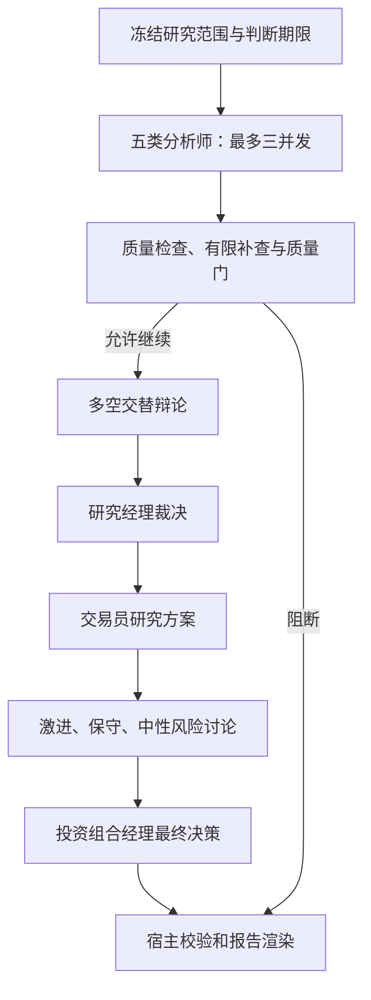

# FinSight 需求文档 v2.1：完整研究、辩论与决策流程

| 项目 | 定义 |
|---|---|
| 版本 / 日期 | v2.1 / 2026-10-20 |
| 用途 | 指导 Codex 在当前 FinAgent 上扩展 Trading 的完整研究与决策流程 |
| 状态 | 待开发需求基线；文档完成不表示代码实现或验收通过 |
| 产品 / 代码包 | FinSight / `finagent`；需求版本不强制改变包版本 |
| 继承基线 | [v2.0 需求](FinSight_需求文档_v2.0.md)、[阶段二开发与验收记录](../history/阶段2开发与验收记录.md)、[自然语言结果与结束行为](../features/OUTPUT.md) |
| 参考实现 | 相邻 [Trading 项目](../../../Trading/tradingagents/graph/setup.py)，以本次核对的本地源码为依据 |

## 🎯 1. 目标与版本关系

### 1.1 本轮必须实现的目标

将以下流程纳入个人金融助手的完整深度研究功能：

> 分析师研究 → 质量检查 → 多头／空头交替辩论 → 研究经理裁决 → 交易员提出方案 → 激进／保守／中性风险讨论 → 投资组合经理最终决策。

所有阶段必须有真实角色执行、明确的输入输出、宿主校验和可追溯产物。不得只在最终报告中增加几个标题，或让一个综合提示词假装完成多角色协作。

沿用现有 AgentLoop、ResearchCoordinator、SQLite、EvidenceStore、计算工具和 CLI/chat。借鉴 deer-flow 的 Harness 职责划分：模型负责领域判断，宿主负责权限、依赖、轮次、预算、状态及产物接纳。本轮不以迁移 LangGraph 为前置条件。

### 1.2 对 v2.0 的继承和覆盖

“必须／不得”为硬要求；P0 为本轮交付门槛，P1 为可选增强。本文只覆盖明确变更的条款，其余 v2.0 要求继续有效。

| 主题 | v2.0 | v2.1 |
|---|---|---|
| 完整深度研究 | 五专家、审阅、有限补查、综合 | 五专家和质量门之后执行完整辩论与决策链 |
| 多空辩论 | P1 | P0，独立多头与空头，严格交替 |
| 经理、交易员、风险团队 | 非必经流程 | P0，各自产物和职责必须实现 |
| 专项和普通聊天 | 保留原入口 | 保持兼容，不自动运行全部角色 |
| 最终综合 | 独立 synthesis 角色 | 完整链由投资组合经理形成最终判断，宿主渲染；旧研究模式保留 synthesis |
| 状态与预算 | 面向五专家协作 | 增加决策状态、依赖版本和完整链预算配置 |
| 补查后审阅 | 不启动第二轮独立审阅 | 增加一次质量门收口；只判断补查及原问题状态，不重新启动补查循环 |
| 实盘交易、仓位优化 | 不在范围 | 继续不在范围；交易员产物是研究方案，不是订单 |

v2.0 第 1.4、2、FR2-14、FR2-15 及默认预算中与本文冲突的部分，由本文的模式、质量门、决策链和配置定义替代。不得据此取消旧版回归、证据约束或未完成的验收义务。

本文 FR21-03—13 的质量门和决策角色要求适用于 `pipeline=trading`。`pipeline=research` 保留 v2.0 的一次审阅、有限补查及 synthesis，不新增质量门收口或决策角色；其他兼容、权限、存储及验证要求按适用范围继承。

### 1.3 当前事实与开发前提

当前已有五类分析师、程序检查、一次交叉审阅、最多两项补查和综合报告，尚无多空、研究经理、交易员、三类风险角色和投资组合经理。

已记录 247 项离线测试通过。此前三次获准的真实模型试跑均未形成合格报告；后续修正尚未重新进行真实模型验证。冻结对照与人工抽查也未全部完成。具体以开发记录为准，开发开始时须重新核对，不能把本文的目标写成现状。

本轮需要同时修复首轮专家稳定提交问题和扩展下游流程。上游不可用时，增加辩论角色不能视为解决了问题。

### 1.4 范围和交付边界

| 优先级 | 内容 |
|---|---|
| P0 | 五专家、质量门、多空辩论、研究经理、交易员、三方风险讨论、投资组合经理 |
| P0 | 结构化交接、论点回应关系、证据来源链、条件与不确定性、报告和过程回看 |
| P0 | 两种研究流程、配置兼容、阶段预算、取消恢复、失败隔离与降级 |
| P0 | 离线故障验证、真实来源与模型验收、固定输入对照及人工质量抽查 |
| P1 | 经评估的自适应停止、多轮定向再取证、额外游资／解禁分析师、结果反馈学习 |
| 本轮之外 | 券商接入、自动下单、杠杆与做空执行、精确仓位优化、完整账户组合管理、收益承诺 |

本地 Trading 还包含游资、解禁等额外分析能力，本轮不新增为默认独立专家；已有材料可以作为五专家的证据。不得声称已迁移 Trading 的全部功能。

## 🔎 2. Trading 对照与迁移原则

| Trading 实现 | 核对到的职责 | FinAgent v2.1 对应要求 |
|---|---|---|
| [GraphSetup](../../../Trading/tradingagents/graph/setup.py) | 分析师串行、Quality Gate、辩论与经理节点 | 保留分析师最多三并发，下游按依赖顺序执行 |
| [ConditionalLogic](../../../Trading/tradingagents/graph/conditional_logic.py) | 多空每轮两次发言，风险每轮三次发言 | 明确定义轮次，宿主维护计数，不解析发言前缀决定下一节点 |
| [Bull](../../../Trading/tradingagents/agents/researchers/bull_researcher.py) / [Bear](../../../Trading/tradingagents/agents/researchers/bear_researcher.py) | 立论并回应对方 | 论点、反驳对象、承认事项和失效条件必须结构化 |
| [Research Manager](../../../Trading/tradingagents/agents/managers/research_manager.py) | 裁决多空并形成研究计划 | 逐项裁决，不按发言长度或角色身份投票 |
| [Trader](../../../Trading/tradingagents/agents/trader/trader.py) | 将研究计划转为方向性方案 | 输出条件化研究方案，不生成可执行订单 |
| [Risk Team](../../../Trading/tradingagents/agents/risk_mgmt) | 激进、保守、中性交替讨论 | 审查同一方案，回应前人，列出风险与可接受条件 |
| [Portfolio Manager](../../../Trading/tradingagents/agents/managers/portfolio_manager.py) | 综合研究、方案和风险形成最终决策 | 解释采纳与否决理由，保留少数意见与未决问题 |
| [Schemas](../../../Trading/tradingagents/agents/schemas.py) | 经理五档评级、交易员三档方向 | 保留方向表达，同时增加“证据不足、暂不判断”出口 |

本地 Trading 默认多空和风险各一轮。v2.1 默认各两轮，使多头也能回应空头、每类风险角色也能回应上一轮；允许明确配置为一轮。差异须在报告中展示。

Trading 当前交易员和投资组合经理提示明确不输出个股买入价、止损价、目标价或仓位数字。v2.1 P0 延续该边界。其源码中的交易规则文字不直接当成权威或历史规则；需要使用时必须读取带来源和有效期的规则材料，缺失则标未知，不复制固定数值作事实。

迁移优先复用角色职责、提示思路和合同设计，不能直接复制相邻项目凭证、全部历史记忆或整张 LangGraph。实际复用代码／提示时记录来源、版本和许可证。

## 👤 3. 用户场景与模式

### 3.1 两种流程

新增冻结字段 `pipeline: research | trading`。这里 `trading` 是内部完整决策流程名称，界面显示“完整研究与决策”，不意味着执行交易。

| 入口 | 默认行为 |
|---|---|
| “深入分析宁德时代，给出最终研判” | `depth=deep, pipeline=trading`，默认五专家和完整链 |
| “对这只股票进行多空辩论／完整投资研究” | 完整链；可从会话焦点解析股票 |
| “深入研究，但只要研究报告，不需要辩论或交易方案” | `depth=deep, pipeline=research`，沿用 v2.0 研究流程 |
| “只看基本面和政策” | `depth=specialist, pipeline=research`，仅所选维度及原有审阅综合 |
| “只用基本面和政策做完整多空与风险讨论” | 显式所选维度的 `pipeline=trading`，覆盖率按声明范围显示；不足关键决策证据时暂不判断 |
| “多空辩论是什么意思？”、“不要做多空辩论” | 概念或否定识别，不能被关键词误触发完整链 |
| “只看这份报告的空方观点” | 回读获授权产物，不重新执行研究 |

新建 deep 研究默认采用完整链；普通“分析一下”、行情问答、专项分析不扩大范围。用户显式指定优先于默认。`specialist + trading` 拒绝并给出改用 deep 的明确提示，不静默改写。

### 3.2 冻结输入

在现有标的、市场、基准、观察窗口、截止时间和所选专家之外，冻结：

- `pipeline`、`workflow_version`、多空和风险轮数、角色配置版本。
- `decision_horizon`：用户明确的判断期限；未指定时使用“未来 1—3 个月”的研究假设，并在报告首屏展示。相对期限以冻结 as_of 为起点解释，不能在历史研究中改用运行当天；该假设不改变行情观察窗口。
- `risk_profile`：`unspecified/aggressive/balanced/conservative`，默认 unspecified；不得根据聊天语气推断个人风险承受能力。
- `position_context`：`unknown/not_held/held`，默认 unknown，用于区分方向观点与持仓操作语义；不要求获取资产、账号或完整持仓。

默认输出为通用研究判断，风险团队的三种立场是分析视角，不能代表用户画像。无持仓信息时，Hold 不写成“维持你目前的仓位”，Sell 不解释为做空指令。

用户未指定上述可默认参数时直接继续并展示假设；证券歧义必须在冻结前解决。冻结后改变股票、截止、流程、轮数或判断期限需新建研究，不修改旧任务。

## 🏗️ 4. 主流程与角色职责



| 角色 | 主要输入 | 必须交付 | 不承担的职责 |
|---|---|---|---|
| 五类分析师 | 冻结范围、授权工具和证据 | 分项主张、依据、缺口、限制 | 替其他角色发言或改范围 |
| 审阅者／质量门收口者 | 专家产物、原始证据及补查 | 问题、解决状态和继续条件 | 用篇幅评分替代核验 |
| 多头 | 合格研究包、此前已接纳辩论 | 最强支持论点、回应与失效条件 | 为角色胜负编造利好 |
| 空头 | 同一研究包、此前已接纳辩论 | 最强反对论点、回应与失效条件 | 把做空执行能力当作前提 |
| 研究经理 | 研究包、完整有效辩论 | 逐项裁决和研究计划 | 绕开质量门证明新事实 |
| 交易员 | 研究计划、约束与同一证据 | 方向、触发条件、失效条件、复核安排 | 下单、填写精确交易参数 |
| 三类风险角色 | 同一交易员方案、此前风险发言 | 机会／风险／约束、回应和修订建议 | 创建各不相同的方案再讨论 |
| 投资组合经理 | 研究计划、交易员方案、风险讨论 | 最终评级、方向、采纳理由、剩余分歧 | 进行未实现的组合优化 |
| 协调器 | 合同、配置、依赖状态 | 真实调度、接纳、预算、恢复和导出 | 伪造任何角色已执行 |

“投资组合经理”在 P0 是对单标的方案进行最终综合的角色名称。没有账户和组合约束时，只能给出单标的结论及组合层面待确认事项，不能声称已验证整个组合的风险。

## 🧩 5. 功能需求

### FR21-01：模式路由和兼容入口

必须实现第 3 节模式及否定／引用识别。新建完整研究明确显示预计阶段及配置预算，用户已明确发起研究时不重复确认。旧研究 ID 保留原流程与范围哈希，不自动补上新角色。

### FR21-02：五专家稳定交付

继承五专家工具白名单、方法资源、范围、确定性计算和提交校验。每个有效专家产物须保留主张类型、时间尺度、证据和缺口。缺失不能写中性，新闻语调不能等同于真实社区情绪。

必须针对 v2 真实失败修复结构、原文定位、正文数字绑定、输出截断和超时处理；不能通过关闭引用校验或把所有失败产物标 complete 来提高成功率。

### FR21-03：质量检查和最终研究包

质量阶段按以下顺序执行：专家提交程序检查 → 一次语义审阅 → 最多一轮两项定向补查 → 程序复检 → 质量门收口。

每个审阅问题须关联具体产物版本和主张，状态为 `open/resolved/withdrawn`。收口只核对原问题及补查：无补查且无未决问题时可由宿主完成；存在补查或未决问题时，最多一个收口任务、最多两次模型调用，不能提出第二轮补查。解决记录须引用补查证据和理由，不能因补查“执行成功”就自动解决语义问题。

输出不可变 `ResearchBundle`，包含已接纳主张、来源索引、排除项、审阅问题状态、覆盖表和质量门结论。之后各角色读取该固定版本；专家文本不是独立的第二份事实来源。

### FR21-04：质量门分支

| 结论 | 硬条件与后续行为 |
|---|---|
| `pass` | 所选专家均 complete；首次语义审阅及需要的收口成功交付；无未解决 critical/major 问题；引用与时间检查通过；进入完整决策链 |
| `limited` | 至少有一项通过核验的主张，无未解决 critical；但存在缺维、partial、major 或收口语义审阅未完成；允许开展明确受限的讨论，最终必须暂不作方向性决策 |
| `blocked` | 无可用主张，或存在未隔离的 critical（如跨标的、未来信息、伪造关键来源）；阻断后续模型决策阶段，宿主输出部分／不可用报告 |

无法信任的产物可以被排除，但排除理由和造成的缺口必须进入研究包；排除不能把缺源自动洗成 pass。程序确定通过的检查不能冒充语义审阅完成。

首次语义审阅失败时，即使 issues 列表为空，也只能 limited 或 blocked；收口任务只检查原问题及补查，不能替代未执行成功的完整审阅。

使用显式缩小范围时，pass 只表示本次证据合同通过。最终方向性决策还必须满足 FR21-13 的关键证据条件。

### FR21-05：多空交替辩论

新增 `bull`、`bear` 独立角色。默认两轮，每轮固定 `bull → bear`，即 `bull_1 → bear_1 → bull_2 → bear_2`；可配置 1—3 轮。轮数是完整双方发言的次数，不是模型调用次数。

每次发言是独立任务，读取同一 ResearchBundle 和严格早于自身序号的有效发言。后续多头须回应此前空头，空头须回应本轮多头；不存在的未来发言不能引用。双方可承认对方成立的论点，不要求为了角色立场否认事实。

多头和空头不能并行假装互相回应。宿主维护顺序、轮次和前置版本，不依赖模型输出“Bull”等字符串控制流程。

### FR21-06：论点和回应合同

每条论点至少有：唯一 ID、方向、主张内容、`claim_refs`、判断期限、成立假设和失效条件。每条回应指定对方论点 ID，态度为 `rebut/accept/qualify/unresolved`，提供理由及引用。

首位多头允许无回应；其他有效发言至少回应一条已存在的对方论点。若对方无法形成有依据论点，可提交“证据不足以支持本方立论”的有效弃权发言，说明缺口；不能强行编造。弃权算已交付发言，不算角色执行失败。

只有前序对方确无可回应的有效论点时，允许 responses 为空，同时必须填写 `no_response_reason` 并引用该对方发言的产物 ID。不能伪造一个 argument_id 满足引用要求。后续一旦出现有效对方论点，恢复正常回应约束。

每次发言最多三条主要论点、三条回应，避免重复全文。新增解释可以引用既有主张推导，但新增客观事实和数字必须有原始证据／计算链，不能只引用另一角色的断言。

### FR21-07：辩论结束与异常

正常结束以达到冻结轮数为准；P0 不允许模型自行扩大或缩短轮数。单方发言失败时仅按重试预算重试该任务，仍失败则当前辩论 incomplete，不跳过它继续制造后续交替发言。

若至少有有效辩论发言，允许研究经理生成受限裁决，后续按暂不判断路径继续；无有效发言则阻断依赖该辩论的模型阶段。所有情况保留已有产物，不能把计划执行过的节点标为已完成。

### FR21-08：研究经理裁决

研究经理读取质量门结论、双方发言及底层主张，逐项标记核心争点为 `supported/refuted/conditional/unresolved`，说明理由、采纳论点和拒绝论点。

输出 `ResearchPlan`：研究立场、判断期限、关键支持、关键反对、催化条件、失效条件、未决问题以及供交易员使用的约束。若研究立场与某方不同，必须引用相关论点解释；不能以多数票、重复次数或强硬措辞裁决。

经理可以裁定双方使用不同时间尺度、并非事实冲突。评级不要求强行给出，证据不足必须 abstain。

质量门 limited 或辩论 incomplete 时，ResearchPlan 必须 abstained、rating=null，仍可裁决已有争点并列出条件性情景。

### FR21-09：交易员提出研究方案

交易员必须基于研究经理计划生成独立 `TraderProposal`：方向、适用前提、进入观察／采取行动的条件、方案失效条件、关键风险、下次复核触发和所用计划版本。

`action` 为 `Buy/Hold/Sell/Wait` 或 null。Wait 表示有足够依据等待明确条件；null 表示无法形成有效方向。不得把“缺数据”映射为 Hold 或 Wait 来掩盖不可判断。

ResearchPlan 为 abstained 时，交易员仍须交付受限方案，但 decision_status=abstained、action=null，只列待核实条件、情景及复核安排。风险角色可以审查这些研究条件和缺口，不能把它改写为已经提出的买卖方案。

方案不输出个股买入价、目标价、止损价、股数、精确仓位比例，不调用下单工具。允许引用历史价格作为已有事实，不能把历史价变成缺少估值／执行依据的目标价。用户要求精确执行参数时，说明本轮能力边界并交付可支持的研究部分。

### FR21-10：三方风险交替讨论

新增 `risk_aggressive`、`risk_conservative`、`risk_neutral`。默认两轮，单轮固定 `aggressive → conservative → neutral`，共六次发言；可配置 1—3 轮。

三者始终审查同一 TraderProposal 版本：激进视角关注机会成本和催化兑现，保守视角关注下行情景和证据不足，中性视角比较条件、可行性与收益风险权衡。激进不等同于必须 Buy，保守不等同于必须 Sell，中性不等同于折中或 Hold。

每次输出对原方案 `accept/modify/reject/abstain`、至少一项有依据的评估、触发条件、建议约束及对已有风险论点的回应。首位激进可无回应，后续发言至少回应一条前序其他风险角色的论点。第二轮须覆盖上一轮对自己的关键质疑。

前序其他角色仅有无论点的有效弃权时，可按 FR21-06 的 no_response_reason 规则免于伪造回应。风险角色弃权须说明依据不足之处，允许 risk_arguments 为空，仍须引用被评估方案／前序发言；该例外不免除后续对实际有效质疑的回应。

无量化模型时只能给定性风险情景，不生成概率、收益率、VaR 或亏损数字。已有确定性结果可引用，但不得当作预测保证。

### FR21-11：风险讨论异常与约束处理

风险轮次和失败规则与多空一致。部分发言失败时不跳过顺序继续后续发言；已有有效风险意见可以交给投资组合经理做受限综合，最终 decision_status 必须 abstained。

区分 `hard_constraint` 和 `judgment`：已核验且适用于本次范围的硬约束必须由宿主执行；风险角色提出的解释性担忧可以被最终经理有理由地接受或拒绝。不能把保守角色的任意判断变成机械否决权，也不能由经理推翻来源和时间校验。

涉及交易规则、停牌、流动性和身份权限时，只能使用有来源、观察时间及适用范围的数据。缺失则在方案可行性中标 unknown，不能声明“已确认可以执行”。

### FR21-12：投资组合经理最终裁决

投资组合经理必须消费 ResearchPlan、TraderProposal 和有效风险发言，并说明：最终评级及方向；采纳、修改或否决交易员方案的理由；至少一条重要反对意见的处置；判断期限、成立条件、失效条件、待确认事项和复核安排。

经理可以改变研究经理评级或交易员方向，但必须逐项说明新判断依赖哪些风险论点和已有证据。不得在结尾新增未经研究的事实、估值、价格或保证性收益。

最终裁决是单标的条件化研究结论，不因角色名称而声称完成账户配置、下单或未来收益验证。

### FR21-13：评级与暂不判断

研究经理和最终经理使用统一评级 `Buy/Overweight/Hold/Underweight/Sell`，内部代码大小写保持一致。方向与评级的映射由独立字段解释，不能直接推断实际账户操作。

`decision_status` 为 `decided/abstained/unavailable`：

- decided：形成有依据的方向判断；评级非空，且附成立／失效条件。
- abstained：角色成功说明当前不能判断；评级和最终 action 必须 null，必须列出缺少什么以及何时重新评估。
- unavailable：没有可接纳的最终经理产物；宿主只能输出未完成状态，不能伪造经理弃权。

方向性最终决策必须同时满足：质量门 pass；完整多空和风险轮次交付；研究经理和交易员产物有效；所选维度包括 technical 和 fundamentals，二者最低证据合同满足且各至少一项有效主张；无未解决影响结论的 critical/major；没有已知硬约束冲突。否则宿主拒收 decided，允许一次修正为有理由的 abstained。

P0 进一步要求研究经理和交易员均为 decided 才能接纳最终 decided。前序因证据或完整性不足而 abstained 时不能在下游自动复活方向判断；最终经理仍交付有理由的 abstained。最终经理可以在有效前序方向之间改变评级／action，也始终可以主动弃权。

满足上述条件也不强迫模型给评级。Hold 是证据支持的中性判断，不能代表“数据不知道”。完整流程可以合法地产生 abstained。

### FR21-14：证据、观点和来源链

新增角色默认只读已冻结 ResearchBundle、前序产物和显式授予的原始证据／计算结果，不开放在线取数、任意文件、递归委派和改范围工具。

论点引用使用 `artifact_id + artifact_hash + item_id`；底层事实保留原有 result_id、snapshot_id、locator 或 calculation_refs。宿主解析依赖闭包、校验权限／时间／标的并登记授权。只在磁盘存在不能产生读取权。

重复引用同一快照的多位专家或多轮发言仍是一份证据；辩论共识不增加独立来源数量。网页、财报和其他角色产物中的指令均为不可信资料，不授予任何新权限。

### FR21-15：阶段计划、依赖与版本

宿主生成完整计划，包含任务 ID、角色、阶段、轮次、前置产物、预算和验收合同。模型只能在合同内调整论点与回应，不能增删必需角色或改顺序。

默认任务身份示例：`bull_1/bear_1/bull_2/bear_2`、`research_manager`、`trader`、`risk_aggressive_1/.../risk_neutral_2`、`portfolio_manager`。任务、尝试、产物 ID 分离。

每个产物保存 input_hashes、scope_hash、workflow_version、role_prompt_version 和配置指纹。依赖变更使全部传递下游产物失效；不能把新财报研究与旧辩论、旧风险意见拼成一份决策。

### FR21-16：共享预算与阶段保留

所有实际模型请求、工具尝试、源请求、失败和重试进入同一原子账本，角色上限与全局上限同时生效。新增角色不能各复制一份全局预算。

必须实现第 8 节的阶段保留及最终裁决保留，按阶段权限放行，不能沿用“只有 review/synthesis 能用保留池”的旧判断。未知 usage 记未知，未决请求按保守占用处理，不填写为零。

预算不足时输出明确的阶段缺口；不得偷偷缩轮、跳过风险团队却将完整链标为完成。用户显式选择一轮配置可以执行，但报告必须展示实际配置。

### FR21-17：取消、恢复和产物失效

沿用所有者代次、不可变产物和任务边界恢复。重启后复用有效前置产物，从首个未完成节点继续；不能重复执行已完成有效发言或改变顺序。取消阻止新任务，等待有界在途请求退出，拒绝晚到代次接纳。

当 resume 明确允许重试 partial 上游且其产物改变时，先失效所有相关下游节点，剩余预算不重置，失效记录不可删除。不能以“恢复”名义跨版本修改旧 v2.0 研究。

### FR21-18：执行、内容、审阅和决策状态分离

保留 v2 execution/content/review 状态，新增 `process_status` 和 `decision_status`。判定详见第 7 节。程序正常导出报告不代表完整决策链成功，结构校验通过不代表预测正确。

### FR21-19：自然语言报告和过程回看

默认首屏呈现判断期限、最终判断或暂不判断原因、主要支持／反对因素、流程覆盖和关键限制。后附完整章节和来源索引，见第 10 节。

必须能按研究 ID 查看多空发言、研究计划、交易员方案、风险讨论和最终裁决，显示真实执行顺序、各阶段状态和未决争点。只展示角色提交的分析，不索要或导出隐藏思维链。

### FR21-20：CLI、chat 和角色配置

实现第 9 节命令、聊天路由及进度。新增八类角色模型映射：bull、bear、research_manager、trader、risk_aggressive、risk_conservative、risk_neutral、portfolio_manager；quality_gate 可单独配置，未配置时继承 review。旧七角色配置保持可加载。

新增角色方法文件随 wheel 打包。模型协议和凭证仍走现有适配层与环境变量，不能硬编码供应商或复制 Trading 环境配置。

### FR21-21：历史研究与会话隔离

同一研究所有阶段使用冻结 as_of，不因辩论时现实日期更新而引入新信息。当前行情不能被冒充历史版本。用户换股后，旧研究不自动授予新会话证据权。

研究追问必须显式回读相关产物；会话只保存研究 ID 和短摘要，不把全部辩论历史塞入普通聊天。期限变化的新研究不得直接复用旧裁决。

### FR21-22：验证和交付记录

实现代码、离线验证、真实来源验证、真实模型验证、人工质量验证分别记录。新增阶段必须在真实执行器中验证，不能用只返回固定经理报告的 stub 代替整条流程验收。

完整功能验收必须满足第 12、13 节及继承的 v2.0 门槛。写文档、准备脚本、冻结输入或离线重核旧响应均不能算新增真实模型成功。

## 📦 6. 内部合同与工具边界

以下为最低字段约束，可按现有 Pydantic 风格拆分，不能在实现中省略关键语义。

### 6.1 共用产物信封

| 字段 | 约束 |
|---|---|
| schema_version / workflow_version | 新产物版本明确；旧产物用兼容读适配器，不回写伪升级 |
| artifact_id / artifact_hash | 宿主生成的不可变身份和内容摘要 |
| research_id / scope_hash | 必须与本次研究一致 |
| task_id / attempt_id / role | 真实执行身份，不让模型指定任意文件路径 |
| input_artifact_refs | 完整列出依赖产物 ID 和哈希，按实际授权限制 |
| content_status / missing / limitations | 使用 complete/partial/unavailable；提交成功不自动完整 |
| created_at / role_prompt_version | 审计信息；created_at 不作为事实可用时间 |

### 6.2 新增业务合同

| 合同 | 至少包含 |
|---|---|
| `ResearchBundle` | 接纳／排除产物、主张索引、源索引、覆盖率、issue_resolution、gate_status、decision_constraints |
| `DebateTurn` | side、round、turn_index、arguments、responses、concessions、open_questions、abstention_reason、no_response_reason／所关联发言 |
| `Argument` | argument_id、text、claim_refs、horizon、assumptions、invalidation_conditions |
| `ArgumentResponse` | target_argument_ref、stance、reason、claim_refs；accept 可仅引用被接受的论点链 |
| `ResearchPlan` | decision_status、rating、horizon、issue_rulings、support_refs、opposition_refs、conditions、constraints、unresolved |
| `TraderProposal` | decision_status、action、plan_ref、preconditions、action_triggers、invalidation_conditions、review_triggers、constraints |
| `RiskTurn` | perspective、round、turn_index、proposal_ref、assessment、risk_arguments、responses、suggested_constraints、unresolved、abstention_reason、no_response_reason／所关联发言 |
| `PortfolioDecision` | decision_status、rating、action、horizon、plan_ref、proposal_ref、risk_refs、accepted_rejected_views、conditions、invalidation_conditions、review_triggers、limitations |

所有条目 ID 在所属不可变产物内唯一。被引用条目必须存在、版本匹配且不是未来发言。新增解释、假设和条件须标明类型；不得为了满足旧 Claim 合同给用户假设伪造证据。

ResearchPlan、TraderProposal 和 PortfolioDecision 共用 decision_status，但按各自产物解释：decided 分别要求非空 rating、非空 action、非空 rating 与 action；abstained 要求相应方向字段为空且有原因；unavailable 只由宿主记录该阶段没有有效产物，不能由模型提交一个空壳充当已交付。

例：用户给出的判断期限是 scope 输入；“若需求回升则重新评估”是条件；“收入增长某比例”是事实。只有第三种必须回到原始数值证据，但前两种也须保留其输入或推导来源。

### 6.3 最小工具集

| 执行者 | 允许的能力 |
|---|---|
| 五专家 | 现有领域白名单、确定性计算和 submit_analysis |
| 审阅／收口 | 依赖产物回读、授权证据回读及已有安全计算；分别提交审阅／质量门结果 |
| 多空、研究经理、交易员、风险、最终经理 | 按 ID 回读已授予产物和证据、回读已有计算，调用各自提交工具 |
| 协调器 | 调度、登记授权、程序校验、原子账本、写入和渲染 |

内部提交可采用 `submit_debate_turn/submit_research_plan/submit_trader_proposal/submit_risk_turn/submit_portfolio_decision` 等专用工具。使用通用提交工具时也必须按角色绑定严格 schema，不接受任意字典。

每个提交最多一次修正，且两次请求都计预算。模型协议不支持原生结构化输出时，通过现有工具适配完成；自由文本不能绕过 schema 接纳。

## 🚦 7. 状态、失败和降级规则

### 7.1 状态定义

| 层次 | 状态及含义 |
|---|---|
| execution_status | 沿用现有 running/completed/failed/cancelled 等；描述宿主执行 |
| task_status | 保存 planned/running/completed/failed/cancelled/skipped/invalidated；可映射现有表，但查询必须区分未执行与已交付 |
| process_status | full：所有配置的必需阶段交付；partial：部分交付；unavailable：无有效研究产物 |
| content_status | complete/partial/unavailable；反映证据覆盖和合同，不是收益认证 |
| review_status | 延续原语义，并保存各问题最终状态；模型“觉得没问题”不能覆盖程序错误 |
| decision_status | decided/abstained/unavailable；宿主兜底不能伪装为最终经理提交 |

review_status 按质量阶段最终结果聚合：首次审阅或必需收口失败为 unavailable；完成后仍有 open 问题为 issues_found；全部 resolved/withdrawn 或无问题为 passed。原始问题及修改历史保留，不因解决而从记录删除。仅剩非关键 minor 时允许 gate pass、review_status=issues_found，是否内容完整按下面的硬条件判断，不能套用旧版“出现过 issue 就永久 partial”的实现。

完整链 content_status=complete 必须同时满足：process_status=full，所选专家完整，质量门 pass，无未解决 critical/major，所有下游产物和引用通过。最终经理有依据地 abstained 可以与 complete 共存；因缺关键证据 abstained 时内容仍应 partial。

在缩小范围且资料完整的研究中，因缺少本轮未选择的关键决策维度而 abstained，可以 process full、content complete；报告必须明确“所选范围研究完整，方向性决策条件未满足”，不能显示“五维完整”。

上述 complete 条件专用于完整决策链。research 模式按 v2.0 计算 content/review，process_status 仅按其实际所需阶段判断；顶层 decision_status=null、decision_not_applicable_reason=pipeline_research，不生成虚假最终经理 unavailable。

### 7.2 故障处理表

| 故障 | 必须行为 |
|---|---|
| 个别专家失败 | 其他专家继续；质量门 limited 或 blocked；缺口保留 |
| 质量门 blocked | 下游标 skipped(reason=quality_gate_blocked)；宿主保留报告，最终决策 unavailable |
| 辩论一方失败 | 不继续后续交替轮次；有有效发言可进入受限裁决，最终只能 abstained |
| 研究经理失败 | 交易员及其依赖风险、最终经理跳过；无有效最终决策 |
| 交易员失败 | 风险及最终经理跳过；不能让风险团队自行编一个方案 |
| 风险发言失败 | 停止后续风险轮次；已有风险发言可供最终经理受限裁决，否则最终经理跳过 |
| 最终经理失败 | 宿主输出已有过程和限制，不回退到交易员方案充当最终决策 |
| 全局预算／活动时间用尽 | 停止新调用，保留真实任务状态和部分报告 |
| 用户取消 | cancelled；不为生成总结额外开启付费模型请求 |
| 引用、范围或代次错误 | 拒收相应产物；不能只增加免责声明后照常发布 |

宿主最终渲染不需要额外模型调用，取消／失败后仍应在可写条件下导出状态和已接纳产物。文件导出失败与研究内容失败分别记录。

## ⏱️ 8. 默认预算与配置

### 8.1 按流程分开配置

旧 `research` 流程保留 v2 默认 48 模型／120 工具／180 源请求／900 秒活动时间；新完整链使用独立 `decision` 配置，旧配置可加载且不能静默把 48 改成 80。

新建 deep 默认进入完整链时，显示所用 decision 配置；迁移说明必须解释调用上限变化。加载旧配置而无 decision 节时使用明确记录的 v2.1 默认值，不能修改原文件掩盖默认来源。

| 参数 | 完整链默认值 | 要求 |
|---|---:|---|
| 全局模型调用 | 80 | 包含失败、修正、收口和所有经理角色 |
| 全局工具尝试 | 180 | 包含回读和提交；计账口径沿用 v2 |
| 全局源请求 | 180 | 下游默认无在线取数；不因角色增加复制额度 |
| 总活动时间 | 1800 秒 | 不含进程离线时间；不是延迟承诺 |
| 专家并发 | 3 | 下游交替发言按序执行 |
| 单任务活动时间 | 180 秒 | 受总剩余时间约束 |
| 单模型请求超时 | 20 秒 | 可显式配置至现有允许上限；不得无提示重试拖长 |
| 专家模型 / 工具上限 | 每位 6 / 18 | 五专家模型最多 30 |
| 首次语义审阅模型 | 4 | 一次审阅任务，含修正 |
| 定向补查 | 最多两项，每项模型 4 | 只有一轮 |
| 质量门收口模型 | 2 | 无需模型时可为 0，任务仍有宿主质量门产物 |
| 多空默认轮数 | 2 | 每轮两次发言，每次最多 2 次模型请求 |
| 研究经理 / 交易员模型 | 各 2 | 包含提交修正 |
| 风险默认轮数 | 2 | 每轮三次发言，每次最多 2 次模型请求 |
| 最终经理模型 | 4 | 包含来源回读及提交修正 |
| 总任务尝试 | 26 | 默认最多 22 个逻辑任务，最多 4 次失败任务重试 |
| 单任务重试 | 最多 1 次 | 与提交修正、HTTP 重试分别计数 |

默认逻辑任务上限：五专家 5 + 审阅 1 + 补查 2 + 收口 1 + 多空 4 + 研究经理 1 + 交易员 1 + 风险 6 + 最终经理 1 = 22。无补查时不生成虚假补查任务。

单次尝试角色模型上限之和为 72：30+4+8+2+8+2+2+12+4。80 留出全局余量，但所有失败重试仍计同一全局和阶段预算，不保证每个允许重试都能执行。

### 8.2 阶段保留与配置验证

为辩论及之后阶段保留模型 32、工具 60、活动时间 720 秒；上游专家、审阅、补查和收口不能动用该保留池。其中再次为最终经理保留模型 4、工具 8、活动时间 180 秒，其他下游角色不能耗尽最终裁决额度。两层保留都包含在总量内，不额外相加。

进入下游后允许使用尚余公共额度及本阶段保留，权限必须按阶段检查。无法满足保留池、必需角色最低提交额度、轮数和总任务尝试上限的配置，应在开始取数前报错，不能执行到中途才发现必然无法完成。

轮数可设 1—3；默认预算仅为两轮制定。增加轮数必须重新计算模型、尝试和时间可行性；配置无效不得静默缩轮。1 轮配置是合法显式选择，不能被计成默认两轮质量验收。

token usage、实际延迟和可确定费用分别记录；供应商没有返回用量或价格配置缺失时标 unknown，不推算为零。上限是治理参数，不是预估实际消费。

## 🖥️ 9. CLI、聊天和持久化设计

### 9.1 命令合同

下列为待实现目标接口，不表示当前已经支持。沿用当前可执行入口，以下用 `finagent` 简写。

```text
finagent research --symbol 300750.SZ --goal "深入分析并给出最终研判"
finagent research --symbol 300750.SZ --pipeline trading --debate-rounds 2 --risk-rounds 2
finagent research --symbol 300750.SZ --pipeline research
finagent research --symbol 300750.SZ --pipeline trading --horizon "未来六个月"
finagent research-status <research_id>
finagent research-report <research_id>
finagent research-trace <research_id> --stage debate
finagent research-trace <research_id> --stage risk
finagent research-resume <research_id>
```

`research` 默认 deep，deep 默认 trading；specialist 默认 research。保留现有 goal、symbol、as_of、analysts 参数，未知参数／角色／组合启动前拒绝。research 模式传入辩论专用参数时拒绝，不能静默忽略。

退出码继承 0=内容完整、2=部分或不可用、130=取消；方向弃权本身不决定退出码。未通过参数或配置验证使用现有参数错误非零码，文档中说明。

### 9.2 聊天交互

提供对应 `/research-trace` 查看入口；沿用状态、报告、恢复命令。进度按“专家完成情况 → 质量门 → 多空第几轮谁发言 → 研究经理 → 交易方案 → 风险第几轮谁发言 → 最终决策”展示。

面向用户使用角色中文名和业务阶段，默认不展示提示词、权限 ID、哈希或工具参数。详细审计保存在本地，来源可以按需查看。

### 9.3 产物与迁移

建议在现有研究目录增加只读导出：

```text
research/<id>/
  plan.json
  quality_gate.json
  research_bundle.json
  debate.json / debate.md
  research_plan.json
  trader_proposal.json
  risk_discussion.json / risk_discussion.md
  portfolio_decision.json
  report.json / report.md
  evidence_manifest.json
  events.jsonl
  tasks/<task>/<attempt>/artifacts/<immutable_id>/...
```

SQLite 继续作为状态、接纳和预算的事实来源，聚合文件只由已接纳产物渲染。缺少未执行阶段文件时，报告须说明状态，不能创建看似模型已交付的假产物。

必须提供可重复执行的增量 schema 迁移，启动前备份或提供可恢复迁移策略；不能重建数据库丢弃 v2 记录。旧研究读取和报告保持可用。旧研究恢复使用原版本兼容执行器；若无法兼容，明确只读并提示新建，禁止用新流程悄悄续跑。

## 📝 10. 最终报告合同

最终 Markdown 至少包括：

1. 研究对象、证据截止、判断期限、模式、实际轮数及假设。
2. 最终评级／暂不判断、方向、主要理由和重要限制。
3. 五维分析摘要与本次实际覆盖。
4. 质量门、排除证据、未解决问题及其影响。
5. 多空主要争点、双方回应、承认事项和条件。
6. 研究经理裁决，说明哪些论点被采纳或否决。
7. 交易员方案：前提、触发、失效和复核条件。
8. 三类风险视角及关键回应，不把中性当作自动折中。
9. 最终经理如何采纳／修改方案、如何处置少数意见。
10. 证据与计算索引、完整／部分／跳过阶段、实际预算和来源限制。

完整过程可放独立 trace，首屏不堆叠所有发言。报告中的评级、方向、状态及条件必须与结构化 PortfolioDecision 一致；自然语言不得用“建议买入”覆盖结构化 abstained。

上述章节合同用于 trading 模式；research 模式沿用 v2.0 报告，不要求填入多空、交易员或风险章节，也不因这些不适用阶段而降为 partial。

保存 `outcome_verified=false` 或等价明确状态。报告不能声称辩论提高了胜率、已回测盈利或未来一定实现收益。历史价格、研究条件与预测情景明确区分。

## 🛠️ 11. 实现分解与开发顺序

### 11.1 建议模块

| 现有／新增模块 | 本轮职责 |
|---|---|
| `research/contracts.py` | 模式、冻结字段、新业务合同、引用类型与状态校验 |
| `research/coordinator.py` | 按模式选择版本化流程与顺序调度，不堆入角色提示全文 |
| `research/workflow.py`（新增） | 任务依赖、轮次、阶段权限、失效传播和配置可行性 |
| `research/quality.py`（新增或拆分） | 研究包、问题收口、pass/limited/blocked |
| `research/runner.py` | 复用 AgentLoop，注入角色、只读工具及提交合同 |
| `research/review.py` | 引用闭包、主张绑定、新数字和跨阶段检查 |
| `research/store.py` / `budget.py` | schema 迁移、依赖哈希、阶段保留、重试计账 |
| `analysts/catalog.py` 或独立角色目录 | 将领域分析师与决策角色分开注册，保持旧角色兼容 |
| `skills/<role>/SKILL.md` | 新角色方法、证据与失败合同，随包发布 |
| `research/reporting.py` | 新报告、trace、状态，不额外调用模型 |
| `cli.py` / `chat.py` / `session.py` | 新模式、过程查看、进度、换股与授权兼容 |
| `research/evaluation.py` 与脚本 | 固定输入、四组配置、人工标注和真实失败记录 |

模块可调整，但职责、合同和验收要求不能省略。流程可以用 Python 状态机或版本化依赖计划实现；不能为了复用 Trading 图另起一套不受原预算治理的执行器。

### 11.2 里程碑

| 里程碑 | 交付 | 完成条件 |
|---|---|---|
| M21-1 | 基线审计、模式与合同、版本化存储／配置迁移 | 旧数据可读、配置兼容、关键状态及参数校验通过 |
| M21-2 | 首轮专家提交稳定性、质量门和不可变研究包 | 不关闭校验，缺源和 critical 分支正确；具备真实模型上游复核记录 |
| M21-3 | 多空交替和研究经理 | 真实 AgentLoop 离线集成验证顺序、回应、裁决和恢复 |
| M21-4 | 交易员、三方风险、最终经理 | 全链合成与故障集成通过，方向与证据约束有效 |
| M21-5 | CLI/chat、trace、报告和打包 | 用户路径可用，wheel 独立加载所有角色资源，旧回归通过 |
| M21-6 | 真实全链、固定对照、人工抽查 | 满足第 12、13 节，完成继承的未完成门槛 |

真实模型授权或来源阻塞时，可继续不依赖它的代码和离线里程碑，但 M21-2 的真实复核项和 M21-6 保持未完成，不宣称全量交付。

## ✅ 12. 验收案例

离线案例应通过真实协调器、角色执行器和工具适配层，使用明确标记的可控模型／数据 fixture。测试重点是边界和失败行为，不能仅断言提示词包含某句话。

| 编号 | 关联需求 | 场景 | 必须结果 |
|---|---|---|---|
| AC21-01 | 01、20 | 深入研究、普通问答、专项、否定、引用、概念查询 | 正确路由，不误启动整链 |
| AC21-02 | 01、21 | 旧 v2 ID 查看／恢复 | 保留旧流程和哈希；不自动新增阶段 |
| AC21-03 | 01、20 | specialist+trading、research+轮数参数、未知角色 | 取数前明确拒绝 |
| AC21-04 | 02 | 原有三个真实失败模式的最小重放 | 定位／数字／结构可纠正；坏主张仍拒收，不关闭检查 |
| AC21-05 | 03 | 一次审阅发现两项缺口，补查后收口 | 最多两项补查；无第二轮补查；问题状态有依据 |
| AC21-06 | 04 | 质量门 pass | 冻结研究包，进入完整链 |
| AC21-07 | 04、13 | 缺维、unresolved major 或首次语义审阅失败但问题列表为空 | 不误判 pass；有有效研究时 limited，经理／方案及最终方向只能 abstained |
| AC21-08 | 04 | 无主张、未来信息或关键伪造来源 | blocked，依赖节点跳过，导出真实缺口 |
| AC21-09 | 05 | 默认两轮多空 | 四次发言顺序准确，无并行伪回应 |
| AC21-10 | 05、06 | bull_2、bear_2 回应 | 引用真实先前对方论点；未来／同方冒充引用拒收 |
| AC21-11 | 06、10 | 某方证据不足、让步，或前序只有无论点弃权 | 可接受弃权／让步，允许有原因的空回应，不伪造目标论点 |
| AC21-12 | 06、14 | 多角色反复引用同一消息 | 仍计一份独立来源，不以共识增加证据强度 |
| AC21-13 | 07 | bear_1 最终失败 | 不运行 bull_2；受限裁决或跳过，状态不假完整 |
| AC21-14 | 08 | 多空分歧来自时间尺度不同 | 经理说明尺度和条件，不机械判一方错误 |
| AC21-15 | 08 | 研究经理改变多数观点 | 引用证据与争点解释，不能按多数票 |
| AC21-16 | 09 | 交易员提交价格／仓位执行参数 | 拒收并允许一次修正，历史事实引用不误判为目标价 |
| AC21-17 | 09、13 | 无持仓资料或 Wait/null/Hold 混淆 | 不推断实际持仓；缺证据不能用 Hold／Wait 掩盖 |
| AC21-18 | 10 | 默认风险两轮 | 六次顺序准确，各自引用同一方案哈希 |
| AC21-19 | 10 | 第二轮风险讨论 | 回应其他视角；激进可反对方案，中性可明确拒绝 |
| AC21-20 | 10、11 | 无量化证据／缺少规则版本 | 不生成风险数字或宣称执行可行，标未知 |
| AC21-21 | 11 | 保守角色判断与有效硬约束 | 前者可有理由否决，后者不得被最终经理覆盖 |
| AC21-22 | 11 | 风险中途失败 | 后续轮次停止；有有效风险意见才允许受限最终裁决 |
| AC21-23 | 12 | 最终经理更改方向 | 说明与研究经理／交易员差异及证据依据 |
| AC21-24 | 12、13 | 最终经理遗漏关键反对意见或编新事实 | 合同／来源检查拒收；不伪装完整决策 |
| AC21-25 | 13、18 | 所有阶段交付但前序经理或交易员弃权 | 弃权沿链保留；process full；依据内容判完整度；最终评级／action=null |
| AC21-26 | 13 | 显式仅两维完整讨论，未含关键决策维度 | 展示实际范围，最终 abstained，不声称五维完整 |
| AC21-27 | 14 | 越权证据、跨研究／标的、伪造哈希、网页注入 | 拒绝读取或接纳，不产生额外权限 |
| AC21-28 | 15、17 | 更新上游产物后恢复 | 全部依赖下游失效，不拼接新旧裁决 |
| AC21-29 | 16 | 并发竞争最后额度、重试及未知 usage | 原子预算正确，失败计账，未知不记零 |
| AC21-30 | 16 | 上游耗尽公共预算 | 下游保留仍有效；风险不能吃掉最终经理保留 |
| AC21-31 | 16 | 增加轮数但预算／尝试不够 | 启动前拒绝，不静默缩轮 |
| AC21-32 | 17 | 在多空／风险中途实际进程退出后恢复 | 有效发言不重跑，顺序与预算延续，晚到不覆盖 |
| AC21-33 | 17 | Ctrl+C 取消时有在途调用 | 不新增付费总结调用，保存状态，代次围栏有效 |
| AC21-34 | 18 | 经理／交易员／最终经理分别失败 | 严格依赖跳过，不拿前序方案冒充最终决定 |
| AC21-35 | 19、20 | CLI/chat 完整路径与 trace | 进度、顺序、状态和报告一致，首屏可读 |
| AC21-36 | 19 | 结构化 abstained，正文却建议买入 | 拒收或渲染纠正，不能向用户输出矛盾结论 |
| AC21-37 | 20 | 旧配置、两种现有模型协议、独立 wheel | 可加载兼容；新角色资源齐全；不泄漏凭证 |
| AC21-38 | 21 | 历史 cutoff、切换股票、回读旧研究 | 无未来泄漏、无自动授权、判断期限和观察窗口分离 |
| AC21-39 | 22 | 两家公司真实默认完整链 | 至少一份完整，另一份真实完整／受限结果有实证记录 |
| AC21-40 | 22 | 固定四组对照和人工标注 | 按第 13 节执行，不把未标注样本或自评分当通过 |

## 🧪 13. 真实模型与质量验收

### 13.1 分层门槛

| 层次 | 必须证据 |
|---|---|
| 代码与离线行为 | 旧测试回归及 AC21-01—38 的相关单元／集成／故障测试；保存日志和版本 |
| 真实来源 | 继承 v2 的三家公司材料、财报／公告、两份政策等来源门槛；明确成功、失败和历史版本边界 |
| 真实完整链 | 两家不同公司，默认五专家、多空两轮、风险两轮实际执行；至少一份 process full 且 content complete 的报告 |
| 受限分支 | 至少一份可复现的 limited/blocked 演示，验证不会强行输出方向；可以用真实材料受控移除来源，但须标明注入条件 |
| 人工质量 | 原文核对、争点回应、裁决一致性和报告可读性，不能只看运行结束或模型自评分 |

第二家公司若未达到 process full，记录失败并补做成功完整流程；两家公司都必须实际交付全部下游阶段的有效产物，允许其中一份因真实缺口 content partial、最终 abstained。执行次数不是预先授权次数，付费运行按实际授权进行。

完整链的上游结果满足 v2.0 相应条件时可作为同一份验收证据复用，须逐条映射；不要求为了重复计数重跑相同模型任务。未满足的 v2.0 对照和人工抽查仍保留，不能因版本升级删除。

### 13.2 固定输入对照

建立至少六个有哈希、来源和时间记录的冻结任务：两家公司的正常研究、跨维度冲突、关键来源缺失、历史截止、规则／可行性资料未知。故障注入必须与真实观测明确区分。崩溃与恢复另做离线集成，不伪装成真实金融来源。

对每个任务比较四组，共至少 24 个配置运行：

1. 单 Agent、同证据和可比工具能力。
2. v2 五专家＋质量审阅与补查＋综合报告。
3. 完整决策链，多空一轮、风险一轮。
4. 完整决策链，多空两轮、风险两轮（产品默认）。

四组使用相同总体模型／token 上限、输入和可比能力，分别报告实际消耗与延迟；不能给完整链更多预算后直接把差异归因于辩论。模型、参数、提示版本、未决请求和停止原因全部留痕。冻结工具未命中时失败关闭，不回退在线取数。

比较关键事实支持率、错误引用／时间泄漏、主要反对意见覆盖、回应是否切中目标、经理是否有理由改变判断、条件完整性、暂不判断是否恰当、成本与延迟。弃权不自动得高分，必须核对是否存在本可充分支持的判断。

这 24 次是验收设计，不是本文写作时已执行的结果，也不是对付费调用的授权。与 v2 对照证据只有在输入、配置和指标真正一致时才能复用，并解释差异。

### 13.3 人工抽查和通过标准

至少人工核对 80 条原子事实／计算主张（覆盖五专家和下游转述），20 条回应关系，以及 12 份研究／最终决策产物。事实样本中至少 50 条满足继承的 v2 抽查要求并明确映射；不足样本时增加合格样本，不重复同一条凑数。

保留未标注队列，标注记录包含原文位置、支持／不支持／无法判断、错误类型和说明。明确事实错误、时间泄漏、伪造来源、违背硬约束和无依据执行参数为严重错误。

发布门槛：事实／计算支持率不低于 95%（无法判断计入未支持，不从分母删除）；严重错误 0；至少 90% 被抽查回应指向正确争点且确实回应；被抽查裁决的评级、方向、期限与条件无自相矛盾。完整链不要求在所有指标上胜出，但必须如实报告与 v2 相比的质量、成本和延迟，不无证宣称协作增益。

金融预测结果不属于本轮可由流程验收证明的事项，不能用上述支持率解释为盈利概率。

### 13.4 模型调用和授权边界

本需求文档不执行模型调用、不改变服务商、不扩大已有外发授权。此前允许的三次真实试跑额度已使用，不能自动用于 v2.1。

开发可以准备完整脚本、材料清单、预计任务数和调用上限。需要新增真实模型验收时，按当前有效授权明确目的地、材料范围、次数和费用上限；旧授权没有覆盖的资料／用途须另行处理。日志不记录密钥，默认验收使用公开材料，用户持仓和其他私人上下文不自动加入外发。

## 📋 14. 开发交付清单与 Codex 指令

开发期间新建 `doc/v2.1开发与验收记录.md`，至少记录 FR21／AC21 对应实现位置、测试、真实来源和模型结果、人工标注、失败与未完成项。当前 v2 记录保留，不覆盖原失败证据。

交付包括：版本化完整流程代码、角色方法及包资源、兼容配置与数据库迁移、报告与 trace、运行说明、故障测试、真实验证脚本、冻结对照、标注清单和实际验收记录。新增配置、预算和默认路由变化必须写入运行说明。

面向开发 Codex 的执行指令：

> 以 `doc/FinSight_需求文档_v2.1.md` 为新增开发基线，继承未被覆盖的 v2.0 要求。先核对工作区、现有测试、数据库与真实失败记录并保留用户改动。复用 AgentLoop 和研究 Harness，按 M21-1—M21-6 实现五专家→质量门→多空交替→研究经理→交易员→三方风险→最终经理的真实流程。确保角色独立、输入有版本、引用可回读、预算原子共享、恢复按依赖失效；普通聊天、专项和旧研究模式保持兼容。不得用报告标题替代角色执行，不得将缺源当中性、将宿主兜底当经理裁决、将离线合成测试当真实成功。自行处理常规实现选择，完成可独立推进的开发和验证；真实付费调用遵守有效授权。最后分别报告代码、离线、真实模型和人工质量验收，不把未完成门槛标为通过。

## 📚 15. 阅读定位与待验证问题

开发者应能仅凭本文回答以下问题：新建深度研究默认走什么流程；一轮辩论是多少次发言；质量门 limited 时能否给 Buy；经理失败后哪些节点跳过；模型重试如何计账；上游改变后哪些产物失效；旧 v2 ID 能否自动升级；怎样证明辩论有价值。

本文中的默认轮数、预算和篇幅是初始产品约束，真实延迟、模型提交稳定性及成本尚需验证。调整这些参数应记录依据并更新对应验收，不能靠静默放宽范围、校验或完成口径获得“通过”。
